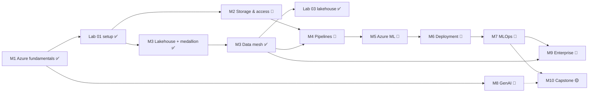

# Course Map

**Status legend:** ✅ available · 🟡 in progress · 📝 planned (design and outline exist)

## Recommended sequence

Module 3 comes before Module 2 in this first version on purpose: it is the architectural core everything else references, and its hands-on part runs locally without a subscription. Module 2 deepens the storage access patterns afterwards.

## Modules

| # | Module | Status | Est. hours | Lessons and labs | Billable Azure resources |
|---|---|---|---|---|---|
| 1 | Azure Fundamentals for Data Scientists | ✅ | 6 | [Azure fundamentals](docs/azure-fundamentals/01-azure-fundamentals.md) · [Lab 01](labs/lab-01-azure-setup/README.md) | Storage account (near zero) |
| 2 | Cloud Storage and Data Access | 📝 | 6 | [Roadmap](docs/storage-and-data-engineering/README.md) · Lab 02 planned | Storage, serverless Azure SQL (auto-pause) |
| 3 | Data Lakes, Lakehouses and Data Mesh | ✅ | 12 | [Lakehouse + medallion](docs/lakehouse/01-lake-warehouse-lakehouse-medallion.md) · [Data mesh](docs/data-mesh/01-data-mesh.md) · [Lab 03](labs/lab-03-lakehouse/README.md) | None required (local); optional ADLS Gen2, Databricks or Fabric trial |
| 4 | Data Pipelines and Scalable Processing | 📝 | 8 | [Roadmap](docs/storage-and-data-engineering/README.md#module-4-data-pipelines-and-scalable-processing-planned) · Lab 04 planned | ADF runs, Databricks job compute |
| 5 | Azure Machine Learning Fundamentals | 📝 | 8 | [Roadmap](docs/azure-machine-learning/README.md) · Lab 05 planned | Compute instance/cluster, Container Registry |
| 6 | Model Management and Deployment | 📝 | 6 | [Roadmap](docs/azure-machine-learning/README.md#module-6-lessons-planned) · Lab 06 planned | **Online endpoints bill while deployed** |
| 7 | MLOps and Production Operations | 📝 | 10 | [Roadmap](docs/mlops/README.md) | Log Analytics ingestion, scheduled compute |
| 8 | Azure AI and Generative AI | 📝 | 10 | [Roadmap](docs/generative-ai/README.md) | **AI Search bills hourly**, tokens |
| 9 | Enterprise Architecture, Security and Governance | 📝 | 8 | [Roadmap](docs/security-and-costs/README.md) | Private endpoints, Purview |
| 10 | End-to-End Capstone | 🟡 | 20 | [Capstone](projects/retail-demand-forecasting/README.md) · Lab 07 planned | All of the above, briefly |

## Reference material (available)

- [Architecture Decision Guide](ARCHITECTURE_DECISION_GUIDE.md): 12 decisions + scenario walkthroughs + ADR template
- [Service Catalog](SERVICE_CATALOG.md): 31 entries
- [Glossary](GLOSSARY.md): 68 terms labelled by kind
- [Architecture views](diagrams/01-azure-service-map.md): service map, data mesh, lakehouse, medallion (available); ML lifecycle, MLOps, RAG (designs)
- [Command cheat sheet](references/command-cheatsheet.md) · [Official docs index](references/official-docs.md)
- [Extending the academy](docs/EXTENDING.md) · [Lesson template](docs/_templates/LESSON_TEMPLATE.md) · [Lab template](docs/_templates/LAB_TEMPLATE.md)

## Prerequisites and cost-sensitive steps at a glance

| Step | Needs a subscription? | Can it bill while idle? | Local alternative |
|---|---|---|---|
| Read any lesson | No | — | — |
| Lakehouse and data mesh hands-on | No | — | Runs fully locally (delta-rs) |
| Lab 01 tasks 4-9 | Yes | No (storage only) | Tasks 1-3 + `--offline` verification |
| Databricks / Fabric variants | Yes (or Fabric trial) | **Yes**: clusters, Fabric capacity | Local pipeline |
| Azure ML compute instance | Yes | **Yes** until stopped | Local training + MLflow |
| Online endpoints, AI Search | Yes | **Yes** | Batch scoring; local vector store |
