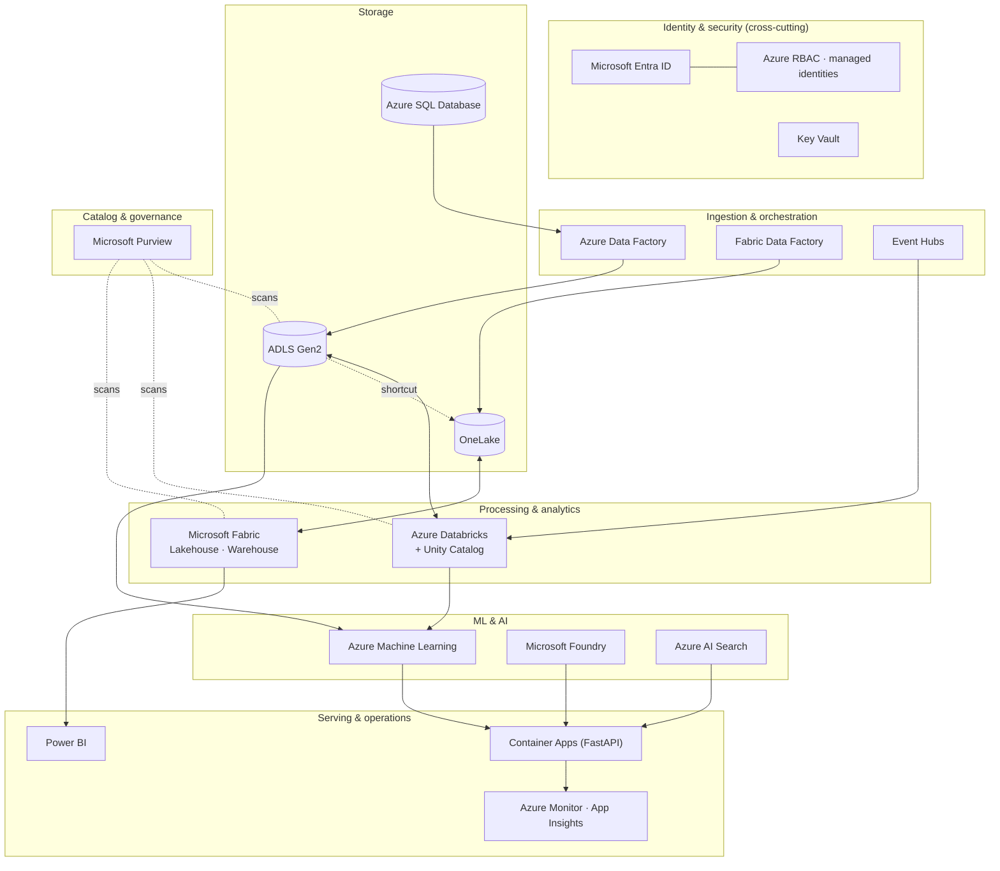

# Azure Data & AI Service Map

**Reading the map:** solid arrows are data flow; dotted lines are references or governance. Every arrow is authenticated by Entra ID and authorised by RBAC or the platform's own permissions (Unity Catalog, Fabric workspaces).

Read next: [Azure fundamentals](../docs/azure-fundamentals/01-azure-fundamentals.md) · [Service Catalog](../SERVICE_CATALOG.md) · [Decision guide](../ARCHITECTURE_DECISION_GUIDE.md)
