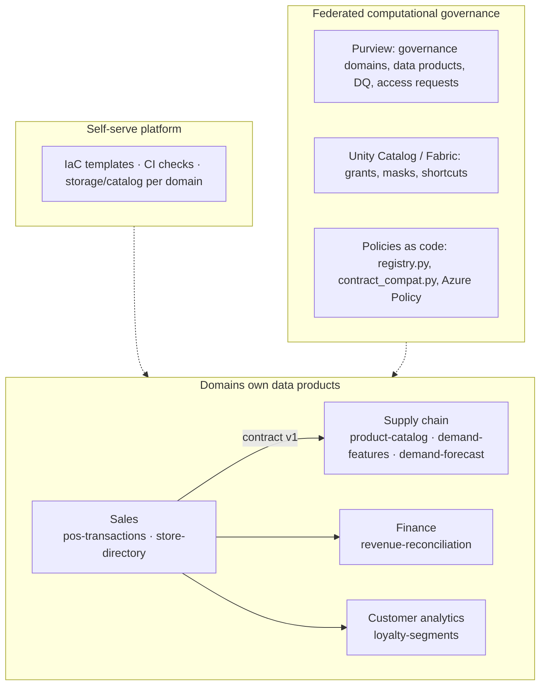

# Data Mesh on Azure

Data mesh is an **operating model and architecture**, not an Azure service. The services provide the building blocks; contracts, templates and policy-as-code are yours to build.

Read next: [Data mesh lesson](../docs/data-mesh/01-data-mesh.md)
