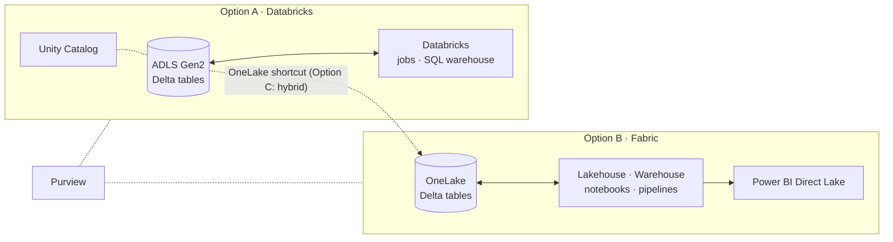

# Lakehouse Reference Architectures

| | Option A | Option B | Option C |
|---|---|---|---|
| Best for | Engineering/ML-heavy teams | BI-centric, low-ops | Both audiences, one copy |
| Storage | Your ADLS Gen2 | OneLake | ADLS Gen2 + shortcuts |
| Governance | Unity Catalog | Fabric + Purview | Both; decide which is authoritative |

Read next: [Lakehouse lesson](../docs/lakehouse/01-lake-warehouse-lakehouse-medallion.md) · [Decision 2](../ARCHITECTURE_DECISION_GUIDE.md#decision-2-azure-databricks-microsoft-fabric-both-or-synapse)
