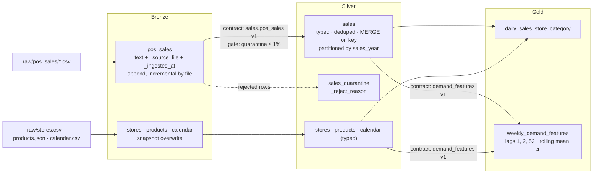

# Medallion Architecture (Retail Example)

These are the exact tables produced by [`code/lakehouse_local/medallion.py`](../code/lakehouse_local/medallion.py).

Medallion is a **data organisation pattern**, not a product feature.

Read next: [Lakehouse lesson §3.7](../docs/lakehouse/01-lake-warehouse-lakehouse-medallion.md#37-the-medallion-architecture)
