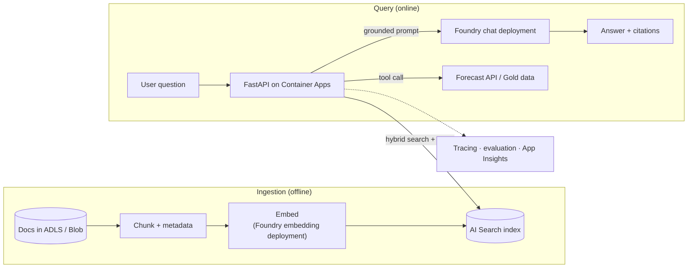

# Generative AI and RAG on Azure (design, Module 8)

Status: **planned**. See the [Module 8 roadmap](../docs/generative-ai/README.md). Product names: Microsoft Foundry was formerly Azure AI Foundry.
