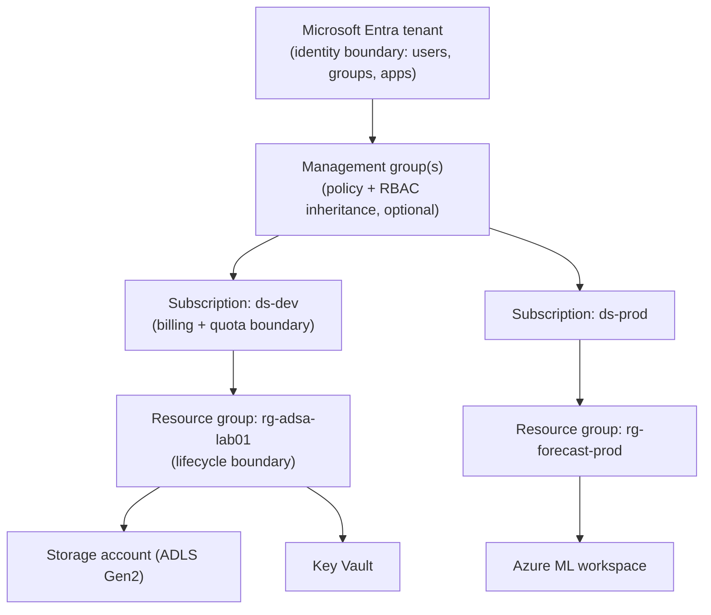
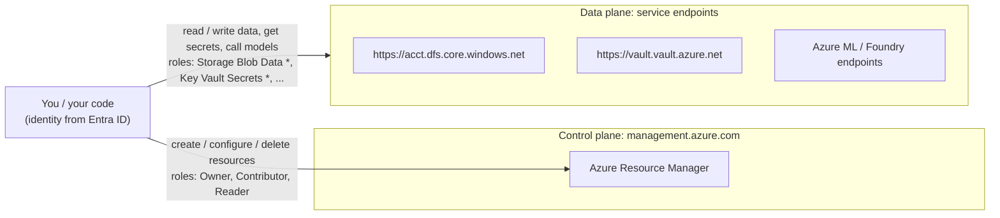
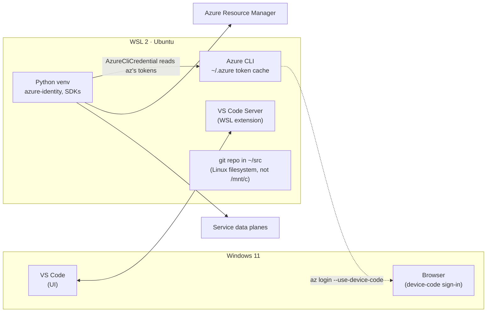
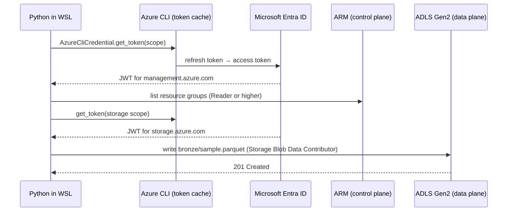

# Azure Fundamentals for Data Scientists

> **Where this fits.** Every later module assumes the mental model built here: *who* is calling *which* API at *what* scope. Most Azure frustration for data scientists ("I'm Owner, why do I get 403 reading a blob?") comes from not separating the control plane from the data plane. Fix that first and the rest of Azure becomes predictable.

## 1. Lesson overview and learning objectives

You already know how to build ML systems. This lesson gives you the Azure-specific scaffolding around them.

By the end you can:

- Explain the resource hierarchy (tenant → management group → subscription → resource group → resource) and choose sensible boundaries for dev/test/prod.
- Distinguish **control-plane** operations (create a storage account) from **data-plane** operations (read a Parquet file in it), and grant the right RBAC role for each.
- Authenticate from WSL, VS Code, notebooks, CI and deployed services **without secrets in code**, using `azure-identity`.
- Decide when you need Key Vault, and when you can avoid secrets entirely with Microsoft Entra ID auth and managed identities.
- Put cost guardrails in place (tags, budgets, cleanup) and understand what they do *not* protect against.
- Set up a WSL 2 + VS Code + Azure CLI + Python environment that the rest of the course builds on.

## 2. Prerequisites

| Need | Why | Notes |
|---|---|---|
| Windows 11 with WSL 2 (Ubuntu 22.04 or 24.04) | All commands in this course run in WSL unless marked otherwise | Check with `wsl -l -v` in **PowerShell** |
| VS Code with the **WSL** extension | Edit and run code inside the Linux filesystem | Open projects from WSL with `code .` |
| Python 3.10+ in WSL | SDK examples | The course uses a per-lab `venv` |
| An Azure subscription | Only for the lab, not for reading | See [Getting a subscription](#getting-a-subscription-safely) below |

No prior Azure knowledge is assumed.

## 3. Core concepts

### 3.1 The resource hierarchy



| Level | What it really is | Design rule of thumb |
|---|---|---|
| **Microsoft Entra tenant** | The identity directory (formerly Azure Active Directory). Holds users, groups, app registrations, service principals. | You rarely create one; your org (or your personal sign-up) has one. |
| **Management group** | A container of subscriptions for applying Azure Policy and RBAC at scale. | Matters in enterprises (landing zones, Module 9). Ignore for personal learning. |
| **Subscription** | A billing, quota and access boundary. Every resource lives in exactly one. | Separate **prod** from **non-prod** at subscription level in real projects. |
| **Resource group (RG)** | A logical container whose members share a lifecycle. Has a region for its *metadata* only. | One RG per thing you will delete together. Deleting the RG deletes everything in it, which is the core cleanup tool of this course. |
| **Resource** | An instance of a service type such as `Microsoft.Storage/storageAccounts`. | Name, region, SKU, tags. |

**Regions and availability zones.** A region (for example `westeurope`, `swedencentral`, `eastus2`) is where a resource's data and compute live. Many regions have availability zones, which are physically separate datacenters you can spread a resource across. For learning, pick one region close to you that offers the services you need. Service availability differs by region, especially for GPU SKUs and new AI models, so check before you commit a design. ([Products by region](https://azure.microsoft.com/explore/global-infrastructure/products-by-region/))

**Resource providers.** Each service is exposed by a *resource provider* namespace (`Microsoft.Storage`, `Microsoft.MachineLearningServices`, `Microsoft.KeyVault`). A subscription must have a provider *registered* before you can create its resources. Many are auto-registered on first use; some are not, which surfaces as a `MissingSubscriptionRegistration` error. ([Resource providers and types](https://learn.microsoft.com/azure/azure-resource-manager/management/resource-providers-and-types))

**Azure Resource Manager (ARM).** The portal, Azure CLI, PowerShell, Python management SDKs, Bicep and Terraform all call the same ARM REST API at `management.azure.com`. Learn one, and the others are translations. ([ARM overview](https://learn.microsoft.com/azure/azure-resource-manager/management/overview))

### 3.2 Control plane vs data plane (the single most important idea)



- **Control plane** operations manage the *resource*: create a storage account, change its firewall, delete a workspace. Authorized by roles such as **Owner**, **Contributor**, **Reader**.
- **Data plane** operations touch the *contents*: list blobs, read a file, get a secret, call a model deployment. Authorized by **data roles** such as **Storage Blob Data Reader/Contributor/Owner**, **Key Vault Secrets User**, or by service-specific keys.

Being **Owner** of a subscription does **not** automatically let you read blob data with Entra ID auth. Owner can *grant* themselves a data role (because Owner includes `Microsoft.Authorization/roleAssignments/write`), and Owner can read the storage *account keys*, which is exactly why you should disable shared-key auth (section 3.5).

### 3.3 Identities: who is calling?

| Principal type | Use it for | Credentials |
|---|---|---|
| **User** | You, interactively (portal, `az login`, VS Code) | Password + MFA, handled by Entra ID |
| **Group** | Assign roles to teams rather than people | n/a, holds members |
| **Service principal** (from an *app registration*) | Non-Azure workloads that cannot use managed identity | Client secret (avoid), certificate, or **workload identity federation** (best) |
| **Managed identity** (system- or user-assigned) | Code running *on* Azure: VMs, App Service, Container Apps, Functions, Azure ML compute, Databricks access connectors | None to manage; Azure issues tokens |
| **Workload identity federation** | GitHub Actions or Kubernetes exchanging an OIDC token for an Entra token | No stored secret; trust is configured on the app or managed identity |

Rules this course follows everywhere:

1. **Humans** authenticate as themselves (`az login`) during development.
2. **Azure-hosted workloads** use **managed identities**. User-assigned identities are easier to pre-grant before deployment and to share across blue/green deployments.
3. **CI/CD** uses **OIDC federation** (Module 7). No long-lived client secrets in GitHub.
4. Keys and connection strings are a last resort, stored in Key Vault, never in code or notebooks.

([Managed identities overview](https://learn.microsoft.com/entra/identity/managed-identities-azure-resources/overview), [Workload identity federation](https://learn.microsoft.com/entra/workload-id/workload-identity-federation))

### 3.4 Azure RBAC: what are they allowed to do?

A **role assignment** = **principal** + **role definition** + **scope**. Assignments inherit downward: a role at subscription scope applies to every RG and resource beneath it.

| Role | Plane | Typical holder in a DS team |
|---|---|---|
| Owner | Control (+ can grant roles) | Platform admin. Not every data scientist. |
| Contributor | Control (cannot grant roles) | Engineers in dev subscriptions |
| Reader | Control, read-only | Auditors, anyone browsing |
| User Access Administrator / Role Based Access Control Administrator | Grant roles | Platform team; the latter can be constrained with conditions |
| Storage Blob Data Reader / Contributor / Owner | Data (Blob + ADLS Gen2) | Pipelines, notebooks, training jobs |
| Key Vault Secrets User / Officer | Data (Key Vault, RBAC mode) | Apps reading secrets / admins managing them |
| AzureML Data Scientist | Data + some control within an Azure ML workspace | Data scientists submitting jobs |

Two practical facts:

- **Propagation delay.** New role assignments can take several minutes to take effect. Retrying in two minutes is normal, not a bug. ([Troubleshoot Azure RBAC](https://learn.microsoft.com/azure/role-based-access-control/troubleshooting))
- **Least privilege at the narrowest useful scope.** Grant *Storage Blob Data Contributor* on the storage account (or a single container) rather than on the subscription.

([Azure RBAC overview](https://learn.microsoft.com/azure/role-based-access-control/overview), [Built-in roles](https://learn.microsoft.com/azure/role-based-access-control/built-in-roles))

### 3.5 Authenticating from code: `azure-identity`

Every modern Azure SDK for Python accepts a `TokenCredential`. The `azure-identity` package provides them.

`DefaultAzureCredential` tries a chain of credentials in order. As currently documented the order is: Environment → Workload Identity → Managed Identity → Shared Token Cache (Windows only) → Visual Studio Code → Azure CLI → Azure PowerShell → Azure Developer CLI → Interactive browser (disabled by default) → Broker. ([Credential chains](https://learn.microsoft.com/azure/developer/python/sdk/authentication/credential-chains))

Guidance, straight from that page and applied in this course:

- Use `DefaultAzureCredential` freely in **local development**. To make it deterministic, set `AZURE_TOKEN_CREDENTIALS=dev` (only developer-tool credentials) or a single credential name such as `AzureCliCredential` (supported from `azure-identity` 1.23.0 / 1.24.0).
- In **deployed** code, Microsoft recommends replacing it with a specific credential such as `ManagedIdentityCredential`. A chain that silently falls through to a different identity is hard to debug.

```python
# The pattern used throughout the course
import os
from azure.identity import AzureCliCredential, DefaultAzureCredential, ManagedIdentityCredential

def get_credential():
    """Explicit in production, convenient in development."""
    if os.getenv("RUNNING_IN_AZURE") == "1":
        # User-assigned identity: pass its client ID explicitly.
        return ManagedIdentityCredential(client_id=os.environ["AZURE_CLIENT_ID"])
    if os.getenv("CI") == "true":
        return DefaultAzureCredential()  # picks up OIDC/workload identity env vars in CI
    return AzureCliCredential()  # you, after `az login` in WSL
```

**Disable shared-key access on storage.** Storage accounts historically accept the account key, which is a superuser password for all data in the account. Setting `allowSharedKeyAccess=false` forces Entra ID auth, so every read and write is tied to an identity and an RBAC assignment. Consequences: SAS tokens signed with the account key stop working, and `az storage ...` commands need `--auth-mode login`. ([Prevent Shared Key authorization](https://learn.microsoft.com/azure/storage/common/shared-key-authorization-prevent))

### 3.6 Secrets: Key Vault, and how to need fewer secrets

Azure Key Vault stores secrets, keys and certificates, with access controlled by Azure RBAC (recommended) or legacy access policies. ([Key Vault overview](https://learn.microsoft.com/azure/key-vault/general/overview))

Decision ladder for any credential your code seems to need:

1. **Does the target service support Entra ID auth?** (Storage, Key Vault, Azure SQL, Azure ML, Azure AI Search, Foundry/Azure OpenAI, Event Hubs, Service Bus, Cosmos DB data plane: yes.) Use a token credential. No secret exists.
2. If not (third-party API keys, a legacy database), store the secret in **Key Vault**, give the workload's managed identity **Key Vault Secrets User**, and read it at startup.
3. Locally, read secrets from Key Vault with your own identity, or keep them in an untracked `.env` file listed in `.gitignore`. Never in notebooks, which get committed and shared.

### 3.7 Networking fundamentals (just enough for now)

By default most PaaS services have a **public endpoint** protected by identity. Enterprises add network controls:

| Concept | One-line meaning |
|---|---|
| Virtual network (VNet) / subnet | Your private IP space in Azure |
| Network security group (NSG) | Stateful allow/deny rules on subnets/NICs |
| Service firewall (e.g., storage "Selected networks") | Restricts the public endpoint to listed IPs/VNets |
| **Private endpoint** | A private IP in your VNet for a PaaS resource; combined with disabling public access, traffic never leaves your private network |
| Private DNS zone | Makes `acct.dfs.core.windows.net` resolve to the private IP inside the VNet |

For this course's labs we keep public endpoints with Entra-only auth (cheap and simple). Module 9 covers private endpoints, which add cost and DNS complexity. ([Private endpoints](https://learn.microsoft.com/azure/private-link/private-endpoint-overview))

### 3.8 Pricing, budgets, quotas and cleanup

**How you get billed.** Most data and AI services bill on some mix of: provisioned capacity per hour (VMs, compute instances, Fabric capacity, dedicated SQL pools, AI Search units), consumption (GB stored, transactions, tokens, DBUs), and data egress. **The expensive surprises are almost always always-on capacity**: a compute instance left running, an online endpoint with a GPU SKU, a Fabric capacity left un-paused, a Databricks all-purpose cluster without auto-termination.

**Budgets alert; they do not stop spend.** In Microsoft's words: "Resources aren't affected, and your consumption isn't stopped." Cost data is "typically available within 8-24 hours and budgets are evaluated against these costs every 24 hours." So a budget email can arrive a day or more after the money is spent. ([Create and manage budgets](https://learn.microsoft.com/azure/cost-management-billing/costs/tutorial-acm-create-budgets))

**Quotas.** Subscriptions have per-region quotas, most visibly **vCPU quotas per VM family**. New and free-trial subscriptions often have low or zero GPU quota, which you discover when an Azure ML compute cluster fails to scale. Check and request increases under *Quotas* in the portal. ([Quotas overview](https://learn.microsoft.com/azure/quotas/quotas-overview))

**Tags.** Key/value metadata (`project=adsa`, `owner=greg`, `expires=2026-12-31`, `env=lab`). Tags power cost analysis grouping and cleanup scripts. Tags are **not** inherited by default from RG to resource; Azure Policy can enforce or inherit them (Module 9).

**Cleanup.** `az group delete --name <rg> --yes --no-wait` removes everything in the RG. Some services keep soft-deleted remnants (Key Vault and Azure ML workspaces, for example) that you may need to purge to reuse names. The lab shows how.

#### Getting a subscription safely

You do not need a subscription to read this course. When you do want one:

- **Azure free account**: Microsoft currently advertises a credit for the first 30 days (shown as $200 USD on the US page), 12 months of selected free services if you move to pay-as-you-go within 30 days, and an "always free" tier of 65+ services. Terms change and vary by country; read the current page before signing up. ([Azure free account](https://azure.microsoft.com/pricing/free-services))
- **Employer subscription**: ask for a dedicated *sandbox* subscription or RG with a budget, and ask which policies apply (allowed regions, required tags, blocked public endpoints). Enterprise policies are a common cause of "works in the tutorial, fails at work".
- **Visual Studio subscription**: includes monthly Azure credits that cannot overrun into a bill while the spending limit is on.

### 3.9 Your development environment



Key choices:

- Keep repositories in the **Linux filesystem** (`~/src/...`), not under `/mnt/c`, for file-system performance and correct permissions.
- Install the Azure CLI **inside WSL** with the Microsoft apt repository. Windows and WSL have separate token caches; signing in on Windows does not sign you in inside WSL.
- `AzureCliCredential` reuses the CLI's sign-in, so Python code needs no extra configuration.
- Useful VS Code extensions: *WSL*, *Python*, *Jupyter*, *Azure Resources*, *Bicep*, *Azure Machine Learning* (later).

## 4. Architecture diagrams

The three diagrams above are the core ones (hierarchy, control vs data plane, dev environment). This one shows the identity flow you will implement in the lab:



## 5. Azure service mapping

| Need | Azure service / tool | Type | Lesson/lab |
|---|---|---|---|
| Identity directory | Microsoft Entra ID | Native service | This lesson |
| Authorization | Azure RBAC | Native capability | This lesson, [Lab 01](../../labs/lab-01-azure-setup/README.md) |
| Workload identity | Managed identities, workload identity federation | Native capability | This lesson, Module 7 |
| Secrets | Azure Key Vault | Native service | This lesson, Module 9 |
| Management automation | Azure CLI, Azure SDK for Python, Bicep | Native tooling | [Lab 01](../../labs/lab-01-azure-setup/README.md) |
| Cost guardrails | Microsoft Cost Management budgets, tags | Native capability | [Lab 01](../../labs/lab-01-azure-setup/README.md) |
| Governance at scale | Azure Policy, management groups | Native service | Module 9 |
| First data store | Storage account with hierarchical namespace (ADLS Gen2) | Native service | [Lab 01](../../labs/lab-01-azure-setup/README.md), [Lakehouse lesson](../lakehouse/01-lake-warehouse-lakehouse-medallion.md) |

See the [Service Catalog](../../SERVICE_CATALOG.md) for full entries.

## 6. Step-by-step implementation

The full, verified procedure is [Lab 01: Azure setup](../../labs/lab-01-azure-setup/README.md). The condensed flow, so you can see the shape before you start:

| # | Where | Command / action |
|---|---|---|
| 1 | WSL | Install Azure CLI from the Microsoft apt repo; `az version` |
| 2 | WSL | `az login --use-device-code`; `az account set --subscription <id>` |
| 3 | WSL | `az provider register --namespace Microsoft.Storage` |
| 4 | WSL | `az group create -n rg-adsa-lab01 -l <region> --tags project=adsa env=lab owner=<you>` |
| 5 | Portal or WSL | Create a **budget** on the RG with 50/80/100% alerts |
| 6 | WSL | Create a storage account with `--hns true --allow-shared-key-access false --allow-blob-public-access false --min-tls-version TLS1_2` |
| 7 | WSL | Grant yourself **Storage Blob Data Contributor** on that account |
| 8 | WSL · Python | Run `verify_setup.py`: lists RGs (control plane), writes and reads a Parquet file (data plane) |
| 9 | WSL | `az group delete -n rg-adsa-lab01` when finished |

## 7. Complete runnable code

The lab ships these, all runnable as-is:

- [`labs/lab-01-azure-setup/scripts/00_preflight.sh`](../../labs/lab-01-azure-setup/scripts/00_preflight.sh): checks WSL, Python, Azure CLI, sign-in, clock skew.
- [`labs/lab-01-azure-setup/scripts/01_create_resources.sh`](../../labs/lab-01-azure-setup/scripts/01_create_resources.sh): idempotent resource creation.
- [`labs/lab-01-azure-setup/python/verify_setup.py`](../../labs/lab-01-azure-setup/python/verify_setup.py): control-plane and data-plane checks.
- [`labs/lab-01-azure-setup/infra/main.bicep`](../../labs/lab-01-azure-setup/infra/main.bicep): the same storage setup as infrastructure as code.

A minimal control-plane example. Note the package layout: recent `azure-mgmt-resource` releases expose the client under `azure.mgmt.resource.resources`, and subscriptions moved to the separate `azure-mgmt-resource-subscriptions` package. Older blog posts that `from azure.mgmt.resource import ResourceManagementClient` will fail with `ImportError` on current versions.

```python
# pip install azure-identity azure-mgmt-resource azure-mgmt-resource-subscriptions
from azure.identity import AzureCliCredential
from azure.mgmt.resource.resources import ResourceManagementClient
from azure.mgmt.resource.subscriptions import SubscriptionClient

cred = AzureCliCredential()
subs = list(SubscriptionClient(cred).subscriptions.list())
for s in subs:
    print(s.subscription_id, s.display_name, s.state)

rm = ResourceManagementClient(cred, subs[0].subscription_id)
for rg in rm.resource_groups.list():
    print(rg.name, rg.location, rg.tags)
```

## 8. Expected outputs and verification

- `az account show --query "{name:name, id:id, user:user.name}" -o table` prints the subscription you intend to use. **Always check this before creating resources**; signing in with multiple tenants is a classic way to create resources in the wrong place.
- The control-plane snippet prints your subscriptions and RGs.
- `verify_setup.py` ends with `ALL CHECKS PASSED`. See the lab for the full expected output.

## 9. Independent exercise

Design (on paper or in Markdown) the subscription and RG layout for a three-person forecasting team that needs: a shared dev environment, a prod environment, a lab sandbox per person that is wiped monthly, and a separate place for the data platform shared with other teams. Specify:

1. Subscriptions and RGs, with names following one convention.
2. Which Entra **groups** exist and which roles they get at which scopes (control *and* data plane).
3. Which workloads get managed identities and what each identity can access.
4. The tags and budgets you would require.

Compare your answer with the [Architecture Decision Guide](../../ARCHITECTURE_DECISION_GUIDE.md) section on environment separation.

## 10. Common errors and troubleshooting

| Symptom | Cause | Fix |
|---|---|---|
| `AuthorizationFailed` on create | Missing control-plane role at that scope | `az role assignment list --assignee <you> --all -o table`; ask for Contributor on the RG |
| `AuthorizationPermissionMismatch` / 403 reading blobs while you are Owner | Owner is control-plane; no data role | Assign **Storage Blob Data Contributor**, wait a few minutes |
| `KeyBasedAuthenticationNotPermitted` | Shared key disabled, tool defaulted to key auth | Add `--auth-mode login` to `az storage` commands; use token credentials in code |
| `MissingSubscriptionRegistration` | Provider not registered | `az provider register --namespace Microsoft.X` and wait for `Registered` |
| `StorageAccountAlreadyTaken` | Names are globally unique | Add a random suffix (the lab does) |
| `AADSTS700024` / "token not yet valid" / clock errors in WSL | WSL clock drifted after laptop sleep | `sudo hwclock -s`, or `wsl --shutdown` from PowerShell and reopen |
| `az login` cannot open a browser in WSL | No browser bridge | `az login --use-device-code` |
| Resources appear in the "wrong" subscription | Multiple tenants or subscriptions, wrong default | `az account set --subscription <id>`; check `az account show` before every create |
| `ImportError: cannot import name 'ResourceManagementClient'` | Package restructure | `from azure.mgmt.resource.resources import ResourceManagementClient` |
| `ClientAuthenticationError` from `DefaultAzureCredential` | Every credential in the chain failed | Read the aggregated message; set `AZURE_TOKEN_CREDENTIALS=AzureCliCredential` to make the failure explicit |

## 11. Security and cost considerations

**Security**
- Disable shared-key access and public blob access on every storage account you create.
- Prefer RBAC-mode Key Vault; avoid access policies for new vaults.
- Use groups for human role assignments; review assignments with `az role assignment list`.
- Enable MFA on your account. A personal Azure account protected by a password alone is a credit-card-backed attack surface.

**Cost**
- Lab 01 creates only a resource group, a storage account and a budget. The storage holds a few MB, so the expected cost is effectively zero (fractions of a cent per month for capacity and transactions at list prices). Verify current rates with the [pricing calculator](https://azure.microsoft.com/pricing/calculator/) or the lab's `price_check.py`, which queries the official [Retail Prices API](https://learn.microsoft.com/rest/api/cost-management/retail-prices/azure-retail-prices).
- Habit to build now: every resource you create has an `owner` and `expires` tag, and lives in an RG you know how to delete.

## 12. Production best practices

- **Environment separation**: separate subscriptions for prod vs non-prod; RGs per workload and lifecycle.
- **Everything as code**: resources in Bicep/Terraform, role assignments included. The portal is for exploring and for emergencies.
- **Identity-first**: managed identities for workloads, OIDC for CI, groups for people, no shared keys.
- **Policy guardrails**: allowed regions, required tags, deny public storage access (Module 9).
- **Naming convention**: adopt the Cloud Adoption Framework abbreviations (`rg-`, `st`, `kv-`, `mlw-`). ([Resource naming](https://learn.microsoft.com/azure/cloud-adoption-framework/ready/azure-best-practices/resource-naming))

## 13. Knowledge check

1. You are Owner on a subscription but get 403 listing files in a container with `az storage fs file list --auth-mode login`. Why, and what is the minimal fix?
2. What is the difference between a service principal and a managed identity? When would you still need a service principal?
3. Why does Microsoft recommend replacing `DefaultAzureCredential` in deployed code?
4. A budget of 20 USD is set on your lab RG. You start a GPU compute instance and forget it for three days. What happens?
5. Which boundary (tenant, subscription, RG) is the right one for: billing separation, deleting a lab, a single identity directory?

<details>
<summary>Answers</summary>

1. Owner is a control-plane role. Entra-authenticated data access needs a data role. Assign **Storage Blob Data Reader** (or Contributor) on the account or container, then wait for propagation.
2. A managed identity is a service principal whose credentials Azure manages and that can only be used by the Azure resource it is attached to. You still need an app registration/service principal for workloads outside Azure, ideally with workload identity federation instead of secrets.
3. The chain is non-deterministic across environments, makes failures hard to diagnose, and adds latency from failing credentials. A specific credential such as `ManagedIdentityCredential` is explicit.
4. You receive alert emails, potentially a day or more late. The compute keeps running and billing. Budgets do not stop resources; auto-shutdown and cleanup do.
5. Billing separation: subscription. Deleting a lab: resource group. Identity directory: tenant.

</details>

## 14. Official documentation and further reading

- Organize resources: [Cloud Adoption Framework, organize your Azure resources](https://learn.microsoft.com/azure/cloud-adoption-framework/ready/azure-setup-guide/organize-resources)
- Azure Resource Manager: [overview](https://learn.microsoft.com/azure/azure-resource-manager/management/overview)
- RBAC: [overview](https://learn.microsoft.com/azure/role-based-access-control/overview) · [built-in roles](https://learn.microsoft.com/azure/role-based-access-control/built-in-roles)
- Identity for code: [Credential chains in the Azure Identity library for Python](https://learn.microsoft.com/azure/developer/python/sdk/authentication/credential-chains)
- Managed identities: [overview](https://learn.microsoft.com/entra/identity/managed-identities-azure-resources/overview)
- Storage auth: [Authorize access with Microsoft Entra ID](https://learn.microsoft.com/azure/storage/blobs/authorize-access-azure-active-directory) · [Prevent Shared Key authorization](https://learn.microsoft.com/azure/storage/common/shared-key-authorization-prevent)
- Key Vault: [overview](https://learn.microsoft.com/azure/key-vault/general/overview)
- Azure CLI on Linux: [install](https://learn.microsoft.com/cli/azure/install-azure-cli-linux)
- Costs: [budgets tutorial](https://learn.microsoft.com/azure/cost-management-billing/costs/tutorial-acm-create-budgets) · [pricing calculator](https://azure.microsoft.com/pricing/calculator/)

**Next:** [Lab 01: Azure setup](../../labs/lab-01-azure-setup/README.md), then Module 3: [Data lake, warehouse, lakehouse and medallion](../lakehouse/01-lake-warehouse-lakehouse-medallion.md).
