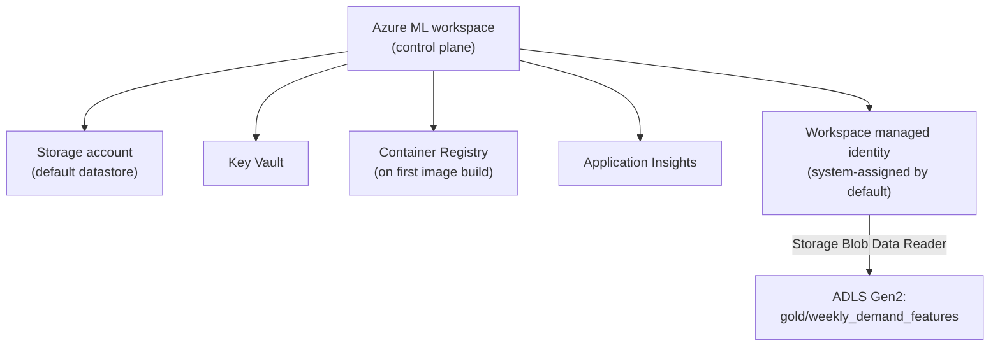
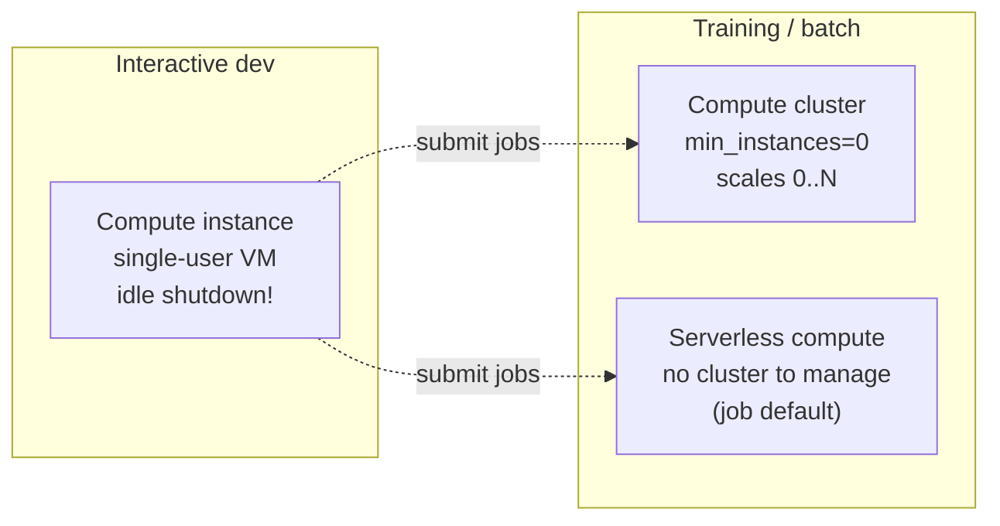
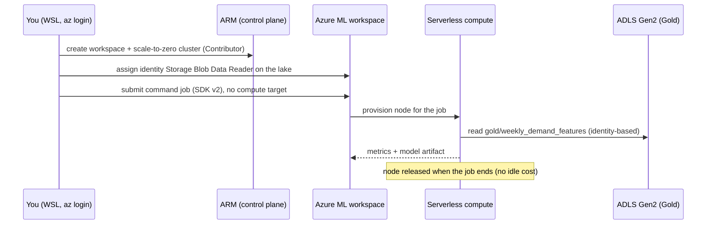

# Azure ML: Workspace, Compute and Costs

> **Where this fits.** You already train models. Azure Machine Learning (Azure ML) is the Azure-native place to run that training reproducibly, track it, and later register and deploy it (Modules 6-7). This lesson builds the ground floor: the workspace, the identity it uses to reach your Gold data, and the compute you pay for. Get the cost model right here and the rest of the module is cheap to run.

## 1. Lesson overview and learning objectives

Azure Machine Learning "is a cloud service that accelerates and manages the machine learning (ML) project lifecycle ... to train and deploy models and manage machine learning operations (MLOps)." ([What is Azure Machine Learning](https://learn.microsoft.com/azure/machine-learning/overview-what-is-azure-machine-learning), updated Sept 2026)

By the end you can:

- Describe the **workspace** and the four dependent resources it creates (Storage, Key Vault, Container Registry, Application Insights), and decide when to bring your own.
- Explain the workspace's **managed identity** and grant it the data-plane role it needs to read the Gold feature table from Module 3.
- Choose between **compute instance**, **compute cluster** and **serverless compute**, and configure each so it does not bill while idle.
- Predict what a training run costs and what keeps costing money after it finishes.
- Connect to a workspace from WSL with the **Python SDK v2 (`azure-ai-ml`)** and the **Azure CLI `ml` extension (v2)**.

This lesson is conceptual plus a small, cheap hands-on (create a workspace, a scale-to-zero cluster, grant the identity). The training itself happens in [Lab 05](../../labs/lab-05-model-training/README.md).

## 2. Prerequisites

| Need | Why | From |
|---|---|---|
| Azure fundamentals: control vs data plane, RBAC, managed identity | The whole lesson rests on "who is calling which API at what scope" | [Module 1](../azure-fundamentals/01-azure-fundamentals.md) |
| The Gold table `gold/weekly_demand_features` | The thing you will train on in Lab 05 | [Lakehouse lesson](../lakehouse/01-lake-warehouse-lakehouse-medallion.md), [Lab 03](../../labs/lab-03-lakehouse/README.md) |
| An Azure subscription (for the hands-on only) | Reading is free | [Lab 01](../../labs/lab-01-azure-setup/README.md) |
| `azure-ai-ml` and the CLI `ml` extension | SDK v2 / CLI v2 are the current interfaces | Section 6 |

> **Azure ML vs Microsoft Foundry.** The same overview page notes that "Both Azure Machine Learning studio and Microsoft Foundry allow you to work with LLMs" and points to [What is Microsoft Foundry?](https://learn.microsoft.com/azure/foundry/) for the generative-AI development experience. This course keeps them separate: **Azure ML** (this module) is where you train and operate classical and custom models like our LightGBM forecaster; **Microsoft Foundry** (Module 8) is the generative-AI platform. They share identity, storage and MLflow conventions.

## 3. Core concepts

### 3.1 The workspace and its four dependent resources

The **workspace** (`Microsoft.MachineLearningServices/workspaces`) is the top-level container for your ML assets: jobs, models, data assets, environments, components, endpoints and compute. When you create one, Azure can provision four dependent resources, or you can bring existing ones ([Manage workspaces](https://learn.microsoft.com/azure/machine-learning/how-to-manage-workspace)):

| Dependent resource | What the workspace uses it for | Bring-your-own? |
|---|---|---|
| **Storage account** | Default datastore: job snapshots, outputs, logs, uploaded data | Yes; a dedicated account per workspace is common |
| **Key Vault** | Stores connection secrets and keys the workspace manages | Yes |
| **Container Registry (ACR)** | Stores the Docker images built for your environments. Created **on first image build**, not necessarily at workspace creation | Yes; one shared ACR across workspaces is fine |
| **Application Insights** | Telemetry for the workspace and for online endpoints | Yes |

Two consequences worth internalising:

- **ACR bills daily once it exists.** The Basic tier is inexpensive, but it is a standing charge, and it appears the first time you build a custom environment (Module 5 jobs lesson).
- **Cross-subscription storage needs a provider registration.** If the workspace is in subscription A and the storage in subscription B, the `Microsoft.MachineLearningServices` provider must be registered in B first ([docs](https://learn.microsoft.com/azure/machine-learning/how-to-manage-workspace)).



### 3.2 The workspace managed identity (how jobs reach your data)

The workspace "uses a managed identity to communicate with other services. By default, this identity is a system-assigned managed identity." ([Use managed identities](https://learn.microsoft.com/azure/machine-learning/how-to-use-managed-identities)) You can add a user-assigned identity (the type becomes SAI+UAI); you cannot later go back from SAI+UAI to SAI only.

For this course the important move is **data-plane**: the identity that runs your training must be able to *read* the Gold table. That is a **Storage Blob Data Reader** (or Contributor) role on the ADLS Gen2 account, exactly as in [Module 1](../azure-fundamentals/01-azure-fundamentals.md#34-azure-rbac-what-are-they-allowed-to-do). Being able to *create* a workspace (Contributor) does not grant data access; you assign the data role explicitly, then wait for propagation.

Who actually reads the data depends on the compute and job identity (Module 5 jobs lesson): it can be the workspace identity, a user-assigned identity attached to the compute, or your own identity. The course default is identity-based access, never storage keys.

### 3.3 Three ways to get compute



| Option | What it is | Bills when idle? | Use it for |
|---|---|---|---|
| **Compute instance** | A single-user managed VM: notebooks, VS Code, terminal | **Yes, while running.** Stop it or set idle shutdown | Interactive development, debugging |
| **Compute cluster** (AmlCompute) | An autoscaling pool of nodes for jobs | **No, when scaled to zero** (`min_instances=0`) | Repeated training, sweeps, shared teams, GPU pools |
| **Serverless compute** | Azure provisions, scales and patches the node per job; no cluster to create | **No** between jobs (nothing persists) | Most training jobs; the course default |

**Compute instance idle shutdown.** "To avoid getting charged for a compute instance that is switched on but inactive, you can configure when to shut down your compute instance due to inactivity." A compute instance is *inactive* only when there are no Jupyter kernel or terminal sessions, no runs, no VS Code connection, and no custom applications running; the idle window must be "a minimum of 15 minutes and a maximum of three days." Set it with `idle_time_before_shutdown_minutes`. Two sharp edges: a **custom application** (RStudio, etc.) keeps the instance "not idle" forever, and if the workspace has a managed identity, "the compute instance won't shut down due to inactivity unless the managed identity has *contributor* access to the Azure Machine Learning workspace." Also, "Stopping the compute instance doesn't release quota," and SSH access is off by default and cannot be toggled after creation. ([Create a compute instance](https://learn.microsoft.com/azure/machine-learning/how-to-create-compute-instance), updated Jan 2026)

**Compute cluster scale-to-zero.** Define the cluster with `min_instances: 0`, `max_instances: N`, and `idle_time_before_scale_down` (seconds; the SDK default is 1800, i.e. 30 minutes). With the minimum at zero, idle nodes are released, so a cluster that is not running a job costs nothing. ([Compute cluster YAML reference](https://learn.microsoft.com/azure/machine-learning/reference-yaml-compute-aml))

**Serverless compute.** If you omit the compute target on a command, sweep or AutoML job, "compute defaults to serverless," and for pipelines you set `default_compute: azureml:serverless` (CLI) or `default_compute="serverless"` (SDK). Azure "handles provisioning, scaling, and patching," and uses your quota to pick a VM size unless you set `instance_type` and `instance_count` per job. ([Serverless compute](https://learn.microsoft.com/azure/machine-learning/how-to-use-serverless-compute)) The forecasting labs use serverless so there is no cluster to remember to delete.

### 3.4 Quotas

Compute instance and compute cluster creation draw on the **same** per-region, per-VM-family vCPU quota, and "Stopping the compute instance doesn't release quota" ([compute instance docs](https://learn.microsoft.com/azure/machine-learning/how-to-create-compute-instance)). New and free-trial subscriptions often have **zero GPU quota**, which surfaces when a cluster or serverless job cannot scale. The retail forecasting work is CPU-only by design, so it runs inside default quotas. Request increases under *Quotas* in the portal ([Quotas overview](https://learn.microsoft.com/azure/quotas/quotas-overview)).

## 4. Architecture diagrams

The identity-and-compute picture you will build in the hands-on:



## 5. Azure service mapping

| Need | Azure service / capability | Type | Where |
|---|---|---|---|
| ML project container | Azure Machine Learning workspace | Native service | This lesson |
| Default datastore / secrets / images / telemetry | Storage, Key Vault, Container Registry, Application Insights | Native services (dependencies) | This lesson |
| Workspace-to-service auth | System- or user-assigned managed identity | Native capability | [Module 1](../azure-fundamentals/01-azure-fundamentals.md) |
| Interactive dev | Compute instance | Native capability | This lesson |
| Training compute | Compute cluster (AmlCompute), serverless compute | Native capability | This lesson, [Lab 05](../../labs/lab-05-model-training/README.md) |
| Control interfaces | Studio, Python SDK v2 (`azure-ai-ml`), CLI v2 `ml`, ARM REST | Native tooling | Section 6 |

See the [Service Catalog](../../SERVICE_CATALOG.md) for full entries.

## 6. Step-by-step implementation

All commands run in **WSL / Ubuntu**, signed in with `az login` (Module 1). Flagged steps are billable.

**Install the tooling (one-time).**

```bash
# WSL
pip install azure-ai-ml azure-identity        # Python SDK v2
az extension add -n ml                         # CLI v2 'ml' extension (or: az extension update -n ml)
az configure --defaults group=<rg> workspace=<ws>   # after the workspace exists
```

**Create the workspace (billable: the workspace itself is free, but its dependents may cost pennies/day).**

```bash
# WSL - CLI v2
az ml workspace create --name mlw-adsa --resource-group rg-adsa-ml --location <region>
```

**Create a scale-to-zero compute cluster (no idle cost).**

```yaml
# cluster.yml
$schema: https://azuremlschemas.azureedge.net/latest/amlCompute.schema.json
name: cpu-cluster
type: amlcompute
size: STANDARD_DS3_v2
min_instances: 0
max_instances: 2
idle_time_before_scale_down: 120   # seconds
```

```bash
# WSL
az ml compute create -f cluster.yml
```

> You do **not** need this cluster for the labs (they use serverless), but creating one with `min_instances: 0` is the safe default for any team cluster.

**Grant the workspace identity read access to the lake (data plane).**

```bash
# WSL - get the workspace's system-assigned principal, then assign the data role
PRINCIPAL=$(az ml workspace show -n mlw-adsa -g rg-adsa-ml --query identity.principal_id -o tsv)
az role assignment create --assignee-object-id "$PRINCIPAL" --assignee-principal-type ServicePrincipal \
  --role "Storage Blob Data Reader" \
  --scope "/subscriptions/<sub>/resourceGroups/<rg>/providers/Microsoft.Storage/storageAccounts/<acct>"
```

**Connect from Python (SDK v2).**

```python
from azure.ai.ml import MLClient
from azure.identity import DefaultAzureCredential
ml_client = MLClient(DefaultAzureCredential(), "<sub>", "<rg>", "mlw-adsa")
print(ml_client.workspace_name, [c.name for c in ml_client.compute.list()])
```

## 7. Complete runnable code

This lesson's artefacts are infrastructure, so the "code" is the YAML and CLI above plus the lab's reusable scripts:

- [`train-job.yml`](../../labs/lab-05-model-training/aml/) (in the lab's `aml/` folder) - a serverless command job (used in the [jobs lesson](02-jobs-data-and-tracking.md)).
- [`labs/lab-05-model-training/aml/submit_job.py`](../../labs/lab-05-model-training/aml/submit_job.py) - the SDK v2 equivalent, including the data-asset and environment registration.

The forecasting model code itself lives in [`code/forecasting/`](../../code/forecasting/) and is the subject of the next two lessons.

## 8. Expected outputs and verification

- `az ml workspace show -n mlw-adsa -g rg-adsa-ml -o table` lists the workspace and its linked Storage, Key Vault and Application Insights. (ACR appears after your first environment build.)
- `az ml compute list -o table` shows `cpu-cluster` with `0` current nodes.
- The Python snippet prints the workspace name and the compute list.
- In the portal, the workspace's **Identity** blade shows a system-assigned principal, and that principal appears under the storage account's **Access Control (IAM)** with *Storage Blob Data Reader*.

> These describe a correct run. They were **not** executed against a live subscription in the course build; the numbers you will see depend on your region and SKUs. The cost figures in section 11 come from Microsoft's published pricing, cited inline.

## 9. Independent exercise

Design the compute and identity plan for the forecasting team:

1. Which of your team develops on a **compute instance**, and what idle-shutdown value and schedule do you set? (Remember the managed-identity caveat.)
2. Do training jobs use a **shared cluster** or **serverless**? Justify in one paragraph using cost and operational overhead.
3. Which identity reads the Gold data in each case, and what single role at what scope grants it?
4. Write the Azure Policy you would use to force an idle-shutdown schedule on every compute instance in the subscription (hint: the [compute instance docs](https://learn.microsoft.com/azure/machine-learning/how-to-create-compute-instance) include a sample policy).

Compare with the environment-separation guidance in the [Architecture Decision Guide](../../ARCHITECTURE_DECISION_GUIDE.md).

## 10. Common errors and troubleshooting

| Symptom | Cause | Fix |
|---|---|---|
| Job fails reading Gold with 403 | Compute/job identity lacks a data role, or it was just assigned | Assign *Storage Blob Data Reader* on the account; wait a few minutes for propagation |
| Compute instance never shuts down | A custom app is running, or the workspace identity lacks *Contributor* on the workspace | Remove the custom app or use a schedule; grant the identity Contributor ([docs](https://learn.microsoft.com/azure/machine-learning/how-to-create-compute-instance)) |
| Cluster/job stuck "Resizing", never starts | vCPU (often GPU) quota is zero for that family/region | Pick a CPU SKU, or request a quota increase |
| Surprise daily charge after first job | ACR was created on first environment build | Expected; use one shared Basic ACR and keep it |
| `az ml` command not found | CLI v2 `ml` extension missing | `az extension add -n ml` |
| `ImportError` on `azure.ai.ml` | SDK v1 (`azureml-core`) installed instead of v2 | `pip install azure-ai-ml` (v2); do not mix with v1 in one env |

## 11. Security and cost considerations

**Security**
- Identity-based data access only; never put storage keys in a datastore or notebook.
- Least privilege: *Storage Blob Data Reader* on the lake, not Contributor on the subscription.
- SSH on compute instances is off by default; leave it off unless you need VS Code Remote debugging.

**Cost (list prices; confirm with the [pricing calculator](https://azure.microsoft.com/pricing/calculator/))**
- **Compute instance / cluster nodes** bill per second at the underlying VM rate while running. A `STANDARD_DS3_v2` (4 vCPU) is a few US cents per minute; forgetting one running overnight is the classic bill.
- **Serverless** bills only for the job's duration; nothing persists afterwards.
- **ACR** (Basic) is a small standing daily charge once it exists.
- **Storage** for job outputs and snapshots is a few cents per GB-month.
- **Budgets alert, they do not stop spend** (Module 1): combine an RG budget with idle shutdown and `min_instances=0`.

## 12. Production best practices

- **Serverless or scale-to-zero clusters** for all batch training; reserve compute instances for interactive work and give them short idle-shutdown windows.
- **One workspace per environment** (dev/test/prod), separated by subscription or resource group, each with its own default storage.
- **User-assigned identity** for compute when you want to pre-grant data access before a workspace or deployment exists, and to share one identity across blue/green deployments (Module 6).
- **Everything as code**: workspace, compute and role assignments in Bicep/Terraform (Module 7), not click-ops.
- Adopt Cloud Adoption Framework naming (`mlw-`, `st`, `cr`, `kv-`).

## 13. Knowledge check

1. You create a workspace but see no Container Registry. Is something wrong?
2. You are Contributor on the subscription. Why might a training job still get 403 reading the Gold table, and what is the minimal fix?
3. Which compute option bills nothing between jobs, and what single setting makes a compute cluster behave that way?
4. A teammate's compute instance has idle shutdown set to 30 minutes but never shuts down. Name two possible causes.
5. Why does the course prefer serverless compute for the forecasting training job?

<details>
<summary>Answers</summary>

1. No. ACR is created on the **first custom environment image build**, not at workspace creation.
2. Contributor is control-plane; reading blob data needs a **data role**. Assign *Storage Blob Data Reader* to the job/compute identity on the storage account and wait for propagation.
3. **Serverless** (and a **compute cluster with `min_instances=0`**). The setting is `min_instances: 0` (plus `idle_time_before_scale_down`).
4. A custom application is running on it, or the workspace's managed identity lacks *Contributor* on the workspace (both documented blockers of idle shutdown).
5. No cluster to create, grant quota to, or remember to delete; it bills only for the job's runtime; Azure manages provisioning, scaling and patching.

</details>

## 14. Official documentation and further reading

- [What is Azure Machine Learning?](https://learn.microsoft.com/azure/machine-learning/overview-what-is-azure-machine-learning) - scope, studio, SDK/CLI v2, MLflow, Foundry relationship
- [Manage Azure ML workspaces](https://learn.microsoft.com/azure/machine-learning/how-to-manage-workspace) - dependent resources, bring-your-own
- [Use managed identities with Azure ML](https://learn.microsoft.com/azure/machine-learning/how-to-use-managed-identities)
- [Create a compute instance](https://learn.microsoft.com/azure/machine-learning/how-to-create-compute-instance) - idle shutdown, schedules, SSH, quota
- [Compute cluster YAML reference](https://learn.microsoft.com/azure/machine-learning/reference-yaml-compute-aml) - `min_instances`, `idle_time_before_scale_down`
- [Serverless compute](https://learn.microsoft.com/azure/machine-learning/how-to-use-serverless-compute)
- [Quotas overview](https://learn.microsoft.com/azure/quotas/quotas-overview)

**Next:** [Azure ML: Jobs, Data and Tracking](02-jobs-data-and-tracking.md) - run the forecasting script as a tracked command job.
