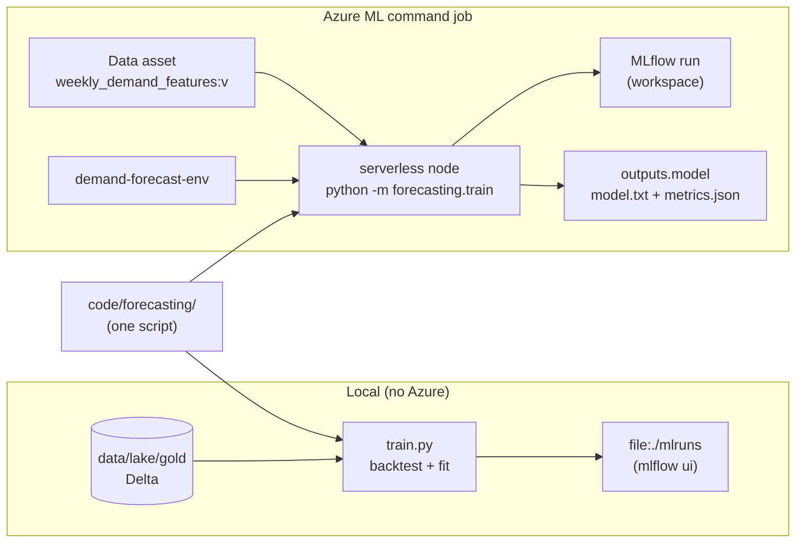

# Azure ML: Jobs, Data and Experiment Tracking

> **Where this fits.** The workspace and compute exist ([previous lesson](01-workspace-compute-and-costs.md)). Now we take the forecasting code from the capstone and make it a *job*: something Azure ML runs on managed compute, with a pinned environment, versioned inputs, and metrics tracked in MLflow. The key discipline: the script you backtest locally is byte-for-byte the script that trains in the cloud.

## 1. Lesson overview and learning objectives

By the end you can:

- Build a **local LightGBM baseline** with a correct **rolling-origin temporal backtest** and report WAPE, bias and MASE against a naive baseline.
- Define a reproducible **environment** (curated vs custom) and know when the Container Registry bill starts.
- Register the Gold table as a **versioned data asset** (`uri_folder`/`uri_file`/`MLTable`) and read Delta from ADLS Gen2 with identity-based auth.
- Submit a **command job** with the **Python SDK v2** and the **CLI v2**, with inputs and outputs, on serverless compute.
- Track runs with **MLflow** - locally and inside the job - and compare them.

The runnable code is [`code/forecasting/`](../../code/forecasting/); the Azure job assets are in [`labs/lab-05-model-training/aml/`](../../labs/lab-05-model-training/). [Lab 05](../../labs/lab-05-model-training/README.md) packages this into a tracked run.

## 2. Prerequisites

| Need | Why | From |
|---|---|---|
| A workspace + the Gold table | The job trains on `gold/weekly_demand_features` | [Workspace lesson](01-workspace-compute-and-costs.md), [Lab 03](../../labs/lab-03-lakehouse/README.md) |
| `azure-ai-ml`, `mlflow`, `lightgbm`, `deltalake` | SDK v2 and the model stack | [`code/requirements.txt`](../../code/requirements.txt) |
| Comfort with the data contract | The job validates against it before training | [`forecasting.demand_features.v1.yaml`](../../code/contracts/forecasting.demand_features.v1.yaml) |

## 3. Core concepts

### 3.1 Backtesting first: why the baseline is the hard part

A forecaster is only useful relative to a cheap baseline, and it must be evaluated **without leaking the future**. Random k-fold cross-validation does leak, and flatters the model. We split on time instead: every test week is strictly later than every training week, with an **expanding window** that mirrors weekly retraining in production. That logic is in [`backtest.py`](../../code/forecasting/backtest.py):

```python
from forecasting.backtest import temporal_splits
# each fold: (train_weeks, test_weeks) with max(train) < min(test)
folds = temporal_splits(weeks, n_splits=4, horizon=4, min_train_weeks=8)
```

The metrics are defined explicitly in [`metrics.py`](../../code/forecasting/metrics.py) (because the same acronym means different things elsewhere):

- **WAPE** `= sum|y - yhat| / sum|y|` - defined even when individual actuals are zero (common for slow movers), volume-weighted.
- **Bias** `= sum(yhat - y) / sum(y)` - signed; positive means over-forecasting.
- **MASE** - model MAE over the in-sample naive (random-walk) MAE; **< 1 beats the naive baseline** (Hyndman & Koehler, 2006).

The model is **LightGBM** with a Tweedie objective (non-negative, over-dispersed counts with many zeros - the shape of retail demand), chosen over squared error so the model is not dragged by a few high-volume weeks. The Gold table already carries the lag and rolling features; [`features.py`](../../code/forecasting/features.py) adds calendar and trend columns and marks `store_id`, `product_id` and `category` as categoricals so LightGBM splits on them natively.

> **Modelling honesty (from the capstone).** Stock-out weeks are *flagged, not imputed*: training on censored sales biases a model low. The baseline keeps `stockout_days` as a feature and leaves censored-demand treatment as a documented Stage-4 decision; it does not pretend to solve it.

### 3.2 Environments: curated vs custom

An **environment** pins the runtime (base image + packages) so a job is reproducible. Two kinds:

- **Curated** environments are maintained by Microsoft and referenced by registry path, e.g. `azureml://registries/azureml/environments/sklearn-1.5/labels/latest`. No build, no ACR cost. Good when your dependencies are covered. (Verify current names at the [azureml registry](https://ml.azure.com/registries/azureml/environments); they are versioned and change.)
- **Custom** environments layer a conda/pip spec on a base image. The forecasting job needs **delta-rs**, which curated environments do not ship, so we build a custom one ([`conda.yaml`](../../labs/lab-05-model-training/aml/), [`environment.yml`](../../labs/lab-05-model-training/aml/)). The workspace builds the image **once** and caches it in ACR - which is when the daily ACR charge begins (previous lesson).

Pin versions and bump deliberately; an unpinned `latest` makes "it trained differently today" impossible to debug. ([Environments concept](https://learn.microsoft.com/azure/machine-learning/concept-environments))

### 3.3 Data: datastores and data assets

A **datastore** is a named, keyless pointer to storage (the workspace's default datastore is its Storage account). A **data asset** is a *versioned* reference to data, of one of three types ([Data concepts](https://learn.microsoft.com/azure/machine-learning/concept-data)):

| Type | What it points at | Our use |
|---|---|---|
| `uri_file` | A single file | A one-off CSV |
| `uri_folder` | A folder (mounted or downloaded) | **The Gold Delta table folder** - the job reads it with delta-rs |
| `mltable` | A folder + an `MLTable` spec describing how to load | When you want Azure ML to materialise rows (schema, subsetting) |

We register the Gold table as a **`uri_folder`** because it is a Delta table (a folder of Parquet + `_delta_log`), and the script already knows how to read Delta. Reading from ADLS Gen2 uses **identity-based** access - the job's identity presents a token, exactly like the local script uses your `az login` ([`train.py` `_storage_options`](../../code/forecasting/train.py)). No keys.

```python
from azure.ai.ml.entities import Data
from azure.ai.ml.constants import AssetTypes
gold = ml_client.data.create_or_update(Data(
    name="weekly_demand_features",
    type=AssetTypes.URI_FOLDER,
    path="abfss://lakehouse@<account>.dfs.core.windows.net/retail/gold/weekly_demand_features",
    description="Gold weekly demand features (Delta), contract v1.",
))
# later: reference by version -> Input(type=URI_FOLDER, path=f"{gold.name}:{gold.version}")
```

### 3.4 Command jobs (SDK v2 and CLI v2)

A **command job** runs one command on a compute target with a code snapshot, an environment, and typed inputs/outputs. The `${{inputs.x}}` / `${{outputs.y}}` placeholders are substituted by Azure ML with the mounted paths. Omitting the compute target runs it on **serverless** (previous lesson).

**Python SDK v2** ([verified against Learn](https://learn.microsoft.com/azure/machine-learning/how-to-train-sdk)):

```python
from azure.ai.ml import command, Input, Output
from azure.ai.ml.constants import AssetTypes

job = command(
    code="../../code",  # the academy code/ folder, so `forecasting` imports
    command=("python -m forecasting.train --data ${{inputs.gold}} "
             "--output ${{outputs.model}} --n-estimators ${{inputs.n_estimators}}"),
    inputs={
        "gold": Input(type=AssetTypes.URI_FOLDER, path="weekly_demand_features@latest"),
        "n_estimators": 300,
    },
    outputs={"model": Output(type=AssetTypes.URI_FOLDER)},
    environment="demand-forecast-env@latest",
    experiment_name="retail-demand-forecasting",
    # no compute= -> serverless
)
returned = ml_client.jobs.create_or_update(job)
ml_client.jobs.stream(returned.name)
```

**CLI v2** is the same job as YAML - [`train-job.yml`](../../labs/lab-05-model-training/aml/) - submitted with `az ml job create -f train-job.yml --web`. Teams keep the YAML in git (Module 7 runs it from CI).

### 3.5 MLflow tracking

Azure ML uses **MLflow** as its tracking interface ([Track experiments with MLflow](https://learn.microsoft.com/azure/machine-learning/how-to-use-mlflow)). Two environments, one API:

- **Inside a job**, tracking is auto-configured: `mlflow.log_metric(...)`, `mlflow.log_params(...)` and `mlflow.<flavor>.log_model(...)` write straight to the job's run. You do **not** set a tracking URI. `mlflow.autolog()` captures framework-specific metrics automatically; our script logs manually because the backtest fits many models per run and we want aggregate metrics, not one noisy run per fit.
- **Interactively / locally**, point MLflow at the workspace with the workspace's tracking URI (valid ~1 hour; refresh for long sessions) - or, as in the course code, at a local `file:./mlruns` store so you can `mlflow ui` with no Azure at all.

The script does both safely ([`train.py` `_log_to_mlflow`](../../code/forecasting/train.py)): if it detects it is inside a job (`AZUREML_RUN_ID`) it reuses the ambient run; otherwise it logs locally. Logging never fails the training run.

## 4. Architecture diagrams



## 5. Azure service mapping

| Need | Azure service / capability | Type | Where |
|---|---|---|---|
| Run a command on managed compute | Azure ML command job | Native capability | This lesson, [Lab 05](../../labs/lab-05-model-training/README.md) |
| Reproducible runtime | Curated / custom environments | Native capability | [`conda.yaml`](../../labs/lab-05-model-training/aml/) |
| Versioned data reference | Data assets (`uri_folder`/`uri_file`/`mltable`) | Native capability | [`submit_job.py`](../../labs/lab-05-model-training/aml/submit_job.py) |
| Experiment tracking | MLflow (Azure ML as backend) | Open source integrated | [`train.py`](../../code/forecasting/train.py) |
| Gradient-boosted model | LightGBM | Open source | [`code/forecasting/`](../../code/forecasting/) |
| Keyless Delta read | delta-rs + `DefaultAzureCredential` | Open source + native capability | [Lakehouse lesson](../lakehouse/01-lake-warehouse-lakehouse-medallion.md) |

## 6. Step-by-step implementation

Local first (no cost), then the job.

**Local baseline (WSL / Python), from `code/`:**

```bash
python retail_data/generate.py --out ../data/raw --seed 42
python lakehouse_local/medallion.py all --raw ../data/raw --lake ../data/lake
python -m forecasting.validate --data ../data/lake/gold/weekly_demand_features
python -m forecasting.train --data ../data/lake/gold/weekly_demand_features \
  --output ../data/model --n-estimators 300
mlflow ui --backend-store-uri ../data/model/mlruns    # open http://127.0.0.1:5000
```

**On Azure ML (billable: a short serverless job + ACR), from `labs/lab-05-model-training/aml/`:**

```bash
# WSL, CLI v2
az ml environment create -f environment.yml                 # builds image once (ACR)
az ml data create --name weekly_demand_features --type uri_folder \
  --path "abfss://lakehouse@<account>.dfs.core.windows.net/retail/gold/weekly_demand_features"
az ml job create -f train-job.yml --web                     # serverless; opens Studio
```

The SDK equivalent (registers environment + data asset, submits, streams) is [`submit_job.py`](../../labs/lab-05-model-training/aml/submit_job.py).

## 7. Complete runnable code

- [`code/forecasting/metrics.py`](../../code/forecasting/metrics.py), [`features.py`](../../code/forecasting/features.py), [`backtest.py`](../../code/forecasting/backtest.py), [`train.py`](../../code/forecasting/train.py), [`validate.py`](../../code/forecasting/validate.py) - the baseline, all runnable locally.
- Tests: [`code/tests/test_forecasting.py`](../../code/tests/test_forecasting.py) (metric formulas, no-leakage splits, end-to-end training, contract validation, release gate).
- Azure assets: [`train-job.yml`](../../labs/lab-05-model-training/aml/), [`submit_job.py`](../../labs/lab-05-model-training/aml/submit_job.py), [`conda.yaml`](../../labs/lab-05-model-training/aml/), [`environment.yml`](../../labs/lab-05-model-training/aml/).

## 8. Expected outputs and verification

Local run, **seed 42**, built and run in the course environment (Linux, Python 3.14, LightGBM 4.7). The Gold table has **42,000 weekly rows across 400 product-store series over 105 weeks**. The 4-fold, 4-week-horizon backtest with 300 trees produced:

| Metric | Model | Naive (persistence) |
|---|---|---|
| WAPE (avg over folds) | **0.227** | 0.337 |
| Bias | **+0.022** | - |
| MASE | **0.707** | 1.0 by definition |
| Skill vs naive (WAPE) | **~33% lower error** | - |

Per-fold WAPE ranged 0.20-0.29 (the hardest fold is the most recent 4 weeks). `metrics.json` and `model/model.txt` are written to `--output`, and an MLflow experiment `retail-demand-forecasting` appears in `mlflow ui`.

> **Reproducibility note.** These are from a real local run and are deterministic for seed 42 on this stack; exact digits can shift with LightGBM/numpy versions. On Azure ML the metrics are identical (same script, same data); only the infrastructure differs. The Azure job itself was **not** executed in the course build (no subscription) - the YAML/SDK follow the current `azure-ai-ml` v2 docs cited inline.

Verify locally:

```bash
cd code && python -m pytest        # includes the forecasting tests
python -m forecasting.evaluate --metrics ../data/model/metrics.json   # RELEASE APPROVED
```

## 9. Independent exercise

1. Change the objective from `tweedie` to `regression_l1` (MAE) in `DEFAULT_PARAMS` and re-run the backtest. Does WAPE or bias change? Explain why in terms of the loss.
2. Add `horizon=1` vs `horizon=8` runs. How does error grow with the forecast horizon, and what does that imply for replenishment lead time?
3. Register two data-asset versions (before and after regenerating with a different seed) and submit the same job against each. Confirm both runs are linked to their input version in the job's lineage.

## 10. Common errors and troubleshooting

| Symptom | Cause | Fix |
|---|---|---|
| Job 403 reading the data asset | Job identity lacks *Storage Blob Data Reader* on the lake | Assign the role (workspace lesson); wait for propagation |
| `ModuleNotFoundError: forecasting` in the job | `code:` does not point at the folder holding the package | Set `code` to the academy `code/` dir; run `python -m forecasting.train` |
| Job can't read Delta (`_delta_log` not found) | Data asset points inside, not at, the table folder | Point `path` at `.../gold/weekly_demand_features` (the folder) |
| Environment build fails on `deltalake` | Base image/python mismatch | Use the pinned [`conda.yaml`](../../labs/lab-05-model-training/aml/) (Python 3.11 base) |
| MLflow metrics missing in Studio | Set a tracking URI inside the job | Don't: inside a job tracking is auto-configured; only set it for local/interactive runs |
| `mlflow ui` errors on the file store | MLflow 3 gates the file backend | The script sets `MLFLOW_ALLOW_FILE_STORE=true`; pass `--backend-store-uri` to `mlflow ui` |
| Backtest raises "Not enough weeks" | Too little history for the split config | Generate more history, or lower `min_train_weeks`/`n_splits` |

## 11. Security and cost considerations

**Security**
- Identity-based data access end to end; the data asset stores a path, never a key.
- The code snapshot is uploaded to the workspace storage; keep secrets out of `code/` (we do - auth is `DefaultAzureCredential`).

**Cost**
- The local baseline is free.
- A serverless CPU training job for this dataset runs in minutes; cost is minutes of one CPU VM plus the one-time image build. ACR then bills daily (Basic) - delete it only when you are done with the whole module.
- Keep `n_estimators` and sweep budgets modest while iterating ([sweeps lesson](03-sweeps-components-and-pipelines.md)).

## 12. Production best practices

- **One script, three contexts** (local, job, pipeline step): no notebook-only training.
- **Version inputs and environments**; a run should name the exact data-asset version and environment version it used.
- **Log aggregate, comparable metrics** (WAPE/MASE/bias), plus params and the model, so runs are comparable in Studio and MLflow.
- **Validate before training** (the contract check is the pipeline's first step) so a bad Gold batch fails fast instead of producing a quietly wrong model.
- **Gate on skill vs a baseline**, not on an absolute metric alone (release gate, Module 6).

## 13. Knowledge check

1. Why is random k-fold cross-validation the wrong evaluation for a forecaster, and what replaces it here?
2. What does MASE < 1 tell you, and what is the denominator in this course's definition?
3. Why register the Gold table as a `uri_folder` rather than `mltable`?
4. Inside an Azure ML job, what MLflow setup do you need to write metrics to the run?
5. When does the Container Registry charge start, and why?

<details>
<summary>Answers</summary>

1. k-fold mixes future and past rows, leaking information and inflating scores. We use a **rolling-origin temporal split** where every test week is strictly after the training weeks, with an expanding window.
2. The model beats the naive baseline. The denominator is the **in-sample MAE of the one-step naive (random-walk) forecast** on the training series.
3. A Delta table is a *folder* of Parquet files plus a `_delta_log`; the script reads Delta directly, so a `uri_folder` mount is exactly right. `mltable` is for when you want Azure ML to materialise rows from a load spec.
4. **None** - tracking is auto-configured inside the job. Setting a URI is only for local/interactive runs.
5. On the **first custom environment image build**, because the image is stored (and billed) in the workspace's Container Registry.

</details>

## 14. Official documentation and further reading

- [Train models with the SDK v2](https://learn.microsoft.com/azure/machine-learning/how-to-train-sdk) and [command job CLI/YAML](https://learn.microsoft.com/azure/machine-learning/reference-yaml-job-command)
- [Environments](https://learn.microsoft.com/azure/machine-learning/concept-environments) · [Create and manage environments](https://learn.microsoft.com/azure/machine-learning/how-to-manage-environments-v2)
- [Data concepts](https://learn.microsoft.com/azure/machine-learning/concept-data) · [Create data assets](https://learn.microsoft.com/azure/machine-learning/how-to-create-data-assets) · [Working with MLTable](https://learn.microsoft.com/azure/machine-learning/how-to-mltable)
- [Track ML experiments with MLflow](https://learn.microsoft.com/azure/machine-learning/how-to-use-mlflow) · [MLflow and Azure ML](https://learn.microsoft.com/azure/machine-learning/concept-mlflow)
- LightGBM [parameters](https://lightgbm.readthedocs.io/en/latest/Parameters.html) · Hyndman & Koehler (2006), "Another look at measures of forecast accuracy"

**Next:** [Azure ML: Sweeps, Components and Pipelines](03-sweeps-components-and-pipelines.md).
