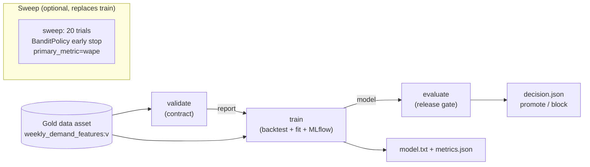

# Azure ML: Sweeps, Components and Pipelines

> **Where this fits.** You can run the forecasting script as a tracked command job ([previous lesson](02-jobs-data-and-tracking.md)). This lesson adds the three things that turn a job into an operable workflow: **sweeps** to tune it within a budget, **components** to make its steps reusable, and **pipelines** to run validate → train → evaluate as one graph. Module 7 then schedules and CI-drives exactly this pipeline.

## 1. Lesson overview and learning objectives

By the end you can:

- Convert a command job into a **sweep job**: define a search space, pick a sampling algorithm, set a budget, and terminate unpromising trials early with a **BanditPolicy**.
- Author **components** (reusable, versioned steps) from Python or YAML and register them.
- Compose components into a **pipeline** with the `@dsl.pipeline` decorator, running on serverless compute, with step-to-step data dependencies.
- Build the forecasting **validate → train → evaluate** pipeline and understand why each step exists.
- Keep sweep and pipeline **costs** bounded.

Runnable assets: [`code/forecasting/`](../../code/forecasting/) (the step scripts) and [`labs/lab-05-model-training/aml/submit_pipeline.py`](../../labs/lab-05-model-training/aml/submit_pipeline.py).

## 2. Prerequisites

| Need | Why | From |
|---|---|---|
| A working command job | A sweep *is* a command job over a search space | [Jobs lesson](02-jobs-data-and-tracking.md) |
| The validate/train/evaluate scripts | They become the pipeline steps | [`code/forecasting/`](../../code/forecasting/) |
| `azure-ai-ml` with `dsl` and `sweep` | SDK v2 pipeline and sweep APIs | [`code/requirements.txt`](../../code/requirements.txt) |

## 3. Core concepts

### 3.1 Sweeps: tuning within a budget

A **sweep** runs the same command many times over a **search space**, optimising a **primary metric** your script logs to MLflow. You call the command like a function with distributions in place of fixed values, then `.sweep(...)` ([verified against Learn](https://learn.microsoft.com/azure/machine-learning/how-to-tune-hyperparameters)):

```python
from azure.ai.ml.sweep import Choice, Uniform, BanditPolicy

# command_job is the Command from the jobs lesson; call it with search ranges
job_for_sweep = command_job(
    learning_rate=Uniform(min_value=0.01, max_value=0.2),
    num_leaves=Choice(values=[15, 31, 63, 127]),
    min_child_samples=Choice(values=[10, 20, 50]),
)

sweep_job = job_for_sweep.sweep(
    sampling_algorithm="bayesian",     # or "random" / "grid"
    primary_metric="wape",             # the script logs this to MLflow
    goal="Minimize",
)
sweep_job.set_limits(max_total_trials=20, max_concurrent_trials=4, timeout=7200)
sweep_job.early_termination = BanditPolicy(slack_factor=0.1, evaluation_interval=2, delay_evaluation=5)
returned = ml_client.jobs.create_or_update(sweep_job)
```

- **Sampling**: `grid` (exhaustive, small spaces), `random` (strong default, discrete + continuous), `bayesian` (uses prior results; best with a larger budget; supports `choice`, `uniform`, `quniform`). ([Tune hyperparameters](https://learn.microsoft.com/azure/machine-learning/how-to-tune-hyperparameters))
- **Primary metric**: must match a metric name your training script logs (here `wape`, `goal="Minimize"`). The sweep reads it from each trial's MLflow run.
- **Early termination** (`BanditPolicy`) stops trials that fall outside a `slack_factor` of the best run, which is the main cost lever. `EvaluationInterval`/`DelayEvaluation` control how aggressively.
- **Budget** (`set_limits`): `max_total_trials` caps spend; `max_concurrent_trials` trades wall-clock for parallel node cost.

For WAPE to be a usable sweep metric, each trial must log a single comparable number - so a sweep trial should log the **aggregate backtest WAPE**, not per-fold values, as the primary metric.

### 3.2 Components: reusable, versioned steps

A **component** is a self-contained, versioned step with typed inputs/outputs - the unit a pipeline is built from and the unit teams share. Define one in YAML and load it, or from Python with a decorator ([Component pipelines](https://learn.microsoft.com/azure/machine-learning/how-to-create-component-pipeline-python)):

```python
from azure.ai.ml import load_component
train_component = load_component(source="./train.yml")
train_component = ml_client.create_or_update(train_component)   # register a version
```

Components make steps independently testable and reusable across pipelines (the same `validate` component guards every training pipeline). Our step logic already lives in small modules (`forecasting.validate`, `forecasting.train`, `forecasting.evaluate`), so each maps cleanly to a component.

### 3.3 Pipelines: compose steps into a graph

The `@dsl.pipeline` decorator wires components together; **data dependencies define execution order**, and `default_compute="serverless"` runs the whole graph serverless ([Pipeline tutorial](https://learn.microsoft.com/azure/machine-learning/tutorial-pipeline-python-sdk)):

```python
from azure.ai.ml import dsl
@dsl.pipeline(description="validate -> train -> evaluate")
def forecasting_pipeline(gold_input, n_estimators=300):
    validate = validate_component(gold=gold_input)
    train = train_component(gold=gold_input, report=validate.outputs.report, n_estimators=n_estimators)
    evaluate = evaluate_component(model=train.outputs.model)
    return {"model": train.outputs.model, "decision": evaluate.outputs.decision}

pipeline_job = forecasting_pipeline(gold_input=Input(type="uri_folder", path="weekly_demand_features@latest"))
pipeline_job.settings.default_compute = "serverless"
ml_client.jobs.create_or_update(pipeline_job, experiment_name="retail-demand-forecasting")
```

Our three steps and why each exists:

| Step | Does | Why it is its own step |
|---|---|---|
| **validate** | Checks Gold against the data contract ([`validate.py`](../../code/forecasting/validate.py)) | Fail fast on a bad data batch *before* paying to train |
| **train** | Backtests + fits + logs to MLflow ([`train.py`](../../code/forecasting/train.py)) | The expensive, reusable core |
| **evaluate** | Applies the release gate ([`evaluate.py`](../../code/forecasting/evaluate.py)) | Decide promote/block from metrics, not vibes |

The full submission is [`submit_pipeline.py`](../../labs/lab-05-model-training/aml/submit_pipeline.py), which uses `command()` nodes so no extra packaging tool is needed; the `validate.outputs.report` reference is what makes `train` wait for `validate`.

### 3.4 The release gate

`evaluate` is a **pure function** ([`release_decision`](../../code/forecasting/evaluate.py)) so the rule is testable and reused by the Module 6 deployment lab and Module 7 CI. The default gate: beat the naive baseline (**MASE < 1**), keep volume-weighted error under **30% WAPE**, and stay near-unbiased (**|bias| ≤ 5%**). A `NaN` metric blocks the release - never silently passes.

## 4. Architecture diagrams



## 5. Azure service mapping

| Need | Azure service / capability | Type | Where |
|---|---|---|---|
| Hyperparameter tuning | Azure ML sweep job (`.sweep`, `BanditPolicy`) | Native capability | This lesson |
| Reusable step | Component (`command_component` / YAML + `load_component`) | Native capability | This lesson |
| Multi-step workflow | Pipeline (`@dsl.pipeline`), serverless default | Native capability | [`submit_pipeline.py`](../../labs/lab-05-model-training/aml/submit_pipeline.py) |
| Promote/block decision | Release gate (custom, pure function) | Custom | [`evaluate.py`](../../code/forecasting/evaluate.py) |

## 6. Step-by-step implementation

**Locally, the whole workflow is three commands (WSL / Python, from `code/`):**

```bash
python -m forecasting.validate --data ../data/lake/gold/weekly_demand_features
python -m forecasting.train    --data ../data/lake/gold/weekly_demand_features --output ../data/model
python -m forecasting.evaluate --metrics ../data/model/metrics.json       # exits 0 if it passes the gate
```

**On Azure ML (billable: serverless trials/steps), from `labs/lab-05-model-training/aml/`:**

```bash
python submit_pipeline.py --subscription <id> --resource-group <rg> --workspace <ws> \
  --gold-uri "abfss://lakehouse@<account>.dfs.core.windows.net/retail/gold/weekly_demand_features"
```

Add a sweep by calling the train command with distributions (section 3.1) before composing it into the pipeline, so the pipeline's train step is itself a sweep.

## 7. Complete runnable code

- Step scripts (runnable + tested locally): [`validate.py`](../../code/forecasting/validate.py), [`train.py`](../../code/forecasting/train.py), [`evaluate.py`](../../code/forecasting/evaluate.py).
- Pipeline submission (SDK v2): [`submit_pipeline.py`](../../labs/lab-05-model-training/aml/submit_pipeline.py).
- Gate tests: [`test_forecasting.py`](../../code/tests/test_forecasting.py) (`test_release_gate_*`).

## 8. Expected outputs and verification

- Local: `validate` prints `CONTRACT OK`; `train` writes `metrics.json`; `evaluate` prints `RELEASE APPROVED` for the seed-42 baseline (WAPE 0.227, |bias| 0.022, MASE 0.707 - all inside the gate). Verified in the course build.
- Azure: the pipeline graph shows three nodes with `validate → train → evaluate` edges, each a separate MLflow run; the sweep view ranks trials by `wape` and marks early-terminated ones. **Not executed against a live subscription in the build**; the SDK follows the current `azure-ai-ml` v2 docs cited inline.

```bash
cd code && python -m pytest tests/test_forecasting.py   # gate + pipeline-step logic
```

## 9. Independent exercise

1. Define a `random` sweep of 12 trials over `learning_rate`, `num_leaves`, `min_child_samples`; add a `BanditPolicy(slack_factor=0.2)`. Predict how many trials you expect to be early-terminated and why.
2. Tighten the release gate to WAPE ≤ 0.22 and re-run `evaluate` on the baseline metrics. Does it still pass? What does that tell you about headroom?
3. Add a fourth pipeline step that writes the forecast for the next 4 weeks (a preview of Module 6's batch endpoint). What are its inputs and outputs?

## 10. Common errors and troubleshooting

| Symptom | Cause | Fix |
|---|---|---|
| Sweep never improves / all trials look equal | `primary_metric` name doesn't match a logged metric | Log the exact name (`wape`) as a single value per trial |
| Sweep too expensive | No early termination or budget | Add `BanditPolicy` and `set_limits(max_total_trials, max_concurrent_trials)` |
| Pipeline steps run out of order / in parallel unexpectedly | No data dependency between them | Pass an upstream output into the downstream step (e.g. `validate.outputs.report`) |
| `train` fails on an unknown `--report` flag | Passing the marker to the script instead of referencing it | Reference it in the command (e.g. `echo ${{inputs.report}}`), don't pass it to the script |
| Component "already exists" with same version | Re-registering without bumping the version | Increment the component `version` |

## 11. Security and cost considerations

- **Cost is the sweep.** `max_total_trials` × trial cost, divided by how aggressively `BanditPolicy` prunes. Start with ≤ 20 trials and `random` sampling; move to `bayesian` only with a real budget.
- `max_concurrent_trials` buys wall-clock at the price of parallel nodes - fine on serverless, but it is still N nodes for the duration.
- Serverless pipelines leave nothing running between runs; there is no cluster to delete.
- Keep step code snapshots secret-free (auth is `DefaultAzureCredential`).

## 12. Production best practices

- **Pipeline, not a mega-script**: validate/train/evaluate as separate, independently testable steps so a failure is localised and a step is reusable.
- **Gate on skill vs baseline** in `evaluate`; block on `NaN`.
- **Pin component and environment versions**; a pipeline run should be reconstructable from its recorded versions.
- **Sweep with a budget and early termination**, always; an unbounded Bayesian sweep is how tuning bills surprise people.
- Hand the pipeline to CI with OIDC and a schedule in [Module 7](../mlops/README.md); this lesson builds exactly what that module automates.

## 13. Knowledge check

1. What makes a metric usable as a sweep `primary_metric`, and where does the sweep read it from?
2. What is the main cost-control lever in a sweep, and how does it work?
3. In a `@dsl.pipeline`, what determines the execution order of steps?
4. Why is the release gate a pure function rather than inline code in the training script?
5. Why split validate, train and evaluate into separate components instead of one step?

<details>
<summary>Answers</summary>

1. It must be a single comparable number that each trial **logs to MLflow** under the exact `primary_metric` name; the sweep reads it from each trial's run.
2. **Early termination** (e.g. `BanditPolicy`): it stops trials that fall outside a slack of the best run so budget goes to promising configs. `max_total_trials` caps the absolute spend.
3. **Data dependencies** - a step that consumes another step's output runs after it; steps with no dependency can run in parallel.
4. So the exact promote/block rule is unit-testable and reused unchanged by the deployment lab (Module 6) and CI (Module 7), with no training run required to test it.
5. Fail-fast on bad data before paying to train, independent testability, and reuse (the same `validate`/`evaluate` guards every pipeline).

</details>

## 14. Official documentation and further reading

- [Tune hyperparameters (sweep)](https://learn.microsoft.com/azure/machine-learning/how-to-tune-hyperparameters) · [sweep job YAML](https://learn.microsoft.com/azure/machine-learning/reference-yaml-job-sweep)
- [Create and run ML pipelines (SDK v2)](https://learn.microsoft.com/azure/machine-learning/how-to-create-component-pipeline-python) · [Pipeline tutorial](https://learn.microsoft.com/azure/machine-learning/tutorial-pipeline-python-sdk)
- [What are ML pipelines?](https://learn.microsoft.com/azure/machine-learning/concept-ml-pipelines) · [Components concept](https://learn.microsoft.com/azure/machine-learning/concept-component)

**Next:** [Lab 05: Model training](../../labs/lab-05-model-training/README.md), then Module 6 (model registry, batch and online endpoints) in the [Azure ML roadmap](README.md).
