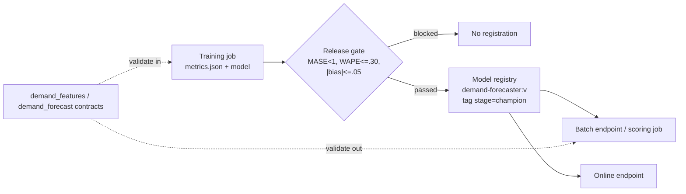

# Model Registry, Versioning and Release Criteria

> **Where this fits.** Module 5 produced a tracked training run with a model and backtest metrics. Deployment (the next two lessons) needs *a specific, trusted version* to serve. This lesson is the gate between them: what must be true before a model is registered, how versions and a "champion" are managed in Azure ML, and how contracts keep the serving path honest.

## 1. Lesson overview and learning objectives

By the end you can:

- Register an MLflow model from a job output as a **versioned** Azure ML model.
- Apply a **release gate** (beat the naive baseline, meet WAPE/bias thresholds) so only good models register - reusing the pure function from Module 5.
- Manage **champion/challenger** in Azure ML with **tags and versions** (and know why Azure ML does this differently from Databricks Unity Catalog / open-source MLflow aliases).
- Validate the model's **inputs and outputs** against the data contract, so a schema drift or a wrong forecast shape fails fast.

Hands-on: [`register_model.py`](../../labs/lab-06-model-deployment/) in [Lab 06](../../labs/lab-06-model-deployment/README.md). The gate is [`code/forecasting/evaluate.py`](../../code/forecasting/evaluate.py).

## 2. Prerequisites

| Need | Why | From |
|---|---|---|
| A completed training job with `metrics.json` + model | You register from its output | [Jobs lesson](02-jobs-data-and-tracking.md), [Lab 05](../../labs/lab-05-model-training/README.md) |
| The release gate | Decides promote/block | [`evaluate.py`](../../code/forecasting/evaluate.py) |
| The feature + forecast contracts | Input/output validation | [`forecasting.demand_features.v1.yaml`](../../code/contracts/forecasting.demand_features.v1.yaml), [`forecasting.demand_forecast.v1.yaml`](../../code/contracts/forecasting.demand_forecast.v1.yaml) |

## 3. Core concepts

### 3.1 The model registry

The Azure ML **model registry** stores versioned models with metadata, lineage back to the producing job, and tags. Register an MLflow model straight from a job's output ([verified](https://learn.microsoft.com/azure/machine-learning/how-to-train-cli)):

```python
from azure.ai.ml.entities import Model
from azure.ai.ml.constants import AssetTypes

model = Model(
    path=f"azureml://jobs/{job_name}/outputs/model",   # the job's 'model' output
    name="demand-forecaster",
    type=AssetTypes.MLFLOW_MODEL,
    description="LightGBM demand forecaster",
    tags={"wape": "0.227", "mase": "0.707", "stage": "candidate"},
)
registered = ml_client.models.create_or_update(model)   # -> demand-forecaster:1, :2, ...
```

The equivalent CLI is `az ml model create -n demand-forecaster -p runs:/$run_id/model --type mlflow_model`. Each call creates a new **immutable version**; you reference a version explicitly (`demand-forecaster:7`) or with the `@latest` label (`azureml:demand-forecaster@latest`). ([Manage models](https://learn.microsoft.com/azure/machine-learning/how-to-manage-models))

> **Why an MLflow model, not just a file.** An MLflow model packages the model plus its signature and environment, so batch and online endpoints can do **no-code deployment** (next lessons). That is the payoff for logging it as an MLflow model in Module 5.

### 3.2 Champion/challenger in Azure ML: tags, not aliases

A common pattern is a **champion** (serving production) and a **challenger** (a candidate being compared). Be precise about the mechanism, because it differs by platform:

- **Azure ML workspace registry**: there is no deploy-by-alias. "Model deployment from a specific model stage isn't currently supported in Azure Machine Learning." ([MLflow models](https://learn.microsoft.com/azure/machine-learning/how-to-manage-models-mlflow)) So champion/challenger is a **tag convention**: tag one version `stage=champion`, deploy *that version*, and promote by retagging and shifting endpoint traffic (next lessons).
- **Open-source MLflow / Databricks Unity Catalog**: use **registered-model aliases** (`set_registered_model_alias(name, "champion", version)`, load `models:/name@champion`). Aliases replaced the deprecated stages. This is the Databricks/OSS mechanism, not the Azure ML workspace one.

[`register_model.py`](../../labs/lab-06-model-deployment/) tags the new version `stage=champion` and demotes the previous one, so exactly one version is the champion.

### 3.3 Release criteria (the gate)

Registering a model is a promotion decision, so it needs criteria, not vibes. The course gate ([`evaluate.py`](../../code/forecasting/evaluate.py)) is a **pure function** so it is testable and identical in the training pipeline (Module 5), here, and in CI (Module 7). Defaults:

| Criterion | Rule | Why |
|---|---|---|
| Beats the baseline | **MASE < 1** | A model that cannot beat persistence is not worth operating |
| Accurate enough | **WAPE ≤ 0.30** | Volume-weighted error target for replenishment |
| Near-unbiased | **\|bias\| ≤ 0.05** | Persistent over/under-forecasting distorts stock |
| Computable | no `NaN` | A missing metric blocks, never silently passes |

`register_model.py` downloads the job's `metrics.json`, runs `release_decision(...)`, and only registers when it passes. For the seed-42 baseline (WAPE 0.227, bias +0.022, MASE 0.707) the gate **approves**.

### 3.4 Input and output validation with the data contract

The registry trusts the model; contracts keep the data honest on both sides:

- **Input**: before scoring, validate the feature table against [`forecasting.demand_features.v1.yaml`](../../code/contracts/forecasting.demand_features.v1.yaml) - the same check that gates the pipeline's training step ([`validate.py`](../../code/forecasting/validate.py)). A schema drift fails before a wrong model is even loaded.
- **Output**: before publishing, validate the forecast against [`forecasting.demand_forecast.v1.yaml`](../../code/contracts/forecasting.demand_forecast.v1.yaml) - unique keys, non-negative `forecast_units`, required `model_version`. [`score.py`](../../code/forecasting/score.py) does this and refuses to write a product that breaks its contract.

This closes the loop with the [data mesh lesson](../data-mesh/01-data-mesh.md): the forecast is a governed data product with an owner, a contract and lineage, not a loose file.

## 4. Architecture diagrams



## 5. Azure service mapping

| Need | Azure service / capability | Type | Where |
|---|---|---|---|
| Versioned model storage | Azure ML model registry | Native capability | This lesson |
| Packaged model format | MLflow model | Open source integrated | [Jobs lesson](02-jobs-data-and-tracking.md) |
| Promotion decision | Release gate | Custom (pure function) | [`evaluate.py`](../../code/forecasting/evaluate.py) |
| Input/output validation | Contract checker | Custom (course) | [`validate.py`](../../code/forecasting/validate.py), [`score.py`](../../code/forecasting/score.py) |
| Governance of the forecast | Data product + contract | Pattern | [data mesh](../data-mesh/01-data-mesh.md) |

## 6. Step-by-step implementation

**Locally (free): the gate and contract checks are the same code.**

```bash
# WSL / Python, from code/
python -m forecasting.evaluate --metrics ../data/model/metrics.json      # RELEASE APPROVED
python -m forecasting.validate --data ../data/lake/gold/weekly_demand_features   # CONTRACT OK
```

**On Azure ML (billable only by the prior training job): gate + register + tag champion.**

```bash
# WSL / Python, from labs/lab-06-model-deployment/aml/
python register_model.py --subscription <id> --resource-group <rg> \
  --workspace <ws> --job-name <train_job_name>
```

## 7. Complete runnable code

- Release gate (runnable + tested locally): [`code/forecasting/evaluate.py`](../../code/forecasting/evaluate.py), tests in [`test_forecasting.py`](../../code/tests/test_forecasting.py).
- Register + gate + champion tag (SDK v2, not run against a subscription): [`register_model.py`](../../labs/lab-06-model-deployment/).
- Output-contract validation: [`code/forecasting/score.py`](../../code/forecasting/score.py), tests in [`test_scoring.py`](../../code/tests/test_scoring.py).

## 8. Expected outputs and verification

- Locally, the gate prints `RELEASE APPROVED` for the seed-42 metrics and blocks when you tighten a threshold (`--wape-max 0.20`). Verified in the course build.
- On Azure, `register_model.py` prints `Registered demand-forecaster:<n>` and `tagged stage=champion`, and the version appears under **Models** in Studio with its metrics tags and a link to the producing job. **Not run against a subscription in the build**; the SDK follows current `azure-ai-ml` v2 docs.

## 9. Independent exercise

1. Add a criterion to the gate: the new model's WAPE must be at least 2% better than the current champion's (stored in its tag). What does `release_decision` need to take as input?
2. Register two versions (seed 42 and a different seed), tag the better one champion, and write the exact commands to roll back to the previous champion.
3. Extend the output contract with a `prediction_interval_low`/`high` pair. What changes in `score.py` and the contract, and which consumers care?

## 10. Common errors and troubleshooting

| Symptom | Cause | Fix |
|---|---|---|
| `register_model.py` blocks with "Release blocked" | Metrics fail the gate | Inspect `metrics.json`; fix the model, don't lower the bar silently |
| Model registers but endpoints can't find a "champion" | Expecting an alias | Deploy the version tagged `stage=champion`, or pin the version |
| `@latest` not resolving in a reference | Using it where only a version is accepted | Pin `name:version`; `@latest` works in workspace model references, not everywhere |
| Output write refused by the contract | Negative/duplicate forecasts | That is the contract working; fix scoring, don't bypass it |

## 11. Security and cost considerations

- **Security**: the registry stores models, not secrets; lineage ties each version to a job and code snapshot for audit. Access is via workspace RBAC.
- **Cost**: registration and the gate are free; only the upstream training job and downstream endpoints cost money. Registering freely is good practice - you pay to *deploy*, not to *register*.

## 12. Production best practices

- **Gate before register**; keep the gate a pure, tested function used in training, promotion and CI.
- **One champion tag**; promote by retag + traffic shift, and keep the ability to roll back to a prior version.
- **Validate inputs and outputs** against contracts at the boundary, every run.
- **Record why**: tag the version with its metrics and the job name, so "why is this in prod?" is answerable months later.

## 13. Knowledge check

1. Why register the model as an MLflow model rather than a bare `model.txt`?
2. How is champion/challenger done in Azure ML, and why not with a `@champion` alias?
3. What are the four default release criteria, and why does a `NaN` metric block?
4. Where are inputs and outputs validated, and against what?

<details>
<summary>Answers</summary>

1. An MLflow model carries the signature and environment, enabling **no-code** batch/online deployment and consistent loading.
2. By **tagging** a version `stage=champion` and deploying that version; Azure ML "deployment from a specific model stage isn't currently supported", so aliases (a Databricks/OSS MLflow mechanism) don't drive Azure ML deployment.
3. MASE < 1, WAPE ≤ 0.30, |bias| ≤ 0.05, and all metrics finite. A `NaN` means a metric could not be computed - unknown is not a pass.
4. Inputs against `forecasting.demand_features.v1` (in `validate.py`), outputs against `forecasting.demand_forecast.v1` (in `score.py`).

</details>

## 14. Official documentation and further reading

- [Register and work with models](https://learn.microsoft.com/azure/machine-learning/how-to-manage-models) · [Manage models with MLflow](https://learn.microsoft.com/azure/machine-learning/how-to-manage-models-mlflow)
- [Model management and MLOps](https://learn.microsoft.com/azure/machine-learning/concept-model-management-and-deployment)
- [Train models and register from a job](https://learn.microsoft.com/azure/machine-learning/how-to-train-model)
- Champion/challenger with aliases (Databricks): [Manage model lifecycle in Unity Catalog](https://learn.microsoft.com/azure/databricks/machine-learning/manage-model-lifecycle/)

**Next:** [Batch Endpoints and the Forecast Data Product](05-batch-endpoints.md).
