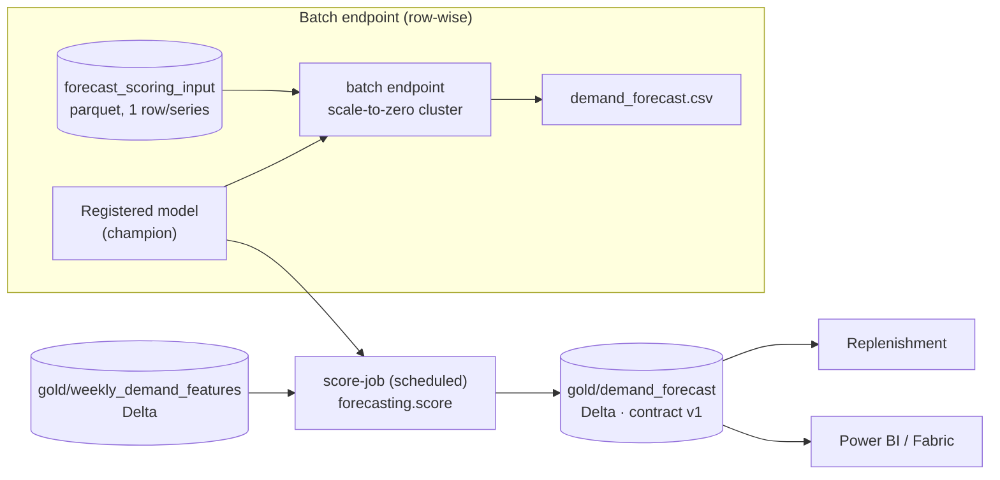

# Batch Endpoints and the Forecast Data Product

> **Where this fits.** We have a registered, gated model. Replenishment needs a **weekly file of forecasts**, not a live API. This lesson produces the `supply-chain.demand-forecast` data product and teaches batch inference - including the honest engineering call of *when a batch endpoint is the right tool and when a scheduled job is*.

## 1. Lesson overview and learning objectives

By the end you can:

- Produce `gold/demand_forecast` (one row per product-store for next week), validated against its contract, as a Delta table on ADLS Gen2.
- Choose correctly between a **scheduled scoring job** and a **batch endpoint** for a given scoring shape.
- Create a **batch endpoint** with a scale-to-zero compute cluster and a custom scoring driver, and invoke it.
- Publish the result as the governed **data product** promoted in the data mesh lesson.

Runnable locally: [`code/forecasting/score.py`](../../code/forecasting/score.py). Azure assets: [Lab 06 `aml/`](../../labs/lab-06-model-deployment/).

## 2. Prerequisites

| Need | Why | From |
|---|---|---|
| A registered model (champion) | Batch scoring deploys it | [Registry lesson](04-model-registry-and-release.md) |
| The Gold feature table | Input to scoring | [Lakehouse](../lakehouse/01-lake-warehouse-lakehouse-medallion.md) |
| The forecast contract + product descriptor | Output governance | [`forecasting.demand_forecast.v1.yaml`](../../code/contracts/forecasting.demand_forecast.v1.yaml), [data mesh](../data-mesh/01-data-mesh.md) |

## 3. Core concepts

### 3.1 What the forecast product is

Weekly replenishment needs **one-week-ahead** demand per series. [`score.py`](../../code/forecasting/score.py) builds a **scoring frame** - one row per series for the first unobserved week, with lags and the rolling mean taken from each series' history, calendar features from the future week, and planning inputs (promotions/holidays) defaulting to none. It predicts non-negative demand, validates against the contract, and writes `gold/demand_forecast`.

Run locally (seed-42 data): **400 forecast rows** (10 stores × 40 products) for the week after the last observed week, mean ≈ 20.3 units, contract OK. Verified in the course build.

### 3.2 Batch endpoint vs scheduled job (the real decision)

Batch endpoints "consume resources only while jobs run"; the cluster sits at zero nodes and bills nothing until a job is submitted ([Batch endpoints](https://learn.microsoft.com/azure/machine-learning/how-to-use-batch-endpoint)). They score inputs **row-wise**, in parallel mini-batches - ideal for *stateless* scoring where each input row is independent.

Our forecast has a wrinkle: building a series' next-week features needs that series' **whole history**. Two clean designs:

| Design | How | When |
|---|---|---|
| **Scheduled scoring job** (course primary) | A command/pipeline job runs `forecasting.score`, which reads the full Gold table and writes `gold/demand_forecast` | The feature build needs full-series context (our case). Module 7 schedules it |
| **Batch endpoint** | An upstream step writes a one-row-per-series **scoring matrix**; the batch endpoint scores it row-wise | Large, stateless scoring of a prepared matrix; reusable HTTPS trigger |

Both appear in the lab. The scheduled job ([`score-job.yml`](../../labs/lab-06-model-deployment/)) is the simplest correct way to produce the product; the batch endpoint shows the general pattern on the prepared matrix (`score.py --scoring-input` writes it as parquet).

### 3.3 Batch endpoints and deployments (SDK v2)

A batch endpoint is an HTTPS URL; a **deployment** under it does the work and a default deployment is chosen when the endpoint is invoked without naming one ([verified](https://learn.microsoft.com/azure/machine-learning/how-to-use-batch-model-deployments)):

```python
from azure.ai.ml.entities import AmlCompute, BatchEndpoint, ModelBatchDeployment, \
    ModelBatchDeploymentSettings, CodeConfiguration, BatchRetrySettings
from azure.ai.ml.constants import BatchDeploymentOutputAction

ml_client.compute.begin_create_or_update(
    AmlCompute(name="batch-cluster", min_instances=0, max_instances=2)).result()  # scale to zero
ml_client.batch_endpoints.begin_create_or_update(BatchEndpoint(name="demand-forecast-batch")).result()

deployment = ModelBatchDeployment(
    name="champion", endpoint_name="demand-forecast-batch", model=champion_model,
    code_configuration=CodeConfiguration(code="../../code", scoring_script="batch_driver.py"),
    environment=env, compute="batch-cluster",
    settings=ModelBatchDeploymentSettings(
        mini_batch_size=1, max_concurrency_per_instance=2, instance_count=1,
        output_action=BatchDeploymentOutputAction.APPEND_ROW, output_file_name="demand_forecast.csv",
        retry_settings=BatchRetrySettings(max_retries=2, timeout=300)),
)
ml_client.batch_deployments.begin_create_or_update(deployment).result()
job = ml_client.batch_endpoints.invoke(endpoint_name="demand-forecast-batch",
                                       input=Input(type=AssetTypes.URI_FILE, path="azureml:forecast_scoring_input@latest"))
```

An **MLflow model can skip the scoring script** (no-code batch deployment does row-wise `predict`), but a custom driver ([`batch_driver.py`](../../labs/lab-06-model-deployment/)) keeps the keys (`week_start`, `store_id`, `product_id`) alongside the prediction - which `APPEND_ROW` collects into one output file. Outputs are written to a datastore for downstream use.

### 3.4 Writing to the lake as a governed product

The scoring job writes `gold/demand_forecast` as Delta to ADLS Gen2 by **identity** (the compute/job identity with *Storage Blob Data Contributor* on the lake). That table is the `supply-chain.demand-forecast` data product, now **published** with a contract (see the [data mesh lesson](../data-mesh/01-data-mesh.md#42-data-products-in-this-organisation)) and dependent on `supply-chain.demand-features`. The registry's impact analysis now shows the forecast downstream of the features and of POS sales.

## 4. Architecture diagrams



## 5. Azure service mapping

| Need | Azure service / capability | Type | Where |
|---|---|---|---|
| Weekly forecast file | Scheduled command/pipeline job | Native capability | [`score-job.yml`](../../labs/lab-06-model-deployment/) |
| Row-wise batch scoring | Batch endpoint + deployment | Native capability | [`deploy_batch.py`](../../labs/lab-06-model-deployment/) |
| Scale-to-zero compute | AmlCompute `min_instances=0` | Native capability | [Workspace lesson](01-workspace-compute-and-costs.md) |
| Governed output | `demand-forecast` data product + contract | Pattern | [data mesh](../data-mesh/01-data-mesh.md) |
| Table format | Delta Lake on ADLS Gen2 | Open source | [lakehouse](../lakehouse/01-lake-warehouse-lakehouse-medallion.md) |

## 6. Step-by-step implementation

**Locally (free): produce the product.**

```bash
# WSL / Python, from code/
python -m forecasting.score \
  --data ../data/lake/gold/weekly_demand_features \
  --model ../data/model/model/model.txt \
  --output ../data/lake/gold/demand_forecast \
  --scoring-input ../data/forecast_scoring_input.parquet
python data_mesh/registry.py validate      # demand-forecast is published with a contract
```

**On Azure ML (billable only while a job runs):**

```bash
# WSL, CLI v2 - scheduled scoring job writing to the lake
az ml job create -f aml/score-job.yml --web
# or the batch endpoint over the scoring matrix (SDK)
python aml/deploy_batch.py --subscription <id> --resource-group <rg> --workspace <ws>
```

## 7. Complete runnable code

- Scoring + output-contract validation (runnable + tested): [`code/forecasting/score.py`](../../code/forecasting/score.py), tests in [`code/tests/test_scoring.py`](../../code/tests/test_scoring.py).
- Scheduled job: [`score-job.yml`](../../labs/lab-06-model-deployment/). Batch endpoint: [`deploy_batch.py`](../../labs/lab-06-model-deployment/) + [`batch_driver.py`](../../labs/lab-06-model-deployment/).
- Product descriptor + contract: [`supply-chain.demand-forecast.yaml`](../../code/data_mesh/products/supply-chain.demand-forecast.yaml), [`forecasting.demand_forecast.v1.yaml`](../../code/contracts/forecasting.demand_forecast.v1.yaml).

## 8. Expected outputs and verification

Local, seed 42, verified in the build: `score.py` writes **400 rows** to `gold/demand_forecast` (one per series, next week), prints `contract OK`, mean `forecast_units` ≈ 20.3, range ≈ 0.8-185. `registry.py validate` reports **8 products, 0 errors, 5 warnings** with `demand-forecast` now published and contracted.

On Azure, the batch job appears under **Jobs**, the deployment writes `demand_forecast.csv` to the default datastore, and the scheduled job's output lands at `gold/demand_forecast`. **Not run against a subscription in the build**; SDK/YAML follow current `azure-ai-ml` v2 docs.

```bash
cd code && python -m pytest tests/test_scoring.py   # scoring + contract tests
```

## 9. Independent exercise

1. Extend `build_scoring_frame` to accept a **promotion plan** (per series, `promo_days` for next week) instead of defaulting to 0, and re-score. How much does the forecast move?
2. Make the scoring job write a `run_date` partition so each week's forecast is kept (time travel over forecasts). What changes in `score.py` and the contract?
3. Decide: should a 1-week vs 4-week horizon forecast be one product with a `horizon` column, or two products? Argue from the consumers' side.

## 10. Common errors and troubleshooting

| Symptom | Cause | Fix |
|---|---|---|
| Batch driver predicts wrongly on categoricals | Scoring matrix lost category dtype/codes | Write it as parquet (preserves categories); `build_scoring_frame` pins categories to the Gold universe |
| `score.py` refuses to write | Forecast breaks the contract (negative/dup) | Fix scoring; the gate is doing its job |
| Batch job 403 writing to the lake | Compute identity lacks *Storage Blob Data Contributor* | Grant it on the storage account; wait for propagation |
| Forecast needs full history but batch endpoint splits it | Wrong tool for stateful feature build | Use the scheduled scoring job, or precompute the scoring matrix for the endpoint |
| Cluster bills when idle | `min_instances` > 0 | Set `min_instances=0` |

## 11. Security and cost considerations

- **Security**: identity-based read of features and write of forecasts; no keys. The forecast product is `internal`-classified; its contract documents that promotions beyond the scored week are assumed absent.
- **Cost**: the scoring job and batch endpoint bill only while running on a scale-to-zero cluster - minutes of CPU weekly. Storage for the Delta product is cents. This is the cheap inference path; online endpoints (next lesson) are the expensive one.

## 12. Production best practices

- **Prefer batch/scheduled** for forecasting: it is cheap, retriable and naturally fits weekly replenishment.
- **Validate the output contract every run**; publish only contract-valid products.
- **Keep history**: partition forecasts by run date so you can measure accuracy later (Module 7 monitoring).
- **Scale to zero** on every batch cluster.
- **Right tool for the shape**: stateless row-wise → batch endpoint; needs full-series context → scheduled job.

## 13. Knowledge check

1. Why is a scheduled scoring job, not a batch endpoint, the primary way this course produces the forecast?
2. What does a batch endpoint's compute cost when no job is running, and why?
3. Why does the batch driver use a custom scoring script instead of no-code MLflow deployment?
4. What makes `gold/demand_forecast` a governed data product rather than a loose file?

<details>
<summary>Answers</summary>

1. Building each series' next-week features needs the **full series history**; a batch endpoint scores rows independently in mini-batches, which doesn't fit stateful feature construction.
2. **Nothing** - the cluster scales to zero (`min_instances=0`) and bills only while a job runs.
3. To keep the **keys** (`week_start`, `store_id`, `product_id`) with each prediction in the appended output; no-code MLflow batch output is predictions only.
4. It has an **owner, a contract, lineage and a published status** in the registry (the `supply-chain.demand-forecast` product), and its writes are gated by that contract.

</details>

## 14. Official documentation and further reading

- [Batch endpoints concept](https://learn.microsoft.com/azure/machine-learning/concept-endpoints-batch) · [Use batch endpoints](https://learn.microsoft.com/azure/machine-learning/how-to-use-batch-endpoint)
- [Deploy models for batch scoring](https://learn.microsoft.com/azure/machine-learning/how-to-use-batch-model-deployments) · [batch deployment YAML](https://learn.microsoft.com/azure/machine-learning/reference-yaml-deployment-batch)
- [Endpoints overview](https://learn.microsoft.com/azure/machine-learning/concept-endpoints)

**Next:** [Online Endpoints and a FastAPI Service](06-online-endpoints-and-fastapi.md).
