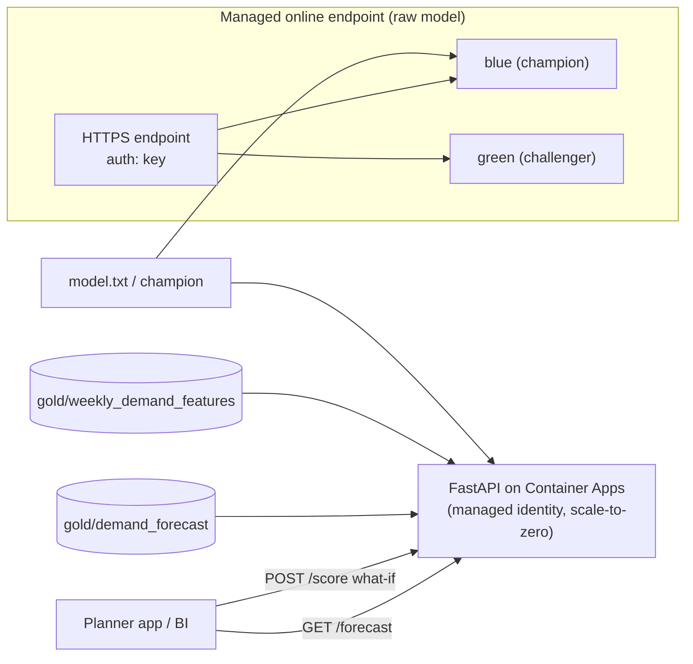

# Online Endpoints and a FastAPI Forecast Service

> **Where this fits.** Batch forecasts cover weekly replenishment ([previous lesson](05-batch-endpoints.md)). Some consumers need an **answer now**: a planner asking "what if we run a promotion next week?", or an app querying one series. This lesson serves the model in real time - and is also the one that *keeps costing money until you delete it*, so cost discipline is the lesson as much as the mechanics.

## 1. Lesson overview and learning objectives

By the end you can:

- Deploy the registered model to a **managed online endpoint** with a **blue/green** deployment, **autoscale**, and a chosen **auth mode**.
- Explain the three auth modes (`key`, `aml_token`, `aad_token`) and pick one.
- Build and deploy a **FastAPI** service on **Azure Container Apps** that serves precomputed forecasts and recomputes what-if scenarios, reading the lake by **managed identity**.
- Decide between a managed online endpoint and a custom container service, and bound the cost of both.

Runnable locally: [`code/forecast_service/`](../../code/forecast_service/). Azure assets: [Lab 06](../../labs/lab-06-model-deployment/README.md).

## 2. Prerequisites

| Need | Why | From |
|---|---|---|
| A registered champion model | Online endpoint deploys it | [Registry lesson](04-model-registry-and-release.md) |
| The forecast + feature tables | The FastAPI service reads them | [Batch lesson](05-batch-endpoints.md) |
| `fastapi`, `uvicorn`, `httpx` | The service and its tests | [`code/requirements.txt`](../../code/requirements.txt) |

## 3. Core concepts

### 3.1 Managed online endpoints

A **managed online endpoint** gives an HTTPS URL backed by one or more **deployments** (a model + instances), abstracting the serving infrastructure. Deploy the registered MLflow model with no scoring script ([verified](https://learn.microsoft.com/azure/machine-learning/tutorial-deploy-model)):

```python
from azure.ai.ml.entities import ManagedOnlineEndpoint, ManagedOnlineDeployment

endpoint = ManagedOnlineEndpoint(name="demand-forecast-xxxx", auth_mode="key")
ml_client.online_endpoints.begin_create_or_update(endpoint).result()

blue = ManagedOnlineDeployment(name="blue", endpoint_name=endpoint.name,
                               model=champion_model, instance_type="Standard_DS3_v2", instance_count=1)
ml_client.online_deployments.begin_create_or_update(blue).result()   # ~8-10 minutes
endpoint.traffic = {"blue": 100}
ml_client.online_endpoints.begin_create_or_update(endpoint).result()
```

**Blue/green.** Traffic is split across deployments and "can't be set during endpoint creation" because the deployments must exist first. Add a `green` deployment with the challenger model, then shift: `endpoint.traffic = {"blue": 90, "green": 10}` (the split must be 0 or sum to 100), or `az ml online-endpoint update --name <ep> --traffic "blue=90 green=10"`. Increase green as confidence grows; roll back by setting it to 0. ([Safe rollout](https://learn.microsoft.com/azure/machine-learning/how-to-safely-rollout-online-endpoints))

**Autoscale.** Managed online endpoints integrate with **Azure Monitor autoscale**: scale instance count on a metric (CPU/memory/request utilisation) or a schedule. ([Autoscale endpoints](https://learn.microsoft.com/azure/machine-learning/how-to-autoscale-endpoints))

**Auth modes** ([online endpoint YAML](https://learn.microsoft.com/azure/machine-learning/reference-yaml-endpoint-online)):

| Mode | What | Use |
|---|---|---|
| `key` | A static shared key | Simple server-to-server; rotate manually |
| `aml_token` | Short-lived Azure ML token | Avoids a long-lived secret |
| `aad_token` | Microsoft Entra token (**preview**) | Entra-native auth; check preview status before prod |

### 3.2 Managed online endpoint vs a custom container service

| | Managed online endpoint | FastAPI on Container Apps |
|---|---|---|
| You get | Model-serving infra, blue/green, autoscale, built-in auth | Full control of the API surface and dependencies |
| You write | Almost nothing (no-code MLflow) | The app |
| Good for | Serving *the model* (feature vector in, prediction out) | A *product API*: precomputed lookups, what-if, joins, business rules |
| Idle cost | **Bills per instance while deployed, even at zero traffic** | **Scale to zero** (min replicas 0) - near-zero idle |

Our forecasting service is a *product API* (precomputed lookups + what-if recomputation + business shape), so Container Apps fits; the managed online endpoint is shown for raw model serving and blue/green.

### 3.3 The FastAPI forecast service

[`code/forecast_service/app.py`](../../code/forecast_service/app.py) exposes:

- `GET /forecast/{store_id}/{product_id}` - the **precomputed** weekly forecast from `gold/demand_forecast` (the cheap, fast path).
- `POST /score` - recompute one series' next-week forecast with **what-if** planning inputs (`promo_days`, `holiday_days`, `avg_price`), reusing `forecasting.score`'s feature construction and the model.
- `GET /health` - liveness.

It reads the lake with `DefaultAzureCredential`, so locally it uses your `az login` and on Container Apps it uses the app's **managed identity** - no keys. Pydantic validates inputs (e.g. `promo_days` must be 0-7). Verified in the build: health, precomputed lookup, 404 for unknown series, what-if overrides, and a 422 for out-of-range inputs all pass.

### 3.4 Azure Container Apps

Container Apps is "serverless container hosting with autoscaling (including scale to zero)". Deploy the image with a **system-assigned managed identity**, grant that identity *Storage Blob Data Reader* on the lake, set `--min-replicas 0`, and the service costs almost nothing when no one is calling it (at the price of cold starts). ([Container Apps overview](https://learn.microsoft.com/azure/container-apps/overview)) The build and deploy are in [`service/`](../../labs/lab-06-model-deployment/).

## 4. Architecture diagrams



## 5. Azure service mapping

| Need | Azure service / capability | Type | Where |
|---|---|---|---|
| Real-time model serving | Managed online endpoint + deployment | Native capability | [`deploy_online.py`](../../labs/lab-06-model-deployment/) |
| Safe rollout | Blue/green traffic split | Native capability | This lesson |
| Scale on load | Azure Monitor autoscale | Native capability | This lesson |
| Product API host | Azure Container Apps | Native service | [`service/`](../../labs/lab-06-model-deployment/) |
| Web framework | FastAPI | Open source | [`code/forecast_service/`](../../code/forecast_service/) |
| Keyless data access | Managed identity + `DefaultAzureCredential` | Native capability | [Module 1](../azure-fundamentals/01-azure-fundamentals.md) |

## 6. Step-by-step implementation

**Locally (free): run the service.**

```bash
# WSL / Python, from code/ (after producing the forecast table in the batch lesson)
FORECAST_TABLE=../data/lake/gold/demand_forecast \
GOLD_TABLE=../data/lake/gold/weekly_demand_features \
MODEL_PATH=../data/model/model/model.txt \
uvicorn forecast_service.app:app --reload
# then:
curl localhost:8000/forecast/S001/P0001
curl -X POST localhost:8000/score -H 'content-type: application/json' \
  -d '{"store_id":"S001","product_id":"P0001","promo_days":5}'
```

**On Azure (billable): managed online endpoint and/or Container Apps.**

```bash
# WSL - managed online endpoint (BILLS WHILE DEPLOYED; delete after)
python aml/deploy_online.py --subscription <id> --resource-group <rg> --workspace <ws>
# WSL - FastAPI on Container Apps (scale-to-zero)
bash service/deploy_containerapp.sh
```

## 7. Complete runnable code

- Service (runnable + tested locally): [`code/forecast_service/app.py`](../../code/forecast_service/app.py), tests in [`code/tests/test_forecast_service.py`](../../code/tests/test_forecast_service.py).
- Online endpoint (SDK v2, not run): [`deploy_online.py`](../../labs/lab-06-model-deployment/).
- Container Apps: [`service/Dockerfile`](../../labs/lab-06-model-deployment/), [`service/deploy_containerapp.sh`](../../labs/lab-06-model-deployment/).

## 8. Expected outputs and verification

Local, verified in the build: `GET /health` → `{"status":"ok"}`; `GET /forecast/S001/P0001` → a precomputed row (`source: precomputed`); unknown series → 404; `POST /score` with overrides → a recomputed forecast (`source: on-demand`); out-of-range `promo_days` → 422.

On Azure: the online endpoint returns predictions at its scoring URI with the configured auth; the Container App returns a public (or VNet-restricted) FQDN and scales to zero when idle. **Not run against a subscription in the build**; SDK/CLI follow current docs cited inline.

```bash
cd code && python -m pytest tests/test_forecast_service.py   # 5 passed in the build
```

## 9. Independent exercise

1. Add a `green` deployment with a challenger model to `deploy_online.py` and script a 90/10 → 50/50 → 100 rollout with a rollback step.
2. Add a `GET /forecast/store/{store_id}` endpoint returning all products for a store, sorted by forecast. What does it read, and does it need the model?
3. Put the online endpoint behind `aml_token` auth instead of `key`. What changes for the caller, and why is it safer?

## 10. Common errors and troubleshooting

| Symptom | Cause | Fix |
|---|---|---|
| Online endpoint still billing after the lab | Deployment not deleted | `az ml online-endpoint delete -n <ep> --yes` (it bills per instance while live) |
| `traffic` rejected at creation | Set before deployments exist | Create deployments first, then set traffic |
| Container App 403 reading the lake | Managed identity lacks a data role | Grant *Storage Blob Data Reader*; wait for propagation |
| What-if `/score` 404s a real series | Series has no history in Gold | Expected; only series with history can be scored |
| Wrong predictions from the online endpoint | Feature schema mismatch | Send the exact feature columns the model expects (MLflow signature) |
| Cold-start latency on Container Apps | Scaled to zero | Accept it, or set `--min-replicas 1` (continuous cost) |

## 11. Security and cost considerations

- **Security**: identity-based data access throughout; the service holds no keys. Choose `aml_token`/`aad_token` over `key` where you can; restrict ingress to a VNet for internal-only services.
- **Cost**: this is the expensive lesson. A **managed online endpoint bills per instance while deployed, even at zero traffic** - delete it the moment the lab is done. **Container Apps scales to zero**, so an idle service is near-free; `--min-replicas 1` removes cold starts but bills continuously.

## 12. Production best practices

- **Prefer batch** for the forecast; add real-time only for genuine interactive needs (what-if, single-series lookups).
- **Blue/green every model change**; shift traffic gradually, keep rollback one command away.
- **Scale to zero** on Container Apps; use autoscale with sane min/max on online endpoints.
- **Delete endpoints** you are not using; put a budget + alert on the serving resource group.
- **Managed identity**, never keys, for the service to reach data and the registry.

## 13. Knowledge check

1. Which serving option bills while idle, and which scales to zero?
2. Why can't you set endpoint traffic at creation time?
3. What are the three online-endpoint auth modes, and which is still preview?
4. How does the FastAPI service reach the lake without secrets, locally and on Container Apps?
5. When is a managed online endpoint the right choice over the FastAPI service?

<details>
<summary>Answers</summary>

1. A **managed online endpoint** bills per instance while deployed; **Container Apps** scales to zero and is near-free when idle.
2. The traffic map references deployments, which must **exist first**; you create the deployment, then set traffic.
3. `key`, `aml_token`, and `aad_token`; **`aad_token` is preview**.
4. With `DefaultAzureCredential`: your `az login` locally, the app's **managed identity** on Container Apps (granted *Storage Blob Data Reader*).
5. When you need to serve **the raw model** (feature vector in, prediction out) with built-in blue/green and autoscale, rather than a product API with lookups, what-if logic and business shape.

</details>

## 14. Official documentation and further reading

- [Online endpoints concept](https://learn.microsoft.com/azure/machine-learning/concept-endpoints-online) · [Deploy an MLflow model online](https://learn.microsoft.com/azure/machine-learning/how-to-deploy-mlflow-models-online-endpoints)
- [Safe rollout (blue/green)](https://learn.microsoft.com/azure/machine-learning/how-to-safely-rollout-online-endpoints) · [Autoscale endpoints](https://learn.microsoft.com/azure/machine-learning/how-to-autoscale-endpoints)
- [Online endpoint auth / YAML](https://learn.microsoft.com/azure/machine-learning/reference-yaml-endpoint-online)
- [Azure Container Apps overview](https://learn.microsoft.com/azure/container-apps/overview) · [FastAPI](https://fastapi.tiangolo.com/)

**Next:** [Lab 06: Deploy the forecaster](../../labs/lab-06-model-deployment/README.md), then Module 7 (MLOps) in the [roadmap](../mlops/README.md).
