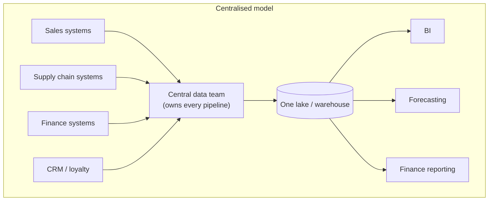
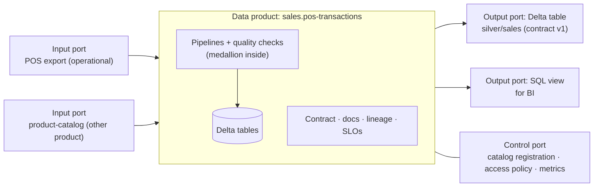
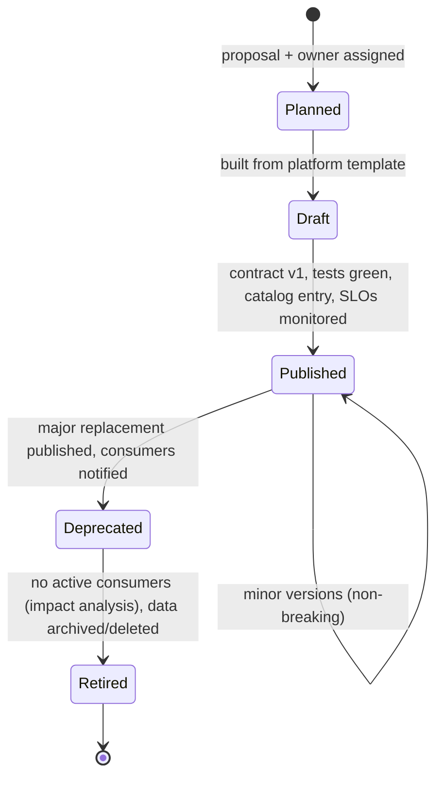
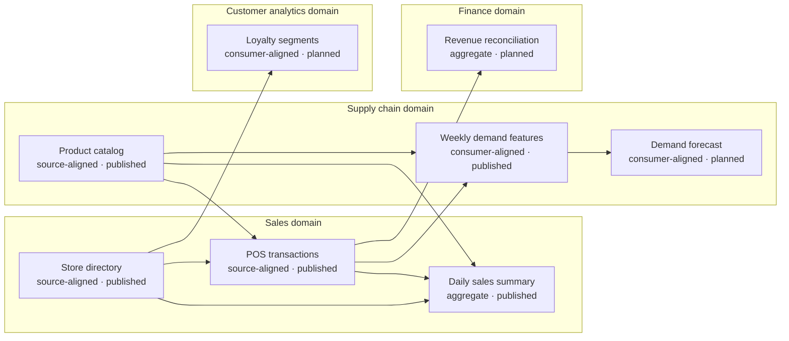
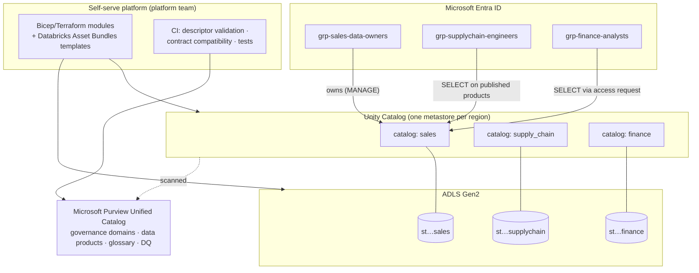
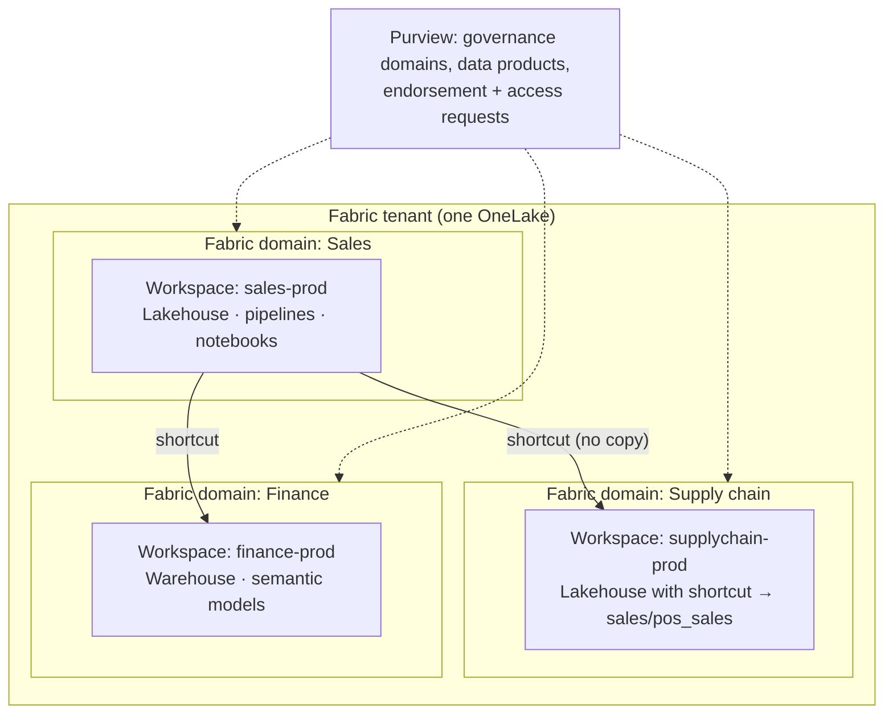

# Data Mesh: Domain Ownership, Data Products and Federated Governance on Azure

> **Data mesh is not an Azure service.** You cannot deploy "a data mesh". It is a socio-technical approach: an **organisational operating model** (who owns and serves data) plus an **architecture** (how independently owned data products interoperate). Azure provides building blocks for it (Purview governance domains and data products, Fabric domains, Unity Catalog, ADLS Gen2, Entra ID, Azure Policy), and every real implementation also needs custom conventions, templates and processes. This lesson keeps those three categories explicitly separate.

## 1. Lesson overview and learning objectives

Data mesh was articulated by Zhamak Dehghani (then at Thoughtworks) in 2019 and expanded in her 2022 book *Data Mesh: Delivering Data-Driven Value at Scale*. It responds to a specific failure: a **central data team** that owns all pipelines becomes a bottleneck, loses the business context of the data it moves, and creates brittle pipelines coupling every source to every consumer.

By the end you can:

- State the four principles and explain what each requires from teams, platforms and governance.
- Design a **data product**: its ports, contract, metadata, SLA, owner and lifecycle.
- Write a **data contract** and detect breaking changes automatically in CI.
- Compare mesh with a centralised lake or warehouse, and argue when mesh is the wrong choice.
- Map each principle to Azure services, marking what is native, what is a pattern, and what you must build.
- Implement a small mesh for a retail company with sales, supply chain, finance and customer analytics domains.

## 2. Prerequisites

- [Lakehouse and medallion lesson](../lakehouse/01-lake-warehouse-lakehouse-medallion.md): this lesson reuses its pipeline and contracts.
- [Azure fundamentals](../azure-fundamentals/01-azure-fundamentals.md): Entra groups and RBAC are how ownership becomes enforceable.

## 3. Core concepts

### 3.1 The problem mesh addresses



Symptoms at scale: a growing ticket backlog for the central team; data engineers who do not understand the source semantics ("what does `status=7` mean?"); source teams changing schemas without knowing who breaks; unclear accountability when numbers are wrong; and data treated as a by-product of applications rather than something with users.

Mesh moves **ownership to the domains that understand the data**, and adds the platform and governance needed so that decentralisation does not become chaos.

### 3.2 The four principles

#### Principle 1: Domain-oriented ownership

Analytical data is owned by the business domain closest to it, aligned with how the organisation is already structured (domain-driven design's *bounded contexts*). The sales domain owns sales data end-to-end: ingestion from POS, cleaning, modelling and serving.

Domain data comes in three flavours:

| Type | Description | Retail example |
|---|---|---|
| **Source-aligned** | Reflects facts from operational systems the domain runs | `sales.pos-transactions`, `supply-chain.product-catalog` |
| **Aggregate** | Combines several products for a common need; ownership must be explicit | `finance.revenue-reconciliation` |
| **Consumer-aligned** | Shaped for a specific use case | `supply-chain.demand-features`, `customer.loyalty-segments` |

What it requires: domain teams with data engineering capacity (embedded or allocated), product-level accountability, and budgets that reflect it.

Failure mode: "domains" that are really just the old central team split into sub-teams, still distant from the source systems.

#### Principle 2: Data as a product

Domains treat the data they share as a **product with consumers**, not as an exhaust of their applications. Dehghani lists the usability characteristics a data product should have: **discoverable, addressable, understandable, trustworthy and truthful, natively accessible, interoperable and composable, valuable on its own, and secure**.

A **data product** is the smallest independently deployable unit of the mesh. Architecturally it bundles:

- **Code**: ingestion, transformation, quality checks, serving APIs, policies.
- **Data and metadata**: the tables/files, schema, semantics, lineage, quality metrics, documentation.
- **Infrastructure**: the storage, compute and permissions it runs on, provisioned from the platform.

It exposes **ports**:



Ownership roles:

| Role | Responsibilities |
|---|---|
| **Data product owner** (in the domain) | Defines consumers and value, prioritises the backlog, owns the contract and SLOs, approves breaking changes and deprecations, decides access requests (or delegates to policy) |
| **Domain data engineers** | Build and run pipelines, tests, monitoring; respond to incidents |
| **Platform team** (central) | Provide self-serve infrastructure, templates, CI, catalog integration; does *not* own domain data |
| **Governance guild** (federated) | Domain representatives plus security, legal, platform: define global policies and standards |
| **Consumers** | Use the product per its terms; give feedback; declare dependencies so impact analysis works |

#### Principle 3: Self-serve data platform

If every domain must become expert in Spark tuning, IAM and networking, mesh fails. A platform team provides **paved roads**: one command or template gives a domain a governed storage location, compute, CI/CD, monitoring, catalog registration and access management that are compliant by default.

Platform capabilities, from the bottom up: infrastructure provisioning (storage, compute, networking, identity); a product development experience (templates, local dev, testing, deployment); and a mesh supervision plane (catalog, lineage, quality dashboards, policy enforcement).

Failure mode: a "platform" that is a wiki page of manual steps, or one so abstract domains cannot debug it.

#### Principle 4: Federated computational governance

Governance decisions are made **federatively** (domains plus central experts agree on global rules) and enforced **computationally** (as code in the platform, not as review meetings).

| Global (decided by the federation, enforced by the platform) | Local (decided by each domain) |
|---|---|
| Identifier standards (`store_id` format), time zones, units | Internal pipeline design, tools within the platform's offering |
| Classification scheme and handling rules for PII | Product-specific schemas and quality thresholds |
| Contract format and versioning policy | Release cadence |
| Required metadata (owner, SLA, classification) | Which consumers to prioritise |
| Access control model, retention minimums, audit | Internal tables not exposed through ports |

"Computational" means: CI rejects a product without an owner or contract; a breaking contract change without a major version fails the build; a column tagged as PII is automatically masked for users without a specific role; the catalog is populated from descriptors, not manual typing. The [hands-on part](#6-step-by-step-implementation) implements several of these checks.

### 3.3 Data contracts

A **data contract** is the formal, machine-readable agreement between a producer and its consumers about a data product's output port. A practical contract specifies:

- **Schema**: columns, logical types, nullability, keys.
- **Semantics**: descriptions, units, business definitions (link to glossary terms).
- **Quality guarantees**: rules the producer enforces before publishing.
- **Service levels**: freshness/latency, frequency, availability, retention.
- **Ownership and support**: owner, team, escalation channel.
- **Security and terms of use**: classification, allowed purposes.
- **Version**: semantic versioning, with a policy for breaking changes.

This course uses the structure of the **Open Data Contract Standard (ODCS) v3** (a Linux Foundation / Bitol project) in simplified form. The Sales domain's contract, abridged ([full file](../../code/contracts/sales.pos_sales.v1.yaml)):

```yaml
apiVersion: v3.0.2
kind: DataContract
id: 7d1f3c52-sales-pos-sales
name: pos_sales
version: 1.0.0
status: active
domain: sales
dataProduct: sales-transactions
description:
  purpose: Cleaned, de-duplicated daily point-of-sale sales per store and product.
  limitations: >
    units_sold is censored by stock availability. Use the stockout flag to avoid
    biasing demand models. Closed-store days have no rows (not zero rows).
schema:
  - name: pos_sales
    physicalName: silver/sales
    quality:
      - rule: unique
        columns: [date, store_id, product_id]
    properties:
      - name: store_id
        logicalType: string
        required: true
        primaryKey: true
        quality:
          - rule: referential
            reference: stores.store_id
      - name: units_sold
        logicalType: integer
        required: true
        quality:
          - rule: range
            mustBeGreaterThanOrEqualTo: 0
      - name: revenue
        logicalType: number
        classification: confidential
      # ...
slaProperties:
  - property: latency     # data for day D available by 06:00 UTC on D+1
    value: 6
    unit: h
```

Notice the `limitations` text: the most valuable contract content is often semantic. A forecasting team that trains on censored sales without the stock-out flag will under-forecast, and no schema check will catch it.

**Versioning rules (consumer's point of view)**

| Change | Classification | Required version bump |
|---|---|---|
| Add an optional column | Non-breaking | Minor |
| Add a quality rule / tighten a guarantee | Non-breaking | Minor |
| Rename or remove a column | **Breaking** | Major |
| Change a column's type | **Breaking** | Major |
| Make a required column optional | **Breaking** | Major |
| Remove a quality rule or weaken an SLA | **Breaking** | Major |

For breaking changes, publish the new major version **alongside** the old one, announce a deprecation window, and retire the old version only when impact analysis shows no active consumers.

### 3.4 Metadata, discoverability and interoperability

- **Discoverable**: products are registered in a catalog with owner, description, domain, classification, quality score and how to request access. On Azure: Purview Unified Catalog, the OneLake catalog in Fabric, Unity Catalog's Catalog Explorer.
- **Addressable**: a stable, unique address per output port (`sales.products.pos_sales` in Unity Catalog; a OneLake path; a contract `id`).
- **Interoperable**: shared standards so products compose: common identifiers (`store_id` matches across domains), common formats (Delta), timestamps in UTC, agreed polysemes (concepts like *Product* or *Customer* that appear in several domains with a canonical ID).
- **Lineage**: product-level lineage (which product feeds which) from descriptors, plus table/column lineage from the platform (Unity Catalog, Purview).

### 3.5 Security and access control

- Access is granted **per data product** (or per output port), to **Entra ID groups**, not individuals.
- Consumers **request** access through the catalog; the product owner or a policy approves. Purview Unified Catalog supports access requests on data products; Unity Catalog uses grants (and can integrate with request workflows).
- Sensitive columns are classified in the contract and enforced by the platform: column masks or row filters in Unity Catalog, secure views, OneLake security roles.
- Aggregate and consumer-aligned products must not quietly leak classified inputs. The registry below warns when a product is classified lower than its inputs.

### 3.6 Data product lifecycle



At every stage, the product has exactly one accountable owner. "Orphaned" data products (owner left, team reorganised) are the mesh equivalent of a data swamp; governance should detect products whose owner is not a valid, active group.

### 3.7 Mesh vs centralised lake or warehouse

| Dimension | Centralised lake/warehouse | Data mesh |
|---|---|---|
| Ownership of analytical data | Central data team | Business domains |
| Unit of architecture | Pipelines and layers | Data products |
| Change bottleneck | Central backlog | Distributed; coordinated via contracts |
| Domain knowledge | Lost at hand-off | Kept with owners |
| Consistency | Easier: one team, one model | Harder: needs global standards and governance-as-code |
| Platform | Built for one team | Must be self-serve for many teams |
| Duplication risk | Lower | Higher unless sharing-by-reference is easy |
| Cost of entry | Lower | Higher (platform, governance, domain staffing) |
| Technology | Lake, warehouse or lakehouse | Usually lakehouse technology per domain; mesh does not prescribe the tech |

Mesh **does not replace** lakes, lakehouses or warehouses: each domain still builds lakehouse-style products, often with medallion layers inside. What changes is *who owns which part* and *how parts connect*.

### 3.8 When mesh fits, and when it is unnecessary complexity

Mesh tends to pay off when:
- There are **many domains** with distinct source systems and semantics, and the central team is a demonstrated bottleneck.
- Domains have (or can fund) their own engineering capacity.
- Leadership will assign accountability for data quality to business domains.
- The organisation already has, or will invest in, a platform team.

Mesh is usually **overkill** when:
- One team of fewer than ~10 data people serves the whole company; the bottleneck is not organisational.
- Data volume and variety are modest and few domains produce analytical data.
- Domains cannot staff data roles; "ownership" would be in name only.
- There is no platform investment: decentralising without paved roads produces inconsistent silos.

A pragmatic path is a **"mesh-ready" centralised platform**: adopt the cheap, high-value practices now (data products with owners, contracts, catalog, governance-as-code, domain-aligned catalogs/workspaces) and decentralise ownership only when a domain is ready. Microsoft's Cloud Adoption Framework describes data mesh within its cloud-scale analytics guidance and makes a similar point about organisational readiness. ([What is a data mesh? (CAF)](https://learn.microsoft.com/azure/cloud-adoption-framework/scenarios/cloud-scale-analytics/architectures/what-is-data-mesh))

## 4. Architecture diagrams

### 4.1 Example organisation: Contoso Retail domain map



This diagram is generated from the domains' product descriptors by `python data_mesh/registry.py mermaid` (layout simplified here), so it cannot drift from what the domains declare.

### 4.2 Data products in this organisation

| Product | Domain | Type | Owner (group) | Output port | Contract | Consumers |
|---|---|---|---|---|---|---|
| `sales.pos-transactions` | Sales | Source-aligned | sales-data-owner | Delta `silver/sales` | [v1](../../code/contracts/sales.pos_sales.v1.yaml) | Supply chain, Finance, Sales BI |
| `sales.store-directory` | Sales | Source-aligned | store-ops-owner | Delta `silver/stores` | *missing (exercise)* | All domains |
| `sales.daily-sales-summary` | Sales | Aggregate | sales-data-owner | Delta `gold/daily_sales_store_category` | *missing* | Sales BI |
| `supply-chain.product-catalog` | Supply chain | Source-aligned | merchandising-owner | Delta `silver/products` | *missing* | Sales, Supply chain |
| `supply-chain.demand-features` | Supply chain | Consumer-aligned | forecasting-owner | Delta `gold/weekly_demand_features` | [v1](../../code/contracts/forecasting.demand_features.v1.yaml) | Forecast training (Module 5) |
| `supply-chain.demand-forecast` | Supply chain | Consumer-aligned | forecasting-owner | Delta `gold/demand_forecast` | planned | Replenishment |
| `finance.revenue-reconciliation` | Finance | Aggregate | finance-data-owner | Delta `gold/revenue_reconciliation` | planned | Controlling |
| `customer.loyalty-segments` | Customer analytics | Consumer-aligned | customer-insights-owner | Delta `gold/loyalty_segments` | planned | Marketing |

### 4.3 Reference implementation on Azure (Databricks-centric)



### 4.4 Reference implementation on Microsoft Fabric



## 5. Azure service mapping

**Legend:** **N** = native platform capability · **P** = architectural pattern/convention you adopt · **C** = custom implementation you build · **3P** = optional third-party/open-source tooling.

| Mesh need | Azure building blocks | Kind | Notes |
|---|---|---|---|
| Domain boundaries | **Purview governance domains** ("a boundary that aligns your data estate to your organization") | N | Business-level grouping for glossary, products, policies |
| | **Fabric domains** (group workspaces by business area, with domain admins and settings) | N | Fabric's own mesh-oriented feature |
| | **Unity Catalog catalogs** per domain (and optionally workspaces per domain) | N + P | Catalog-per-domain is a convention |
| | Subscriptions / resource groups / storage accounts per domain | N + P | For cost and blast-radius isolation |
| Ownership | Entra ID groups as owners; UC object ownership; Fabric workspace roles | N + P | "One accountable group per product" is a policy you enforce |
| Data products | **Purview data products** ("a kit of data assets … that provides assets with a use case for ease of discovery and understanding") | N | Groups tables, files, reports; supports access requests |
| | Fabric endorsement (promoted/certified), UC tags and comments | N | Signals, not full product semantics |
| Data contracts | YAML contracts in git (ODCS), validation in CI and pipelines | C + 3P | No Azure service natively enforces ODCS contracts end to end |
| Quality | Purview Data Quality; Lakeflow Declarative Pipelines expectations; Great Expectations/Soda/pandera | N / 3P | Configure from the contract where possible |
| Self-serve platform | Bicep/Terraform modules, Azure Verified Modules, Databricks Asset Bundles, Fabric Git integration and deployment pipelines, GitHub Actions | N + C | The templates and golden paths are yours to build |
| Federated computational governance | Azure Policy, UC grants/row filters/column masks/ABAC, Purview classification and policies, Fabric admin and domain settings, CI policy checks | N + C | Policies-as-code glue is custom |
| Discovery | Purview Unified Catalog, OneLake catalog, UC Catalog Explorer | N | |
| Sharing without copies | OneLake shortcuts, Delta Sharing / UC sharing, UC cross-catalog grants, external locations | N | |
| Lineage | Unity Catalog lineage, Purview lineage, product-level lineage from descriptors | N + C | |
| Orchestration across products | Azure Data Factory, Fabric Data Factory, Lakeflow Jobs; event-driven triggers on product publish | N + P | |

Sources: [Purview Unified Catalog](https://learn.microsoft.com/purview/unified-catalog), [Governance domains](https://learn.microsoft.com/purview/concept-governance-domain), [Fabric domains](https://learn.microsoft.com/fabric/governance/domains), [Unity Catalog](https://learn.microsoft.com/azure/databricks/data-governance/unity-catalog/), [OneLake shortcuts](https://learn.microsoft.com/fabric/onelake/onelake-shortcuts).

## 6. Step-by-step implementation

This is the **end-to-end implementation exercise**. Part A runs locally and is fully tested. Part B maps it onto Azure; it requires paid or trial resources and is described as a procedure, not verified in this build.

### Part A: a working mesh "control plane" in miniature (local, free)

**Where:** WSL, in `code/` with the virtual environment from the lakehouse lesson activated.

**A1. Inspect the domains' product descriptors.** Each domain owns its YAML files in [`code/data_mesh/products/`](../../code/data_mesh/products/). Example ([full file](../../code/data_mesh/products/supply-chain.demand-features.yaml)):

```yaml
id: supply-chain.demand-features
name: Weekly demand features
domain: supply-chain
type: consumer-aligned
status: published
version: 1.0.0
owner: forecasting-owner@contoso.example
description: Weekly product-store demand with lags and promo/stock-out/holiday signals for model training.
classification: internal
input_ports:
  - product: sales.pos-transactions
  - product: supply-chain.product-catalog
output_ports:
  - name: delta
    format: delta
    location: gold/weekly_demand_features
    contract: ../../contracts/forecasting.demand_features.v1.yaml
sla: {freshness_hours: 48}
```

**A2. Enforce global policies (federated computational governance).**

```bash
python data_mesh/registry.py validate
```

The registry fails (exit code 1) on errors: missing owner or required metadata, unknown types/classifications, ids not prefixed by domain, missing contract files, dependencies on unknown or unpublished products, and dependency cycles. It warns on published ports without contracts and on products classified *lower* than their inputs.

**A3. Discover products and analyse change impact.**

```bash
python data_mesh/registry.py list
python data_mesh/registry.py impact sales.pos-transactions
python data_mesh/registry.py mermaid
```

**A4. Gate contract changes in CI.** The Sales team proposes renaming `stockout` to `is_stockout` and adding `basket_count`, as a *minor* version ([proposal](../../code/contracts/proposals/sales.pos_sales.v1.1-proposal.yaml)):

```bash
python data_mesh/contract_compat.py contracts/sales.pos_sales.v1.yaml \
  contracts/proposals/sales.pos_sales.v1.1-proposal.yaml
echo $?   # 1 = rejected
```

**A5. Produce and consume the products.** Run the medallion pipeline from the lakehouse lesson. In mesh terms, its Silver `sales` table is the Sales domain's output port and the Gold `weekly_demand_features` table is the Supply chain domain's product; both are validated against their contracts before they are written.

```bash
python lakehouse_local/medallion.py all --raw ../data/raw --lake ../data/lake
```

*Domain-oriented vs central:* in a centrally managed design, one team runs this whole script. In the mesh design, `bronze/silver sales` would live in the Sales domain's repository and storage, the feature table in the Supply chain domain's, and the only coupling between them is the published contract and the registry entry. The next exercise makes that split concrete.

**A6. Run the tests.**

```bash
python -m pytest
```

### Part B: implementing the same on Azure (procedure; requires subscriptions/trials)

Choose **B1 (Databricks)** or **B2 (Fabric)**; both use **B3 (Purview)**.

**B1. Azure Databricks + Unity Catalog**

1. *Platform team:* create one ADLS Gen2 account (or container) per domain via Bicep, plus a Databricks access connector (managed identity) granted *Storage Blob Data Contributor* on each.
2. *Platform team:* in Unity Catalog, create a storage credential for the connector and an external location per domain; create a **catalog per domain** with a managed location on that domain's storage.
3. Create Entra groups (`grp-sales-data-owners`, `grp-sales-engineers`, `grp-supplychain-engineers`, `grp-finance-analysts`), sync them to the Databricks account (SCIM / automatic identity management), and make the owner group the catalog owner.
4. Within each catalog, use schemas for medallion layers or a dedicated `products` schema for published output ports.
5. Grant consumers access to **published** products only (Databricks SQL, run by a catalog owner):

```sql
-- Sales domain publishes pos_sales to the supply chain engineers
GRANT USE CATALOG ON CATALOG sales TO `grp-supplychain-engineers`;
GRANT USE SCHEMA  ON SCHEMA  sales.products TO `grp-supplychain-engineers`;
GRANT SELECT      ON TABLE   sales.products.pos_sales TO `grp-supplychain-engineers`;

-- Document the product where consumers look for it
COMMENT ON TABLE sales.products.pos_sales IS
  'Data product sales.pos-transactions v1. Contract: <git URL>. Owner: grp-sales-data-owners';
ALTER TABLE sales.products.pos_sales SET TAGS ('data_product' = 'sales.pos-transactions',
                                              'contract_version' = '1.0.0', 'classification' = 'confidential');
```

6. Mask the confidential `revenue` column for non-finance consumers with a Unity Catalog column mask function, or publish a view without it.
7. Run `registry.py validate` and `contract_compat.py` in each domain's CI before deploying with Databricks Asset Bundles.

**B2. Microsoft Fabric**

1. A Fabric admin creates **domains** (Sales, Supply chain, Finance, Customer analytics) and assigns domain admins.
2. Each domain gets workspaces (`sales-dev`, `sales-prod`) assigned to the domain and a capacity; workspace roles go to Entra groups.
3. The Sales workspace has a Lakehouse running the medallion pipeline (notebooks or pipelines).
4. Consumers create **OneLake shortcuts** in their own Lakehouse pointing to the Sales Lakehouse's published tables, instead of copying data.
5. Endorse published items (promoted/certified) and connect workspaces to Git for CI.

**B3. Microsoft Purview Unified Catalog** (portal procedure)

1. Create **governance domains** matching the business domains; assign owners and stewards.
2. Register and scan sources (ADLS Gen2, Azure Databricks Unity Catalog, Fabric) in the Data Map.
3. Create **data products** (for example *Sales transactions*), add the relevant assets (tables, reports), description, use cases, owners, and link **glossary terms** (*Net sales*, *Stock-out*).
4. Configure **data quality** rules on the product's assets and **access policies** so consumers can request access.
5. Optionally, link products to **OKRs** to show business value.

**Cost note:** Part B needs a Databricks workspace (compute billed while running; serverless or small job clusters with auto-termination), or a Fabric capacity or trial, and Purview (check your tenant's Purview licensing and the [pricing page](https://azure.microsoft.com/pricing/details/purview/)). None of this is required to learn the concepts; Part A is free.

## 7. Complete runnable code

| File | Purpose |
|---|---|
| [`code/data_mesh/products/*.yaml`](../../code/data_mesh/products/) | Eight data product descriptors across four domains |
| [`code/data_mesh/registry.py`](../../code/data_mesh/registry.py) | Validation of global policies, discovery, impact analysis, Mermaid lineage |
| [`code/data_mesh/contract_compat.py`](../../code/data_mesh/contract_compat.py) | Breaking-change detection and semver gate for contracts |
| [`code/contracts/`](../../code/contracts/) | Contracts for published products and a rejected proposal |
| [`code/lakehouse_local/`](../../code/lakehouse_local/) | Producing the products (from the lakehouse lesson) |
| [`code/tests/test_data_mesh.py`](../../code/tests/test_data_mesh.py) | Registry and contract tests |

## 8. Expected outputs and verification

`python data_mesh/registry.py validate`:

```text
WARNING sales.daily-sales-summary          published port 'delta' has no data contract
WARNING sales.daily-sales-summary          classified lower than its input 'sales.pos-transactions' (internal < confidential); confirm sensitive fields are removed
WARNING sales.store-directory              published port 'delta' has no data contract
WARNING supply-chain.demand-features       classified lower than its input 'sales.pos-transactions' (internal < confidential); confirm sensitive fields are removed
WARNING supply-chain.product-catalog       published port 'delta' has no data contract
8 products, 0 errors, 5 warnings
```

The classification warnings are real findings: `pos-transactions` is *confidential* because of `revenue`; the derived products do not include revenue, so the owners should confirm that and document it, which is exactly the review a federated policy should force.

`python data_mesh/registry.py impact sales.pos-transactions`:

```text
Changing sales.pos-transactions affects 4 product(s):
  - finance.revenue-reconciliation  (owner: finance-data-owner@contoso.example, status: planned)
  - sales.daily-sales-summary  (owner: sales-data-owner@contoso.example, status: published)
  - supply-chain.demand-features  (owner: forecasting-owner@contoso.example, status: published)
  - supply-chain.demand-forecast  (owner: forecasting-owner@contoso.example, status: planned)
```

`contract_compat.py` on the proposal:

```text
BREAKING      column 'stockout' removed or renamed
NON-BREAKING  column 'is_stockout' added (required: breaking for writers)
NON-BREAKING  column 'basket_count' added
required bump: major; proposed bump: minor -> REJECTED
```

`python -m pytest` → all tests pass (15 at the time of writing, including the lakehouse tests).

## 9. Independent exercise

1. **Close the governance gaps.** Write contracts for `sales.store-directory` and `supply-chain.product-catalog`, reference them in the descriptors, and get `validate` down to only the classification warnings. Then resolve those by adding a `classification_rationale` field and teaching `registry.py` to accept it.
2. **Ship a breaking change properly.** Create `sales.pos_sales.v2.yaml` with the rename, keep v1 published, and add a second output port to `sales.pos-transactions`. Mark v1 `deprecated` with a `sunset` date. Extend `registry.py` to warn consumers that depend on a deprecated port.
3. **Split the pipeline by domain.** Refactor `medallion.py` into `sales_product.py` (Bronze/Silver sales, stores) and `demand_features_product.py` (Gold features) that only communicate through the published Delta table and its contract. The consumer should validate the input against the contract at read time (consumer-driven check).
4. **Write the Finance product.** Implement `finance.revenue-reconciliation` against a synthetic ledger table you generate, with a contract that includes a reconciliation tolerance rule.
5. **Decide.** Write a one-page recommendation for Contoso Retail: mesh now, mesh-ready central platform, or stay central? Use the criteria in section 3.8 and state which facts would change your answer.

## 10. Common errors and troubleshooting

| Problem | Likely cause | What to do |
|---|---|---|
| Every domain built its own ingestion framework | Platform did not provide paved roads | Invest in templates; make the compliant path the easiest path |
| Products are discoverable but nobody trusts them | No quality signals or SLOs in the catalog | Publish quality scores and freshness; certify products that meet the bar |
| Consumers break on upstream changes | No contracts or no CI gate | Contracts + `contract_compat`-style checks + deprecation policy |
| Same entity has different IDs per domain | No global identifier standard | Federation defines canonical IDs; master data products publish them |
| Data copied into every domain | Sharing by reference is hard | Shortcuts, Delta Sharing, UC grants; measure duplication |
| `GRANT` fails in Unity Catalog | Caller is not owner/does not hold `MANAGE` on the object, or group not synced to the account | Check object ownership; sync Entra groups to the Databricks account |
| Purview shows assets but no products | Products must be created and curated in Unified Catalog | Automate product creation from descriptors via Purview APIs (advanced) |
| `registry.py validate` exit code 1 | A global policy is violated | Read the `ERROR` lines; they name product and rule |

## 11. Security and cost considerations

- Grant access per product to **groups**, through requests with an approver and an expiry where possible.
- Keep classification **in the contract** so it travels with the product, and enforce it with masks/views.
- Audit: Unity Catalog audit logs and Purview/Fabric activity logs show who accessed which product.
- Cost transparency is a mesh feature: tag storage and compute per domain (`domain=sales`) and per product so owners see what their products cost. Separate storage accounts or capacities per domain make chargeback simple, at the price of more resources to manage.
- Mesh can increase cost through duplicated platforms and data copies. Shared platform, separate ownership is usually cheaper than separate platforms.

## 12. Production best practices

- Start with **2-3 domains** and a handful of high-value products; prove the model before scaling.
- Treat descriptors and contracts as code in each domain's repository; publish to the catalog from CI.
- Every published product has an owner group, a contract, SLOs, quality checks, and an on-call path.
- Version output ports, never mutate a published contract in place; support N and N-1 during migrations.
- Measure the mesh: lead time for a new product, number of consumers per product, contract violations, incidents, duplication.
- Keep a small central **enabling team** for standards and coaching, not for building every pipeline.

## 13. Knowledge check

1. Name the four principles and, for each, one thing that must exist for it to work.
2. What distinguishes a source-aligned from a consumer-aligned data product?
3. Why is renaming a column a breaking change even if you also add the new column?
4. Which Azure features are native for "data product" as a catalog concept, and which mesh capabilities still require custom work?
5. A 6-person analytics team at a 300-employee company asks whether to "implement a data mesh on Fabric". What do you recommend?
6. How does a data contract differ from a table schema?

<details>
<summary>Answers</summary>

1. Domain ownership (domain teams with data capacity and accountability); data as a product (owners, consumers, contracts, SLOs); self-serve platform (templates/paved roads, automated provisioning); federated computational governance (agreed global policies enforced as code).
2. Source-aligned products represent facts from the domain's operational systems; consumer-aligned products are shaped for a particular use case (features, segments, forecasts) and often combine inputs.
3. Existing consumers query the old name; their code fails or silently receives nothing. Compatibility is judged from the consumer's perspective.
4. Native: Purview data products and governance domains, Fabric domains and endorsement, Unity Catalog grants/tags/lineage, shortcuts and sharing. Custom: contracts and their enforcement, platform templates/golden paths, policy-as-code glue, product registry automation.
5. Probably not a full mesh: one small team is not an organisational bottleneck. Adopt mesh-ready practices (products with owners, contracts, catalog, domain-aligned workspaces) on a central Fabric or Databricks platform, and revisit if domains grow their own data teams.
6. A schema describes structure. A contract adds semantics, quality guarantees, SLAs, ownership, classification, terms of use and a versioning commitment, and is enforced on both sides.

</details>

## 14. Official documentation and further reading

- Concepts: Zhamak Dehghani, [Data Mesh Principles and Logical Architecture](https://martinfowler.com/articles/data-mesh-principles.html) (martinfowler.com) and the book *Data Mesh* (O'Reilly, 2022)
- Microsoft guidance: [What is a data mesh? (Cloud Adoption Framework)](https://learn.microsoft.com/azure/cloud-adoption-framework/scenarios/cloud-scale-analytics/architectures/what-is-data-mesh)
- Purview: [Unified Catalog](https://learn.microsoft.com/purview/unified-catalog) · [Governance domains](https://learn.microsoft.com/purview/concept-governance-domain) · [Create and manage governance domains](https://learn.microsoft.com/purview/how-to-create-manage-governance-domains)
- Fabric: [Domains](https://learn.microsoft.com/fabric/governance/domains) · [OneLake shortcuts](https://learn.microsoft.com/fabric/onelake/onelake-shortcuts)
- Databricks: [Unity Catalog](https://learn.microsoft.com/azure/databricks/data-governance/unity-catalog/) · [Manage privileges](https://learn.microsoft.com/azure/databricks/data-governance/unity-catalog/manage-privileges/)
- Contracts: [Open Data Contract Standard](https://bitol-io.github.io/open-data-contract-standard/)

**Next:** [Architecture Decision Guide](../../ARCHITECTURE_DECISION_GUIDE.md) to practise choosing between these options.
