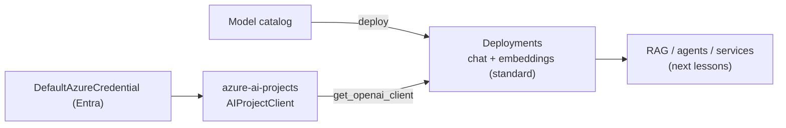

# Microsoft Foundry: Resource Model, Deployments and Inference

> **Where this fits.** This module adds generative AI to the platform. It is the fastest-moving area in Azure - product names and SDKs changed through 2025-2026 - so this lesson pins the current resource model and the SDK shape, with everything dated. Verify names against the portal you actually have before following any tutorial.

> **Naming (as of October 2026).** Azure AI Studio / Azure AI Foundry → **Microsoft Foundry**; Azure AI Services → **Foundry Tools**; the hub + Azure OpenAI + AI Services resources collapse into a single **Foundry resource** with **projects**. Existing **Azure OpenAI** resources can be upgraded to Foundry resources, keeping their endpoint and keys. Hub-based projects live on in **Foundry (classic)**. ([Foundry overview](https://learn.microsoft.com/azure/ai-foundry/what-is-azure-ai-foundry))

## 1. Lesson overview and learning objectives

By the end you can:

- Explain the **Foundry resource → project** model and the model **catalog**.
- Choose a **deployment type** (standard pay-per-token vs provisioned/PTU) and understand quotas/regions.
- Deploy a **chat** and an **embedding** model.
- Call them from Python with **`azure-ai-projects`** and **Entra** auth (no keys).

## 2. Prerequisites

| Need | Why | From |
|---|---|---|
| Entra auth + `DefaultAzureCredential` | Keyless inference | [Module 1](../azure-fundamentals/01-azure-fundamentals.md) |
| `azure-ai-projects>=2.3`, `openai>=3.0` | Current Foundry SDK | [docs](https://learn.microsoft.com/azure/ai-foundry/how-to/develop/sdk-overview) |
| A Foundry resource + project | The thing you deploy into | [Foundry quickstart](https://learn.microsoft.com/azure/foundry/quickstarts/get-started-code) |

## 3. Core concepts

### 3.1 Resource, project, catalog

A **Foundry resource** is the Azure resource; inside it you create **projects** (the unit of collaboration, connections, deployments, agents, indexes and evaluations). The **model catalog** offers models from Azure OpenAI/OpenAI, Meta, Mistral, Cohere, NVIDIA, Hugging Face and Microsoft; you **deploy** a model to get an endpoint to call. ([Foundry overview](https://learn.microsoft.com/azure/ai-foundry/what-is-azure-ai-foundry))

The project endpoint has the form `https://<resource>.services.ai.azure.com/api/projects/<project>`, and **Entra ID is the only supported auth** for the 2.x client. ([SDK overview](https://learn.microsoft.com/azure/ai-foundry/how-to/develop/sdk-overview))

### 3.2 Deployment types

| Type | Billing | Use |
|---|---|---|
| **Standard / Global Standard** | Per **token** (input + output) | Learning, variable load - the course default |
| **Provisioned (PTU)** | Reserved throughput, hourly **commitment** | Steady high-volume production with latency SLAs |

Each deployment has a **rate limit** (tokens/requests per minute) tied to your quota, which varies by **region** and model. New subscriptions often have small quotas; request increases as needed. For learning, always use **standard** (pay-per-token) - provisioned is a commitment you can forget and keep paying for.

### 3.3 Calling models from Python

The current SDK is **`azure-ai-projects` 2.x**, which returns an **OpenAI-compatible** client, so you use the familiar OpenAI SDK against your Foundry deployment ([SDK overview](https://learn.microsoft.com/azure/ai-foundry/how-to/develop/sdk-overview)):

```python
from azure.ai.projects import AIProjectClient
from azure.identity import DefaultAzureCredential

project = AIProjectClient(
    endpoint="https://<resource>.services.ai.azure.com/api/projects/<project>",
    credential=DefaultAzureCredential(),
)
client = project.get_openai_client()      # OpenAI-compatible (openai>=3.0)

# chat
resp = client.chat.completions.create(
    model="<chat-deployment>",             # your deployment name
    messages=[{"role": "user", "content": "Summarise the demand forecast contract."}],
)

# embeddings
emb = client.embeddings.create(model="text-embedding-3-large", input=["weekly demand forecast"])
vector = emb.data[0].embedding
```

Auth is `DefaultAzureCredential` - your `az login` locally, a managed identity in Container Apps (next lessons) - so **no API key** lives in code. The older `azure-ai-inference` package (`ChatCompletionsClient`/`EmbeddingsClient`) still exists; the project client's OpenAI-compatible path is the current recommendation.

> **Version caution.** `azure-ai-projects` is on the 2.x line (2.3.0+ for the new portal; 1.x targets Foundry classic) and moves quickly - pin a version and re-check the SDK overview when you upgrade.

### 3.4 Embeddings

An **embedding** maps text to a vector so similar text is near in vector space - the basis of vector search and RAG (next lesson). Foundry offers `text-embedding-3-large`/`-small` (and others); pick by quality vs cost/dimensionality, and **use one model consistently** for a given index (you cannot compare vectors from different models). Keep the interface swappable: develop with a local embedder, deploy with a Foundry embedding deployment ([`code/genai/rag.py`](../../code/genai/rag.py) shows that seam).

## 4. Architecture diagrams



## 5. Azure service mapping

| Need | Service / capability | Type | Where |
|---|---|---|---|
| GenAI platform | Microsoft Foundry (resource + projects) | Native service | [catalog](../../SERVICE_CATALOG.md) |
| Model hosting | Foundry model deployments | Native capability | §3.2 |
| SDK | `azure-ai-projects` + OpenAI-compatible client | Native + open source | §3.3 |
| Keyless auth | Entra ID + `DefaultAzureCredential` | Native capability | [Module 1](../azure-fundamentals/01-azure-fundamentals.md) |

## 6. Step-by-step implementation

```bash
# WSL - install the current SDK
pip install "azure-ai-projects>=2.3.0" "openai>=3.0.0" azure-identity
# Deploy a chat + an embedding model in the Foundry portal (standard), then:
python - <<'PY'
from azure.ai.projects import AIProjectClient
from azure.identity import DefaultAzureCredential
p = AIProjectClient(endpoint="https://<res>.services.ai.azure.com/api/projects/<proj>",
                    credential=DefaultAzureCredential())
c = p.get_openai_client()
print(c.embeddings.create(model="text-embedding-3-large", input=["hello"]).data[0].embedding[:3])
PY
```

## 7. Complete runnable code

The embedding **interface** the Azure client plugs into is the local, tested one in [`code/genai/rag.py`](../../code/genai/rag.py) (`Embedder` protocol + `HashingEmbedder` for offline dev). Swap `HashingEmbedder` for a thin wrapper that calls `client.embeddings.create(...)` to go live - the retrieval code is unchanged.

## 8. Expected outputs and verification

- The embeddings call returns a numeric vector; a chat call returns a completion. **Not run against a Foundry resource in the build** (no subscription); the SDK shape follows the current `azure-ai-projects` 2.x docs, dated October 2026.
- Local proxy: `python -m genai.rag` exercises the same `Embedder` interface offline.

## 9. Independent exercise

1. Write a `FoundryEmbedder` implementing the `Embedder` protocol in [`rag.py`](../../code/genai/rag.py) using `get_openai_client().embeddings`. What must stay identical for the vector store to work?
2. Decide standard vs provisioned for: (a) a prototype, (b) a chatbot with steady 24/7 load and a latency SLA. Justify.
3. Find the region/quota for `text-embedding-3-large` in your subscription; what fails first if you exceed the rate limit?

## 10. Common errors and troubleshooting

| Symptom | Cause | Fix |
|---|---|---|
| `401/403` calling a deployment | Missing Entra data role on the Foundry resource | Grant the right role (e.g. Azure AI user) to your identity |
| Tutorial code uses `azure.ai.inference` or a hub | Mix of old/classic SDKs | Match the SDK to your portal; prefer `azure-ai-projects` 2.x for the new portal |
| `429 Too Many Requests` | Deployment rate limit / quota | Back off and retry; raise quota; use Global Standard |
| Model not available in region | Regional availability | Deploy in a supported region; check the catalog |
| Surprise ongoing bill | Provisioned (PTU) deployment left up | Use standard for learning; delete provisioned deployments |

## 11. Security and cost considerations

- **Security**: Entra-only auth; no keys in code; scope roles on the Foundry resource; content filters and prompt-injection defences come in the agents/security lesson.
- **Cost**: **standard = pay per token** (measure tokens - next lessons); **provisioned = a standing commitment**. Model choice matters: a smaller/cheaper model may suffice for embeddings or simple chat.

## 12. Production best practices

- **Pin SDK versions**; this area changes fast - re-verify on upgrade.
- **Standard deployments for dev**, provisioned only for steady production with SLAs.
- **One embedding model per index**; never mix vectors from different models.
- **Keyless** everywhere; managed identity in deployed services.
- Keep model access behind an **interface** so you can swap models/providers.

## 13. Knowledge check

1. What replaced Azure AI Foundry / Azure AI Studio, and what is a Foundry "project"?
2. Standard vs provisioned deployment - which for learning, and why?
3. How do you call a Foundry chat/embedding deployment from Python today, and how do you authenticate?
4. Why must one index use a single embedding model?

<details>
<summary>Answers</summary>

1. **Microsoft Foundry**; a **project** is the collaboration unit inside a Foundry resource holding connections, deployments, agents, indexes and evaluations.
2. **Standard** (pay-per-token) for learning - no standing commitment; provisioned reserves throughput and bills hourly whether used or not.
3. `AIProjectClient(endpoint, DefaultAzureCredential())` → `get_openai_client()` → OpenAI SDK `chat.completions`/`embeddings`; auth is **Entra ID** (no key).
4. Vectors from different models aren't comparable, so mixing them makes similarity search meaningless.

</details>

## 14. Official documentation and further reading

- [What is Microsoft Foundry?](https://learn.microsoft.com/azure/ai-foundry/what-is-azure-ai-foundry) · [SDK overview](https://learn.microsoft.com/azure/ai-foundry/how-to/develop/sdk-overview)
- [Foundry SDK quickstart](https://learn.microsoft.com/azure/foundry/quickstarts/get-started-code) · [`azure-ai-projects` on PyPI](https://pypi.org/project/azure-ai-projects/)
- [Deployment types](https://learn.microsoft.com/azure/ai-foundry/concepts/deployment-overview) · [Embeddings models](https://learn.microsoft.com/azure/ai-foundry/concepts/models-featured)

**Next:** [Embeddings, Azure AI Search and RAG Ingestion](02-rag-and-ai-search.md).
