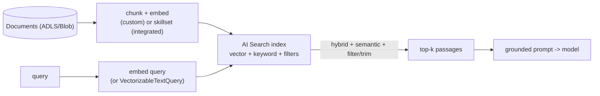

# Embeddings, Azure AI Search and RAG Ingestion

> **Where this fits.** RAG = retrieve relevant context, then generate grounded on it. The *retrieval* half decides answer quality: if the right passage isn't retrieved, no model can ground on it. This lesson builds retrieval - runnable locally - and maps it to Azure AI Search.

## 1. Lesson overview and learning objectives

By the end you can:

- **Chunk** documents sensibly and embed them.
- Build an index and run **vector**, **hybrid** and **semantic** queries.
- Choose **integrated vectorization** vs a **custom ingestion** pipeline.
- Apply **metadata filters** and **security trimming**.

Runnable core: [`code/genai/rag.py`](../../code/genai/rag.py). Azure mapping uses `azure-search-documents`.

## 2. Prerequisites

| Need | Why | From |
|---|---|---|
| Embedding deployment | Vectors for text | [Foundry lesson](01-foundry-models-and-inference.md) |
| `azure-search-documents` | The Azure path | docs below |
| Storage/formats | Where documents live | [Module 2](../storage-and-data-engineering/02-python-data-access.md) |

## 3. Core concepts

### 3.1 Chunking

Models and indexes work on passages, not whole documents. **Chunk** text into overlapping windows: small enough to be specific, with **overlap** so a sentence split across a boundary stays retrievable. [`chunk_text`](../../code/genai/rag.py) does word-window chunking with overlap; production often sizes by **tokens** and respects structure (headings, paragraphs). Too-large chunks dilute relevance; too-small chunks lose context - tune per corpus.

### 3.2 The runnable retrieval core

[`code/genai/rag.py`](../../code/genai/rag.py) is a full, offline RAG retriever: `chunk_text` → `Embedder.embed` → `VectorStore` (cosine) → `RagIndex.retrieve` → `build_prompt` (grounded prompt that tells the model to answer **only** from the context and say "I don't know" otherwise - the core anti-hallucination move). It runs with a deterministic `HashingEmbedder` so you develop and test retrieval with no Azure, then swap the embedder and store for Azure services. Verified: indexing the forecasting docs and querying "when is the model retrained" retrieves the retraining document.

### 3.3 Azure AI Search: vector, hybrid, semantic

Azure AI Search stores documents with vector and keyword fields and supports three retrieval modes ([vector search](https://learn.microsoft.com/azure/search/vector-search-overview)):

```python
from azure.search.documents import SearchClient
from azure.search.documents.models import VectorizedQuery
from azure.identity import DefaultAzureCredential

client = SearchClient("https://<svc>.search.windows.net", "forecast-docs", DefaultAzureCredential())

# vector: pass a precomputed embedding
vq = VectorizedQuery(vector=embedding, k_nearest_neighbors=5, fields="contentVector")
results = client.search(vector_queries=[vq])

# hybrid: vector + keyword in one call (usually best recall)
results = client.search(search_text="retraining policy", vector_queries=[vq])

# semantic ranking on top of hybrid (re-ranks with a language model)
results = client.search(search_text="retraining policy", vector_queries=[vq],
                        query_type="semantic", semantic_configuration_name="default")
```

**Hybrid** (keyword + vector) generally beats either alone; **semantic ranking** re-ranks the top results and can return captions/answers. Auth is `DefaultAzureCredential` (no key). ([hybrid search](https://learn.microsoft.com/azure/search/hybrid-search-overview), [semantic ranking](https://learn.microsoft.com/azure/search/semantic-search-overview))

### 3.4 Ingestion: integrated vectorization vs custom

- **Integrated vectorization**: Azure AI Search chunks and embeds for you via a **skillset** and **indexer**, and can **embed the query** at search time with `VectorizableTextQuery(text=...)` (you send text, the service vectorizes it). Least code; ties you to the service's chunkers/skills. ([integrated vectorization](https://learn.microsoft.com/azure/search/vector-search-integrated-vectorization))
- **Custom pipeline**: you chunk and embed (as in `rag.py`) and push documents to the index. More control (your chunking, your embedding model, your enrichment), more code. Use it when you need bespoke chunking or to reuse embeddings elsewhere.

**Incremental indexing**: re-index only changed documents (indexer change tracking, or your own high-watermark from [Module 4](../storage-and-data-engineering/06-incremental-cdc-and-testing.md)) - don't re-embed the whole corpus every run (embedding costs tokens).

### 3.5 Filters and security trimming

Store metadata (domain, source, ACL groups) as filterable fields and constrain queries with an **OData filter** (`filter="domain eq 'supply-chain'"`). **Security trimming** filters results to what the *caller* may see - e.g. an allowed-groups field intersected with the user's groups - so RAG never surfaces a passage the user couldn't open. This is the retrieval-side mirror of the ADLS ACL model ([Module 2](../storage-and-data-engineering/01-storage-and-access-control.md)).

## 4. Architecture diagrams



## 5. Azure service mapping

| Need | Service / capability | Type | Where |
|---|---|---|---|
| Retrieval engine | Azure AI Search (vector/hybrid/semantic) | Native service | §3.3 |
| Server-side ingest | Integrated vectorization (skillset + indexer) | Native capability | §3.4 |
| Local retrieval core | chunk + embed + cosine store | Custom (course) | [`rag.py`](../../code/genai/rag.py) |
| Access-aware results | Metadata filters + security trimming | Pattern | §3.5 |

## 6. Step-by-step implementation

**Locally (free): the whole retrieval core.**

```bash
# WSL / Python, from code/
python -m genai.rag        # chunk, embed, retrieve, build a grounded prompt
python - <<'PY'
from genai.rag import RagIndex, HashingEmbedder
from genai.evaluate import evaluate_retrieval
idx = RagIndex(HashingEmbedder()); idx.index_documents([
  {"id":"a","text":"weekly one-step-ahead demand forecast per product and store"},
  {"id":"b","text":"retraining is triggered by drift and accuracy decay"}])
print(evaluate_retrieval(idx, [{"query":"how often retrain","relevant":{"b"}}], k=2))
PY
```

**On Azure (billable - AI Search bills per unit-hour):** create an index with a vector field, ingest via integrated vectorization or push custom-embedded chunks, and query with `SearchClient` as in §3.3.

## 7. Complete runnable code

- [`code/genai/rag.py`](../../code/genai/rag.py): `chunk_text`, `HashingEmbedder`, `VectorStore`, `RagIndex`, `build_prompt`.
- [`code/genai/evaluate.py`](../../code/genai/evaluate.py): `recall_at_k`, `mrr`, `evaluate_retrieval`.
- Tests: [`code/tests/test_genai.py`](../../code/tests/test_genai.py).

## 8. Expected outputs and verification

- Local: indexing the forecasting docs and querying retrieves the right document; `evaluate_retrieval` reports recall@k and MRR (recall@k = 1.0 on the sample). Verified in the build (`python -m pytest tests/test_genai.py`).
- Azure AI Search queries return ranked hits; **not run against a service in the build** - the `azure-search-documents` shapes follow current docs.

## 9. Independent exercise

1. Add `source`/`domain` metadata to the indexed chunks and a filter to `retrieve`; confirm a filtered query excludes other domains (mirror of security trimming).
2. Compare retrieval with `chunk_size` 40 vs 120 on the course docs using `evaluate_retrieval`. Which gives better recall@k, and why?
3. Sketch the integrated-vectorization skillset for the forecasting docs (what splits, what embeds); when would you prefer the custom pipeline?

## 10. Common errors and troubleshooting

| Symptom | Cause | Fix |
|---|---|---|
| Irrelevant results | Pure vector or pure keyword | Use **hybrid**; add **semantic** re-ranking |
| Query vector mismatch | Different embedding model than the index | Use the same embedding model for index and query |
| Re-embedding whole corpus each run | No incremental indexing | Index only changed docs (indexer change tracking / watermark) |
| Users see passages they shouldn't | No security trimming | Filter on an allowed-groups field by the caller's groups |
| AI Search bills while idle | Any paid tier is always-on | Use Free tier for labs or delete after |

## 11. Security and cost considerations

- **Security**: keyless (`DefaultAzureCredential`); **security-trim** results; store only what you may expose.
- **Cost**: **Azure AI Search bills per unit-hour even idle** - the standing cost of this module; embeddings cost tokens per chunk, so **index incrementally**. Semantic ranking is billed additionally.

## 12. Production best practices

- **Hybrid + semantic** retrieval by default; tune chunking to the corpus.
- **One embedding model** for index and query; version it.
- **Incremental indexing**; never re-embed unchanged docs.
- **Filters + security trimming** so RAG respects access.
- Keep a **local retrieval core** behind the same interface for fast, offline iteration and tests.

## 13. Knowledge check

1. Why is retrieval quality the ceiling on RAG answer quality?
2. What does hybrid search combine, and what does semantic ranking add?
3. Integrated vectorization vs custom ingestion - one advantage of each.
4. What is security trimming and why does RAG need it?

<details>
<summary>Answers</summary>

1. If the relevant passage isn't retrieved, the model has nothing correct to ground on - generation can't recover missing context.
2. **Keyword + vector** search in one query; **semantic ranking** re-ranks the top results with a language model (and can return captions/answers).
3. Integrated: least code, service chunks/embeds for you. Custom: full control of chunking, embedding model and enrichment, and reusable embeddings.
4. Filtering results to what the **caller** is allowed to see (e.g. allowed-groups ∩ user groups) so RAG never surfaces content the user couldn't access.

</details>

## 14. Official documentation and further reading

- [Azure AI Search vector search](https://learn.microsoft.com/azure/search/vector-search-overview) · [Hybrid search](https://learn.microsoft.com/azure/search/hybrid-search-overview) · [Semantic ranking](https://learn.microsoft.com/azure/search/semantic-search-overview)
- [Integrated vectorization](https://learn.microsoft.com/azure/search/vector-search-integrated-vectorization) · [`azure-search-documents`](https://learn.microsoft.com/python/api/overview/azure/search-documents-readme)
- [RAG in Azure AI Search](https://learn.microsoft.com/azure/search/retrieval-augmented-generation-overview)

**Next:** [AI Services, Agents, Evaluation and Cost](03-agents-evaluation-and-cost.md).
