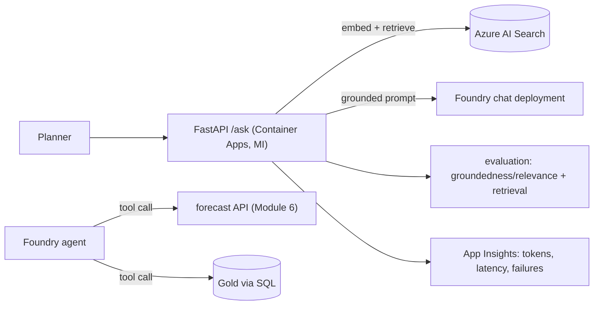

# AI Services, Agents, Evaluation and Cost

> **Where this fits.** You can deploy models (lesson 1) and retrieve context (lesson 2). This lesson ships a GenAI *feature*: a service that answers grounded questions, an **agent** that can call the forecasting platform's own tools, and - the part most teams skip - **evaluation**, **security** and **cost** control so it is safe and affordable to run.

## 1. Lesson overview and learning objectives

By the end you can:

- Serve a **grounded AI endpoint** from FastAPI on Container Apps with managed identity.
- Build a **Foundry agent** that calls **tools** (the forecast API, Gold data) with guardrails.
- **Evaluate** answers (groundedness/relevance) and retrieval (recall@k/MRR), and keep prompt **regression tests**.
- Defend against **prompt injection**, apply **content filters**, and bound **token and AI Search cost**.

## 2. Prerequisites

| Need | Why | From |
|---|---|---|
| Model deployments + RAG retrieval | The feature's engine | [Lesson 1](01-foundry-models-and-inference.md), [Lesson 2](02-rag-and-ai-search.md) |
| The FastAPI + Container Apps pattern | How we serve it | [Module 6](../azure-machine-learning/06-online-endpoints-and-fastapi.md) |
| The forecast API + Gold data | The agent's tools | [Module 6](../azure-machine-learning/05-batch-endpoints.md) |

## 3. Core concepts

### 3.1 A grounded AI service (FastAPI)

The serving pattern is the one from [Module 6](../azure-machine-learning/06-online-endpoints-and-fastapi.md): **FastAPI on Azure Container Apps**, scale-to-zero, reaching Foundry and AI Search by **managed identity** (no keys). A `/ask` endpoint: embed the question → retrieve from AI Search (lesson 2) → `build_prompt` (grounded, "answer only from context") → call the chat deployment → return the answer **with citations**. Validate inputs/outputs with Pydantic, and **stream** long responses (`stream=True`) for responsiveness. The retrieval core ([`rag.py`](../../code/genai/rag.py)) is the same offline-testable code; only the embedder and store become Azure services.

### 3.2 Agents and tool calling

An **agent** is a model given **instructions** and **tools** it may call to act, looping until it can answer. **Foundry Agent Service** hosts this; in `azure-ai-projects` 2.x agents are created through the project's `agents` client and built on the **OpenAI Responses** protocol ([SDK overview](https://learn.microsoft.com/azure/ai-foundry/how-to/develop/sdk-overview)):

```python
from azure.ai.projects import AIProjectClient
from azure.identity import DefaultAzureCredential

project = AIProjectClient(endpoint="https://<res>.services.ai.azure.com/api/projects/<proj>",
                          credential=DefaultAzureCredential())
agent = project.agents.create_version(
    agent_name="replenishment-helper",
    definition={  # PromptAgentDefinition: model + instructions + tools
        "model": "<chat-deployment>",
        "instructions": "Answer planners about demand. Use get_forecast for numbers; never invent figures.",
        "tools": [...],   # function tools: get_forecast(store,product), query_gold(sql)
    },
)
```

For the forecasting platform the useful **tools** are the Module 6 **forecast API** (`get_forecast`) and read-only **Gold** access (`query_gold`). Guardrails that matter: tools are **least-privilege and read-only**, the model is told to use tools for numbers rather than guess, and tool inputs are validated (the forecast service already rejects out-of-range inputs). An agent that can call a tool can act, so scope what the tool can do, not just what the model is asked.

### 3.3 Evaluation

GenAI needs evaluation as much as a model needs a backtest - "looks good" is not a metric. Two layers:

- **Retrieval** (offline, deterministic): recall@k and MRR with [`code/genai/evaluate.py`](../../code/genai/evaluate.py). If retrieval is poor, fix it before touching prompts.
- **Answer quality**: Foundry's **`azure-ai-evaluation`** evaluators - **groundedness** (is the answer supported by the retrieved context?), **relevance**, coherence, fluency, plus agent/tool-use evaluators - run over a dataset, in CI or in the portal. The package is standalone today and consolidating into `azure-ai-projects` 2.x ([evaluate agents](https://learn.microsoft.com/azure/ai-foundry/observability/how-to/evaluate-agent)):

```python
from azure.ai.evaluation import RelevanceEvaluator, GroundednessEvaluator, evaluate
# evaluate(data="qa.jsonl", evaluators={"groundedness": GroundednessEvaluator(model_config), ...})
```

**Prompt regression tests**: keep a fixed evaluation set and run it on every prompt/model change, so a "small tweak" that silently worsens groundedness fails the build (Module 7 CI). Trace requests to **Application Insights** for latency, tokens and failures.

### 3.4 Security: prompt injection and content filters

- **Prompt injection**: retrieved documents or user input may contain instructions ("ignore previous instructions…"). Defences: keep the **system instruction authoritative**, treat retrieved text as **data not instructions**, constrain the model to the context, give tools **least privilege**, and never let model output trigger a privileged action without validation. Azure provides **Prompt Shields** for jailbreak/indirect-injection detection.
- **Content filters**: Foundry applies configurable content filtering to inputs and outputs (hate, violence, self-harm, sexual, plus jailbreak detection); tune severity per use case.
- **Networking**: private endpoints for Foundry and AI Search for internal services (Module 9).

### 3.5 Cost

The two cost drivers:

- **Tokens**: you pay per input + output token on standard deployments. **Context size dominates** - stuffing 20 chunks when 4 suffice multiplies every request's cost. Measure **tokens per request** in evaluation runs; retrieve fewer, better chunks; cap output length.
- **Azure AI Search**: bills **per unit-hour even idle** on paid tiers - a standing cost. Use the Free tier for labs or delete after; semantic ranking is billed additionally.

Put a **budget + alert** on the resource group (Module 1). The expensive surprises here are a large `k` with a big model on every request, and an idle AI Search service left running.

## 4. Architecture diagrams



## 5. Azure service mapping

| Need | Service / capability | Type | Where |
|---|---|---|---|
| Serve the feature | FastAPI on Azure Container Apps | Open source on native service | [Module 6](../azure-machine-learning/06-online-endpoints-and-fastapi.md) |
| Agents + tools | Foundry Agent Service (`azure-ai-projects`) | Native capability | §3.2 |
| Answer evaluation | `azure-ai-evaluation` (groundedness, relevance) | Native + open source | §3.3 |
| Retrieval evaluation | recall@k / MRR | Custom (course) | [`evaluate.py`](../../code/genai/evaluate.py) |
| Safety | Content filters, Prompt Shields | Native capability | §3.4 |

## 6. Step-by-step implementation

**Locally (free): retrieval + grounded prompt + retrieval evaluation.**

```bash
# WSL / Python, from code/
python -m genai.rag        # retrieve + build a grounded prompt
python - <<'PY'
from genai.rag import RagIndex, HashingEmbedder
from genai.evaluate import evaluate_retrieval
idx = RagIndex(HashingEmbedder())
idx.index_documents([{"id":"r","text":"retrain on drift and accuracy decay; challenger must beat naive"},
                     {"id":"f","text":"weekly one-step forecast per store and product"}])
print(evaluate_retrieval(idx, [{"query":"when do we retrain","relevant":{"r"}}], k=2))
PY
```

**On Azure (billable - AI Search + tokens):** deploy the FastAPI `/ask` service to Container Apps (Module 6 pattern), create a Foundry agent with the forecast/Gold tools, and run `azure-ai-evaluation` over a QA set in CI.

## 7. Complete runnable code

- Retrieval + grounded prompt + metrics (runnable, tested): [`code/genai/rag.py`](../../code/genai/rag.py), [`code/genai/evaluate.py`](../../code/genai/evaluate.py), [`code/tests/test_genai.py`](../../code/tests/test_genai.py).
- The FastAPI serving pattern and managed identity are the tested [`code/forecast_service/`](../../code/forecast_service/) from Module 6; the agent and `azure-ai-evaluation` snippets here are illustrative (no Foundry resource in the build).

## 8. Expected outputs and verification

- Local: grounded prompt assembled with citations; `evaluate_retrieval` reports recall@k/MRR (1.0 on the sample). Verified in the build.
- Azure: `/ask` returns a cited answer; the agent calls `get_forecast` instead of inventing numbers; `azure-ai-evaluation` reports groundedness/relevance per row. **Not run against Foundry in the build**; SDK shapes follow the current (Oct 2026) `azure-ai-projects` 2.x / `azure-ai-evaluation` docs.

## 9. Independent exercise

1. Add an `/ask` route to the [`forecast_service`](../../code/forecast_service/) pattern: embed → retrieve → grounded prompt → chat, returning the answer plus the cited `doc_id`s. What do you validate on input and output?
2. Define the `get_forecast` tool's schema and the guardrails so the agent can read but never write. Why scope the tool, not just the prompt?
3. Build a 10-item QA set and describe how you'd gate a prompt change in CI on groundedness not dropping.

## 10. Common errors and troubleshooting

| Symptom | Cause | Fix |
|---|---|---|
| Confident wrong answers | Weak grounding / too few retrieved chunks | Strengthen the "answer only from context" instruction; improve retrieval |
| Agent invents numbers | Tool not used / not required | Instruct it to use the tool for figures; validate tool outputs |
| Injected instructions obeyed | Retrieved text treated as instructions | Keep system prompt authoritative; treat context as data; Prompt Shields |
| Token bill high | Large `k` / big context / long outputs | Retrieve fewer, better chunks; cap output; smaller model where adequate |
| AI Search cost while idle | Paid tier always-on | Free tier for labs; delete after |

## 11. Security and cost considerations

- **Security**: keyless (managed identity); least-privilege read-only tools; content filters + Prompt Shields; private networking for internal services (Module 9). Treat retrieved text and user input as untrusted.
- **Cost**: tokens scale with context - measure and minimise; AI Search is a standing per-unit-hour cost; budget + alert on the RG; standard (not provisioned) deployments for anything but steady production.

## 12. Production best practices

- **Ground every answer** and return **citations**; refuse when context is insufficient.
- **Agents with least-privilege tools**; validate tool I/O; the tool, not just the prompt, is the security boundary.
- **Evaluate retrieval and answers**; keep a fixed eval set as a **regression gate** in CI.
- **Trace tokens/latency/failures** to App Insights (Module 7).
- **Bound cost**: small `k`, capped output, right-sized model, Free/temporary AI Search, budgets.

## 13. Knowledge check

1. What is the core anti-hallucination move in a RAG prompt, and where is it in the course code?
2. Why is a tool's scope, not just the prompt, the security boundary for an agent?
3. Name two evaluation layers for a RAG feature and what each checks.
4. What are the two main cost drivers here, and how do you control each?

<details>
<summary>Answers</summary>

1. Instruct the model to answer **only from the provided context** and say "I don't know" otherwise (with citations) - in [`build_prompt`](../../code/genai/rag.py).
2. The model can be manipulated (prompt injection); if the tool itself can only read, a hijacked prompt still can't write - so constrain what the tool can do.
3. **Retrieval** (recall@k/MRR - was the right passage fetched?) and **answer quality** (groundedness/relevance - is the answer supported and on-topic?).
4. **Tokens** (control via smaller `k`, capped output, right-sized model) and **Azure AI Search unit-hours** (Free/temporary tier, delete when idle); budget + alert.

</details>

## 14. Official documentation and further reading

- [Foundry agents](https://learn.microsoft.com/azure/ai-foundry/agents/overview) · [SDK overview](https://learn.microsoft.com/azure/ai-foundry/how-to/develop/sdk-overview)
- [Evaluate generative AI](https://learn.microsoft.com/azure/ai-foundry/concepts/evaluation-approach-gen-ai) · [Evaluate agents](https://learn.microsoft.com/azure/ai-foundry/observability/how-to/evaluate-agent)
- [Prompt Shields / content safety](https://learn.microsoft.com/azure/ai-services/content-safety/concepts/jailbreak-detection) · [Content filtering](https://learn.microsoft.com/azure/ai-foundry/openai/concepts/content-filter)

**Next:** Module 9 (Enterprise Architecture, Security and Governance) in the [security roadmap](../security-and-costs/README.md).
