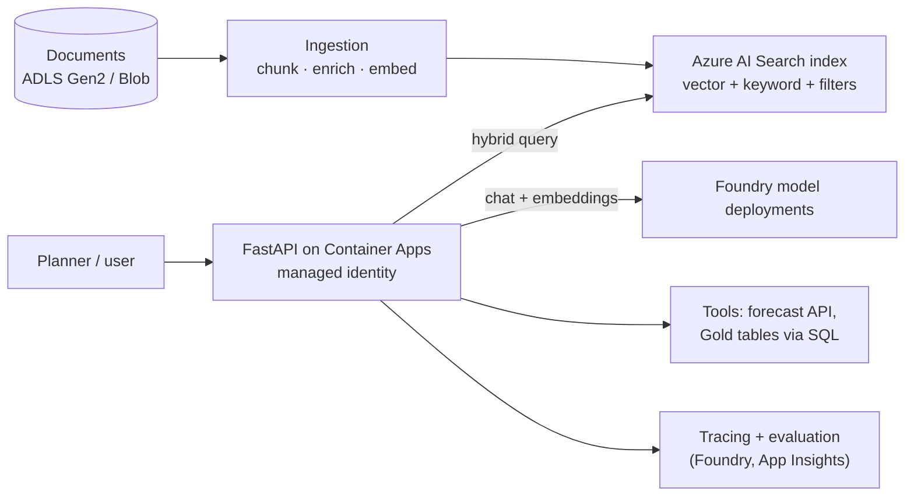

# Module 8 Roadmap: Azure AI and Generative AI

**Module 8 is built.** Its lessons are written and verified (links below); the terminology table and design further down record the current naming and the original plan.

**Module 8 (available):**
- [8.1-8.2 Foundry resource model, deployments and inference](01-foundry-models-and-inference.md)
- [8.3-8.4 Embeddings, Azure AI Search and RAG ingestion](02-rag-and-ai-search.md)
- [8.5-8.8 AI services, agents, evaluation and cost](03-agents-evaluation-and-cost.md)

The runnable, offline RAG core (chunk, embed, retrieve, ground, evaluate) is [`code/genai/`](../../code/genai/); Azure-side steps (Foundry deployments, AI Search, agents) are documented and verified against Microsoft Learn but not run against a subscription. Module 8 has no separate lab.

## Terminology check (verified October 2026)

Microsoft documents the following renames on the [Foundry overview page](https://learn.microsoft.com/azure/ai-foundry/what-is-azure-ai-foundry):

| Previous name | Current name |
|---|---|
| Azure AI Studio / Azure AI Foundry | **Microsoft Foundry** |
| Azure AI Services | **Foundry Tools** |
| Hub + Azure OpenAI + Azure AI Services resources | **Foundry resource** (single resource with projects) |

Hub-based projects remain available in the **Foundry (classic)** portal; Microsoft states new investment focuses on Foundry projects in the new portal. Existing **Azure OpenAI** resources can be upgraded to Foundry resources while keeping their endpoint and keys. When following any tutorial, first check which portal and resource model it assumes.

## Target RAG architecture

## Lessons (built - see links above)

| # | Lesson | Key content |
|---|---|---|
| 8.1 | Foundry resource model and portal | Resources, projects, model catalog, deployment types and regional availability, quotas |
| 8.2 | Model deployment and inference | Chat and embedding deployments, Entra ID auth with `DefaultAzureCredential`, rate limits |
| 8.3 | Embeddings and vector search | Chunking strategies, embedding choice, Azure AI Search vector/hybrid/semantic ranking |
| 8.4 | RAG ingestion pipelines | Integrated vectorisation vs custom pipeline, incremental indexing, metadata filters, security trimming |
| 8.5 | FastAPI AI service | Streaming responses, managed identity, input/output validation, Container Apps deployment |
| 8.6 | Agents and tools | Foundry Agent Service, tool calling into the forecasting API and Gold data, guardrails |
| 8.7 | Evaluation and observability | Groundedness/relevance evaluations, tracing, regression tests for prompts |
| 8.8 | Security and cost | Content filters, prompt injection defences, private networking, token budgets, AI Search unit costs |

## Cost warnings

- Azure AI Search bills per search unit-hour on any paid tier, even idle; delete after labs or use the Free tier where its limits allow.
- Token costs scale with context size: measure tokens per request in evaluation runs.
- Provisioned throughput is a commitment; use standard (pay-per-token) deployments for learning.

## Local alternatives

Develop retrieval logic locally with an open-source vector store and a small local embedding model, keeping the interfaces identical so you can swap in Azure AI Search and Foundry deployments.
