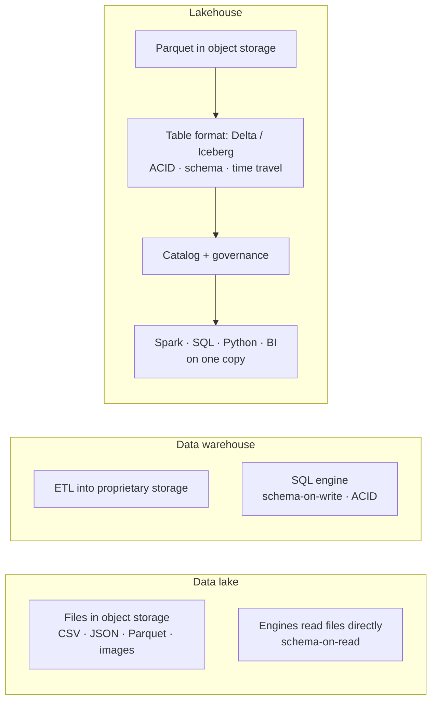
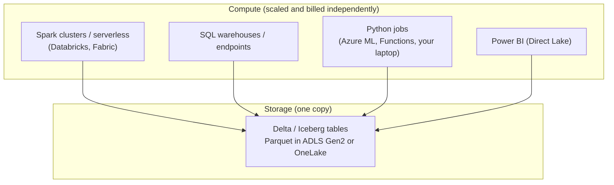
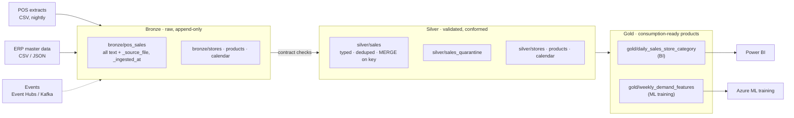
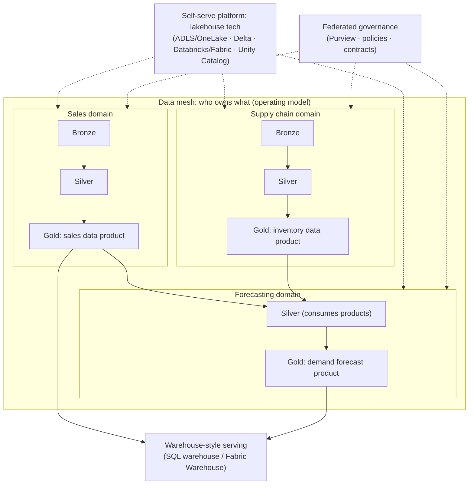
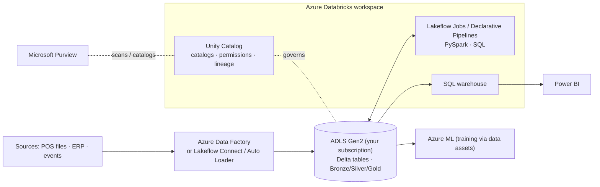
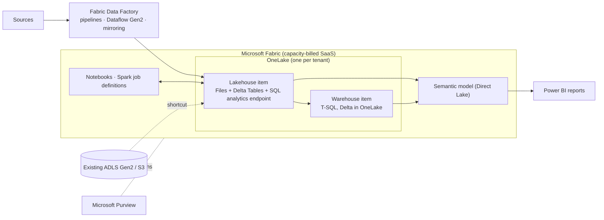

# Data Lakes, Warehouses, Lakehouses and the Medallion Architecture

> **Concept vs product.** *Data lake*, *data warehouse* and *lakehouse* are **architectural patterns**. *Medallion* is a **data organisation pattern** inside a lake or lakehouse. *Delta Lake* and *Apache Iceberg* are **open-source table formats**. *ADLS Gen2*, *Azure Databricks*, *Microsoft Fabric*, *Azure Synapse Analytics* and *Microsoft Purview* are **Azure products** that implement parts of these patterns. Keep the three layers apart and most vendor confusion disappears.

## 1. Lesson overview and learning objectives

As a data scientist you have probably consumed a warehouse through SQL and a lake through `pd.read_parquet`. This lesson explains *why* those systems look the way they do, so you can design the platform your models depend on, not just query it.

By the end you can:

- Define lake, warehouse, lakehouse and medallion precisely, and explain how they **complement** each other rather than compete.
- Explain how a table format (Delta Lake, Iceberg) delivers ACID transactions, schema enforcement and evolution, and time travel on top of Parquet files in object storage.
- Design Bronze, Silver and Gold layers for a real dataset, including keys, quality gates, partitioning and ownership.
- Choose between ADLS Gen2 + Azure Databricks, Microsoft Fabric (OneLake), and a hybrid, and explain how OneLake differs from an ADLS Gen2 account.
- Place batch and streaming ingestion, catalogs and lineage, data quality and observability in the architecture.
- Run a working medallion pipeline locally on Delta Lake, then point it at ADLS Gen2 without code changes.

## 2. Prerequisites

- [Azure Fundamentals](../azure-fundamentals/01-azure-fundamentals.md) (control vs data plane, RBAC, Entra auth).
- Comfortable with pandas, SQL and Parquet. Spark experience helps but is not required; the hands-on part uses `deltalake` (delta-rs), which needs no Spark or JVM.
- For the optional Azure step: [Lab 01](../../labs/lab-01-azure-setup/README.md) completed (storage account with hierarchical namespace and your data role).

## 3. Core concepts

### 3.1 The vocabulary, sorted by kind

| Term | Kind | The question it answers |
|---|---|---|
| Data lake | Architectural pattern | Where do I keep *all* data cheaply, in any format, for any future use? |
| Data warehouse | Architectural pattern (and product category) | How do I serve consistent, modelled, governed data for SQL analytics fast? |
| Lakehouse | Architectural pattern | Can I get warehouse guarantees (transactions, schemas, governance, SQL performance) directly on open files in the lake? |
| Medallion (Bronze/Silver/Gold) | Data organisation pattern | How do I stage data from raw to consumption-ready, with clear quality contracts per stage? |
| Data mesh | Socio-technical architecture and operating model | *Who* owns which data, and how do independent domains publish data others can trust? See the [data mesh lesson](../data-mesh/01-data-mesh.md). |
| Delta Lake, Apache Iceberg (and Apache Hudi) | Open table formats (OSS) | How do I make a folder of Parquet files behave like a transactional table? |
| ADLS Gen2, OneLake | Storage services | Where do the bytes live, and who can reach them? |
| Azure Databricks, Microsoft Fabric, Azure Synapse | Analytics platforms (products) | Which engines (Spark, SQL, BI) run over the data, and how are they billed and governed? |
| Unity Catalog, Microsoft Purview | Catalog and governance products | What exists, what does it mean, who may use it, and where did it come from? |

### 3.2 The data lake

A data lake stores data as files in **object storage** (on Azure: Blob Storage with hierarchical namespace, i.e. ADLS Gen2) and applies structure when reading (**schema-on-read**).

Strengths:
- Cheap, effectively unlimited storage; any format (CSV, JSON, Parquet, images, PDFs, audio).
- Many engines can read the same files (Spark, pandas/PyArrow, DuckDB, SQL engines).
- Raw history is preserved, which is gold for ML: you can rebuild features with new logic years later.

Classic failure modes ("data swamp"):
- **No transactions**: a job dies halfway through writing 200 files; readers see a partial dataset.
- **No schema enforcement**: an upstream system renames a column; downstream jobs silently produce nulls.
- **No updates/deletes**: GDPR erasure or late-arriving corrections mean rewriting whole partitions by hand.
- **Small-file problem**: streaming or frequent appends create millions of tiny files; every query pays the listing and open cost.
- **No catalog**: nobody knows what `/raw/export_v2_final/` contains or whether it is still maintained.

**Partitioning** (folder layout like `year=2025/month=03/`) lets engines skip files. Partition on low-cardinality columns that you filter on (date parts, region), never on high-cardinality IDs. Rule of thumb: aim for files in the ~100 MB to 1 GB range; partitions with a handful of KB-sized files hurt more than they help.

### 3.3 The enterprise data warehouse

A warehouse stores **modelled, schema-on-write** data in a database engine optimised for analytical SQL, typically columnar and **MPP** (massively parallel processing).

- Data is cleaned and conformed *before* loading. Typical modelling is **dimensional** (Kimball): fact tables (sales lines) and dimension tables (store, product, date) in **star schemas**, often with slowly changing dimensions.
- Strong guarantees: ACID transactions, constraints, fine-grained security, fast BI concurrency, mature tooling.
- Weaknesses for data science: proprietary storage (historically), cost of storing raw/semi-structured data, awkward access from Python at scale (export via ODBC/JDBC), and unstructured data does not fit.

On Azure: **Fabric Warehouse**, **Azure Synapse dedicated SQL pools**, **Azure Databricks SQL warehouses** (a lakehouse engine with warehouse-style serving) and, for smaller operational-analytical needs, **Azure SQL Database**.

### 3.4 The lakehouse

A lakehouse keeps data in **open file formats in object storage** and adds the missing database capabilities through a **transactional table format** plus a **catalog**, so that BI SQL, data engineering and ML all work on **one copy** of the data.

Defining characteristics:

1. **Open storage format** (Parquet data files) in low-cost object storage.
2. **Transactional metadata layer** (Delta Lake or Iceberg): ACID commits, snapshot isolation, schema enforcement, schema evolution, time travel, upserts/deletes.
3. **Separation of storage and compute**: many engines, scaled independently, can read and write the same tables.
4. **Catalog and governance**: tables have names, owners, permissions, lineage and documentation (Unity Catalog, OneLake catalog, Purview).
5. **Performance features** that close the gap with warehouses: file compaction, data skipping statistics, clustering, caching, vectorised engines.
6. **Support for diverse workloads**: SQL/BI, streaming, data science and ML on the same tables.

The lakehouse does **not** remove the need for modelling. Your Gold layer will still contain star schemas for BI; they are simply Delta/Iceberg tables in the lake instead of tables in a separate warehouse.



### 3.5 Open table formats: how files become tables

#### Delta Lake

A Delta table is a folder of Parquet data files plus a **transaction log** in `_delta_log/`:

```text
silver/sales/
├── _delta_log/
│   ├── 00000000000000000000.json   ← commit 0: protocol, schema, "add" actions
│   ├── 00000000000000000001.json   ← commit 1: MERGE adds/removes files
│   └── 00000000000000000010.checkpoint.parquet  ← periodic snapshot of log state
├── sales_year=2024/part-0000-....parquet
└── sales_year=2025/part-0000-....parquet
```

- **Atomicity**: a write creates new Parquet files, then commits by writing the next numbered JSON log file. Readers only see files referenced by committed log entries, so a crashed job leaves invisible orphans, not a half-written table.
- **Isolation and concurrency**: writers use **optimistic concurrency control**. Two writers race to create log file N; one wins, the other re-checks for conflicts and retries or fails.
- **Schema enforcement**: appends with incompatible columns or types are rejected. You saw this in the course tests (`test_schema_enforcement_rejects_incompatible_append`).
- **Schema evolution**: opt in explicitly (Spark `mergeSchema`, delta-rs `schema_mode="merge"`) to add columns.
- **Updates, deletes, MERGE**: implemented as copy-on-write of affected files, or with **deletion vectors** (mark rows deleted without rewriting files).
- **Time travel**: read an older version (`VERSION AS OF 3` or `TIMESTAMP AS OF ...`). Old files stay until **VACUUM** removes those older than the retention period (7 days by default), after which those versions can no longer be read.
- **Maintenance**: `OPTIMIZE` compacts small files; Databricks adds **liquid clustering** and predictive optimisation to manage layout automatically.
- **Change data feed (CDF)**: an optional row-level change log per commit, used for incremental downstream processing (Module 4).

Delta Lake is an open-source Linux Foundation project. Azure Databricks and Microsoft Fabric both use it as their default table format. ([Delta Lake docs](https://docs.delta.io/latest/index.html), [What is Delta Lake in Azure Databricks](https://learn.microsoft.com/azure/databricks/delta/))

#### Apache Iceberg

Iceberg reaches the same goals with a different metadata design: a **catalog** points at the table's current `metadata.json`, which references **manifest lists** (one per snapshot), which reference **manifests**, which reference data files with column statistics. Notable features are hidden partitioning (partition transforms the query writer does not need to know), partition evolution, and a strong multi-engine ecosystem (Spark, Trino, Flink, Snowflake, and others) built around the **REST catalog** specification. ([Apache Iceberg](https://iceberg.apache.org/docs/latest/))

#### Choosing, and not having to choose

| | Delta Lake | Apache Iceberg |
|---|---|---|
| Metadata | Ordered JSON log + Parquet checkpoints in `_delta_log` | Tree of metadata, manifest lists and manifests; catalog holds the current pointer |
| Catalog dependence | Table is self-describing from its folder | Needs a catalog to find the current snapshot reliably |
| Azure-native default | Yes: Azure Databricks, Microsoft Fabric | Supported via interoperability features |
| Strongest when | You are mainly on Databricks and/or Fabric | You share tables with many non-Azure engines (Snowflake, Trino, Flink) |

Interoperability on Azure:
- **OneLake table format virtualisation**: Microsoft documents that "Iceberg tables [can] be interpreted as Delta Lake tables, and vice versa" through metadata virtualisation, currently limited to Parquet data files and Iceberg V2 output, with conversion latency of seconds to a couple of minutes and some regional and private-link restrictions. ([Use Iceberg tables with OneLake](https://learn.microsoft.com/fabric/onelake/onelake-iceberg-tables))
- **Azure Databricks** can expose Delta tables to Iceberg readers (UniForm) and serves Iceberg clients through Unity Catalog. Databricks also added managed Iceberg tables; check the current release status in the [Databricks Iceberg docs](https://learn.microsoft.com/azure/databricks/iceberg/) before relying on it.

For this course: **Delta Lake by default**, Iceberg when an external consumer requires it.

### 3.6 Separation of storage and compute



Why it matters for ML teams:
- Training jobs on Azure ML read the same Silver/Gold tables BI uses, with no export step.
- You pay for compute only while it runs; storage is cheap. A forgotten cluster is the expensive mistake, not stored data.
- Workload isolation: a heavy backfill on one Spark cluster does not slow analysts' SQL warehouse.

### 3.7 The medallion architecture

Medallion is a **convention for organising tables by refinement level**. It is not a product feature, and three layers are a default, not a law.



| | Bronze | Silver | Gold |
|---|---|---|---|
| Purpose | Faithful, replayable copy of source data | Clean, typed, de-duplicated, conformed "single version of truth" at source grain | Business-level, use-case-shaped data products |
| Typical shape | Source schema (+ ingestion metadata). Often all strings or raw JSON. | Enforced schema, business keys, standard types and units | Aggregates, star schemas, feature tables |
| Write pattern | Append-only, incremental | MERGE/upsert on keys, SCD handling | Overwrite or incremental refresh |
| Quality | Minimal (file arrived, row counts) | **Contract-enforced** (types, nulls, ranges, referential integrity); bad rows quarantined | Business rules, reconciliation with finance, SLA freshness |
| Consumers | Data engineers, reprocessing | Data scientists (exploration, features), other domains | Analysts, BI, ML training/inference, applications |
| Retention | Long (replay); watch PII | Long | As required by consumers |
| Access | Restricted | Broader, governed | Broadest, often published as data products |

Design rules that save pain:
- **Bronze is immutable**. Never "fix" Bronze; fix the transformation and replay.
- **Silver keeps source grain** (one row per transaction or per day/store/product). Aggregation belongs in Gold.
- **Every Silver table has a declared business key** and an idempotent write (MERGE on the key), so reruns and late data are safe.
- **Quarantine, don't drop.** Rejected rows go to a quarantine table with a reason, and the batch fails if the reject rate breaches an agreed threshold.
- **Gold is shaped by consumers.** A feature table for forecasting and a star schema for Power BI are different Gold products built from the same Silver.
- **Medallion layers ≠ domains.** In a [data mesh](../data-mesh/01-data-mesh.md), each domain can run its own Bronze/Silver/Gold, and Gold (or Silver) tables become the domain's published data products.

Anti-patterns: a "Platinum" layer added because Gold became a dumping ground; Silver tables that are just Bronze with renamed columns; Gold tables that join across five domains without owners; using medallion folder names as the only form of access control.

### 3.8 Batch and streaming

| | Batch | Streaming |
|---|---|---|
| Latency | Minutes to days | Seconds to minutes |
| Typical source | Files, database extracts, APIs, CDC snapshots | Event Hubs / Kafka, IoT, CDC change streams |
| Azure options | Data Factory / Fabric Data Factory pipelines, Databricks Jobs, Fabric notebooks | Spark Structured Streaming on Databricks or Fabric, Databricks Auto Loader for files, Fabric Real-Time Intelligence (Eventstream, Eventhouse), Azure Stream Analytics |
| Into the lakehouse | Append to Bronze, MERGE to Silver | Streaming writes to Bronze Delta tables; incremental MERGE to Silver |

Most forecasting systems are batch (daily or weekly). Streaming earns its complexity when decisions are made in minutes: fraud, dynamic pricing, real-time inventory. Delta tables can be both a streaming sink and source, which avoids maintaining two separate code paths (the old *Lambda architecture* problem).

### 3.9 Catalogs, lineage, governance and discovery

Three layers of "catalog" are easy to conflate:

| Layer | What it does | Azure examples |
|---|---|---|
| **Technical metastore** | Maps table names to storage locations and schemas so engines can query `catalog.schema.table` | Unity Catalog metastore (Databricks), Fabric lakehouse/warehouse metadata, legacy Hive metastore |
| **Platform governance** | Permissions, row/column security, lineage, audit inside one platform | **Unity Catalog** ("the unified governance layer for data and AI built into Azure Databricks", automatically enabled for workspaces created after 9 Nov 2023), Fabric workspace roles and OneLake security |
| **Enterprise catalog and governance** | Discovery, business glossary, classification, data products, data quality and access requests *across* platforms | **Microsoft Purview Unified Catalog** (governance domains, data products, glossary terms, data quality, access requests) |

Sources: [Unity Catalog](https://learn.microsoft.com/azure/databricks/data-governance/unity-catalog/), [Purview Unified Catalog](https://learn.microsoft.com/purview/unified-catalog).

**Lineage** tells you which upstream tables and jobs produced a table and which reports and models depend on it. For ML this is how you answer "which models were trained on the data affected by last Tuesday's bug?" Unity Catalog captures lineage automatically for Databricks workloads; Purview aggregates lineage from supported sources; Azure ML records which data asset versions a job used (Module 5).

### 3.10 Data quality and data observability

**Data quality** = does the data meet explicit expectations? Encode them as checks that run *in the pipeline*:
- Schema: columns and types (enforced by the table format plus contract validation).
- Completeness: required fields not null.
- Validity: ranges, patterns, allowed values.
- Uniqueness: business key unique.
- Referential integrity: every `store_id` exists in `stores`.
- Consistency/reconciliation: Gold revenue equals finance's ledger within tolerance.

**Data observability** = continuously monitoring data health over time: freshness, volume, schema changes, distribution drift, lineage-aware alerting. For ML this overlaps with data drift monitoring (Module 7).

Tooling options:

| Option | Kind | Notes |
|---|---|---|
| Lakeflow Declarative Pipelines expectations (formerly Delta Live Tables) | Native (Azure Databricks) | Declarative `expect` / `expect_or_drop` / `expect_or_fail`. Databricks renamed several products in 2025; verify names in current docs. |
| Microsoft Purview Data Quality | Native (Purview) | Rules at governance domain, data product and asset level; scores roll up. |
| Great Expectations, Soda, pandera | Open source / third-party | Run anywhere Python runs, including Azure ML and Fabric notebooks. |
| This course's `quality.py` | Custom (~150 lines) | Reads the data contract and enforces it. Readable on purpose. |

### 3.11 Data sharing and avoiding duplication

Every copy of a dataset is a future inconsistency and a governance gap. Prefer **reference over copy**:

- **OneLake shortcuts**: "a reference to data stored in other file locations", inside OneLake, across workspaces, or in external stores such as ADLS Gen2 or Amazon S3, without copying. ([OneLake shortcuts](https://learn.microsoft.com/fabric/onelake/onelake-shortcuts))
- **Fabric mirroring**: continuously replicates operational databases (for example Azure SQL Database, Cosmos DB, Snowflake) into OneLake as Delta tables. This *is* a copy, but managed and near real-time.
- **Delta Sharing** (open protocol from Databricks) and Unity Catalog sharing: share live tables across organisations and platforms.
- **External tables / external locations** in Unity Catalog: govern data that stays in your own ADLS Gen2 account.
- **Single Gold product, many consumers**: publish once, grant access, instead of each team building its own extract.

### 3.12 How the concepts complement each other



- The **lake** is the storage substrate.
- The **lakehouse** makes that substrate transactional and governed.
- **Medallion** organises tables inside each lakehouse.
- **Warehouse** capabilities serve Gold to BI at high concurrency, either as a separate engine or as SQL endpoints on the same Delta tables.
- **Data mesh** decides who owns each lakehouse and its products, and how they interoperate.

## 4. Architecture diagrams

The diagrams above cover the concepts. Below are three concrete **Azure reference implementations** for the retail scenario.

### Option A: ADLS Gen2 + Azure Databricks + Unity Catalog



### Option B: Microsoft Fabric (OneLake)



### Option C: Hybrid (common in enterprises)

Databricks owns heavy data engineering and ML feature pipelines writing Delta to ADLS Gen2; Fabric exposes the same Gold tables to business users via OneLake shortcuts (or Unity Catalog mirroring) and Power BI Direct Lake; Purview provides the cross-platform catalog. One copy of data, two engines, one governance view.

## 5. Azure service mapping

### 5.1 Capability map

| Capability | ADLS Gen2 + Databricks | Microsoft Fabric | Synapse (existing estates) | Type |
|---|---|---|---|---|
| Storage | ADLS Gen2 account (you own it) | OneLake (tenant-wide, SaaS) | ADLS Gen2 | Native service |
| Table format | Delta Lake (default), Iceberg interop | Delta Lake (default), Iceberg via metadata virtualisation | Delta/Parquet via Spark; dedicated pools use internal storage | OSS integrated |
| Spark | Databricks clusters, serverless | Fabric Spark (notebooks, job definitions) | Synapse Spark pools | Native (managed OSS) |
| SQL serving | Databricks SQL warehouses | Lakehouse SQL analytics endpoint (read-only), Warehouse (read/write T-SQL) | Serverless SQL, dedicated SQL pools | Native |
| Orchestration | Lakeflow Jobs, Azure Data Factory | Fabric Data Factory pipelines | Synapse pipelines | Native |
| Platform governance | Unity Catalog | Workspace roles, OneLake security, domains | Workspace RBAC | Native |
| Enterprise catalog | Microsoft Purview | Microsoft Purview (deeply integrated) | Microsoft Purview | Native |
| BI | Power BI via SQL warehouse | Power BI Direct Lake | Power BI | Native |
| ML | Databricks ML / MLflow, or Azure ML | Fabric Data Science (MLflow-based), or Azure ML | Azure ML | Native |
| Billing | Databricks Units (DBU) + underlying VMs, or serverless DBUs; storage separately | Fabric capacity (F SKU, capacity units) + OneLake storage | Per-pool (dedicated: DWU hours; serverless: per TB processed; Spark: per vCore-hour) | — |

### 5.2 Azure Databricks vs Microsoft Fabric: terminology that does not line up

| Concept | Azure Databricks | Microsoft Fabric |
|---|---|---|
| Top-level container | Workspace (an Azure resource in your subscription) + Unity Catalog metastore (per region) | Tenant → **workspace** (a Fabric construct, not an Azure resource) assigned to a capacity |
| Storage | Your ADLS Gen2 (managed storage locations or external locations) | OneLake; each workspace appears as a container, each item as a folder |
| "Lakehouse" | The *architecture*; implemented as catalogs/schemas of Delta tables | A specific **item type** ("Lakehouse") with a `Files` area and a `Tables` area plus an auto-created SQL analytics endpoint |
| Warehouse | **SQL warehouse** = a *compute* endpoint for SQL over Delta tables | **Warehouse** = an *item* (data + T-SQL engine) storing Delta in OneLake |
| Namespace | `catalog.schema.table` | `workspace` → `lakehouse/warehouse` → `schema.table` |
| Compute | Clusters (classic, your VMs) and serverless | Shared capacity units consumed by all workloads in the capacity |
| Governance | Unity Catalog: grants, row filters, column masks, lineage, audit | Workspace roles, item permissions, OneLake security, domains, Purview integration |
| Pipelines | Lakeflow Jobs, Lakeflow Declarative Pipelines | Data Factory pipelines, Dataflow Gen2, notebooks |

Practical heuristics: Databricks shines for engineering-heavy teams, complex Spark and ML, multi-cloud, and fine-grained Unity Catalog governance. Fabric shines for Power BI–centric organisations, unified SaaS experience, low-ops analytics, and capacity-based predictable billing. Many enterprises run both. See the [Architecture Decision Guide](../../ARCHITECTURE_DECISION_GUIDE.md).

### 5.3 OneLake vs an ADLS Gen2 storage account

| | OneLake | ADLS Gen2 storage account |
|---|---|---|
| What it is | Fabric's built-in, tenant-wide lake. "Every Fabric tenant automatically gets one OneLake." You cannot create a second one or delete it. | An Azure resource you create in a subscription, as many as you like |
| Built on | ADLS Gen2 technology; "supports the same ADLS Gen2 APIs and SDKs" | — |
| Addressing | `onelake.dfs.fabric.microsoft.com`; each **workspace** looks like a container, each **item** like a folder | `<account>.dfs.core.windows.net`; you create containers and folders |
| Security model | Fabric workspace roles, item permissions, OneLake security roles | Azure RBAC + POSIX-style ACLs, storage firewall, private endpoints |
| Networking and keys | Managed by Fabric (tenant/workspace-level private links available) | Fully under your control (firewall, private endpoints, CMK) |
| Billing | OneLake storage billed with the Fabric capacity | Storage account pricing in your subscription |
| Table format | Tabular data stored as Delta Parquet | Any (you decide) |
| Reuse existing data | **Shortcuts** to ADLS Gen2, S3, other OneLake locations without copying | n/a |

Source: [OneLake overview](https://learn.microsoft.com/fabric/onelake/onelake-overview), [OneLake shortcuts](https://learn.microsoft.com/fabric/onelake/onelake-shortcuts).

### 5.4 Where Azure Synapse Analytics fits

Azure Synapse Analytics combines serverless and dedicated SQL pools, Spark pools and pipelines in one workspace, and remains a supported service you will find in many existing estates. ([What is Azure Synapse Analytics](https://learn.microsoft.com/azure/synapse-analytics/overview-what-is)). Microsoft's new analytics investment is concentrated in Microsoft Fabric, and Microsoft publishes guidance for migrating Synapse workloads to Fabric. *(Inference from Microsoft's product direction and migration documentation; the Synapse overview page itself does not discuss this.)* For new greenfield designs in this course, choose between Databricks and Fabric; learn Synapse when you need to operate or migrate an existing estate.

## 6. Step-by-step implementation

You will build the medallion pipeline in the diagram in section 3.7, locally, using real Delta tables. The same code then writes to ADLS Gen2.

**Where:** WSL / Ubuntu terminal, from the academy root folder.

**Step 1: create a virtual environment and install dependencies**

```bash
cd ~/src/azure-data-science-academy/code   # adjust to where you cloned/copied the academy
python3 -m venv .venv
source .venv/bin/activate
pip install -r requirements.txt
```

**Step 2: generate the synthetic retail data** (10 stores × 40 products × 2 years, about 246k POS rows with ~0.6% deliberately defective rows)

```bash
python retail_data/generate.py --out ../data/raw --seed 42
```

**Step 3: run Bronze → Silver → Gold**

```bash
python lakehouse_local/medallion.py all --raw ../data/raw --lake ../data/lake
```

**Step 4: run it again** and observe idempotency: Bronze skips already-ingested files, Silver MERGEs on the business key without creating duplicates.

```bash
python lakehouse_local/medallion.py all --raw ../data/raw --lake ../data/lake
python lakehouse_local/medallion.py history --lake ../data/lake --table silver/sales
```

**Step 5: explore with pandas and time travel** (in a notebook or Python REPL)

```python
from deltalake import DeltaTable
dt = DeltaTable("../data/lake/silver/sales")
print(dt.version(), dt.schema())
v0 = DeltaTable("../data/lake/silver/sales", version=0).to_pandas()   # time travel
q = DeltaTable("../data/lake/silver/sales_quarantine").to_pandas()
print(q["_reject_reason"].value_counts())
feat = DeltaTable("../data/lake/gold/weekly_demand_features").to_pandas()
print(feat.head())
```

**Step 6 (optional, Azure): write the same lakehouse to ADLS Gen2.** Requires Lab 01 resources and the *Storage Blob Data Contributor* role. Create a `lakehouse` container first (Lab 01 creates `bronze`, `silver`, `gold`; for this exercise one container is simpler):

```bash
az storage fs create --name lakehouse --account-name <yourStorageAccount> --auth-mode login
python lakehouse_local/medallion.py all --raw ../data/raw \
  --lake "abfss://lakehouse@<yourStorageAccount>.dfs.core.windows.net/retail"
```

Authentication uses your Azure CLI sign-in through delta-rs's `azure_use_azure_cli` option: no keys or SAS tokens. **Cost:** a few MB of storage and a few thousand transactions, which is cents at most. **Not verified in this build environment**, because it has no Azure subscription; the local path is covered by automated tests.

## 7. Complete runnable code

| File | What it does |
|---|---|
| [`code/retail_data/generate.py`](../../code/retail_data/generate.py) | Synthetic stores, products, calendar with holidays, POS sales with promotions, price elasticity, stock-outs and injected defects |
| [`code/contracts/sales.pos_sales.v1.yaml`](../../code/contracts/sales.pos_sales.v1.yaml) | Data contract for Silver sales (simplified ODCS v3) |
| [`code/contracts/forecasting.demand_features.v1.yaml`](../../code/contracts/forecasting.demand_features.v1.yaml) | Data contract for the Gold feature table |
| [`code/lakehouse_local/quality.py`](../../code/lakehouse_local/quality.py) | Contract-driven validation, quarantine and batch quality gate |
| [`code/lakehouse_local/medallion.py`](../../code/lakehouse_local/medallion.py) | Bronze ingest, Silver MERGE, Gold products, Delta history |
| [`code/tests/test_pipeline.py`](../../code/tests/test_pipeline.py) | Tests: determinism, incremental Bronze, quarantine, idempotent Silver, time travel, schema enforcement, lag features |

The core of the Silver step, for reading here:

```python
raw = read_table(lake, "bronze/pos_sales")
raw = raw.sort_values("_ingested_at").drop_duplicates(subset=SALES_KEYS, keep="last")
valid, rejected, report = quality.validate(raw[cols], contract, refs, max_quarantine_ratio)
if not report.passed:
    raise RuntimeError("Silver quality gate failed; nothing written.\n" + report.summary())

(DeltaTable(uri, storage_options=so)
   .merge(pa.Table.from_pandas(valid), predicate="t.date = s.date AND t.store_id = s.store_id AND t.product_id = s.product_id",
          source_alias="s", target_alias="t")
   .when_matched_update_all()
   .when_not_matched_insert_all()
   .execute())
```

**The same Silver step on Azure Databricks (PySpark).** Shown for comparison; *not executed in this build*. On Databricks you would normally use Unity Catalog table names instead of paths:

```python
from delta.tables import DeltaTable
from pyspark.sql import functions as F, Window

bronze = spark.read.table("retail.bronze.pos_sales")
w = Window.partitionBy("date", "store_id", "product_id").orderBy(F.col("_ingested_at").desc())
latest = (bronze.withColumn("_rn", F.row_number().over(w)).filter("_rn = 1").drop("_rn")
          .select(F.to_date("date").alias("date"), "store_id", "product_id",
                  F.col("units_sold").cast("int").alias("units_sold"),
                  F.col("unit_price").cast("double").alias("unit_price")))  # ... remaining columns

valid = latest.filter("units_sold >= 0 AND unit_price > 0")
(DeltaTable.forName(spark, "retail.silver.sales").alias("t")
   .merge(valid.alias("s"), "t.date = s.date AND t.store_id = s.store_id AND t.product_id = s.product_id")
   .whenMatchedUpdateAll().whenNotMatchedInsertAll().execute())
```

In a **Fabric notebook** the PySpark code is nearly identical; tables live in the attached Lakehouse (`spark.read.table("bronze_pos_sales")` or the `Tables/` path in OneLake).

## 8. Expected outputs and verification

First run of step 3 (numbers are deterministic with `--seed 42`):

```text
bronze: {"files_ingested": 24, "rows_ingested": 246492, "files_skipped": 0}
contract=7d1f3c52-sales-pos-sales in=245997 valid=244524 quarantined=1473 (0.599%) batch=PASSED
  [QUAR] referential  store_id                     failed_rows=489 stores.store_id
  [QUAR] range        units_sold                   failed_rows=492
  [QUAR] notNull      unit_price                   failed_rows=492
  [PASS] unique       date,store_id,product_id     failed_rows=0
  [PASS] rowCount     pos_sales                    failed_rows=0 rows=244524
  ... (other checks PASS)
gold: {"daily_sales_store_category": 30750, "weekly_demand_features": 42000}
```

Second run: `bronze: {"files_ingested": 0, "rows_ingested": 0, "files_skipped": 24}`, and `history` shows a `WRITE` at version 0 and a `MERGE` at version 1 with `num_target_rows_inserted: 0`.

Automated verification:

```bash
cd code && python -m pytest
# 9 passed
```

Checklist:
- [ ] `../data/lake` contains `bronze/`, `silver/`, `gold/` folders, each table with a `_delta_log/` directory.
- [ ] `silver/sales` has no duplicate `(date, store_id, product_id)` and no negative units.
- [ ] `silver/sales_quarantine` explains every rejected row in `_reject_reason`.
- [ ] Reading `silver/sales` at `version=0` works (time travel).
- [ ] `pytest` passes.

## 9. Independent exercise

**Part A: extend the pipeline.**
1. Add a Gold table `gold/stockout_rate_weekly` (by region, category, week) and a contract for it in `code/contracts/`.
2. Add a rule to the sales contract that `revenue` equals `units_sold * unit_price` within 0.01, implement it in `quality.py`, and add a test.
3. Simulate a late correction: edit one row in a copied POS file, ingest it under a new file name, rerun Silver and prove with `history` and time travel that the row was updated, not duplicated.

**Part B: scenario-based architecture choice.** For each scenario, choose Option A, B or C from section 4 (or something else), and justify it on data volume, workloads, governance, team skills, interoperability, performance and cost:

1. A 40-person retailer with a Power BI–savvy analytics team, no Spark engineers, 200 GB of data, wanting predictable monthly costs.
2. A global retailer with 80 data engineers, 400 TB, ML-heavy demand forecasting across 30 countries, existing Databricks expertise and strict column-level PII controls.
3. A company that already runs Databricks for engineering but whose finance department lives in Power BI and wants self-service on Gold tables without copies.

Suggested answers are discussed in the [Architecture Decision Guide](../../ARCHITECTURE_DECISION_GUIDE.md#scenario-walkthroughs).

## 10. Common errors and troubleshooting

| Symptom | Cause | Fix |
|---|---|---|
| `Silver quality gate failed` | Reject rate above `--max-quarantine-ratio` (default 1%) | Inspect the printed summary; fix the source or, if expected, raise the threshold deliberately |
| `Schema error` / `Cannot cast` on append | Delta schema enforcement | Fix the producer, or evolve schema explicitly with `schema_mode="merge"` |
| `Table not found` | Steps run out of order | Run `bronze` before `silver` before `gold`, or use `all` |
| Many tiny Parquet files after repeated runs | Each append/merge writes new files | `DeltaTable(path).optimize.compact()` then `vacuum()`; on Databricks `OPTIMIZE` and predictive optimisation |
| Time travel to an old version fails | `VACUUM` removed the files | Keep retention ≥ your reproducibility needs; for ML, snapshot training data explicitly (Module 5) |
| `403 AuthorizationPermissionMismatch` writing to `abfss://` | No data-plane role | Assign *Storage Blob Data Contributor* on the account, wait a few minutes |
| `Failed to get token` with `abfss://` | Not signed in to Azure CLI in WSL, or token expired | `az login --use-device-code`; check `az account show` |
| Spark: `ConcurrentAppendException` | Two writers changed the same files | Partition/cluster writes so jobs touch disjoint data, or retry |

## 11. Security and cost considerations

**Security**
- Bronze often holds raw PII. Restrict it to engineering identities; publish only Silver/Gold to consumers.
- Classify columns (the contract's `classification` field; Purview classifications) and apply column masks or views for sensitive data (Unity Catalog column masks, Fabric/warehouse security).
- Use identity-based access (Entra ID), not storage keys or SAS, for every engine. Databricks accesses ADLS Gen2 through an *access connector* managed identity governed by Unity Catalog.
- Remember **time travel retains deleted data** until `VACUUM`. For GDPR erasure, delete and then vacuum within your compliance window.

**Cost**
- Storage is cheap; **compute left running** is not. Databricks: set auto-termination on all-purpose clusters and prefer job clusters or serverless. Fabric: capacity bills while active; pause F-SKU capacities you do not need.
- Small files multiply transaction costs and slow queries; compact them.
- Avoid copying data between platforms; use shortcuts, external tables and sharing.
- Local first: everything in this lesson's hands-on part runs free on your laptop.

## 12. Production best practices

- Treat every Silver and Gold table as code: owned, versioned, tested, documented with a contract.
- Make all writes idempotent and every pipeline replayable from Bronze.
- Separate environments (dev/test/prod) by catalog or workspace *and* by storage, with CI promoting code, not data.
- Monitor freshness, volume and quality per table; alert owners, not a shared inbox.
- Prefer managed tables (catalog controls lifecycle) unless another platform needs to own the files.
- Schedule table maintenance (compaction, vacuum, statistics) or enable platform automation.
- Use Gold feature tables (or a feature store) as the *only* input to training pipelines, so the lineage from model to data is explicit.

## 13. Knowledge check

1. Which three capabilities does a table format add to Parquet files in a lake, and how does Delta implement atomic commits?
2. Why is Bronze kept as raw text in this course's pipeline?
3. Your Silver MERGE doubles the row count on rerun. What is wrong?
4. What is the difference between a Databricks *SQL warehouse* and a Fabric *Warehouse*?
5. Name two differences between OneLake and an ADLS Gen2 account.
6. When would you choose Iceberg over Delta on Azure?
7. A data scientist wants to train on data "as of last quarter's model release". Which features make this possible, and what can break it?

<details>
<summary>Answers</summary>

1. ACID transactions, schema enforcement/evolution and time travel (also updates/deletes/MERGE). Delta writes new data files, then commits by atomically creating the next numbered JSON file in `_delta_log`; readers only see committed files.
2. So ingestion never fails on bad types and the raw source is replayable exactly. Typing and validation happen in Silver, where failures are quarantined and explained.
3. The MERGE predicate does not match the business key (or the source has duplicates on the key). Match on the full key and de-duplicate the source first.
4. A Databricks SQL warehouse is compute that runs SQL over Delta tables governed by Unity Catalog. A Fabric Warehouse is an item that owns data (stored as Delta in OneLake) and provides full T-SQL read/write.
5. Any two: one per tenant vs many per subscription; SaaS managed by Fabric vs Azure resource you configure; Fabric workspace/item security vs Azure RBAC + ACLs; workspaces appear as containers; billed with Fabric capacity vs storage account billing; shortcuts.
6. When important consumers or producers are Iceberg-native (Snowflake, Trino, Flink, AWS services) and you want them to work with the tables without conversion; otherwise Delta is the Azure default.
7. Delta/Iceberg time travel (versions/timestamps) plus recorded data versions in the ML run. `VACUUM` with short retention breaks it; the robust approach is to record the table version in the run and keep retention long enough, or snapshot the training set.

</details>

## 14. Official documentation and further reading

- Storage: [ADLS Gen2 introduction](https://learn.microsoft.com/azure/storage/blobs/data-lake-storage-introduction) · [Best practices for ADLS Gen2](https://learn.microsoft.com/azure/storage/blobs/data-lake-storage-best-practices)
- Databricks: [What is a data lakehouse?](https://learn.microsoft.com/azure/databricks/lakehouse/) · [Medallion architecture](https://learn.microsoft.com/azure/databricks/lakehouse/medallion) · [Delta Lake](https://learn.microsoft.com/azure/databricks/delta/) · [Unity Catalog](https://learn.microsoft.com/azure/databricks/data-governance/unity-catalog/)
- Fabric: [OneLake overview](https://learn.microsoft.com/fabric/onelake/onelake-overview) · [Shortcuts](https://learn.microsoft.com/fabric/onelake/onelake-shortcuts) · [Iceberg in OneLake](https://learn.microsoft.com/fabric/onelake/onelake-iceberg-tables) · [Lakehouse overview](https://learn.microsoft.com/fabric/data-engineering/lakehouse-overview) · [Implement medallion architecture in Fabric](https://learn.microsoft.com/fabric/onelake/onelake-medallion-lakehouse-architecture)
- Synapse: [overview](https://learn.microsoft.com/azure/synapse-analytics/overview-what-is)
- Governance: [Purview Unified Catalog](https://learn.microsoft.com/purview/unified-catalog)
- Open formats: [Delta Lake](https://docs.delta.io/latest/index.html) · [Apache Iceberg](https://iceberg.apache.org/docs/latest/) · [delta-rs Python](https://delta-io.github.io/delta-rs/)
- Architecture: [Azure Architecture Center, analytics architectures](https://learn.microsoft.com/azure/architecture/data-guide/)

**Next:** [Data mesh](../data-mesh/01-data-mesh.md), which reuses this pipeline's contracts to build domain data products.
