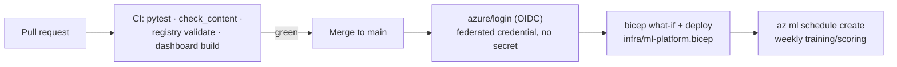

# CI/CD with GitHub Actions, OIDC and Infrastructure as Code

> **Where this fits.** Modules 5-6 built training, scoring and serving. MLOps is what makes them *operable*: every change tested automatically, deployments reproducible and secretless, infrastructure described in code. This lesson wires the repo to GitHub Actions and Azure.

## 1. Lesson overview and learning objectives

By the end you can:

- Run the course's **tests, content checks and contract compatibility** as CI on every pull request.
- Authenticate from GitHub Actions to Azure with **OIDC workload identity federation** - no client secret anywhere.
- Deploy the **ML platform** (workspace + dependencies) and the **training schedule** from **Bicep**, with a what-if preview in PRs.
- Compare Bicep and Terraform and know when each fits.

The real CI workflow is `.github/workflows/ci.yml`; the deploy workflow and `infra/ml-platform.bicep` are shown inline (they run only when Azure is configured).

## 2. Prerequisites

| Need | Why | From |
|---|---|---|
| The repo's tests + checks | They become the CI jobs | [`code/tests/`](../../code/tests/), `scripts/check_content.py` |
| A registered model + deployment YAML | CD deploys/schedules them | [Module 6](../azure-machine-learning/04-model-registry-and-release.md) |
| Lab 01's Bicep | The first IaC module | [`main.bicep`](../../labs/lab-01-azure-setup/infra/main.bicep) |
| Entra app or user-assigned identity | OIDC trust target | [Module 1](../azure-fundamentals/01-azure-fundamentals.md) |

## 3. Core concepts

### 3.1 CI for data and ML code

The repo already ships everything CI needs; CI just runs it on every change:

- **Unit tests** (`cd code && python -m pytest`): the forecasting baseline, scoring, service, monitoring, lakehouse and data-mesh tests - 42 at the time of writing.
- **Content checks** (`python3 scripts/check_content.py`): frontmatter, unique ids, internal links/anchors, lab checklists.
- **Contract governance** (`python data_mesh/registry.py validate`): the data products validate, and [`contract_compat.py`](../../code/data_mesh/contract_compat.py) can gate any change to `code/contracts/` so a breaking schema change needs a major version.
- **Dashboard** (`npm test && npm run build`): the content site stays green.

That is the whole of `ci.yml`: two jobs, no Azure credentials, because these checks are all local.

```yaml
# .github/workflows/ci.yml (excerpt)
jobs:
  python:
    runs-on: ubuntu-latest
    steps:
      - uses: actions/checkout@v4
      - uses: actions/setup-python@v5
        with: { python-version: "3.11" }
      - run: pip install -r code/requirements.txt
      - run: cd code && python -m pytest
      - run: python3 scripts/check_content.py
      - run: cd code && python data_mesh/registry.py validate
```

> **The ML-specific CI insight**: the most valuable checks are not on the model, they are on the **data and the contracts**. A broken contract or a failing backtest gate should fail the PR, not surface in production.

### 3.2 OIDC: GitHub to Azure with no secrets

Storing an Azure client secret in GitHub is the classic MLOps footgun. **Workload identity federation** removes it: GitHub mints a short-lived OIDC token for the run, and Azure exchanges it for an access token because you configured a **federated credential** that trusts that specific repo/branch/environment ([Connect from Azure with OIDC](https://learn.microsoft.com/azure/developer/github/connect-from-azure-openid-connect)).

Setup, once:

1. Create an Entra app registration (or a user-assigned managed identity) and give it least-privilege roles on the target resource group (e.g. Contributor on `rg-adsa-ml`, plus the data roles the pipeline needs).
2. Add a **federated credential** with a **subject condition** (e.g. `repo:<org>/<repo>:environment:production`); without a subject condition the trust is too broad. Audience: `api://AzureADTokenExchange`.
3. In the workflow, request the token and log in:

```yaml
# .github/workflows/deploy.yml (excerpt)
permissions:
  id-token: write      # lets the run FETCH an OIDC token; grants no resource access by itself
  contents: read
steps:
  - uses: azure/login@v2
    with:
      client-id: ${{ vars.AZURE_CLIENT_ID }}        # identifiers, not secrets
      tenant-id: ${{ vars.AZURE_TENANT_ID }}
      subscription-id: ${{ vars.AZURE_SUBSCRIPTION_ID }}
```

`client-id`/`tenant-id`/`subscription-id` are identifiers, so they can be repo **variables**; there is **no client secret**. Use a GitHub **environment** (`production`) with protection rules so deploys need approval.

### 3.3 Infrastructure as code

The platform should be reproducible from code, role assignments included. We use **Bicep** (Lab 01 started it). `infra/ml-platform.bicep` defines the workspace and its four dependents with the course's security defaults (HNS on, shared-key off, RBAC Key Vault, system-assigned workspace identity):

```bicep
resource workspace 'Microsoft.MachineLearningServices/workspaces@2024-04-01' = {
  name: workspaceName
  identity: { type: 'SystemAssigned' }
  properties: {
    storageAccount: storage.id
    keyVault: keyVault.id
    applicationInsights: appInsights.id
    containerRegistry: registry.id
  }
}
```

CD runs `az deployment group what-if` on PRs (a reviewable diff of what will change) and `az deployment group create` on merge. Keep the IaC idempotent so re-running is safe.

**Bicep vs Terraform.** Bicep is Azure-native, no state file to manage, first-class ARM coverage, free. Terraform is multi-cloud with an explicit state backend and a large provider ecosystem. For an Azure-only ML platform, Bicep is the lower-friction default; choose Terraform if your org standardises on it or you span clouds. ([Bicep overview](https://learn.microsoft.com/azure/azure-resource-manager/bicep/overview))

## 4. Architecture diagrams



## 5. Azure service mapping

| Need | Service / tool | Type | Where |
|---|---|---|---|
| CI/CD runner | GitHub Actions | Third-party (integrates with Azure) | `ci.yml` |
| Secretless auth | Workload identity federation + `azure/login` | Native capability | §3.2 |
| IaC | Bicep (ARM) | Native tooling | [`main.bicep`](../../labs/lab-01-azure-setup/infra/main.bicep) |
| Contract gate | `registry.py` / `contract_compat.py` | Custom (course) | [`code/data_mesh/`](../../code/data_mesh/) |

## 6. Step-by-step implementation

**Locally (free): run exactly what CI runs.**

```bash
# WSL, from the repo root
pip install -r code/requirements.txt
cd code && python -m pytest && cd ..
python3 scripts/check_content.py
cd code && python data_mesh/registry.py validate && cd ..
cd dashboard && npm test && npm run build && cd ..
```

**On GitHub/Azure:** commit `ci.yml` (runs immediately on PRs), then configure the federated credential and repo variables, and enable `deploy.yml`.

## 7. Complete runnable code

- CI workflow (runs on GitHub as-is): `.github/workflows/ci.yml`.
- Deploy workflow (OIDC + Bicep; runs when configured): `.github/workflows/deploy.yml`.
- IaC: `infra/ml-platform.bicep`, and Lab 01's [`main.bicep`](../../labs/lab-01-azure-setup/infra/main.bicep).
- Contract gate: [`contract_compat.py`](../../code/data_mesh/contract_compat.py), [`registry.py`](../../code/data_mesh/registry.py).

## 8. Expected outputs and verification

- The four local commands above pass (42 tests, 0 content errors, registry 0 errors, dashboard build). Verified in the course build.
- On GitHub, the `ci` checks appear on the PR and must be green to merge; `deploy` shows a what-if diff then applies it. **The GitHub/Azure runs were not executed in the build** (no remote/subscription); the workflows are valid YAML and use current action versions.

## 9. Independent exercise

1. Make `contract_compat.py` a **required** PR check that runs only when files under `code/contracts/` change (hint: `paths:` filter + compare base vs head). What should it block?
2. Add a `bicep` lint/what-if job that comments the diff on the PR.
3. Scope the deployment identity to the narrowest roles that still let CD deploy the workspace and create the schedule. List them.

## 10. Common errors and troubleshooting

| Symptom | Cause | Fix |
|---|---|---|
| `AADSTS70021` no matching federated credential | Subject condition doesn't match the run | Align the credential subject with the repo/branch/environment |
| `login` fails with "secret not found" | Using secret-based login | Switch to OIDC: `id-token: write` + `azure/login` with client/tenant/subscription |
| CI can't install `lightgbm` | Old Python on the runner | Pin `python-version: "3.11"` (wheels available) |
| what-if shows unexpected deletes | Drift between portal edits and IaC | Stop click-ops; make IaC the source of truth |
| Deploy succeeds but schedule missing | `ml` extension not added in the runner | `az extension add -n ml -y` before `az ml schedule create` |

## 11. Security and cost considerations

- **Security**: no stored secrets; federated credentials scoped by subject; least-privilege deployment identity; GitHub environment protection on `production`. This is the Module 1 identity model applied to CI.
- **Cost**: CI minutes are free for public repos; `what-if` is free. The deploy's cost is the resources it creates (Module 5 cost model).

## 12. Production best practices

- **Gate merges on CI**: tests + content + contract checks all green.
- **OIDC everywhere**; never a long-lived client secret in CI.
- **IaC is the source of truth**; review infra changes via what-if in PRs.
- **Separate environments** (dev/prod) with separate identities and federated-credential subjects.
- **Keep the contract check in CI**: data breaks production more often than code.

## 13. Knowledge check

1. Which CI checks matter most for an ML/data repo, and why?
2. What does `id-token: write` actually grant, and what does it *not*?
3. Why can `client-id`/`tenant-id`/`subscription-id` be variables rather than secrets?
4. When would you pick Terraform over Bicep here?

<details>
<summary>Answers</summary>

1. The **data and contract** checks (registry/contract compatibility) plus the backtest gate - a bad contract or a model that fails the gate breaks production more insidiously than a code bug.
2. It lets the run **fetch** a GitHub OIDC token; it grants **no** access to any resource by itself - access comes from the federated credential and the identity's roles.
3. They are **identifiers**, not credentials; the secretless property comes from having **no client secret/certificate** stored, because trust is federated.
4. When the org standardises on Terraform or you deploy across multiple clouds; otherwise Bicep is the lower-friction, state-free Azure-native choice.

</details>

## 14. Official documentation and further reading

- [GitHub Actions for Azure](https://learn.microsoft.com/azure/developer/github/github-actions) · [Connect from Azure with OpenID Connect](https://learn.microsoft.com/azure/developer/github/connect-from-azure-openid-connect)
- [Configure OIDC in Azure (GitHub docs)](https://docs.github.com/en/actions/how-tos/secure-your-work/security-harden-deployments/oidc-in-azure)
- [Bicep overview](https://learn.microsoft.com/azure/azure-resource-manager/bicep/overview) · [What-if deployments](https://learn.microsoft.com/azure/azure-resource-manager/bicep/deploy-what-if)

**Next:** [Production Pipelines, Scheduling and Monitoring](08-pipelines-and-monitoring.md).
