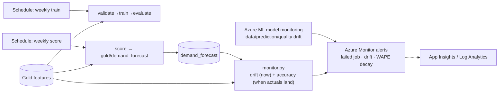

# Production Pipelines, Scheduling, Monitoring and Drift

> **Where this fits.** CI/CD ([previous lesson](07-cicd-and-iac.md)) ships changes safely. Now the system has to *run on its own and tell you when it is going wrong*: train weekly, score weekly, watch for drift, and raise accuracy alarms once actuals arrive. Forecasting has a twist most monitoring guides skip - **ground truth is delayed by weeks** - and this lesson handles it honestly.

## 1. Lesson overview and learning objectives

By the end you can:

- Schedule the training and scoring pipelines with `JobSchedule` + `RecurrenceTrigger`.
- Version training data via Delta table versions so a run is reproducible.
- Configure **Azure ML model monitoring** signals (data drift, prediction drift, data quality).
- Explain why forecasting needs a **custom accuracy monitor** on delayed actuals, and run the course's [`monitor.py`](../../code/forecasting/monitor.py).
- Route logs and alerts through **Azure Monitor / Application Insights**.

## 2. Prerequisites

| Need | Why | From |
|---|---|---|
| The training pipeline + scoring job | The things being scheduled | [Pipelines lesson](../azure-machine-learning/03-sweeps-components-and-pipelines.md), [batch lesson](../azure-machine-learning/05-batch-endpoints.md) |
| Gold features + forecast product | Monitoring inputs | [Lakehouse](../lakehouse/01-lake-warehouse-lakehouse-medallion.md), [Module 6](../azure-machine-learning/05-batch-endpoints.md) |
| `monitor.py` | Drift + accuracy signals | [`code/forecasting/monitor.py`](../../code/forecasting/monitor.py) |

## 3. Core concepts

### 3.1 Scheduling pipelines

A `JobSchedule` runs a pipeline (or command) job on a recurrence; schedules are **time-based** (no event triggers) ([Schedule pipeline jobs](https://learn.microsoft.com/azure/machine-learning/how-to-schedule-pipeline-job)):

```python
from azure.ai.ml.entities import JobSchedule, RecurrenceTrigger, RecurrencePattern

trigger = RecurrenceTrigger(frequency="week", interval=1,
                            schedule=RecurrencePattern(week_days=["Monday"], hours=4, minutes=0))
schedule = JobSchedule(name="weekly-train", trigger=trigger, create_job=pipeline_job)
ml_client.schedules.begin_create_or_update(schedule).result()
```

Our system has two schedules: **weekly training** (validate → train → evaluate, Module 5) and **weekly scoring** (the [`score-job`](../../labs/lab-06-model-deployment/), Module 6) that writes `gold/demand_forecast`. Both run on serverless/scale-to-zero compute, so a schedule costs only its runtime.

**Data versioning for reproducibility.** Delta tables are versioned, so a training run can pin the exact table version it read (`DeltaTable(path, version=N)`), and the job's lineage records it. "Which data trained model v7?" is then answerable - essential when you retrain weekly.

### 3.2 Azure ML model monitoring

Azure ML has built-in **model monitoring**: a `MonitorSchedule` runs signals on a serverless Spark compute and alerts on threshold breaches ([Monitor performance](https://learn.microsoft.com/azure/machine-learning/how-to-monitor-model-performance)):

```python
from azure.ai.ml.entities import (MonitorSchedule, MonitorDefinition, MonitoringTarget,
    DataDriftSignal, PredictionDriftSignal, DataQualitySignal, AlertNotification,
    ServerlessSparkCompute, RecurrenceTrigger)

monitor_def = MonitorDefinition(
    compute=ServerlessSparkCompute(instance_type="standard_e4s_v3", runtime_version="3.4"),
    monitoring_target=MonitoringTarget(ml_task="regression",
                                       endpoint_deployment_id="azureml:<endpoint>:<deployment>"),
    monitoring_signals={"drift": DataDriftSignal(...), "pred": PredictionDriftSignal(...),
                        "quality": DataQualitySignal(...)},
    alert_notification=AlertNotification(emails=["mlops@contoso.example"]),
)
ml_client.schedules.begin_create_or_update(
    MonitorSchedule(name="demand-monitor", trigger=RecurrenceTrigger(frequency="week", interval=1),
                    create_monitor=monitor_def))
```

The signals:

| Signal | Detects | Metric example |
|---|---|---|
| **Data drift** | Inputs shifted vs a reference (training) dataset | Jensen-Shannon distance, Pearson's chi-squared |
| **Prediction drift** | Output distribution shifted | Chi-squared on predicted classes/bins |
| **Data quality** | Nulls, out-of-bounds, type changes | null-value rate, out-of-bounds rate |

Built-in monitoring compares **collected inference data** (from a deployment) against a reference. It is the right tool for the online endpoint and for input drift on the scoring data.

### 3.3 The forecasting twist: delayed ground truth

Classification monitoring can often score accuracy quickly. **Demand forecasting cannot**: the actual units for the week you forecast arrive **a week or more later**. So:

- **Input/prediction drift**: use Azure ML model monitoring (or the course's PSI check) on the features and the forecast distribution - available immediately.
- **Accuracy**: must wait for actuals, then join forecasts to the realized `units`. This is domain logic you own. [`monitor.py`](../../code/forecasting/monitor.py) does both: `feature_drift` (PSI per feature; > 0.25 = significant) and `accuracy_report` (join `gold/demand_forecast` to the actuals in `gold/weekly_demand_features`, compute realized WAPE/bias, flag retrain). When no actuals exist yet it says so rather than inventing a number.

```bash
# WSL / Python, from code/
python -m forecasting.monitor drift --reference <training_gold> --current <latest_gold>
python -m forecasting.monitor accuracy --forecast ../data/lake/gold/demand_forecast \
  --actuals ../data/lake/gold/weekly_demand_features
```

### 3.4 Logging and alerting

The workspace's **Application Insights** (a dependent resource) collects job and endpoint telemetry; **Azure Monitor** holds metrics and logs (Log Analytics, queried with KQL) and fires **alerts** ([Azure Monitor overview](https://learn.microsoft.com/azure/azure-monitor/overview)). Practical signals to alert on: a failed scheduled job, a scoring job that wrote zero rows, a drift breach, and realized WAPE above target. Keep logging sampled and retention bounded - verbose logs can cost more than the thing they watch.

## 4. Architecture diagrams



## 5. Azure service mapping

| Need | Service / capability | Type | Where |
|---|---|---|---|
| Recurring runs | `JobSchedule` + `RecurrenceTrigger` | Native capability | §3.1 |
| Built-in drift | Azure ML model monitoring | Native capability | §3.2 |
| Accuracy on delayed truth | Custom monitor (PSI + WAPE) | Custom (course) | [`monitor.py`](../../code/forecasting/monitor.py) |
| Telemetry + alerts | Azure Monitor + Application Insights | Native service | §3.4 |
| Reproducible inputs | Delta table versions | Open source | [lakehouse](../lakehouse/01-lake-warehouse-lakehouse-medallion.md) |

## 6. Step-by-step implementation

**Locally (free): the drift and accuracy signals.**

```bash
# WSL / Python, from code/ - compare a past Gold version against the latest (drift)
python -m forecasting.monitor drift \
  --reference ../data/lake/gold/weekly_demand_features \
  --current  ../data/lake/gold/weekly_demand_features
# accuracy once actuals exist for the forecast weeks
python -m forecasting.monitor accuracy \
  --forecast ../data/lake/gold/demand_forecast \
  --actuals  ../data/lake/gold/weekly_demand_features
```

**On Azure (billable while running):** create the `JobSchedule`s and a `MonitorSchedule`, wrap `monitor.py` in a scheduled command job, and add Azure Monitor alert rules on failures and WAPE decay.

## 7. Complete runnable code

- Monitoring (runnable + tested): [`code/forecasting/monitor.py`](../../code/forecasting/monitor.py), tests in [`code/tests/test_monitor.py`](../../code/tests/test_monitor.py).
- Scheduled scoring job: [`score-job.yml`](../../labs/lab-06-model-deployment/) (schedule it with `az ml schedule create`).

## 8. Expected outputs and verification

- `monitor drift` on a table vs itself reports all PSI ≈ 0, `n_drifted: 0`. A shifted feature pushes PSI above 0.25 and lists it under `drifted` (see tests). Verified in the build.
- `monitor accuracy` with no overlapping actuals returns `matched: 0` and the delayed-ground-truth note (honest, not a fake score); with actuals it returns realized WAPE/bias and the retrain flag.
- Azure ML monitoring + schedules were **not** run against a subscription; SDK shapes follow current docs cited inline.

```bash
cd code && python -m pytest tests/test_monitor.py   # 7 passed in the build
```

## 9. Independent exercise

1. Add a **prediction-drift** check to `monitor.py`: PSI between last week's forecast distribution and this week's. What reference do you use?
2. Schedule `monitor.py` as a weekly command job that writes a drift/accuracy report to the lake and fails (nonzero exit) when retrain is recommended. What should the alert rule watch?
3. Pin a training run to a specific Delta version and record it in the model's tags. How does that help an incident investigation?

## 10. Common errors and troubleshooting

| Symptom | Cause | Fix |
|---|---|---|
| Accuracy report always `matched: 0` | Actuals for the forecast week not in yet | Expected for a future forecast; re-run after the week closes |
| PSI huge for a feature with few values | Too many bins for the data | PSI uses reference quantile bins; sparse features naturally have fewer |
| Model monitor finds no data | No inference data collected from the deployment | Enable data collection on the online/batch deployment first |
| Schedule created but never runs | Disabled, or start time in the past/timezone off | Check the schedule's state and timezone |
| Alert storm | Thresholds too tight / no grouping | Tune thresholds; group and suppress |

## 11. Security and cost considerations

- **Security**: monitoring reads the lake and inference data by identity; alerts go to a team alias, not individuals.
- **Cost**: schedules bill only their runtime on scale-to-zero compute; Azure ML model monitoring runs a **serverless Spark** job per evaluation (not free - size and frequency it deliberately); Log Analytics bills per GB ingested, so sample and set retention.

## 12. Production best practices

- **Schedule train and score separately**; keep both on scale-to-zero compute.
- **Monitor inputs now, accuracy later**: don't block on ground truth for drift; don't fake accuracy before actuals.
- **Version the training data**; record the version on the model.
- **Alert on the business signal** (WAPE decay, zero-row scoring) as well as infra failures.
- **Bound logging cost** with sampling and retention.

## 13. Knowledge check

1. Why can't you measure forecast accuracy at scoring time, and what do you do instead?
2. What does Azure ML model monitoring compare, and what must be enabled for it to work?
3. What is PSI, and what value signals significant drift?
4. Which signals should page the on-call, beyond "a job failed"?

<details>
<summary>Answers</summary>

1. The actual demand for a forecast week arrives **weeks later** (delayed ground truth). You monitor **input/prediction drift** immediately and compute **accuracy** once actuals land, by joining forecasts to realized units.
2. Collected **inference data** from a deployment against a **reference** (usually training) dataset; you must enable **data collection** on the deployment.
3. **Population Stability Index** - a binned distribution-shift metric; **> 0.25** is significant (0.1-0.25 moderate).
4. Drift breaches, **realized WAPE above target**, and a scoring run that wrote **zero rows** - business-meaningful failures, not just infra errors.

</details>

## 14. Official documentation and further reading

- [Schedule pipeline jobs](https://learn.microsoft.com/azure/machine-learning/how-to-schedule-pipeline-job) · [`JobSchedule`](https://learn.microsoft.com/python/api/azure-ai-ml/azure.ai.ml.entities.jobschedule)
- [Model monitoring concept](https://learn.microsoft.com/azure/machine-learning/concept-model-monitoring) · [Monitor model performance](https://learn.microsoft.com/azure/machine-learning/how-to-monitor-model-performance)
- [Azure Monitor overview](https://learn.microsoft.com/azure/azure-monitor/overview)

**Next:** [Retraining, Lineage and the MLOps Loop](09-retraining-and-lineage.md).
