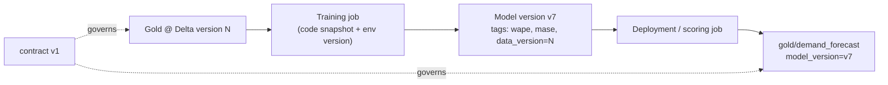
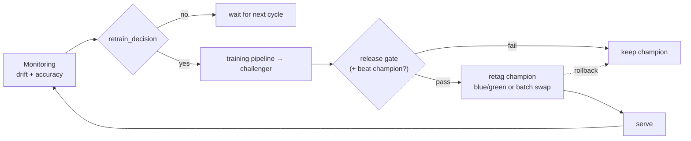

# Retraining Policy, Lineage and the MLOps Loop

> **Where this fits.** The pieces exist: CI/CD, scheduled training and scoring, monitoring. This lesson makes them a **loop** - monitoring decides when to retrain, a challenger is promoted or rejected on the same gate as before, and every deployed model traces back to the exact data and code that made it. Then we add up the bill.

## 1. Lesson overview and learning objectives

By the end you can:

- Define a **retraining policy** from schedule + drift + accuracy signals, and express it as code ([`monitor.retrain_decision`](../../code/forecasting/monitor.py)).
- Promote a **challenger** to champion safely, with a one-command **rollback**.
- Keep **end-to-end lineage**: data version → job → model version → deployment, plus the contract and code snapshot.
- Estimate the **monthly cost** of running the forecasting platform.

## 2. Prerequisites

| Need | Why | From |
|---|---|---|
| Monitoring signals | They trigger retraining | [Monitoring lesson](08-pipelines-and-monitoring.md) |
| The release gate + champion tag | Promotion reuses them | [Registry lesson](../azure-machine-learning/04-model-registry-and-release.md) |
| Blue/green deployment | Safe challenger rollout | [Online endpoints lesson](../azure-machine-learning/06-online-endpoints-and-fastapi.md) |

## 3. Core concepts

### 3.1 Retraining policy

Retraining on a fixed schedule alone is wasteful (retraining a healthy model) or dangerous (waiting a week while accuracy rots). Combine three triggers:

| Trigger | Signal | From |
|---|---|---|
| **Scheduled** | Weekly cadence matching new data | `JobSchedule` (Module 7) |
| **Drift** | Feature PSI > 0.25 on important features | `monitor.feature_drift` |
| **Accuracy decay** | Realized WAPE above target once actuals land | `monitor.accuracy_report` |

[`monitor.retrain_decision(accuracy, drift)`](../../code/forecasting/monitor.py) combines the last two into a single boolean with reasons, so a scheduled monitoring job can decide: *proceed with the scheduled retrain, or trigger an off-cycle one, and say why.* Encoding the policy as a tested pure function means "why did it retrain?" is always answerable.

### 3.2 Champion/challenger, safely

Retraining produces a **challenger**. It must pass the **same release gate** as the champion did (MASE < 1, WAPE ≤ 0.30, |bias| ≤ 0.05; Module 6), and ideally beat the current champion's recorded WAPE. Then roll it out safely:

- **Batch** (our main path): swap the scoring job's model version behind the same contract; compare one cycle's forecasts before retagging champion.
- **Online**: deploy the challenger as **green**, shift traffic gradually (`blue=90 green=10` → `50/50` → `100`), and **roll back by setting green to 0** if it misbehaves.

Promotion is just **retagging** the version `stage=champion` (and demoting the old one); rollback is retagging back and redeploying the previous version. Keep at least the last known-good version registered.

```python
# conceptual: triggered by the monitoring job when retrain_decision says so
decision = retrain_decision(accuracy_report(...), feature_drift(...))
if decision["retrain"]:
    submit_training_pipeline()      # produces a challenger
    # register_model.py gates + registers + tags champion only if it passes
```

### 3.3 Lineage and reproducibility

An auditable system can answer, for any forecast: *which model made it, from which data, trained by which code?* Azure ML records most of this automatically; you add the data version:



- **Data version**: pin and tag the Delta version the job read.
- **Code + environment**: the job snapshots the code and records the environment version.
- **Model tags**: carry metrics, the producing job, and the data version.
- **Output stamp**: `demand_forecast` carries `model_version`, so a bad forecast week traces to a model and its inputs.
- **Contract version**: both ends are governed by a versioned contract (Module 3).

### 3.4 What the platform costs to run

A rough monthly estimate for the forecasting platform at this scale (confirm with the [pricing calculator](https://azure.microsoft.com/pricing/calculator/)):

| Component | Driver | Rough monthly cost |
|---|---|---|
| Weekly training (serverless CPU, minutes) | 4 runs | low single-digit USD |
| Weekly scoring (scale-to-zero cluster) | 4 runs | low single-digit USD |
| Container Registry (Basic) | standing | a few USD |
| Storage (Delta tables) | GBs | cents-low USD |
| Model monitoring (serverless Spark) | 4 runs | moderate; size it |
| Log Analytics ingestion | volume | tune sampling/retention |
| **Online endpoint** (if kept) | per instance, 24/7 | **the big one - delete if unused** |

The design keeps the standing cost tiny (ACR + storage) and everything else scale-to-zero. The single largest avoidable cost is a managed online endpoint left deployed.

## 4. Architecture diagrams



## 5. Azure service mapping

| Need | Service / capability | Type | Where |
|---|---|---|---|
| Retrain trigger | Monitoring signals → `retrain_decision` | Custom (course) | [`monitor.py`](../../code/forecasting/monitor.py) |
| Safe rollout/rollback | Blue/green traffic, champion tag | Native capability | [Online endpoints](../azure-machine-learning/06-online-endpoints-and-fastapi.md) |
| Lineage | Job/model/deployment lineage + Delta versions | Native + open source | §3.3 |
| Cost control | Scale-to-zero, budgets, endpoint cleanup | Native capability | [Module 1](../azure-fundamentals/01-azure-fundamentals.md) |

## 6. Step-by-step implementation

**Locally (free): the retrain decision from real signals.**

```bash
# WSL / Python, from code/
python - <<'PY'
from forecasting.monitor import feature_drift, accuracy_report, retrain_decision
from forecasting.train import load_gold
gold = "../data/lake/gold/weekly_demand_features"
drift = feature_drift(load_gold(gold), load_gold(gold))          # self vs self: no drift
acc = accuracy_report(load_gold("../data/lake/gold/demand_forecast"), load_gold(gold))
print(retrain_decision(acc, drift))                               # {'retrain': False, 'reasons': []}
PY
```

**On Azure:** a scheduled monitoring command job runs the above against the latest data, and on `retrain: True` submits the training pipeline; `register_model.py` gates and promotes the challenger.

## 7. Complete runnable code

- Retrain decision (runnable + tested): [`code/forecasting/monitor.py`](../../code/forecasting/monitor.py) (`retrain_decision`), tests in [`code/tests/test_monitor.py`](../../code/tests/test_monitor.py).
- Gate + champion tagging: [`register_model.py`](../../labs/lab-06-model-deployment/), [`evaluate.py`](../../code/forecasting/evaluate.py).

## 8. Expected outputs and verification

- On the seed-42 data the retrain decision is `{'retrain': False, 'reasons': []}` (no drift self-vs-self, no actuals yet). Injecting a shifted feature or a high realized WAPE flips it to `True` with reasons (see tests). Verified in the build.
- The Azure retrain loop and promotion were **not** run against a subscription; they compose the verified Module 5-7 SDK pieces.

```bash
cd code && python -m pytest tests/test_monitor.py tests/test_forecasting.py
```

## 9. Independent exercise

1. Extend `retrain_decision` with a "beat the champion by ≥ 2% WAPE" rule before promotion. Where does the champion's WAPE come from?
2. Write the runbook for "forecast accuracy alert fired": the steps from alert to either a promoted challenger or a documented no-action.
3. Draw the lineage for one bad forecast week back to its data version, and list what you'd inspect at each hop.

## 10. Common errors and troubleshooting

| Symptom | Cause | Fix |
|---|---|---|
| Retrains every week regardless | Schedule-only policy | Add drift/accuracy conditions via `retrain_decision` |
| Challenger worse than champion reaches prod | No "beat champion" check | Gate on improvement vs the champion's recorded metric |
| Can't reproduce an old model | Data version not recorded | Pin + tag the Delta version on every training run |
| Rollback is slow/manual | Previous version not kept/deployable | Keep the last known-good version registered; rollback = retag + redeploy |
| Surprise monthly bill | Online endpoint left running | Delete unused endpoints; budget + alert on the serving RG |

## 11. Security and cost considerations

- **Security**: promotion and rollback are RBAC-gated changes recorded in the registry; lineage supports audit.
- **Cost**: the loop is cheap by design (scale-to-zero train/score/monitor); the one large avoidable cost is an idle online endpoint. Put a budget on the platform resource group (Module 1) and alert on it.

## 12. Production best practices

- **Policy as code**: a tested `retrain_decision`, not a cron that blindly retrains.
- **Same gate for every model**, champion or challenger; add a beat-the-champion rule.
- **Safe rollout + instant rollback** via blue/green or batch model swap; keep the last good version.
- **End-to-end lineage**: data version, code snapshot, env, model tags, output stamp, contract version.
- **Design for scale-to-zero**; the platform's standing cost should be ACR + storage, nothing more.

## 13. Knowledge check

1. What three signals should drive retraining, and why not schedule alone?
2. How do you promote a challenger and roll back in Azure ML's batch path? the online path?
3. What five things make a forecast reproducible?
4. Which single resource is most likely to cause a surprise bill, and how do you prevent it?

<details>
<summary>Answers</summary>

1. **Schedule, drift, and accuracy decay.** Schedule-only either retrains a healthy model (waste) or waits while accuracy rots (risk).
2. **Batch**: swap the scoring job's model version, compare a cycle, then retag `stage=champion`; roll back by retagging the previous version. **Online**: deploy the challenger as green, shift traffic gradually, roll back by setting green traffic to 0.
3. The **Delta data version**, the **code snapshot**, the **environment version**, the **model tags/metrics**, and the **output `model_version` stamp** (all governed by a versioned **contract**).
4. A **managed online endpoint** left deployed - it bills per instance 24/7. Delete unused endpoints and put a budget + alert on the serving resource group.

</details>

## 14. Official documentation and further reading

- [MLOps model management](https://learn.microsoft.com/azure/machine-learning/concept-model-management-and-deployment)
- [Model monitoring](https://learn.microsoft.com/azure/machine-learning/concept-model-monitoring) · [Data lineage with Purview + Azure ML](https://learn.microsoft.com/purview/register-scan-azure-machine-learning)
- [Create and manage budgets](https://learn.microsoft.com/azure/cost-management-billing/costs/tutorial-acm-create-budgets)

**Next:** Module 8 (Azure AI / generative AI) in the [GenAI roadmap](../generative-ai/README.md), then Module 9 (security and governance).
