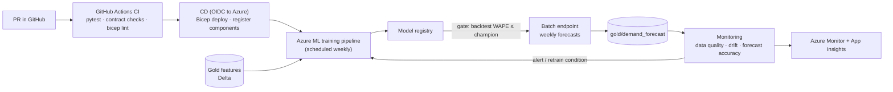

# Module 7 Roadmap: MLOps and Production Operations

**Module 7 is built.** Its lessons are written and verified (links below); the tables further down record the original design.

**Module 7 (available):**
- [7.1-7.3 CI/CD with GitHub Actions, OIDC and IaC](07-cicd-and-iac.md)
- [7.4-7.6 Production pipelines, scheduling, monitoring and drift](08-pipelines-and-monitoring.md)
- [7.7 Retraining policy, lineage and the loop](09-retraining-and-lineage.md)

The hands-on lives in the repo itself: `.github/workflows/ci.yml` runs the tests, content and contract checks; [`code/forecasting/monitor.py`](../../code/forecasting/monitor.py) provides the drift/accuracy signals. Module 7 has no separate lab (its artifacts are the CI workflow, the monitoring code, and the IaC).

## Target architecture

## Lessons (built - see links above)

| # | Lesson | Key content | Official docs |
|---|---|---|---|
| 7.1 | CI for data and ML code | pytest, contract compatibility (`code/data_mesh/contract_compat.py`), linting, data tests | [GitHub Actions for Azure](https://learn.microsoft.com/azure/developer/github/github-actions) |
| 7.2 | OIDC from GitHub to Azure | Workload identity federation, no secrets, least-privilege deployment identity | [Connect from Azure with OpenID Connect](https://learn.microsoft.com/azure/developer/github/connect-from-azure-openid-connect) |
| 7.3 | Infrastructure as code | Bicep modules (from Lab 01's `main.bicep`), what-if in PRs, Terraform comparison | [Bicep](https://learn.microsoft.com/azure/azure-resource-manager/bicep/overview) |
| 7.4 | Training pipelines in production | Schedules, data versioning via Delta versions, lineage to models | [Schedule pipelines](https://learn.microsoft.com/azure/machine-learning/how-to-schedule-pipeline-job) |
| 7.5 | Monitoring and drift | Input data drift, prediction drift, delayed ground truth for forecasts, Azure ML model monitoring | [Model monitoring](https://learn.microsoft.com/azure/machine-learning/concept-model-monitoring) |
| 7.6 | Logging, alerting, incident response | OpenTelemetry, Application Insights, KQL, runbooks | [Azure Monitor](https://learn.microsoft.com/azure/azure-monitor/overview) |
| 7.7 | Retraining policy | Triggers (schedule, drift, accuracy decay), champion/challenger, rollback | — |

## Reuse from what exists

- Tests already in `code/tests/` become the first CI job.
- `contract_compat.py` becomes a required PR check for any change to `code/contracts/`.
- `labs/lab-01-azure-setup/infra/main.bicep` becomes the first IaC module.
