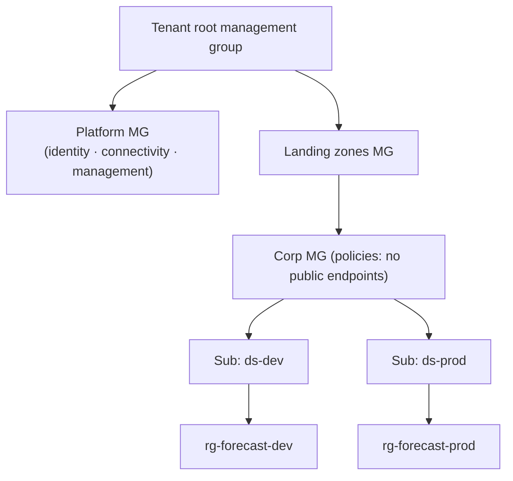

# Landing Zones, Environment Separation and Policy as Code

> **Where this fits.** The earlier modules built the forecasting platform; this module makes it *enterprise-ready*. The platform doesn't live in a vacuum - it sits inside an organisation's Azure estate with central guardrails. This lesson is how that estate is organised and governed so your workload inherits security and consistency instead of reinventing them.

## 1. Lesson overview and learning objectives

By the end you can:

- Explain **landing zones** and the **management group** hierarchy (platform vs application landing zones).
- Separate **dev/test/prod** cleanly and promote between them via CI/CD.
- Enforce guardrails with **Azure Policy** (audit/deny/modify), and know what Policy does and doesn't stop.
- Apply a **tagging strategy** and validate it before deployment.

Runnable: the tag policy checker [`code/governance/tags.py`](../../code/governance/tags.py).

## 2. Prerequisites

| Need | Why | From |
|---|---|---|
| Resource hierarchy, RBAC, subscriptions | Landing zones build on it | [Module 1](../azure-fundamentals/01-azure-fundamentals.md) |
| CI/CD + IaC | How you promote and apply policy | [Module 7](../mlops/07-cicd-and-iac.md) |
| Environment-separation decision | The design choices | [Decision 11](../../ARCHITECTURE_DECISION_GUIDE.md#decision-11-environment-separation) |

## 3. Core concepts

### 3.1 Landing zones

A **landing zone** is a pre-provisioned, governed environment - identity, networking, management and policy already set up - that workloads deploy into, so each team doesn't rebuild the basics (or the mistakes). The **Cloud Adoption Framework (CAF)** Azure landing zone uses a **management group** hierarchy to apply policy and RBAC at scale ([What is a landing zone?](https://learn.microsoft.com/azure/cloud-adoption-framework/ready/landing-zone/)):

- **Platform landing zones**: shared services (identity, connectivity/hub networking, management) owned by the platform team.
- **Application landing zones**: subscriptions where workloads (like this forecasting platform) run, inheriting policy from the management groups above them.



For personal learning you ignore this; in an enterprise it is *why* your storage account won't allow a public endpoint - a policy inherited from a management group, not something you chose locally.

### 3.2 Environment separation

Separate **prod from non-prod at the subscription level**, with **separate identities** per environment and **promotion via CI/CD**, not manual edits (Module 7). Benefits: blast-radius isolation, independent quotas/budgets, and the ability to apply stricter policy to prod. The forecasting platform maps to `rg-forecast-dev` / `rg-forecast-prod` in separate subscriptions, each deployed from the same Bicep with different parameters. ([Decision 11](../../ARCHITECTURE_DECISION_GUIDE.md#decision-11-environment-separation))

### 3.3 Policy as code

**Azure Policy** evaluates resources against rules and takes an **effect** ([Azure Policy overview](https://learn.microsoft.com/azure/governance/policy/overview)):

| Effect | Does | Example |
|---|---|---|
| **Audit** | Flags non-compliance, allows it | Report storage accounts allowing public access |
| **Deny** | Blocks the create/update | Deny storage with `allowBlobPublicAccess=true` |
| **Append / Modify** | Adds/sets properties | Add a missing `cost-center` tag; inherit a tag from the RG |
| **DeployIfNotExists** | Deploys a remediation | Deploy diagnostic settings |

Policies group into **initiatives**, assigned at a management group/subscription/RG scope and inherited downward. Guardrails this course cares about: **allowed regions**, **required tags**, **deny public network access** on storage/PaaS, and **enforce idle-shutdown schedules** on compute instances (Module 5). Policies are **assigned as code** (Bicep/Terraform) in the landing zone, and start in **audit** mode before you switch to **deny**.

> **Policy vs budgets.** Policy can *deny* non-compliant **configuration**; it does **not** stop **spend** (budgets only alert - Module 1). To stop spend you need auto-shutdown, scale-to-zero and cleanup, not Policy.

### 3.4 Tagging strategy

Tags (`project`, `env`, `owner`, `cost-center`, `expires`) drive cost allocation (Module 9 FinOps lesson), cleanup and ownership. Enforce them with a **required-tags** Policy (deny or modify), and validate in CI before deployment with [`check_tags`](../../code/governance/tags.py), which mirrors the policy locally so a missing tag fails the PR, not the deployment. Tags are **not** inherited RG→resource by default; a **Modify** policy can inherit them.

## 4. Architecture diagrams

See 3.1 (management group hierarchy) above - the core diagram for this lesson.

## 5. Azure service mapping

| Need | Service / capability | Type | Where |
|---|---|---|---|
| Governed environments | CAF landing zones + management groups | Pattern + native capability | §3.1 |
| Guardrails | Azure Policy (initiatives, effects) | Native service | §3.3 |
| Environment isolation | Subscriptions per environment | Native capability | §3.2 |
| Tag enforcement (local gate) | `check_tags` | Custom (course) | [`tags.py`](../../code/governance/tags.py) |

## 6. Step-by-step implementation

```bash
# WSL / Python - validate tags in CI before deploy (local gate)
python -m governance.tags      # prints COMPLIANT or the violations

# CLI - a deny policy for public storage (assigned at a management group/subscription)
az policy assignment create --name deny-public-blob \
  --policy <built-in-deny-public-blob-definition-id> --scope <mg-or-sub-scope>
```

Real landing zones are deployed from the CAF accelerators (Bicep/Terraform) and policy is assigned as code in the platform repo; the local `check_tags` gate runs in the workload's CI (Module 7).

## 7. Complete runnable code

- [`code/governance/tags.py`](../../code/governance/tags.py): `check_tags` + `DEFAULT_TAG_POLICY`, tested in [`test_governance.py`](../../code/tests/test_governance.py).
- The platform Bicep (`infra/ml-platform.bicep` from Module 7) is where policy-compliant defaults (HNS, no public access, RBAC Key Vault) live.

## 8. Expected outputs and verification

- `python -m governance.tags` prints `COMPLIANT` for a fully-tagged resource and lists violations (bad `env`, missing `cost-center`) otherwise. Verified in the build.
- In Azure, `az policy state summarize` shows compliance; a deny policy blocks a non-compliant create. **Not run against a subscription in the build**; effects follow the Azure Policy docs.

## 9. Independent exercise

1. Design the management-group and subscription layout for the forecasting platform across dev/test/prod and a shared data platform. Which policies sit at which scope?
2. Write (in words) a required-tags initiative with `env` constrained to a set and `cost-center` auto-inherited from the RG. Which effects do you use?
3. Extend `check_tags` to require an `expires` tag in `lab` environments only. How would the equivalent Azure Policy express "only in lab"?

## 10. Common errors and troubleshooting

| Symptom | Cause | Fix |
|---|---|---|
| "Works in the tutorial, fails at work" | A management-group policy denies it (e.g. public endpoint) | Check inherited policy; use the compliant pattern (private endpoint, Module 9) |
| Deny policy blocks a legitimate deploy | Rule too broad / wrong scope | Scope correctly; start in audit; add exemptions deliberately |
| Tags missing on resources | Not inherited by default | Set at creation (IaC) or a Modify policy to inherit from the RG |
| Prod change bypassed review | No environment separation / manual edit | Separate subscriptions + CI/CD promotion (Module 7) |

## 11. Security and cost considerations

- **Security**: guardrails inherited from landing zones (allowed regions, no public access, required tags) mean the workload is secure by default, not by vigilance.
- **Cost**: tags enable cost allocation (FinOps lesson); Policy controls **configuration** cost drivers (e.g. deny expensive SKUs) but not spend itself - pair with budgets and scale-to-zero.

## 12. Production best practices

- **Deploy into a landing zone**; inherit identity/network/policy rather than rebuilding.
- **Subscriptions per environment**; promote via CI/CD, never manual prod edits.
- **Policy as code**, audit before deny, grouped in initiatives.
- **Required tags** enforced by Policy and checked in CI; tags drive cost and cleanup.
- Remember Policy guards configuration, **budgets only alert** - stop spend with auto-shutdown/scale-to-zero/cleanup.

## 13. Knowledge check

1. What is a landing zone, and what's the difference between platform and application landing zones?
2. Where should dev/test/prod separation sit, and how do changes reach prod?
3. Name three Azure Policy effects and a guardrail each enforces.
4. What can Policy stop, and what can it not - and what do you use instead?

<details>
<summary>Answers</summary>

1. A pre-governed environment (identity/network/management/policy) workloads deploy into. **Platform** landing zones hold shared services; **application** landing zones are where workloads run, inheriting policy from management groups above.
2. At the **subscription** level, with separate identities; changes reach prod via **CI/CD promotion**, not manual edits.
3. **Deny** (block public storage), **Audit** (flag non-compliant regions), **Modify/Append** (inherit a required tag) - also DeployIfNotExists (remediation).
4. Policy stops non-compliant **configuration**; it does **not** stop **spend**. For cost you use budgets (alerts) plus auto-shutdown, scale-to-zero and cleanup.

</details>

## 14. Official documentation and further reading

- [What is an Azure landing zone?](https://learn.microsoft.com/azure/cloud-adoption-framework/ready/landing-zone/) · [Management groups](https://learn.microsoft.com/azure/governance/management-groups/overview)
- [Azure Policy overview](https://learn.microsoft.com/azure/governance/policy/overview) · [Policy effects](https://learn.microsoft.com/azure/governance/policy/concepts/effect-basics)
- [Resource naming (CAF)](https://learn.microsoft.com/azure/cloud-adoption-framework/ready/azure-best-practices/resource-naming) · [Tagging strategy](https://learn.microsoft.com/azure/cloud-adoption-framework/ready/azure-best-practices/resource-tagging)

**Next:** [Network Isolation and Secrets](02-networking-and-secrets.md).
