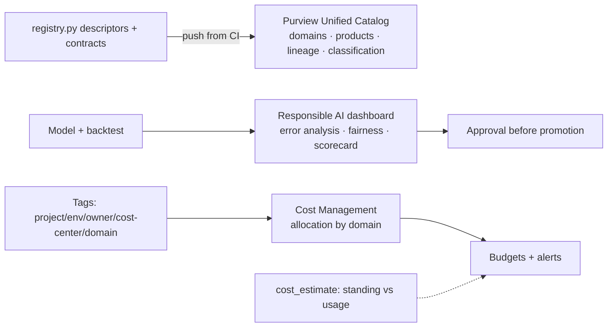

# Governance, Responsible AI and FinOps

> **Where this fits.** The platform works, is secure and is networked. This last lesson is about running it **responsibly and affordably** at enterprise scale: cataloguing and governing the data products, documenting and checking the model for fairness and errors, and keeping the bill predictable and allocated to the right owners.

## 1. Lesson overview and learning objectives

By the end you can:

- Govern data products in **Microsoft Purview Unified Catalog** (governance domains, classification, lineage) and connect it to the course's registry.
- Assess and document the forecasting model with the **Responsible AI dashboard** (error analysis, fairness, scorecard).
- Apply **FinOps**: tag-based **cost allocation**, budgets, idle-resource detection, and a monthly **cost estimate**.

Runnable: the cost estimator [`code/governance/cost_estimate.py`](../../code/governance/cost_estimate.py) and tag checker [`code/governance/tags.py`](../../code/governance/tags.py).

## 2. Prerequisites

| Need | Why | From |
|---|---|---|
| Data products + contracts + registry | What Purview governs | [Module 3](../data-mesh/01-data-mesh.md) |
| The trained model + lineage | What RAI documents | [Modules 5-7](../azure-machine-learning/04-model-registry-and-release.md) |
| Tags + budgets | FinOps foundation | [Module 1](../azure-fundamentals/01-azure-fundamentals.md), [landing zones lesson](01-landing-zones-and-policy.md) |

## 3. Core concepts

### 3.1 Microsoft Purview Unified Catalog in practice

The course built a miniature registry ([`registry.py`](../../code/data_mesh/registry.py)) - the "control port" of the data mesh. **Microsoft Purview Unified Catalog** is the enterprise version. Its model ([governance domains](https://learn.microsoft.com/purview/concept-governance-domain)):

- **Governance domains**: a boundary for governance, ownership and discovery of **data products** and **business concepts** (glossary terms, critical data elements, OKRs) - the direct analogue of the course's domains (Sales, Supply chain, …).
- **Data products**: curated, owned, discoverable collections - what the `supply-chain.demand-forecast` descriptor becomes in Purview.
- **Classification and lineage**: the **Data Map** scans sources, **classifies** sensitive columns, and tracks **lineage** across pipelines so you can see where a column came from and what depends on it.
- **Roles**: catalog-level (tenant data governance admin) vs domain-level (domain owners) - federated governance, matching the data mesh.
- **Discovery**: search by domain/data product/keyword, with an AI copilot.

The workflow that keeps the catalog honest: **push descriptors/contracts from CI** (the course's `registry.py validate` gate) into Purview, so the catalog never drifts from what domains actually ship - the same principle as the local registry, at enterprise scale.

### 3.2 Responsible AI for the forecasting model

A production model needs documentation and checks, not just metrics. Azure ML's **Responsible AI dashboard** combines open-source tools into one view ([RAI dashboard](https://learn.microsoft.com/azure/machine-learning/concept-responsible-ai-dashboard)):

- **Error analysis**: finds **cohorts** with higher error than the overall benchmark - for the forecaster, e.g. which categories/stores/weeks are worst (new products, promo weeks, stock-out weeks). This is where to target improvement.
- **Fairness** (Fairlearn): assesses how predictions affect groups - here, whether error is systematically worse for some regions/store types, which would bias replenishment against them.
- **Interpretability** (InterpretML): which features drive predictions.
- **RAI scorecard**: a PDF exporting the responsible-AI metadata for **approval/compliance** sign-off.

For demand forecasting the responsible-AI framing is concrete: biased error means some stores are systematically under- or over-stocked. Pair the dashboard with the course's backtest gate (Module 6) and an **approval workflow** before promotion (Module 7). Document the model: intended use, data, metrics by cohort, limitations (censored demand, cold-start products).

### 3.3 FinOps for data and AI

FinOps makes cloud cost a managed, allocated, visible thing:

- **Tag-based cost allocation**: `project`/`env`/`owner`/`cost-center`/domain tags let Cost Management group spend by domain/product, so each owner sees their bill. Enforce the tags (landing zones lesson).
- **Budgets + alerts**: alert at 50/80/100% - but remember **budgets don't stop spend** (Module 1).
- **Idle-resource detection**: the biggest savings are **standing** costs - a managed online endpoint left deployed, an AI Search service idle, a compute instance running. The [cost estimator](../../code/governance/cost_estimate.py) separates **standing** from usage cost precisely to surface these.
- **Reservations / savings plans**: commit to steady usage (reserved capacity, provisioned throughput) only when the baseline is predictable; use pay-as-you-go while learning.

The estimator shows the platform's shape: with everything scale-to-zero, the **standing** cost is small (ACR + storage) **unless** you leave AI Search or an online endpoint running - exactly the two "delete after the lab" warnings from Modules 6 and 8.

## 4. Architecture diagrams



## 5. Azure service mapping

| Need | Service / capability | Type | Where |
|---|---|---|---|
| Enterprise catalog + lineage | Microsoft Purview Unified Catalog | Native service | §3.1 |
| Model fairness/error/docs | Responsible AI dashboard (Azure ML) | Native capability | §3.2 |
| Cost visibility | Cost Management + budgets + tags | Native capability | §3.3 |
| Cost estimate + allocation | `cost_estimate` / `check_tags` | Custom (course) | [`code/governance/`](../../code/governance/) |

## 6. Step-by-step implementation

**Locally (free): tag compliance + a cost estimate with allocation.**

```bash
# WSL / Python, from code/
python -m governance.tags            # validate required tags (CI gate)
python -m governance.cost_estimate   # monthly estimate: total, standing vs usage, by domain
```

**On Azure:** scan sources into Purview, publish the data products with owners and classifications, review the model in the Responsible AI dashboard before promotion, and set a budget per resource group with alerts and a cost view grouped by the `domain`/`cost-center` tags.

## 7. Complete runnable code

- [`code/governance/cost_estimate.py`](../../code/governance/cost_estimate.py): `estimate` (total, standing vs usage, by-domain) - prices are inputs you supply.
- [`code/governance/tags.py`](../../code/governance/tags.py): `check_tags` against the required-tag policy.
- Tests: [`code/tests/test_governance.py`](../../code/tests/test_governance.py). The data-product descriptors Purview would catalogue are [`code/data_mesh/products/`](../../code/data_mesh/products/).

## 8. Expected outputs and verification

- `cost_estimate` prints a breakdown separating standing from usage cost and allocating by domain; on the illustrative inputs, AI Search dominates the standing cost - the "delete it when idle" signal. `tags` prints COMPLIANT or violations. Verified in the build (`python -m pytest tests/test_governance.py`).
- Purview scans/lineage and the RAI dashboard are **not run against a subscription in the build**; they follow the cited docs.

> The cost figures are **illustrative placeholders**, not real prices - replace them with current quotes from the pricing calculator or the Retail Prices API (see [`price_check.py`](../../labs/lab-01-azure-setup/python/price_check.py)).

## 9. Independent exercise

1. Map each course data product ([`code/data_mesh/products/`](../../code/data_mesh/products/)) to a Purview governance domain, owner and classification. Which columns need classifying as sensitive?
2. For the forecaster, define the cohorts you'd inspect in error analysis and the groups you'd check for fairness. What would a fairness problem mean operationally?
3. Replace the `cost_estimate` inputs with real prices for your region (one component via `price_check.py`), and identify the largest standing cost to cut.

## 10. Common errors and troubleshooting

| Symptom | Cause | Fix |
|---|---|---|
| Catalog drifts from reality | Manual catalog edits | Push descriptors/contracts from CI (registry gate) |
| "The model is accurate overall but bad somewhere" | Only looked at aggregate metrics | Use error analysis cohorts; check fairness by group |
| Cost can't be attributed | Missing/inconsistent tags | Enforce required tags (Policy + CI); group Cost Management by tag |
| Budget alert too late | Budgets evaluate on delayed cost data | Pair with scale-to-zero/auto-shutdown; monitor standing resources |
| Surprise monthly bill | Idle AI Search / online endpoint | Delete when idle; the estimator's standing line flags these |

## 11. Security and cost considerations

- **Security/governance**: classification and lineage make sensitive data and its dependencies visible; domain owners govern their products (federated).
- **Cost**: allocate by tag so owners are accountable; attack **standing** costs first (idle endpoints/search); reservations only for predictable baselines; budgets alert, they don't stop.

## 12. Production best practices

- **Catalog from CI**: contracts/descriptors flow to Purview; the catalog never drifts.
- **Responsible AI before promotion**: error-analysis cohorts, fairness by group, a documented scorecard and an approval gate.
- **FinOps discipline**: enforced tags, cost allocation by domain, idle-resource detection, budgets + alerts, reservations only when steady.
- **Standing cost is the enemy**: design for scale-to-zero; delete idle premium resources.

## 13. Knowledge check

1. How does Purview Unified Catalog's model map to the course's data mesh, and how do you keep the catalog from drifting?
2. What does error analysis add over an aggregate accuracy metric, and why does fairness matter for demand forecasts?
3. In FinOps, what is "standing" cost and why target it first?
4. Why isn't a budget enough to control spend?

<details>
<summary>Answers</summary>

1. Governance **domains** = the mesh's domains; **data products** = the product descriptors; plus classification and lineage. Keep it current by **pushing descriptors/contracts from CI** (the registry-validate gate), not manual edits.
2. Error analysis finds **cohorts** (categories/stores/weeks) with worse-than-average error to target; biased error means some stores are systematically mis-stocked - an operational fairness problem.
3. Cost you pay **even when idle** (ACR, idle AI Search, a deployed online endpoint). It's the biggest avoidable spend, so cut it first (scale-to-zero, delete idle).
4. Budgets only **alert** (on delayed cost data) and arrive after the money is spent; stopping spend needs auto-shutdown, scale-to-zero and cleanup.

</details>

## 14. Official documentation and further reading

- [Microsoft Purview Unified Catalog](https://learn.microsoft.com/purview/unified-catalog) · [Governance domains](https://learn.microsoft.com/purview/concept-governance-domain)
- [Responsible AI dashboard](https://learn.microsoft.com/azure/machine-learning/concept-responsible-ai-dashboard) · [Responsible AI in Azure ML](https://learn.microsoft.com/azure/machine-learning/concept-responsible-ai)
- [Cost Management](https://learn.microsoft.com/azure/cost-management-billing/costs/overview-cost-management) · [FinOps on Azure](https://learn.microsoft.com/azure/cost-management-billing/finops/overview-finops)

**Next:** The [capstone](../../projects/retail-demand-forecasting/README.md) ties Modules 1-9 together end to end.
