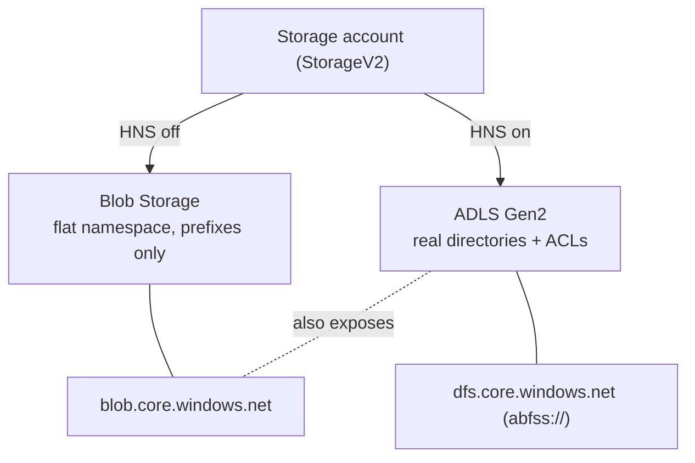
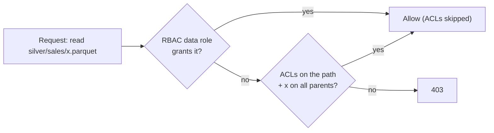

# Blob vs ADLS Gen2, and the RBAC + ACL Access Model

> **Where this fits.** Module 3 built the medallion lakehouse on ADLS Gen2 and Module 1 set up identity-based access. This lesson fills in the storage layer underneath: *why* ADLS Gen2 (not plain Blob), what the two endpoints are, and exactly how access is decided when both RBAC and ACLs are in play - the thing that turns "I'm Storage Blob Data Reader, why 403 on this folder?" into a predictable answer.

## 1. Lesson overview and learning objectives

By the end you can:

- Explain what the **hierarchical namespace (HNS)** changes and when you need it.
- Distinguish the **blob** (`blob.core.windows.net`) and **dfs** (`dfs.core.windows.net`, `abfss://`) endpoints.
- Choose **access tiers** (hot/cool/cold/archive) and write a **lifecycle** rule.
- Reason about **RBAC + POSIX ACLs** together, and grant a domain least-privilege access to one directory.

The hands-on is [Lab 02](../../labs/lab-02-cloud-storage/README.md).

## 2. Prerequisites

| Need | Why | From |
|---|---|---|
| Control vs data plane, RBAC, managed identity | The access model builds on it | [Module 1](../azure-fundamentals/01-azure-fundamentals.md) |
| A storage account with HNS (Entra-only) | The thing we access | [Lab 01](../../labs/lab-01-azure-setup/README.md) |
| The medallion lakehouse context | Where this storage is used | [Module 3](../lakehouse/01-lake-warehouse-lakehouse-medallion.md) |

## 3. Core concepts

### 3.1 Blob Storage vs ADLS Gen2

ADLS Gen2 **is** Blob Storage with the **hierarchical namespace** enabled at account creation. HNS adds real directories (not just name prefixes), so you get:

- **Atomic directory operations**: renaming or deleting `silver/sales/` is one metadata operation, not a per-blob loop. This is what makes analytics engines fast and transactions on table formats practical.
- **POSIX-style ACLs** per directory and file (section 3.3).
- The **dfs endpoint** and the `abfss://` driver that Spark, delta-rs and adlfs use.



Without HNS, `a/b/c.parquet` is a blob whose *name* contains slashes; "deleting a folder" means listing and deleting every blob under the prefix. With HNS it is a genuine directory. **HNS is chosen at creation** (or via a one-way upgrade), so decide up front - for a lakehouse, always on. ([ADLS Gen2 introduction](https://learn.microsoft.com/azure/storage/blobs/data-lake-storage-introduction))

### 3.2 The two endpoints

An HNS account exposes the same data on two endpoints:

| Endpoint | Host | Used by | Scheme |
|---|---|---|---|
| **Blob** | `<acct>.blob.core.windows.net` | Blob SDKs, `az storage blob`, tools that don't need directories | `https`, `wasbs://` |
| **DFS** (Data Lake) | `<acct>.dfs.core.windows.net` | Spark, delta-rs, adlfs, `az storage fs` | `abfss://<container>@<acct>.dfs.core.windows.net/<path>` |

The course uses the **dfs** endpoint and `abfss://` everywhere (as in [`medallion.py`](../../code/lakehouse_local/medallion.py)). Some tools silently default to the blob endpoint; mixing them is a common source of confusion when ACLs are involved, because ACLs are a dfs/HNS concept.

### 3.3 Access control: RBAC and ACLs together

This is the part that bites. Access to ADLS Gen2 data is decided by **two** systems, evaluated in a fixed order ([Access control model](https://learn.microsoft.com/azure/storage/blobs/data-lake-storage-access-control-model)):

1. **Azure RBAC first.** If the caller holds a data role (e.g. **Storage Blob Data Reader/Contributor/Owner**) at the account or container scope that permits the operation, access is granted and **ACLs are not consulted**. RBAC cannot be *narrowed* by a stricter ACL.
2. **POSIX ACLs** apply only when RBAC did not already grant access. ACLs are per-directory/file entries (read `r`, write `w`, execute `x`) for the owning user, named users, owning/named groups, and *other*, evaluated in that order. `x` on every parent directory is required to traverse to a file.

Practical consequences:

- A broad data role at account scope **overrides** fine-grained ACLs. So to give a data mesh **domain** access to only its own directory, grant **no** account-wide data role and instead set ACLs (and default ACLs for new files) on `silver/<domain>/`.
- Files written with the **account key** are owned by `$superuser`; disabling shared-key (Module 1) keeps ownership tied to real identities.
- New role or ACL changes take minutes to propagate - retrying is normal.



### 3.4 Access tiers and lifecycle

Blob/ADLS data has an **access tier**: **hot** (frequent access), **cool** (infrequent, ~30-day min retention), **cold** (rarer, longer min retention), **archive** (offline, hours to rehydrate). Cooler tiers cost less to store but more to read and have minimum-retention charges. A **lifecycle management** policy moves or deletes blobs automatically by age/last-access (e.g. Bronze raw → cool after 30 days, delete after 365). ([Best practices](https://learn.microsoft.com/azure/storage/blobs/data-lake-storage-best-practices))

## 4. Architecture diagrams

See 3.1 (Blob vs ADLS), 3.2 (endpoints) and 3.3 (access decision) above - those are the core ones for this lesson.

## 5. Azure service mapping

| Need | Service / capability | Type | Where |
|---|---|---|---|
| Object storage | Azure Blob Storage | Native service | [catalog](../../SERVICE_CATALOG.md) |
| Analytics storage | ADLS Gen2 (HNS) | Native service | This lesson, [Lab 01](../../labs/lab-01-azure-setup/README.md) |
| Coarse access | Azure RBAC data roles | Native capability | [Module 1](../azure-fundamentals/01-azure-fundamentals.md) |
| Fine-grained access | POSIX ACLs | Native capability | §3.3 |
| Cost tiering | Access tiers + lifecycle policies | Native capability | §3.4 |

## 6. Step-by-step implementation

All commands run in **WSL**, signed in with `az login` (billable steps touch a storage account).

```bash
# Create an HNS account (ADLS Gen2), Entra-only - from Lab 01
az storage account create -n <acct> -g <rg> --sku Standard_LRS --kind StorageV2 \
  --hns true --allow-shared-key-access false --min-tls-version TLS1_2 --allow-blob-public-access false

# A container (filesystem) via the dfs endpoint
az storage fs create -n lakehouse --account-name <acct> --auth-mode login

# Grant yourself a data role (coarse), or set an ACL (fine-grained) on one directory
az role assignment create --assignee <you> --role "Storage Blob Data Contributor" \
  --scope <account-resource-id>
az storage fs access set --acl "user::rwx,group::r-x,other::---" \
  -p silver/sales -f lakehouse --account-name <acct> --auth-mode login

# Access tier + a lifecycle rule (JSON policy omitted) move Bronze to cool after 30 days
az storage account management-policy create --account-name <acct> -g <rg> --policy @lifecycle.json
```

## 7. Complete runnable code

This lesson is configuration; the runnable data access is in the [next lesson](02-python-data-access.md) ([`code/storage/`](../../code/storage/)). The lakehouse's identity-based `abfss://` access is in [`medallion.py`](../../code/lakehouse_local/medallion.py).

## 8. Expected outputs and verification

- `az storage account show -n <acct> --query isHnsEnabled` returns `true`.
- `az storage fs access show -p silver/sales -f lakehouse --account-name <acct> --auth-mode login` shows the ACL you set.
- A principal with only an ACL (no account data role) can read its directory and is denied elsewhere; a principal with an account data role reads everything (RBAC wins). **Not executed against a subscription in the build**; cited behaviour is from the access-control docs.

## 9. Independent exercise

Design per-domain access for the data mesh (Module 3): Sales, Supply chain, Finance each own a directory under `silver/`. Specify, for each domain group: whether it gets an account/container RBAC data role or only ACLs; the ACL entries (including default ACLs and the `x` traversal bits); and how a cross-domain consumer reads another domain's *published* product. Explain why an account-wide Reader role would break the isolation.

## 10. Common errors and troubleshooting

| Symptom | Cause | Fix |
|---|---|---|
| 403 reading a folder despite an ACL | Missing `x` on a parent directory | Grant `x` on every ancestor; ACLs don't inherit to existing files |
| ACL seems ignored | Caller has an account/container RBAC data role (RBAC wins) | Remove the broad role to enforce ACL isolation |
| Files owned by `$superuser` | Written with the account key | Disable shared-key; use identity-based writes |
| `abfss` works, blob tools 403 | Tool hit the blob endpoint; ACLs are dfs-side | Use the dfs endpoint / `--auth-mode login` |
| Archive blob read fails | Archive is offline | Rehydrate first (hours), or don't archive hot data |

## 11. Security and cost considerations

- **Security**: shared-key off, Entra-only; prefer **groups** for ACLs and RBAC; use ACLs for per-domain isolation, not broad account roles.
- **Cost**: tier cold/archive for rarely-read Bronze; set lifecycle rules; cooler tiers cost more to *read* and have minimum retention - don't tier data you still query.

## 12. Production best practices

- **HNS on** for any analytics storage; decide at creation.
- **One storage account per environment/domain** boundary where isolation matters; ACLs within.
- **Groups + default ACLs** so new files inherit the right access.
- **Lifecycle policies** on raw/Bronze; **dfs endpoint** everywhere in code.

## 13. Knowledge check

1. What does the hierarchical namespace add over plain Blob, and when must you enable it?
2. In what order are RBAC and ACLs evaluated, and can an ACL make a broad data role *more* restrictive?
3. How do you give one data mesh domain access to only its directory?
4. Why might a folder read 403 even though the file's ACL grants you read?

<details>
<summary>Answers</summary>

1. Real directories (atomic renames/deletes) and POSIX ACLs, plus the dfs endpoint. Enable it **at account creation** (or a one-way upgrade).
2. **RBAC first**; if a data role grants the operation, ACLs are skipped. No - RBAC cannot be narrowed by a stricter ACL.
3. Grant **no** account-wide data role; set **ACLs** (and default ACLs) on that domain's directory, with `x` on the parents.
4. You lack **`x` (traverse)** on a parent directory on the path to the file.

</details>

## 14. Official documentation and further reading

- [Introduction to ADLS Gen2](https://learn.microsoft.com/azure/storage/blobs/data-lake-storage-introduction) · [Best practices](https://learn.microsoft.com/azure/storage/blobs/data-lake-storage-best-practices)
- [Access control model](https://learn.microsoft.com/azure/storage/blobs/data-lake-storage-access-control-model) · [ACLs](https://learn.microsoft.com/azure/storage/blobs/data-lake-storage-access-control)
- [Access tiers](https://learn.microsoft.com/azure/storage/blobs/access-tiers-overview) · [Lifecycle management](https://learn.microsoft.com/azure/storage/blobs/lifecycle-management-overview)

**Next:** [Reading and Writing Data from Python](02-python-data-access.md).
