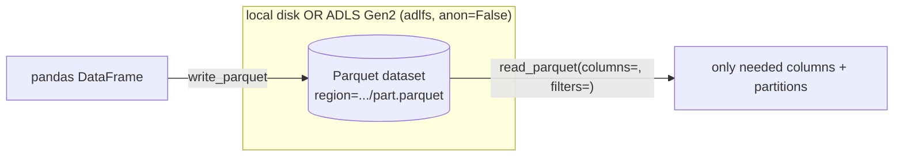

# Reading and Writing Data from Python: adlfs, PyArrow, Parquet

> **Where this fits.** You know the storage layer and its access model ([previous lesson](01-storage-and-access-control.md)). This is the day-to-day skill: get a DataFrame to and from the lake from Python, cheaply and without keys, and lay it out so reads are fast.

## 1. Lesson overview and learning objectives

By the end you can:

- Read/write Parquet from **pandas/PyArrow** against local disk and **ADLS Gen2** through **adlfs/fsspec**, authenticating with `DefaultAzureCredential`.
- Read Delta tables with **delta-rs** over `abfss://` (as the lakehouse does).
- Choose between **CSV, JSON and Parquet**, and pick compression.
- Lay out **partitioned datasets** with **column projection** and **predicate pushdown**, and avoid the small-files problem.

Runnable code: [`code/storage/parquet_io.py`](../../code/storage/parquet_io.py).

## 2. Prerequisites

| Need | Why | From |
|---|---|---|
| Storage + access model | Where/how you read | [Previous lesson](01-storage-and-access-control.md) |
| `adlfs`, `pyarrow`, `pandas`, `deltalake` | The stack | [`code/requirements.txt`](../../code/requirements.txt) |
| `az login` (for the ADLS path) | Identity-based access | [Module 1](../azure-fundamentals/01-azure-fundamentals.md) |

## 3. Core concepts

### 3.1 One API, local or cloud: fsspec + adlfs

pandas and PyArrow read/write through **fsspec**, so the same call works on a local path or an `abfss://`/`az://` URI once you pass **storage options**. For ADLS Gen2, **adlfs** provides the filesystem; `anon=False` switches it to the `DefaultAzureCredential` chain (its default is `anon=True`, i.e. public) ([adlfs](https://github.com/fsspec/adlfs)):

```python
from storage.parquet_io import adls_storage_options, read_parquet, write_parquet

opts = adls_storage_options("myaccount")        # {"account_name": "myaccount", "anon": False}
df = read_parquet("az://lakehouse/silver/sales", storage_options=opts)
write_parquet(df, "az://lakehouse/gold/export", storage_options=opts, partition_cols=["region"])
```

Locally the same functions take a path and no options. No keys anywhere - your `az login` locally, a managed identity in Azure. ([Python SDK / fsspec for ADLS Gen2](https://learn.microsoft.com/azure/storage/blobs/data-lake-storage-directory-file-acl-python))

### 3.2 Delta over abfss with delta-rs

For **Delta tables** the course uses delta-rs (`deltalake`), which authenticates to ADLS Gen2 with your Azure CLI sign-in ([`medallion.py`](../../code/lakehouse_local/medallion.py) `storage_options`): `{"azure_storage_account_name": acct, "azure_use_azure_cli": "true"}`. Use delta-rs when you want ACID, time travel and MERGE (Module 3); use plain Parquet via adlfs for one-off exports and interchange.

### 3.3 File formats

| Format | Shape | Schema | Compresses | Good for |
|---|---|---|---|---|
| **CSV** | row text | none | poorly | interchange, tiny/debug data |
| **JSON (lines)** | row text, nested | implicit | poorly | semi-structured API dumps, Bronze landing |
| **Parquet** | **columnar** binary | embedded | **well** | analytics: Silver/Gold, training sets |

Parquet is columnar, typed and compressed, so analytic reads touch only the columns and row groups they need. Concretely, in this course's data a year of POS sales is **~14 MB as CSV** but **~1.1 MB as snappy Parquet** (about 13× smaller) - and column/partition pruning then reads a fraction of that. Verified in the course build.

**Compression**: `snappy` (fast, default) for working data; `zstd` for a better ratio when storage or egress dominates. `gzip` for maximum interchange compatibility.

### 3.4 Layout: partitioning, projection, pushdown, file sizing

- **Partitioned dataset**: writing with `partition_cols=["region"]` produces Hive-style `region=North/` folders. Readers then **prune partitions** with `filters=[("region","==","North")]`, never touching other folders.
- **Column projection**: `columns=[...]` reads only those columns (the columnar payoff).
- **File sizing**: many tiny files are slow to list and read (the *small-files problem*). Aim for larger files, roughly **100 MB-1 GB** each, and partition on a column with moderate cardinality you actually filter on (region, date) - not a high-cardinality key (product_id) that explodes into millions of folders.

[`dataset_stats`](../../code/storage/parquet_io.py) reports file count, rows and average file size so you can see this.

## 4. Architecture diagrams



## 5. Azure service mapping

| Need | Service / tool | Type | Where |
|---|---|---|---|
| Python ↔ ADLS Gen2 | adlfs / fsspec + `DefaultAzureCredential` | Open source + native capability | [`parquet_io.py`](../../code/storage/parquet_io.py) |
| Columnar format | Apache Parquet (via PyArrow) | Open source | §3.3 |
| Delta tables | delta-rs over `abfss://` | Open source | [`medallion.py`](../../code/lakehouse_local/medallion.py) |

## 6. Step-by-step implementation

**Locally (free):**

```bash
# WSL / Python, from code/ (after generating data in Module 3/Lab 03)
python -m storage.parquet_io ../data/raw/pos_sales ../data/parquet/pos_sales
#   -> wrote 246492 rows; {'files': 1, 'rows': 246492, 'total_mb': 1.1, ...}
python - <<'PY'
from storage.parquet_io import read_parquet, write_parquet, dataset_stats
import pandas as pd
df = read_parquet("../data/parquet/pos_sales")
write_parquet(df, "../data/parquet/by_month", partition_cols=["date"])  # Hive-style folders
print(dataset_stats("../data/parquet/by_month"))
print(read_parquet("../data/parquet/pos_sales", columns=["store_id","units_sold"]).shape)
PY
```

**On ADLS Gen2 (billable, pennies):** pass `storage_options=adls_storage_options("<acct>")` and an `az://lakehouse/...` path; everything else is identical.

## 7. Complete runnable code

- [`code/storage/parquet_io.py`](../../code/storage/parquet_io.py): `read_parquet`, `write_parquet`, `dataset_stats`, `adls_storage_options`.
- Tests: [`code/tests/test_storage.py`](../../code/tests/test_storage.py) (round-trip, partition pruning, column projection, sizing).

## 8. Expected outputs and verification

- Round-trip returns an identical DataFrame; a partitioned write creates `region=.../` folders; a filtered read returns only the matching partition; projection returns only the requested columns. Verified in the build (`python -m pytest tests/test_storage.py`).
- The CSV→Parquet demo prints ~1.1 MB for 246,492 rows (vs ~14 MB CSV).
- The ADLS path was **not** run against a subscription; it differs only by the `storage_options` and the `az://` URI.

## 9. Independent exercise

1. Partition the Gold `weekly_demand_features` by `category` and by `week_start`'s year; compare `dataset_stats` and a filtered read's speed. Which partitioning helps the forecasting reads, which just makes small files?
2. Re-encode the POS Parquet with `zstd` vs `snappy`; compare size and read time.
3. Read a single column with `read_parquet(columns=[...])` and confirm (via a profiler or timing) it beats reading all columns.

## 10. Common errors and troubleshooting

| Symptom | Cause | Fix |
|---|---|---|
| adlfs reads a public/anon path or 403s | `anon` left at its default `True` | Pass `anon=False` (use `adls_storage_options`) |
| `az://` write fails with 403 | Missing data-plane role/ACL | Grant *Storage Blob Data Contributor* or the ACL (previous lesson) |
| Partitioned read still slow | Filtered on a non-partition column | Partition on the column you filter; or rely on row-group stats |
| Millions of tiny files | Partitioned on a high-cardinality key | Partition on low/medium cardinality; compact files |
| `ModuleNotFoundError: adlfs` | Not installed | `pip install -r requirements.txt` |

## 11. Security and cost considerations

- **Security**: `anon=False` + `DefaultAzureCredential`; no keys or SAS in code. The account has shared-key disabled (Module 1).
- **Cost**: Parquet + compression cuts storage and egress ~10×+; partition pruning and projection cut transaction and compute cost on every read. This is cost optimisation you get for free from layout.

## 12. Production best practices

- **Parquet (or Delta) for analytics**, not CSV; CSV only for interchange/debug.
- **Partition on what you filter**, at moderate cardinality; keep files ~100 MB-1 GB.
- **Project columns and push down filters** on every read.
- **adlfs `anon=False`** and identity; the same code path local and cloud.
- Prefer **Delta** (Module 3) when you need ACID/time-travel/MERGE; plain Parquet for exports.

## 13. Knowledge check

1. What single storage option makes adlfs use your identity, and what is its default?
2. Why is Parquet so much smaller and faster to query than CSV here?
3. What two read-time techniques cut how much data you load, and how do you enable each?
4. When do you partition on a column, and what goes wrong if its cardinality is too high?

<details>
<summary>Answers</summary>

1. `anon=False` (adlfs defaults to `anon=True`, public). With it, adlfs uses the `DefaultAzureCredential` chain.
2. It is **columnar, typed and compressed**, so reads touch only needed columns/row groups; a year of POS is ~1.1 MB Parquet vs ~14 MB CSV.
3. **Column projection** (`columns=[...]`) and **predicate pushdown / partition pruning** (`filters=[...]`).
4. Partition on a **low/medium-cardinality** column you filter on (region, date). Too-high cardinality creates millions of tiny folders/files - the small-files problem.

</details>

## 14. Official documentation and further reading

- [Use Python to manage ADLS Gen2](https://learn.microsoft.com/azure/storage/blobs/data-lake-storage-directory-file-acl-python) · [adlfs](https://github.com/fsspec/adlfs) · [fsspec](https://filesystem-spec.readthedocs.io/)
- [PyArrow Parquet](https://arrow.apache.org/docs/python/parquet.html) · [pandas IO](https://pandas.pydata.org/docs/user_guide/io.html#parquet)
- [ADLS Gen2 best practices](https://learn.microsoft.com/azure/storage/blobs/data-lake-storage-best-practices)

**Next:** [Azure SQL Database for Reference and Operational Data](03-azure-sql.md).
