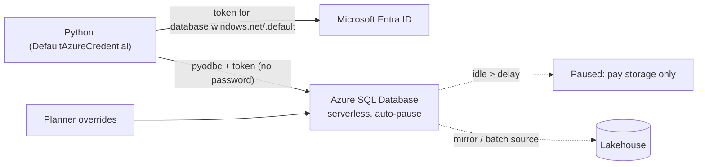

# Azure SQL Database for Reference and Operational Data

> **Where this fits.** The lake is for analytics at scale; some data wants a database - small reference tables, planner overrides, point lookups, transactions. This lesson covers **Azure SQL Database**, its cheap **serverless** tier, and **passwordless** Python access, so you can add relational storage to the forecasting platform without a standing bill or a stored password.

## 1. Lesson overview and learning objectives

By the end you can:

- Decide when **Azure SQL Database** is the right store versus the lakehouse.
- Use the **serverless** tier with **auto-pause** so a lab database costs almost nothing idle.
- Connect from Python with **Microsoft Entra** auth (no password), via `pyodbc` with an access token.

The hands-on (load reference data) is [Lab 02](../../labs/lab-02-cloud-storage/README.md).

## 2. Prerequisites

| Need | Why | From |
|---|---|---|
| Entra auth + `DefaultAzureCredential` | Passwordless connection | [Module 1](../azure-fundamentals/01-azure-fundamentals.md) |
| The ODBC driver + `pyodbc` | Python connectivity | Section 6 |
| Lake vs DB intuition | The when-to-use decision | [Module 3](../lakehouse/01-lake-warehouse-lakehouse-medallion.md) |

## 3. Core concepts

### 3.1 When a database beats the lake

| Use Azure SQL when… | Use the lakehouse when… |
|---|---|
| Small, frequently-updated **operational/reference** data (store attributes, planner overrides) | Large analytical datasets scanned in bulk |
| **Point lookups** and row-level updates/transactions | Column aggregations over millions of rows |
| Strong constraints, foreign keys, concurrent writers | Append/merge batch pipelines (Delta) |
| A backend for a small app or service | ML training data, Bronze/Silver/Gold |

In the forecasting platform: the Gold forecast is a **lake** product; **planner overrides** ("force 0 for this discontinued SKU") belong in **Azure SQL**, and can later feed back as a Delta source or via Fabric mirroring. ([Azure SQL Database overview](https://learn.microsoft.com/azure/azure-sql/database/sql-database-paas-overview))

### 3.2 The serverless tier and auto-pause

The **serverless** compute tier scales vCores automatically and **bills per second only while the database is in use**; when idle past the **auto-pause delay** it pauses and you pay only for **storage** ([Serverless tier](https://learn.microsoft.com/azure/azure-sql/database/serverless-tier-overview)):

- Auto-pause **default is 60 minutes**; the **minimum is 15 minutes**; `-1` disables auto-pause.
- Pausing requires **no sessions and zero user CPU** for the whole delay - a client that reconnects frequently keeps it awake.
- The first query after a pause **resumes in a few seconds** (plan for that latency; the connection may need a retry).

This makes serverless ideal for a lab or an intermittently-used reference DB: near-zero cost when nobody is querying.

### 3.3 Passwordless connection from Python

Use **Microsoft Entra** auth, never a SQL password. The established pattern is `pyodbc` with an **access token** ([Passwordless migration for Python](https://learn.microsoft.com/azure/azure-sql/database/azure-sql-passwordless-migration-python)):

```python
import struct, pyodbc
from azure.identity import DefaultAzureCredential

SQL_COPT_SS_ACCESS_TOKEN = 1256   # from msodbcsql.h
token = DefaultAzureCredential().get_token("https://database.windows.net/.default").token
# ODBC wants the token as UTF-16-LE bytes with a 4-byte length prefix
packed = token.encode("utf-16-le")
token_struct = struct.pack(f"<I{len(packed)}s", len(packed), packed)

conn = pyodbc.connect(
    "Driver={ODBC Driver 18 for SQL Server};"
    "Server=tcp:<server>.database.windows.net,1433;Database=<db>;Encrypt=yes;",
    attrs_before={SQL_COPT_SS_ACCESS_TOKEN: token_struct},   # no UID/PWD/Authentication
)
```

Note there is **no UID/PWD/Authentication** in the connection string when passing a token. For SQLAlchemy, refresh the token on each new connection via a `do_connect` event and recycle pooled connections before the token expires. Microsoft's newer pure-Python **`mssql-python`** driver is an alternative to the ODBC stack; `pyodbc` with the token is the widely-deployed pattern today. Grant the Entra principal access inside the DB: `CREATE USER [<identity>] FROM EXTERNAL PROVIDER;` and a role such as `db_datareader`/`db_datawriter`.

## 4. Architecture diagrams



## 5. Azure service mapping

| Need | Service / capability | Type | Where |
|---|---|---|---|
| Relational store | Azure SQL Database | Native service | This lesson |
| Cheap intermittent compute | Serverless tier + auto-pause | Native capability | §3.2 |
| Passwordless auth | Entra auth + token via `pyodbc` | Native capability + open source | §3.3 |

## 6. Step-by-step implementation

```bash
# WSL - create a serverless DB with a short auto-pause (billable: near-zero idle)
az sql server create -n <server> -g <rg> -l <region> --enable-ad-only-auth \
  --external-admin-principal-type User --external-admin-name <you> --external-admin-sid <object-id>
az sql db create -g <rg> -s <server> -n refdata \
  --edition GeneralPurpose --compute-model Serverless --family Gen5 --capacity 1 \
  --auto-pause-delay 15 --min-capacity 0.5
```

Then from Python, get a token with `DefaultAzureCredential` and connect as in §3.3; create the external user and load reference data. The lab script is [`load_reference_data.py`](../../labs/lab-02-cloud-storage/sql/load_reference_data.py).

## 7. Complete runnable code

- Illustrative Entra-token loader (not run against a subscription): [`labs/lab-02-cloud-storage/sql/load_reference_data.py`](../../labs/lab-02-cloud-storage/sql/load_reference_data.py).
- The reference data itself (store directory) comes from the synthetic generator ([`retail_data/generate.py`](../../code/retail_data/generate.py)).

## 8. Expected outputs and verification

- `az sql db show ... --query "{sku:currentServiceObjectiveName, autoPause:autoPauseDelay}"` shows the serverless SKU and a 15-minute auto-pause.
- The Python token connection runs a `SELECT @@VERSION` with no password in the string; after ~15 idle minutes the DB pauses (portal shows "Paused") and the next query resumes in seconds. **Not executed against a subscription in the build**; the token pattern follows Microsoft's passwordless Python doc.

## 9. Independent exercise

1. Model planner overrides as a table (`store_id, product_id, week_start, forced_units, reason, set_by, set_at`) with the right keys/constraints. Why is a DB better than a Parquet file for this?
2. Write the SQLAlchemy `do_connect` hook that injects a fresh token per connection, and explain the pool-recycle setting.
3. Decide the auto-pause delay for (a) a demo DB, (b) a DB a nightly job hits for 2 minutes. What are the trade-offs against resume latency?

## 10. Common errors and troubleshooting

| Symptom | Cause | Fix |
|---|---|---|
| `Login failed` with a token | UID/PWD/Authentication left in the connection string | Remove them; pass only the token via `attrs_before` |
| First query after idle times out | Serverless resuming from pause | Retry; expect a few seconds of resume latency |
| DB never pauses | Frequent reconnects or a monitoring poll keep CPU/sessions > 0 | Reduce polling; check the auto-pause conditions |
| `Can't open lib 'ODBC Driver 18'` | Driver not installed in WSL | Install msodbcsql18 from the Microsoft apt repo |
| Token scope error | Wrong scope | Use `https://database.windows.net/.default` |

## 11. Security and cost considerations

- **Security**: Entra-only auth (`--enable-ad-only-auth`), no SQL passwords; grant least-privilege DB roles to the identity; `Encrypt=yes`.
- **Cost**: serverless + a short auto-pause means a lab DB costs ~storage when idle; set `--min-capacity 0.5` and a 15-minute delay. Provisioned tiers bill 24/7 - don't use them for intermittent data.

## 12. Production best practices

- **Serverless** for intermittent/unpredictable workloads; **provisioned** for steady high load.
- **Entra-only auth**; identities, not passwords; store nothing in code.
- **Right store for the job**: operational/reference → SQL; analytics → lake. Bridge with mirroring/CDC (Module 4), don't run analytics scans on the DB.
- **Retry on resume**; tune auto-pause to the access pattern.

## 13. Knowledge check

1. Give two kinds of data that belong in Azure SQL rather than the lake, and why.
2. What are the serverless auto-pause default, minimum, and disable values, and what must be true for the DB to pause?
3. How do you connect from Python with no password, and what must NOT be in the connection string?
4. What latency should a client expect right after an idle period, and how do you handle it?

<details>
<summary>Answers</summary>

1. **Operational/reference** data with updates/transactions (e.g. planner overrides, store attributes) - point lookups, constraints and concurrent writers are what relational engines do well and lake files do not.
2. Default **60 min**, minimum **15 min**, `-1` disables. It pauses only after **no sessions and zero user CPU** for the full delay.
3. Get a token for `https://database.windows.net/.default` with `DefaultAzureCredential`, pack it UTF-16-LE with a length prefix, and pass it via `pyodbc` `attrs_before={1256: ...}`. **No** UID/PWD/Authentication in the string.
4. A **few seconds** of resume latency from a paused state; **retry** the first query.

</details>

## 14. Official documentation and further reading

- [Azure SQL Database overview](https://learn.microsoft.com/azure/azure-sql/database/sql-database-paas-overview) · [Serverless tier](https://learn.microsoft.com/azure/azure-sql/database/serverless-tier-overview)
- [Passwordless connections for Python](https://learn.microsoft.com/azure/azure-sql/database/azure-sql-passwordless-migration-python) · [Entra authentication](https://learn.microsoft.com/azure/azure-sql/database/authentication-aad-overview)

**Next:** [Lab 02: Cloud storage and data access](../../labs/lab-02-cloud-storage/README.md), then Module 4 (data pipelines).
