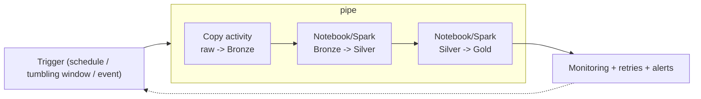

# ETL vs ELT, Batch vs Streaming, and Orchestration

> **Where this fits.** Module 3 built the medallion transforms; Module 2 covered storage access. This module is about *running* those transforms reliably - on a schedule, with retries, monitoring and the right incremental strategy. This first lesson sets the vocabulary (ETL/ELT, batch/streaming) and the orchestration options.

## 1. Lesson overview and learning objectives

By the end you can:

- Explain **ETL vs ELT** and why lakehouses favour ELT.
- Distinguish **batch** and **streaming** and pick one for a workload.
- Describe **Azure Data Factory (ADF)** and **Microsoft Fabric Data Factory** pipelines (copy activity, triggers, parameters, retries, monitoring).
- Choose between ADF and Fabric Data Factory for a given situation.

The hands-on orchestration is [Lab 04](../../labs/lab-04-data-pipelines/README.md).

## 2. Prerequisites

| Need | Why | From |
|---|---|---|
| The medallion transforms | The thing being orchestrated | [Module 3](../lakehouse/01-lake-warehouse-lakehouse-medallion.md) |
| Storage access + formats | Pipelines move/transform this data | [Module 2](02-python-data-access.md) |
| The decision guide | Tool-choice framing | [Architecture Decision Guide](../../ARCHITECTURE_DECISION_GUIDE.md) |

## 3. Core concepts

### 3.1 ETL vs ELT

- **ETL** (extract, transform, load): transform *before* loading into the target - the classic warehouse pattern when compute was scarce and the warehouse was precious.
- **ELT** (extract, load, transform): land raw data first, then transform *inside* the lake/warehouse using its elastic compute. The medallion lakehouse is ELT: Bronze is the raw load, Silver/Gold are in-lake transforms.

Lakehouses favour **ELT** because storage is cheap, compute is elastic and separate, and keeping raw Bronze lets you reprocess when logic changes or a bug is found - you cannot re-transform data you discarded. ([Decision guide](../../ARCHITECTURE_DECISION_GUIDE.md))

### 3.2 Batch vs streaming

| | Batch | Streaming |
|---|---|---|
| Unit | Bounded sets on a schedule (hourly/daily/weekly) | Unbounded events, continuously |
| Latency | Minutes to hours | Seconds |
| Complexity/cost | Lower | Higher (state, watermarks, exactly-once) |
| Fits | Weekly demand forecasting, reporting | Fraud, real-time personalisation |

Retail demand replenishment is **weekly**, so the forecasting platform is batch. Use streaming only when the business value needs sub-minute latency; it is more expensive and harder to operate. Many "streaming" needs are met by frequent **micro-batch** (e.g. Auto Loader, next lesson).

### 3.3 Orchestration: ADF and Fabric Data Factory

An orchestrator runs activities in order, on triggers, with parameters, retries and monitoring. The two Microsoft options:

- **Azure Data Factory (ADF)**: the mature, standalone service. **Copy activity** (90+ connectors) for ingestion, control-flow activities, and three trigger types - **schedule**, **tumbling window** (with backfill/dependencies), and **event** (storage/custom). Integration runtimes (incl. a managed VNet) you configure. Bills per activity run, data-movement DIU-hours and IR hours.
- **Microsoft Fabric Data Factory**: pipelines inside Fabric, integrated with Lakehouse/Warehouse. Datasets are defined **inline** in activities, you **don't manage integration runtimes**, and it bills from Fabric **Capacity Units**. About 90% of ADF activities are available; transformations use **Dataflow Gen2**. ([Activity parity](https://learn.microsoft.com/fabric/data-factory/activity-parity))

Microsoft's direction is that **Fabric Data Factory is the focus for new enterprise ingestion**, while **ADF is not deprecated** ([migration guidance](https://learn.microsoft.com/fabric/data-factory/migrate-from-azure-data-factory)).

### 3.4 Choosing: ADF vs Fabric Data Factory

| Choose **Fabric Data Factory** when… | Choose **ADF** when… |
|---|---|
| Data already lives in / targets Fabric Lakehouse/Warehouse | You need **tumbling-window** or rich **event** triggers |
| You want managed compute (no IR to run) and standard connectors | You need the **managed VNet** maturity or **niche connectors** (SAP, Oracle, …) |
| You bill through a Fabric capacity | You have an existing ADF estate with no urgent driver to move |

For orchestrating this course's medallion pipeline, either works; the choice follows where your lakehouse lives (Module 3's Databricks-vs-Fabric decision). Confirm connector lists and trigger parity against current docs before committing.

## 4. Architecture diagrams



## 5. Azure service mapping

| Need | Service / capability | Type | Where |
|---|---|---|---|
| Orchestration (standalone) | Azure Data Factory | Native service | This lesson, [Lab 04](../../labs/lab-04-data-pipelines/README.md) |
| Orchestration (in Fabric) | Fabric Data Factory | Native service | This lesson |
| Pattern | ELT on the lakehouse | Pattern | [Module 3](../lakehouse/01-lake-warehouse-lakehouse-medallion.md) |
| Tool choice | [Decision 6: orchestration](../../ARCHITECTURE_DECISION_GUIDE.md#decision-6-orchestration-and-integration) | Reference | guide |

## 6. Step-by-step implementation

Orchestration is configured in the portal or as code (ARM/Bicep/Terraform, or Fabric items). The shape of an ADF schedule trigger over the medallion steps:

```json
{ "name": "weekly", "properties": {
    "type": "ScheduleTrigger",
    "typeProperties": { "recurrence": { "frequency": "Week", "interval": 1,
      "schedule": { "weekDays": ["Monday"], "hours": [4], "minutes": [0] } } },
    "pipelines": [{ "pipelineReference": { "referenceName": "medallion", "type": "PipelineReference" } }]
} }
```

Each activity sets **retry** and **timeout** (`"policy": {"retry": 2, "retryIntervalInSeconds": 300, "timeout": "0.02:00:00"}`), and failures raise alerts (next-next lesson / Module 7). [Lab 04](../../labs/lab-04-data-pipelines/README.md) runs the medallion steps on a schedule.

## 7. Complete runnable code

Orchestration itself needs Azure; the transforms it runs are the local, tested medallion ([`code/lakehouse_local/`](../../code/lakehouse_local/)) and the incremental step ([`code/pipelines/incremental.py`](../../code/pipelines/incremental.py), next-next lesson), which an ADF/Fabric pipeline invokes as a notebook or job step.

## 8. Expected outputs and verification

- A pipeline run shows each activity succeeding in order with its retry policy; the monitoring view shows duration and status. **Not executed against a subscription in the build**; the trigger/activity JSON follows the ADF/Fabric docs cited inline.
- Local proxy: running the medallion steps in sequence (Module 3) is the same logical pipeline an orchestrator would trigger.

## 9. Independent exercise

1. Map the medallion pipeline to ADF activities: which is a Copy activity, which are notebook/Spark activities, and where do you set retries and a timeout?
2. Decide ADF vs Fabric Data Factory for: (a) a team already on Fabric, (b) a pipeline needing tumbling-window backfill, (c) ingesting from SAP. Justify each.
3. Argue ELT over ETL for the forecasting platform in three sentences, referencing Bronze.

## 10. Common errors and troubleshooting

| Symptom | Cause | Fix |
|---|---|---|
| Pipeline "succeeds" but data is stale | No dependency/trigger wiring | Chain activities; use a trigger, not manual runs |
| Backfill reruns overlap/clash | Schedule trigger used where tumbling window is needed | Use tumbling-window triggers (ADF) for backfill with dependencies |
| Fabric pipeline missing an activity | ~90% parity, not 100% | Check activity parity; keep that step in ADF or Dataflow Gen2 |
| Niche source has no connector in Fabric | Connector gap | Use ADF, or a custom/self-hosted IR |

## 11. Security and cost considerations

- **Security**: orchestrators authenticate to storage/compute with **managed identities**, not keys (Module 1); scope their roles tightly.
- **Cost**: ADF bills per activity run + DIU-hours + IR hours; Fabric draws Capacity Units. Batch on a weekly schedule is cheap; avoid over-frequent triggers and idle self-hosted IRs.

## 12. Production best practices

- **ELT on the lakehouse**; keep raw Bronze for reprocessing.
- **Batch unless latency demands streaming**; prefer micro-batch for "near real-time".
- **Parameterise** pipelines; set **retries, timeouts and alerts** on every activity.
- **Pick the orchestrator by where your lakehouse lives**; don't run two.
- **Everything as code** (Module 7): pipelines and triggers in source control.

## 13. Knowledge check

1. Why do lakehouses favour ELT, and what does keeping Bronze buy you?
2. When is streaming worth its extra cost over batch (or micro-batch)?
3. Name ADF's three trigger types and which Fabric currently lacks full parity on.
4. Give one reason to pick Fabric Data Factory and one to stay on ADF.

<details>
<summary>Answers</summary>

1. Cheap storage + elastic, separate compute let you transform in-lake; keeping raw **Bronze** lets you reprocess when logic changes or a bug is found - you can't re-transform discarded data.
2. When the business value needs **sub-minute latency** (fraud, real-time personalisation); otherwise batch/micro-batch is cheaper and simpler.
3. **Schedule**, **tumbling window**, **event**. Fabric's **tumbling-window** support isn't at full ADF parity yet.
4. Fabric: data already in Fabric, managed compute, Capacity-Unit billing. ADF: tumbling-window/event triggers, managed-VNet maturity, niche connectors.

</details>

## 14. Official documentation and further reading

- [Azure Data Factory](https://learn.microsoft.com/azure/data-factory/introduction) · [Pipeline triggers](https://learn.microsoft.com/azure/data-factory/concepts-pipeline-execution-triggers)
- [Fabric Data Factory](https://learn.microsoft.com/fabric/data-factory/data-factory-overview) · [Activity parity](https://learn.microsoft.com/fabric/data-factory/activity-parity) · [Migrate from ADF](https://learn.microsoft.com/fabric/data-factory/migrate-from-azure-data-factory)

**Next:** [Spark Processing and Databricks Jobs](05-spark-and-databricks.md).
