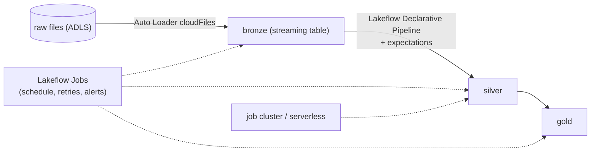

# Spark Processing, Databricks Jobs and Lakeflow Declarative Pipelines

> **Where this fits.** The course's medallion runs locally on pandas + delta-rs, which is perfect up to a few hundred million rows on one machine. Past that - or when the org standardises on Databricks - you move to **Spark**. This lesson maps what you already have to PySpark and to Databricks' production runtime, without pretending you need a cluster for the retail dataset.

## 1. Lesson overview and learning objectives

By the end you can:

- Decide **when Spark earns its complexity** versus single-node pandas/delta-rs/Polars.
- Read the **PySpark** equivalents of the medallion transforms.
- Explain **Databricks** execution: **Lakeflow Jobs** (orchestration), **job clusters vs serverless**, and **Lakeflow Declarative Pipelines** (formerly Delta Live Tables) with **expectations**.
- Describe **Auto Loader** for incremental file ingestion.

## 2. Prerequisites

| Need | Why | From |
|---|---|---|
| The medallion transforms | We port them | [Module 3](../lakehouse/01-lake-warehouse-lakehouse-medallion.md) |
| ELT/orchestration context | Where Spark jobs run | [Previous lesson](04-etl-elt-and-orchestration.md) |
| Delta Lake basics | Spark writes the same tables | [Module 3](../lakehouse/01-lake-warehouse-lakehouse-medallion.md) |

## 3. Core concepts

### 3.1 When do you actually need Spark?

Spark is a distributed engine: it shines when data exceeds one machine's memory/disk or when you need cluster parallelism. It also adds real complexity (cluster sizing, shuffles, JVM, cost). For context, the course's entire year of POS sales is ~1.1 MB as Parquet - single-node tools handle this instantly.

| Reach for… | When |
|---|---|
| **pandas / delta-rs / Polars / DuckDB** (single node) | Up to ~hundreds of millions of rows that fit one machine |
| **Spark (Databricks/Fabric)** | Terabytes, many sources, heavy joins/shuffles, or org standard |

Don't adopt Spark for data a laptop handles - "runs locally" is a feature. ([Decision guide](../../ARCHITECTURE_DECISION_GUIDE.md))

### 3.2 The medallion in PySpark

The logic is identical; the API changes. Silver's idempotent MERGE in PySpark (illustrative):

```python
from pyspark.sql import functions as F
from delta.tables import DeltaTable

bronze = spark.read.table("bronze.pos_sales")
deduped = (bronze.withColumn("rn", F.row_number().over(
             Window.partitionBy("date", "store_id", "product_id").orderBy(F.col("_ingested_at").desc())))
           .filter("rn = 1").drop("rn"))
# ... cast + validate ...
(DeltaTable.forName(spark, "silver.sales").alias("t")
   .merge(valid.alias("s"), "t.date = s.date AND t.store_id = s.store_id AND t.product_id = s.product_id")
   .whenMatchedUpdateAll().whenNotMatchedInsertAll().execute())
```

Compare with the local delta-rs MERGE in [`medallion.py`](../../code/lakehouse_local/medallion.py) - same semantics (dedupe on the business key, upsert). Spark adds partitioning/shuffle control and scales across nodes; delta-rs does it in-process.

### 3.3 Databricks execution: clusters and Lakeflow Jobs

- **Job clusters vs all-purpose**: a **job cluster** is created for a run and torn down after (cheapest for scheduled jobs). An **all-purpose cluster** stays up for interactive work (set auto-termination or it bills idle - the Databricks analogue of the compute-instance trap). **Serverless** compute removes cluster management entirely.
- **Lakeflow Jobs** (formerly Jobs/Workflows) is Databricks' orchestrator: tasks (notebooks, Python, SQL, pipelines) with dependencies, schedules, retries and alerts - the Databricks counterpart to ADF/Fabric pipelines. **Lakeflow Connect** handles managed ingestion. ([Where is DLT / Lakeflow](https://docs.databricks.com/aws/en/ldp/where-is-dlt))

### 3.4 Lakeflow Declarative Pipelines (formerly Delta Live Tables)

**Lakeflow Declarative Pipelines** (announced at the 2025 Data + AI Summit; existing **Delta Live Tables / DLT** code runs unchanged, and the framework is now Spark Declarative Pipelines in Apache Spark) let you declare tables as transformations and let the runtime handle orchestration, incrementalisation and data quality. You declare **expectations** - quality constraints that *warn and keep*, *drop*, or *fail* on violating rows:

```python
import pyspark.pipelines as dp     # the dlt module's new name; @dlt still works
from pyspark.sql import functions as F

@dp.table
@dp.expect_or_drop("valid_units", "units_sold >= 0")   # drop rows that break the rule
def silver_sales():
    return spark.readStream.table("bronze.pos_sales")  # streaming table, incremental
```

This is the managed equivalent of the course's **contract-driven quality gate + quarantine** ([`quality.py`](../../code/lakehouse_local/quality.py)): expectations are where the contract's row rules live on Databricks.

### 3.5 Auto Loader (incremental file ingestion)

**Auto Loader** (`cloudFiles`) incrementally ingests new files from cloud storage as they arrive, tracking what it has seen so it processes each file once - the Spark-streaming way to do Bronze ingestion without re-listing everything. It underpins micro-batch "near real-time" ingestion and is the production analogue of the next lesson's high-watermark pattern.

```python
(spark.readStream.format("cloudFiles")
   .option("cloudFiles.format", "csv")
   .load("abfss://raw@acct.dfs.core.windows.net/pos_sales/")
   .writeStream.option("checkpointLocation", "/chk/pos").table("bronze.pos_sales"))
```

## 4. Architecture diagrams



## 5. Azure service mapping

| Need | Service / capability | Type | Where |
|---|---|---|---|
| Distributed processing | Apache Spark on Azure Databricks | Open source on native service | This lesson |
| Orchestration | Lakeflow Jobs | Native (Databricks) | §3.3 |
| Declarative ETL + quality | Lakeflow Declarative Pipelines + expectations | Native (Databricks) | §3.4 |
| Incremental ingestion | Auto Loader (`cloudFiles`) | Native (Databricks) | §3.5 |
| Single-node alternative | pandas + delta-rs | Open source | [`medallion.py`](../../code/lakehouse_local/medallion.py) |

## 6. Step-by-step implementation

This course runs the medallion **locally** (no Spark needed). To run the *same logic* on Databricks: create a **job cluster** (or serverless), put the transforms in a notebook or a Declarative Pipeline, ingest with Auto Loader, and schedule with Lakeflow Jobs. The PySpark snippets above are the porting guide; the retail dataset does not require a cluster, so the lab keeps the hands-on local and treats Spark as read-and-understand.

## 7. Complete runnable code

- Local, runnable, tested: [`code/lakehouse_local/medallion.py`](../../code/lakehouse_local/medallion.py), [`quality.py`](../../code/lakehouse_local/quality.py), and the incremental step [`code/pipelines/incremental.py`](../../code/pipelines/incremental.py) (next lesson).
- The PySpark/Databricks snippets here are **illustrative** (no Spark in the course build) and mirror that tested logic.

## 8. Expected outputs and verification

- The local medallion produces the same Bronze/Silver/Gold tables a Spark job would (Module 3 numbers). The PySpark MERGE and expectations map 1:1 to the tested delta-rs MERGE and contract checks. **Spark was not run in the build.**

## 9. Independent exercise

1. Rewrite the Gold weekly-feature aggregation ([`medallion.gold_build`](../../code/lakehouse_local/medallion.py)) as PySpark with `groupBy`/window functions. Which parts shuffle?
2. Express the Silver `units_sold >= 0` and uniqueness rules as **expectations**. Which behaviour (warn/drop/fail) matches the course's quarantine approach, and which matches its table-level gate?
3. Decide: for 50 GB of daily files, do you keep single-node delta-rs or move to Spark + Auto Loader? Justify.

## 10. Common errors and troubleshooting

| Symptom | Cause | Fix |
|---|---|---|
| All-purpose cluster bills overnight | No auto-termination | Set auto-termination; use **job clusters**/serverless for scheduled runs |
| `import dlt` examples don't match docs | Rename to Lakeflow Declarative Pipelines | `dlt` still works; new import is `pyspark.pipelines as dp` |
| Auto Loader reprocesses files | Missing/0changed checkpoint location | Keep a stable `checkpointLocation` per stream |
| Spark job slow on tiny data | Spark overhead on data a laptop handles | Use single-node tools below the Spark threshold |

## 11. Security and cost considerations

- **Security**: Databricks reaches ADLS via a **Unity Catalog access connector** (managed identity), not keys (Module 3 glossary); scope catalog/schema grants.
- **Cost**: the big levers are **cluster auto-termination**, **job clusters/serverless** over all-purpose, and **not using Spark below its threshold**. A cluster left running is the Databricks version of the forgotten compute instance.

## 12. Production best practices

- **Right engine for the size**: single-node until data genuinely needs Spark.
- **Job clusters or serverless** for scheduled work; auto-terminate everything interactive.
- **Declarative Pipelines + expectations** for managed ETL and quality; keep the contract as the source of truth.
- **Auto Loader** for file ingestion; stable checkpoints.
- Keep the **same transform logic** portable (the local medallion is the spec).

## 13. Knowledge check

1. Give the rough data-size threshold for choosing Spark over single-node tools, and why "runs locally" is a feature.
2. What replaced Delta Live Tables, and does existing DLT code still run?
3. Job cluster vs all-purpose cluster - which for a scheduled job, and what's the cost trap?
4. What does Auto Loader do that plain batch file reads don't?

<details>
<summary>Answers</summary>

1. Roughly beyond what one machine's memory/disk handles (hundreds of millions of rows / terabytes). Single-node avoids cluster cost and complexity, so staying local when you can is cheaper and simpler.
2. **Lakeflow Declarative Pipelines** (Spark Declarative Pipelines); existing **DLT code runs unchanged**.
3. **Job cluster** (created per run, torn down) for scheduled jobs; an **all-purpose cluster** left running bills idle.
4. It **incrementally** ingests only new files and tracks what it has processed (process-once), instead of re-listing/re-reading the whole folder.

</details>

## 14. Official documentation and further reading

- [Azure Databricks](https://learn.microsoft.com/azure/databricks/introduction/) · [Lakeflow Jobs](https://learn.microsoft.com/azure/databricks/jobs/) · [Where is DLT / Lakeflow Declarative Pipelines](https://docs.databricks.com/aws/en/ldp/where-is-dlt)
- [Lakeflow Declarative Pipelines](https://learn.microsoft.com/azure/databricks/ldp/) · [Auto Loader](https://learn.microsoft.com/azure/databricks/ingestion/cloud-object-storage/auto-loader/)
- [PySpark](https://spark.apache.org/docs/latest/api/python/) · [Delta Lake](https://docs.delta.io/latest/index.html)

**Next:** [Incremental Ingestion, CDC and Pipeline Testing](06-incremental-cdc-and-testing.md).
