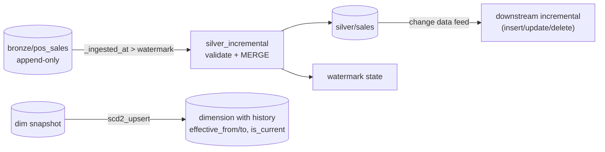

# Incremental Ingestion, Change Data Feed, SCD2 and Pipeline Testing

> **Where this fits.** Module 3's medallion reprocesses *all* of Bronze every run - fine at course scale, wasteful as data grows. This lesson makes processing **incremental** and adds the patterns a real pipeline needs: change data capture, slowly changing dimensions, and tests that prove the pipeline is idempotent and contract-clean. Everything here runs locally on delta-rs.

## 1. Lesson overview and learning objectives

By the end you can:

- Replace full reprocessing with a **high-watermark** incremental Bronze→Silver step, and know why it must be **idempotent**.
- Read a Delta table's **change data feed (CDF)** and explain CDC.
- Keep history with **slowly changing dimension type 2 (SCD2)**.
- **Test** pipelines: idempotency, contract conformance, and data diffing.

Runnable code: [`code/pipelines/incremental.py`](../../code/pipelines/incremental.py).

## 2. Prerequisites

| Need | Why | From |
|---|---|---|
| The medallion Bronze/Silver | What we incrementalise | [Module 3](../lakehouse/01-lake-warehouse-lakehouse-medallion.md) |
| Delta + MERGE | Incremental upserts | [Module 3](../lakehouse/01-lake-warehouse-lakehouse-medallion.md) |
| The data contract + quality gate | Incremental must still validate | [`quality.py`](../../code/lakehouse_local/quality.py) |

## 3. Core concepts

### 3.1 High-watermark incremental processing

Instead of re-reading all of Bronze, track a **watermark** - the highest `_ingested_at` already processed - and process only rows newer than it, then MERGE them into Silver. [`silver_incremental`](../../code/pipelines/incremental.py) does exactly this:

1. Load the watermark (empty on first run).
2. Read Bronze rows with `_ingested_at > watermark` (only the new batch).
3. De-duplicate on the business key, **validate against the contract** (same gate as the full pipeline), cast.
4. **MERGE** into `silver/sales` (upsert on the key).
5. Advance the watermark to the batch's max `_ingested_at`.

**Idempotency is the non-negotiable property**: re-running with no new data must be a no-op, and re-processing an overlapping batch must not double-count. The MERGE (upsert on the business key) guarantees the second; the watermark guarantees the first. Verified locally: a first run processes **244,524** valid rows and sets the watermark; an immediate re-run processes **0** (`skipped`); appending one new Bronze row makes the next run process exactly that **1** row.

> Production stores the watermark durably (a state table, or the orchestrator's variables), not a local file. Azure ML/Databricks equivalents are Auto Loader checkpoints (previous lesson) and CDF below.

### 3.2 Change data feed and CDC

**Change data capture (CDC)** means consuming *what changed* (inserts/updates/deletes) rather than rescanning a whole table. Delta Lake's **change data feed** records this when the table property `delta.enableChangeDataFeed = true` is set (at creation or via `ALTER TABLE`); only changes **after** enabling are captured. Reading it yields the data plus a **`_change_type`** column (`insert`, `delete`, `update_preimage`, `update_postimage`) and `_commit_version`/`_commit_timestamp` ([Delta CDF](https://docs.delta.io/latest/delta-change-data-feed.html)).

[`change_feed`](../../code/pipelines/incremental.py) reads it locally via delta-rs `load_cdf`:

```python
from pipelines.incremental import change_feed
changes = change_feed("data/lake/silver/sales", starting_version=5)
changes["_change_type"].value_counts()   # insert / update_preimage / update_postimage / delete
```

On Databricks the same feed drives downstream incremental tables (`readStream.option("readChangeFeed","true")` or `table_changes(...)`). CDF is how you propagate *updates and deletes* downstream - a high-watermark on an append-only column alone cannot see deletes.

### 3.3 Slowly changing dimensions (SCD type 2)

Dimensions change: a product is re-priced, a store is re-regioned. **SCD type 2** keeps history by versioning rows: when an attribute changes, **close** the current row (`effective_to = asof`, `is_current = False`) and **open** a new current row. Queries "as of" a date join on the validity window. [`scd2_upsert`](../../code/pipelines/incremental.py) implements this as a pure function:

```python
from pipelines.incremental import scd2_upsert
dim = scd2_upsert(current_dim, new_snapshot, keys=["product_id"],
                  attributes=["list_price"], asof="2024-06-01")
```

Use SCD2 for dimensions whose history matters to analysis (price over time); SCD type 1 (overwrite) when only the latest value matters.

### 3.4 Testing pipelines

Data pipelines need tests as much as app code - arguably more, because failures are silent:

- **Transformation unit tests**: run the transform on a tiny fixture and assert the output (the course's [`test_pipeline.py`](../../code/tests/test_pipeline.py)).
- **Contract tests**: the output conforms to its contract; a breaking schema change is blocked ([`contract_compat.py`](../../code/data_mesh/contract_compat.py)).
- **Idempotency tests**: running twice yields the same state (the incremental tests in [`test_pipelines.py`](../../code/tests/test_pipelines.py)).
- **Data diffing**: compare row counts / key sets / aggregates between runs or versions (Delta time travel makes "what changed since version N?" a query).

## 4. Architecture diagrams



## 5. Azure service mapping

| Need | Service / capability | Type | Where |
|---|---|---|---|
| Incremental processing | High-watermark + Delta MERGE | Pattern + open source | [`incremental.py`](../../code/pipelines/incremental.py) |
| CDC | Delta change data feed | Open source | §3.2 |
| History | SCD type 2 | Pattern | §3.3 |
| Managed equivalents | Auto Loader, Lakeflow Declarative Pipelines | Native (Databricks) | [previous lesson](05-spark-and-databricks.md) |
| Pipeline tests in CI | pytest + contract checks | Custom | [Module 7](../mlops/07-cicd-and-iac.md) |

## 6. Step-by-step implementation

**Locally (free), from `code/`:**

```bash
# Build Bronze first (Module 3), then incremental Silver
python lakehouse_local/medallion.py bronze --raw ../data/raw --lake ../data/lake
python -m pipelines.incremental --lake ../data/lake      # first run: processes the batch
python -m pipelines.incremental --lake ../data/lake      # second run: skipped (idempotent)

# Change data feed + SCD2
python - <<'PY'
from pipelines.incremental import change_feed, scd2_upsert
print(change_feed("../data/lake/silver/sales", starting_version=0)["_change_type"].value_counts())
PY
```

## 7. Complete runnable code

- [`code/pipelines/incremental.py`](../../code/pipelines/incremental.py): `silver_incremental`, `change_feed`, `scd2_upsert`, watermark helpers.
- Tests: [`code/tests/test_pipelines.py`](../../code/tests/test_pipelines.py) (idempotency + new-batch, CDF change types, SCD2 close/open).

## 8. Expected outputs and verification

Verified locally (delta-rs 1.6): first incremental run processes **244,524** valid rows (deduped from 245,997; the ~0.6% defects quarantined) and records the watermark; the next run reports `skipped` with 0 rows; appending one new Bronze row makes the following run process exactly 1. The CDF read returns rows with `_change_type` values including `insert` and, after an update, `update_preimage`/`update_postimage`. SCD2 closes the changed row and opens a new current one.

```bash
cd code && python -m pytest tests/test_pipelines.py   # 3 passed in the build
```

## 9. Independent exercise

1. Extend `silver_incremental` to also handle **deletes** from Bronze using the change data feed instead of a high-watermark. Why can't the watermark alone do this?
2. Build an SCD2 **store** dimension and query it "as of" a past date. What join predicate do you use?
3. Write a **data-diff** test: compare `silver/sales` row counts and the set of business keys between two Delta versions; assert no keys vanished unexpectedly.

## 10. Common errors and troubleshooting

| Symptom | Cause | Fix |
|---|---|---|
| Re-run double-counts rows | Append instead of MERGE, or no watermark | Upsert on the business key; advance the watermark |
| CDF read errors / empty | Table written without CDF enabled | Set `delta.enableChangeDataFeed=true` at creation (only post-enable changes are captured) |
| Watermark skips late-arriving data | Clock/`_ingested_at` ordering issues | Use ingestion time, handle late data with a lookback window or CDF |
| SCD2 has two current rows for a key | Didn't close the old row | Ensure the update closes `is_current` before opening the new row |
| Incremental fails the quality gate | New batch has too many defects | That's the gate working; fix upstream or raise the quarantine ratio deliberately |

## 11. Security and cost considerations

- **Security**: incremental steps read/write the lake by identity (Module 2); the watermark/state holds no secrets.
- **Cost**: incremental processing reads and rewrites far less than full reprocessing - the main cost saving of this lesson. CDF adds `_change_data` storage (cleaned by VACUUM per retention); keep retention bounded.

## 12. Production best practices

- **Incremental + idempotent** by default; MERGE on the business key, durable watermark.
- **CDF for updates/deletes** downstream; high-watermark only for append-only sources.
- **SCD2** where dimension history matters; document which dims are type 1 vs 2.
- **Test pipelines** (unit, contract, idempotency, diff) and run them in CI (Module 7).
- **Keep raw Bronze** so any incremental bug can be fixed by a full reprocess.

## 13. Knowledge check

1. What two mechanisms make incremental Silver idempotent, and what does each guarantee?
2. What does a change data feed give you that an append-only high-watermark cannot?
3. In SCD2, what happens to the old and new rows when an attribute changes?
4. Name three kinds of pipeline test and what each catches.

<details>
<summary>Answers</summary>

1. The **watermark** (re-run with no new data is a no-op) and the **MERGE upsert on the business key** (re-processing overlapping rows updates rather than duplicates).
2. Visibility of **updates and deletes** (via `_change_type`); a watermark on an append-only column can't see deletes or in-place updates.
3. The **old** current row is closed (`effective_to = asof`, `is_current = False`) and a **new** current row is opened (`effective_from = asof`, `is_current = True`).
4. **Unit** (transform output on a fixture), **contract** (schema/quality conformance, blocks breaking changes), **idempotency** (two runs → same state); data diffing catches unexpected row/key changes.

</details>

## 14. Official documentation and further reading

- [Delta change data feed](https://docs.delta.io/latest/delta-change-data-feed.html) · [Use CDF on Azure Databricks](https://learn.microsoft.com/azure/databricks/delta/delta-change-data-feed)
- [delta-rs Python](https://delta-io.github.io/delta-rs/) · [Slowly changing dimensions](https://en.wikipedia.org/wiki/Slowly_changing_dimension)
- [Incremental processing with Auto Loader](https://learn.microsoft.com/azure/databricks/ingestion/cloud-object-storage/auto-loader/)

**Next:** [Lab 04: Orchestrated and incremental pipelines](../../labs/lab-04-data-pipelines/README.md), then Module 8 (Azure AI / GenAI).
