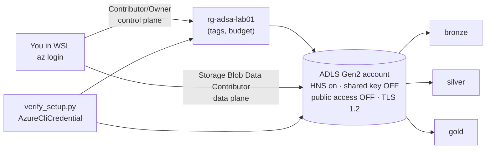

# Lab 01: Secure Azure Setup from WSL

## Overview

You will build the foundation every later lab uses, the secure way from day one:



**Outcome:** `python python/verify_setup.py` prints `ALL CHECKS PASSED`, proving that you can manage resources *and* read/write data using only your Entra ID identity, with no keys anywhere.

**Lesson:** [Azure Fundamentals for Data Scientists](../../docs/azure-fundamentals/01-azure-fundamentals.md)

## Prerequisites

| Requirement | Check | Needed for |
|---|---|---|
| WSL 2 with Ubuntu 22.04/24.04 | PowerShell: `wsl -l -v` shows `VERSION 2` | All tasks |
| Python 3.10+ with `venv` | WSL: `python3 --version` | Tasks 3, 8 |
| Azure CLI in WSL | WSL: `az version` (Task 1 installs it) | Tasks 1-9 |
| An Azure subscription where you can create resource groups and **assign roles** (Owner, or Contributor + User Access Administrator / Role Based Access Control Administrator) | `az role assignment list --assignee <you> --all -o table` | Tasks 4-9 |

**No subscription yet?** Do tasks 1-3 and the offline check in task 8 (`--offline`), then read the rest. See [getting a subscription safely](../../docs/azure-fundamentals/01-azure-fundamentals.md#getting-a-subscription-safely). Nothing in this lab is required to continue with the [lakehouse](../../docs/lakehouse/01-lake-warehouse-lakehouse-medallion.md) and [data mesh](../../docs/data-mesh/01-data-mesh.md) hands-on parts, which run locally.

## Required Azure resources

| Resource | Created by | Billable? | Notes |
|---|---|---|---|
| Resource group `rg-adsa-lab01` | Task 5 | No | Lifecycle boundary; deleting it deletes everything |
| Storage account `stadsa<random>` (StorageV2, Standard_LRS, HNS) | Task 5 | Yes (tiny) | Capacity per GB-month + per-operation transactions |
| Role assignment *Storage Blob Data Contributor* | Task 5 | No | Your data-plane access |
| Cost budget on the resource group | Task 6 | No | Alerts only |
| Microsoft.Storage provider registration | Task 5 | No | One-time per subscription |

## Cost and safety

- **Main cost driver:** storage capacity and transactions. This lab stores a few KB to MB and performs a few hundred operations, which at list prices is far below one US cent per month. Check current rates yourself: `python python/price_check.py --region <your-region>` queries the official [Azure Retail Prices API](https://learn.microsoft.com/rest/api/cost-management/retail-prices/azure-retail-prices), or use the [pricing calculator](https://azure.microsoft.com/pricing/calculator/).
- **Nothing here runs when idle.** There is no compute in this lab.
- **Free allowances:** new Azure free accounts include time-limited credit and 12 months of selected free services; whether this storage is covered depends on the current offer. Assume pay-as-you-go pricing.
- **Budgets do not stop spending.** They email you, possibly a day or more after the spend.
- **Cleanup:** Task 9 deletes the resource group. The lab tags resources with `expires=<today+30d>` so you can find leftovers: `az group list --tag project=adsa -o table`.

## Step-by-step tasks

Copy the lab folder into your Linux home first (performance and file permissions are better than on `/mnt/c`):

```bash
# WSL / Ubuntu
mkdir -p ~/src && cp -r /path/to/azure-data-science-academy ~/src/
cd ~/src/azure-data-science-academy/labs/lab-01-azure-setup
```

### Task 1: Install the Azure CLI in WSL

**Where:** WSL / Ubuntu. (The CLI installed on Windows is separate and does not share sign-in with WSL.)

Microsoft's documented apt installation ([source](https://learn.microsoft.com/cli/azure/install-azure-cli-linux?pivots=apt)):

```bash
sudo apt-get update
sudo apt-get install -y apt-transport-https ca-certificates curl gnupg lsb-release
sudo mkdir -p /etc/apt/keyrings
curl -sLS https://packages.microsoft.com/keys/microsoft.asc | \
  gpg --dearmor | sudo tee /etc/apt/keyrings/microsoft.gpg > /dev/null
sudo chmod go+r /etc/apt/keyrings/microsoft.gpg
AZ_DIST=$(lsb_release -cs)
echo "Types: deb
URIs: https://packages.microsoft.com/repos/azure-cli/
Suites: ${AZ_DIST}
Components: main
Architectures: $(dpkg --print-architecture)
Signed-by: /etc/apt/keyrings/microsoft.gpg" | sudo tee /etc/apt/sources.list.d/azure-cli.sources
sudo apt-get update
sudo apt-get install -y azure-cli
az version
```

Expected: JSON with `"azure-cli": "2.x.y"`. (This course was checked against 2.91.0.)

### Task 2: Run the preflight check

**Where:** WSL.

```bash
bash scripts/00_preflight.sh
```

Expected: `PASS` for WSL, Linux filesystem, Python, venv, git and Azure CLI. Sign-in shows `SKIP` until Task 4.

### Task 3: Create the Python environment

**Where:** WSL.

```bash
python3 -m venv .venv
source .venv/bin/activate
pip install --upgrade pip
pip install -r python/requirements.txt
python python/verify_setup.py --offline
```

Expected last line: `ALL CHECKS PASSED (offline mode: Azure not checked)`.

> **Package note:** current `azure-mgmt-resource` versions expose `ResourceManagementClient` under `azure.mgmt.resource.resources`, and `SubscriptionClient` moved to the separate `azure-mgmt-resource-subscriptions` package. Older tutorials' imports fail.

### Task 4: Sign in and select the subscription

**Where:** WSL.

```bash
az login --use-device-code          # open the shown URL in your Windows browser, enter the code
az account list -o table            # all subscriptions you can see
az account set --subscription "<subscription name or id>"
az account show --query "{name:name, id:id, user:user.name, tenant:tenantId}" -o table
```

**Check the output carefully.** Everything that follows is created in this subscription. Put its ID in `lab.env` (next task) so scripts refuse to drift.

### Task 5: Configure and create the resources

**Where:** WSL. **Billable:** yes (tiny).

```bash
cp lab.env.example lab.env
nano lab.env            # set AZ_LOCATION, OWNER_TAG, BUDGET_EMAIL, AZ_SUBSCRIPTION_ID
bash scripts/01_create_resources.sh
```

What [`01_create_resources.sh`](scripts/01_create_resources.sh) does, step by step (read it before running it):

1. Confirms the subscription with you.
2. Registers the `Microsoft.Storage` provider.
3. Creates the resource group with `project`, `lab`, `env`, `owner`, `expires` tags.
4. Picks a free, globally unique storage name and saves it to `.lab-state`.
5. Creates the account with `--hns true --allow-shared-key-access false --allow-blob-public-access false --min-tls-version TLS1_2 --https-only true`.
6. Assigns **you** *Storage Blob Data Contributor* on that account only.
7. Creates `bronze`, `silver`, `gold` file systems with `--auth-mode login`, retrying while the role propagates.

**Alternative: infrastructure as code.** The same account, file systems and role assignment are defined in [`infra/main.bicep`](infra/main.bicep):

```bash
source lab.env
az group create -n "$AZ_RESOURCE_GROUP" -l "$AZ_LOCATION" --tags project=adsa env=lab owner="$OWNER_TAG"
az deployment group what-if --resource-group "$AZ_RESOURCE_GROUP" --template-file infra/main.bicep \
  --parameters storageAccountName=stadsa$RANDOM$RANDOM principalId=$(az ad signed-in-user show --query id -o tsv)
# then the same command with `create` instead of `what-if`
```

If you deploy with Bicep, add `STORAGE_ACCOUNT=<the name>` to `.lab-state` so the verification script finds it.

### Task 6: Create a budget

**Where:** WSL (or the portal: resource group → *Budgets* → *Add*).

```bash
bash scripts/02_create_budget.sh
```

Expected: JSON showing the budget name, amount, `Monthly`, and alerts `actual_50`, `actual_100`, `forecast_100`. The script uses the Budgets REST API through `az rest` because the CLI's preview `az consumption budget create` cannot configure notifications.

### Task 7: Explore the control and data planes by hand

**Where:** WSL.

```bash
source lab.env; source .lab-state
# Control plane: read the security settings
az storage account show -n "$STORAGE_ACCOUNT" -g "$AZ_RESOURCE_GROUP" \
  --query "{hns:isHnsEnabled, sharedKey:allowSharedKeyAccess, publicBlob:allowBlobPublicAccess, tls:minimumTlsVersion}" -o table

# Data plane with your identity
echo "hello lakehouse" > /tmp/hello.txt
az storage fs file upload -f bronze -s /tmp/hello.txt -p _lab01/hello.txt --account-name "$STORAGE_ACCOUNT" --auth-mode login
az storage fs file list -f bronze --path _lab01 --account-name "$STORAGE_ACCOUNT" --auth-mode login -o table

# Now try key-based auth and watch it fail (this is the point)
az storage fs file list -f bronze --account-name "$STORAGE_ACCOUNT" --auth-mode key -o table
```

Expected: the last command fails (shared key is disabled, or listing keys is refused). Clean up the test file:

```bash
az storage fs file delete -f bronze -p _lab01/hello.txt --account-name "$STORAGE_ACCOUNT" --auth-mode login --yes
```

### Task 8: Verify from Python

**Where:** WSL, virtual environment active.

```bash
python python/verify_setup.py
```

Expected output (names will differ):

```text
Local
  PASS [local] python >= 3.10  (3.12.3)
  PASS [local] import azure.identity
  ...
Control plane (management.azure.com)
  PASS [control] Azure CLI credential issues a token
  PASS [control] subscription visible  (1111...)
  PASS [control] resource group rg-adsa-lab01 exists  (westeurope)
  PASS [control] resource group has project/owner/expires tags  (project=adsa, ...)
  PASS [control] hierarchical namespace enabled (ADLS Gen2)
  PASS [control] shared key access disabled
  PASS [control] public blob access disabled
  PASS [control] minimum TLS 1.2
Data plane (dfs.core.windows.net)
  PASS [data] write bronze/_lab01/verify_1760000000.parquet  (1272 bytes)
  PASS [data] read back and compare  (3 rows)
  PASS [data] list directory  (1 item(s))
  PASS [data] delete test file

ALL CHECKS PASSED
```

**Optional stretch:** run the lakehouse pipeline against this account, as described in the [lakehouse lesson, step 6](../../docs/lakehouse/01-lake-warehouse-lakehouse-medallion.md#6-step-by-step-implementation).

### Task 9: Clean up

**Where:** WSL. **Irreversible.**

```bash
bash scripts/99_cleanup.sh
az group exists --name rg-adsa-lab01      # expect: false
```

If you plan to continue straight to the next labs, you may keep the resource group; it costs almost nothing. Delete it before the `expires` tag date either way.

## Completion checklist

- [ ] Azure CLI installed in WSL and `az version` works
- [ ] Preflight script passes the environment checks
- [ ] Virtual environment created and offline verification passes
- [ ] Signed in with `az login --use-device-code` and the correct subscription selected
- [ ] Resource group, ADLS Gen2 account, role assignment and file systems created
- [ ] Budget with email alerts created on the lab resource group
- [ ] Uploaded and listed a file with `--auth-mode login`; observed key-based access fail
- [ ] `verify_setup.py` prints ALL CHECKS PASSED
- [ ] (Optional) Deployed the same storage with `infra/main.bicep` using what-if first
- [ ] Resource group deleted, or consciously kept with an `expires` tag

## Verification criteria

You have completed the lab when:

1. `python python/verify_setup.py` exits with code 0 and prints `ALL CHECKS PASSED`.
2. `az storage account show ... --query allowSharedKeyAccess` returns `false`.
3. `az consumption budget list --resource-group rg-adsa-lab01 -o table` (or the portal) shows your budget.
4. After cleanup, `az group exists --name rg-adsa-lab01` returns `false`.

## Cleanup

`bash scripts/99_cleanup.sh` deletes the budget and the resource group (with everything in it) after showing what will be removed and asking for confirmation. Manual equivalent:

```bash
az group delete --name rg-adsa-lab01 --yes
```

Storage accounts have no soft-delete for the account itself by default in this configuration; once the group is deleted, the data is gone. Leftover search: `az group list --tag project=adsa -o table`.

## Troubleshooting

| Symptom | Cause | Fix |
|---|---|---|
| `Please run 'az login'` | Not signed in inside WSL | `az login --use-device-code` |
| `AuthorizationFailed` creating the RG/account | No control-plane rights | Need Contributor (or Owner) at subscription or RG scope |
| `AuthorizationFailed` on `role assignment create` | You cannot assign roles | Ask for Owner, User Access Administrator or Role Based Access Control Administrator on the RG, or ask an admin to assign the role |
| `az ad signed-in-user show` fails | Guest account or restricted Graph access | Use `--assignee <your-UPN>` instead of `--assignee-object-id` in the script |
| Script keeps printing "not authorised yet" | Role propagation | Normally resolves within minutes; if it doesn't, check `az role assignment list --scope <storage id>` |
| `KeyBasedAuthenticationNotPermitted` | A command defaulted to key auth | Add `--auth-mode login` |
| `RequestDisallowedByPolicy` | An Azure Policy in your org (e.g. allowed regions, required tags) | Read the policy name in the error; adjust region/tags or ask your admin |
| `StorageAccountAlreadyTaken` | Global name collision | Remove `STORAGE_ACCOUNT` from `.lab-state` and rerun |
| Token or `AADSTS` clock errors | WSL clock drift | `sudo hwclock -s` or `wsl --shutdown` from PowerShell |
| Budget creation returns 400 | Start date not the first of the month or invalid email | The script computes the date; check `BUDGET_EMAIL` |
| `verify_setup.py`: `ImportError` | Old package layout or venv not active | `source .venv/bin/activate`; `pip install -r python/requirements.txt` |

## What was tested in this course build

- `verify_setup.py --offline` runs and passes; `python -m pytest python/tests` passes (7 tests), including a fake-transport test that runs the real Azure SDK request/response path for the control-plane checks.
- The shell scripts were syntax-checked, shellchecked and executed end to end against a **stubbed** `az` CLI; every `az` invocation was parse-checked against Azure CLI 2.91.0.
- `infra/main.bicep` compiles and lints cleanly with Bicep 0.48.1.
- **Not tested here:** execution against a real Azure subscription (the build environment has none). Treat your first run as the real test and report anything that differs.

## References

- [Install the Azure CLI on Linux](https://learn.microsoft.com/cli/azure/install-azure-cli-linux)
- [Authorize access to blobs using Microsoft Entra ID](https://learn.microsoft.com/azure/storage/blobs/authorize-access-azure-active-directory)
- [Prevent Shared Key authorization](https://learn.microsoft.com/azure/storage/common/shared-key-authorization-prevent)
- [Assign Azure roles using Azure CLI](https://learn.microsoft.com/azure/role-based-access-control/role-assignments-cli)
- [Create and manage budgets](https://learn.microsoft.com/azure/cost-management-billing/costs/tutorial-acm-create-budgets)
- [Bicep: storage account resource reference](https://learn.microsoft.com/azure/templates/microsoft.storage/storageaccounts)
- [Azure Identity credential chains (Python)](https://learn.microsoft.com/azure/developer/python/sdk/authentication/credential-chains)
