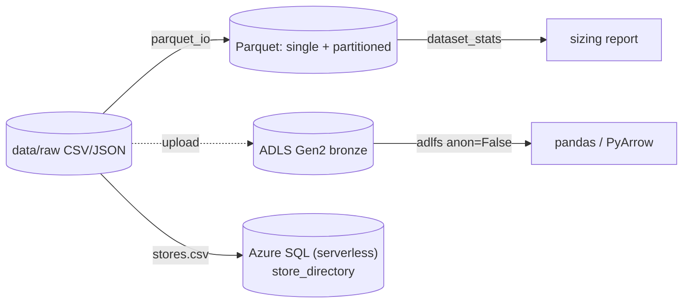

# Lab 02: Cloud Storage and Data Access

## Overview

This lab practises the storage skills from Module 2: Parquet I/O and layout (local, free), then identity-based access to ADLS Gen2 and a serverless Azure SQL Database (optional, on Azure).



What is what: **Parquet**, **PyArrow**, **adlfs** are open source; **ADLS Gen2** and **Azure SQL Database** are native services; the I/O helpers are **course code** ([`code/storage/`](../../code/storage/)). Read the three Module 2 lessons alongside this lab.

## Prerequisites

| Requirement | Check | Needed for |
|---|---|---|
| Python venv with `pyarrow`, `pandas`, `adlfs` | `python -c "import adlfs, pyarrow"` | Tasks 1-3 |
| Synthetic data generated | `data/raw/` exists (Lab 03 task 2) | All tasks |
| Storage account (Lab 01) + your data role | `az storage fs list ... --auth-mode login` | Task 4 (optional) |
| ODBC Driver 18 + `pyodbc` | `python -c "import pyodbc"` | Task 5 (optional) |

## Required Azure resources

| Resource | Created by | Billable? | Notes |
|---|---|---|---|
| ADLS Gen2 container | Lab 01 / task 4 | Negligible (few MB) | Identity-based access |
| Azure SQL Database (serverless) | Task 5 | Near-zero when paused | 15-minute auto-pause |

## Cost and safety

- **Tasks 1-3 are free** (local Parquet).
- ADLS holds a few MB (cents). The serverless SQL DB pauses after 15 idle minutes and then bills only storage; a brief lab session is a few cents. Confirm with the [pricing calculator](https://azure.microsoft.com/pricing/calculator/).

## Step-by-step tasks

### Task 1: setup

**Where:** WSL, from `code/`.

```bash
source .venv/bin/activate
pip install -r requirements.txt            # includes adlfs
python retail_data/generate.py --out ../data/raw --seed 42   # if not already done
```

### Task 2: CSV to Parquet and sizing

**Where:** WSL

```bash
python -m storage.parquet_io ../data/raw/pos_sales ../data/parquet/pos_sales
```

Expect ~246,492 rows and about **1.1 MB** of snappy Parquet (the same data is ~14 MB as CSV).

### Task 3: partitioned layout, pruning and projection

**Where:** WSL / Python

```bash
python - <<'PY'
from storage.parquet_io import read_parquet, write_parquet, dataset_stats
df = read_parquet("../data/parquet/pos_sales")
write_parquet(df, "../data/parquet/by_store", partition_cols=["store_id"])
print("partitioned:", dataset_stats("../data/parquet/by_store"))
one = read_parquet("../data/parquet/by_store", filters=[("store_id","==","S001")], columns=["date","units_sold"])
print("pruned+projected rows/cols:", one.shape)
PY
```

Note how partitioning on a high-cardinality key (store_id) makes many files - discuss in your notes which key is a better choice.

### Task 4 (Azure, optional): upload and read through adlfs

**Where:** WSL, signed in. **Billable (a few MB).**

```bash
az storage fs create -n bronze --account-name <acct> --auth-mode login
az storage fs directory upload -f bronze --account-name <acct> --auth-mode login \
  -s ../data/parquet/pos_sales -d pos_sales --recursive
python - <<'PY'
from storage.parquet_io import read_parquet, adls_storage_options
df = read_parquet("az://bronze/pos_sales", storage_options=adls_storage_options("<acct>"))
print(df.shape)
PY
```

### Task 5 (Azure, optional): reference data in serverless Azure SQL

**Where:** WSL. **Billable (near-zero when paused).**

```bash
az sql db create -g <rg> -s <server> -n refdata \
  --edition GeneralPurpose --compute-model Serverless --family Gen5 --capacity 1 \
  --auto-pause-delay 15 --min-capacity 0.5
python sql/load_reference_data.py --server <server>.database.windows.net \
  --database refdata --stores ../../data/raw/stores.csv
```

## Completion checklist

- [ ] venv with `adlfs`/`pyarrow` ready and data generated
- [ ] POS CSVs converted to Parquet; sizing report seen (~1.1 MB)
- [ ] Partitioned dataset written; partition pruning + column projection run
- [ ] Noted why store_id is a poor partition key vs region/date
- [ ] (Azure, optional) Uploaded to ADLS Gen2 and read it via adlfs with `anon=False`
- [ ] (Azure, optional) Loaded store reference data into serverless Azure SQL with Entra auth
- [ ] `python -m pytest tests/test_storage.py` passes in `code/`
- [ ] Azure resources cleaned up (SQL DB + container) if you did tasks 4-5

## Verification criteria

```bash
cd code && python -m pytest tests/test_storage.py    # 5 passed at build time
```

## Cleanup

- **Local:** `rm -rf ../data/parquet`.
- **Azure:** `az sql db delete -g <rg> -s <server> -n refdata --yes`; `az storage fs delete -n bronze --account-name <acct> --auth-mode login --yes`; or `az group delete --name <rg> --yes --no-wait`.

## Troubleshooting

| Symptom | Cause | Fix |
|---|---|---|
| adlfs 403 / reads nothing | `anon` left `True`, or missing data role/ACL | Pass `anon=False` (use `adls_storage_options`); grant the role/ACL |
| Thousands of tiny files | Partitioned on `store_id` (high cardinality) | Partition on region/date; compact |
| SQL first query times out | Serverless resuming from pause | Retry; expect a few seconds |
| `ODBC Driver 18` not found | Driver not installed in WSL | Install `msodbcsql18` from the Microsoft apt repo |

## What was tested in this course build

Tasks 1-3 and the test suite were **run** on Linux (Python 3.14): the sizing numbers (246,492 rows → ~1.1 MB Parquet) and the partition/projection behaviour are from those runs. Tasks 4-5 (Azure) were **not** run (no subscription); the adlfs and Entra-token patterns follow the Module 2 lessons' cited docs.

## References

- [Blob vs ADLS Gen2 and access control](../../docs/storage-and-data-engineering/01-storage-and-access-control.md)
- [Python data access](../../docs/storage-and-data-engineering/02-python-data-access.md)
- [Azure SQL Database](../../docs/storage-and-data-engineering/03-azure-sql.md)
- [ADLS Gen2 Python](https://learn.microsoft.com/azure/storage/blobs/data-lake-storage-directory-file-acl-python) · [Passwordless Python for Azure SQL](https://learn.microsoft.com/azure/azure-sql/database/azure-sql-passwordless-migration-python)
