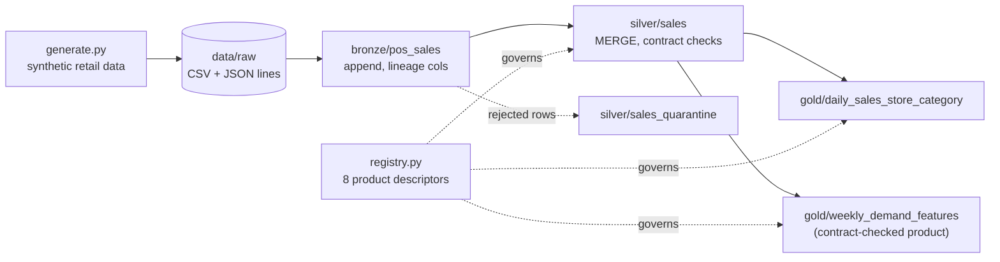

# Lab 03: Local Medallion Lakehouse and Data Products

## Overview

This lab is the hands-on companion to the two Module 3 lessons. It packages their exercises into one tracked run with a checklist. Everything runs locally on open-source Delta Lake (delta-rs), so you need no Azure subscription; the optional last task points the same code at ADLS Gen2.



What is what: Delta Lake and delta-rs are **open source**; the medallion layout and data contracts are **patterns**; the registry and compatibility checker are **custom code** written for this course (on Azure their roles map to Unity Catalog and Microsoft Purview, see the [data mesh lesson](../../docs/data-mesh/01-data-mesh.md#5-azure-service-mapping)).

## Prerequisites

- The [lakehouse lesson](../../docs/lakehouse/01-lake-warehouse-lakehouse-medallion.md) and the [data mesh lesson](../../docs/data-mesh/01-data-mesh.md) (you can read them side by side).
- Python 3.10 or newer in WSL/Ubuntu (tested with 3.13), about 300 MB free disk for the virtual environment and data.

## Tasks

All commands run in the **WSL / Ubuntu terminal**, from the academy's `code/` folder, with the virtual environment active.

### Task 1: set up the environment

**Where:** WSL

```bash
cd ~/src/azure-data-science-academy/code   # adjust to your copy
python3 -m venv .venv
source .venv/bin/activate
pip install -r requirements.txt
```

Keep the academy on the Linux filesystem (`~/...`), not under `/mnt/c/...`: file I/O across the Windows boundary is many times slower.

### Task 2: generate the data

**Where:** WSL

```bash
python retail_data/generate.py --out ../data/raw --seed 42
```

Expect 24 monthly POS files (about 246k rows) plus `stores.csv`, `products.json` and `calendar.csv`. About 0.6% of rows are deliberately defective so the quality gate has something to catch.

### Task 3: build Bronze, Silver and Gold

**Where:** WSL

```bash
python lakehouse_local/medallion.py all --raw ../data/raw --lake ../data/lake
```

Expected (deterministic with seed 42): Bronze ingests 24 files; Silver keeps 244,524 rows and quarantines 1,473 (0.599%), batch `PASSED`; Gold writes 30,750 daily rows and 42,000 weekly feature rows.

### Task 4: prove idempotency and time travel

**Where:** WSL, then Python

```bash
python lakehouse_local/medallion.py all --raw ../data/raw --lake ../data/lake      # Bronze skips 24 files
python lakehouse_local/medallion.py history --lake ../data/lake --table silver/sales
```

```python
from deltalake import DeltaTable
print(DeltaTable("../data/lake/silver/sales", version=0).to_pandas().shape)
print(DeltaTable("../data/lake/silver/sales_quarantine").to_pandas()["_reject_reason"].value_counts())
```

### Task 5: govern the outputs as data products

**Where:** WSL

```bash
python data_mesh/registry.py validate                         # 8 products, 0 errors, 5 warnings
python data_mesh/registry.py impact sales.pos-transactions    # 4 downstream products
python data_mesh/registry.py mermaid > ../data/lineage.mmd
```

Read the five warnings: they are real review items (missing contracts on published ports, and derived products classified lower than their confidential input).

### Task 6: block a breaking contract change

**Where:** WSL

```bash
python data_mesh/contract_compat.py contracts/sales.pos_sales.v1.yaml \
  contracts/proposals/sales.pos_sales.v1.1-proposal.yaml
echo $?   # 1 = rejected: a rename is breaking and needs a major version
```

Then copy the proposal, change its `version` to `2.0.0`, and run the check again: it passes.

### Task 7 (optional, Azure): write the lakehouse to ADLS Gen2

**Where:** WSL, signed in with `az login`, with Lab 01's storage account and your *Storage Blob Data Contributor* role.

```bash
az storage fs create --name lakehouse --account-name <yourStorageAccount> --auth-mode login
python lakehouse_local/medallion.py all --raw ../data/raw \
  --lake "abfss://lakehouse@<yourStorageAccount>.dfs.core.windows.net/retail"
```

Authentication uses your Azure CLI sign-in (no keys or SAS). **Not verified in the build environment**, which had no Azure subscription.

## Completion checklist

- [ ] Virtual environment created and `requirements.txt` installed
- [ ] Synthetic data generated with seed 42 (24 POS files)
- [ ] Bronze, Silver and Gold tables built, each with a `_delta_log` folder
- [ ] Silver quality gate passed with about 0.6% of rows quarantined
- [ ] Second run skipped all Bronze files and inserted no Silver rows
- [ ] Read Silver at version 0 (time travel) and inspected quarantine reasons
- [ ] Registry validation run and its five warnings explained in your own words
- [ ] Breaking contract proposal rejected, then accepted as a major version
- [ ] `python -m pytest` passes in `code/`

## Verification

```bash
python -m pytest     # from code/: 15 passed at the time of writing
```

## Cleanup

Local only: `rm -rf ../data/lake ../data/raw ../data/lineage.mmd` (regenerate any time). If you did task 7, delete the container: `az storage fs delete --name lakehouse --account-name <yourStorageAccount> --auth-mode login --yes`, or run Lab 01's cleanup script to remove the whole resource group.

## Troubleshooting

| Symptom | Cause and fix |
|---|---|
| `ModuleNotFoundError: deltalake` | The virtual environment is not active: `source .venv/bin/activate`. |
| `Silver quality gate failed; nothing written` | You raised `--dq-defect-rate` above 1%. That is the gate working; lower it or pass `--max-quarantine-ratio`. |
| Very slow runs | The folder is under `/mnt/c`. Move it to the Linux filesystem. |
| `abfss` write fails with 403 | Missing data-plane role, or it was assigned less than a few minutes ago. See Lab 01 troubleshooting. |

## What was tested

Tasks 1 to 6 and the test suite were run in the build environment (Linux, Python 3.13): the numbers above are from those runs. Task 7 was not run (no Azure subscription).
