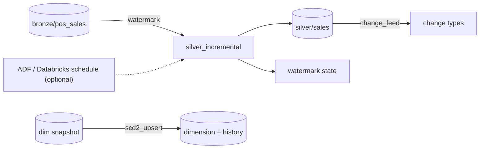

# Lab 04: Orchestrated and Incremental Pipelines

## Overview

This lab turns the Module 3 medallion into a production-shaped pipeline: incremental, idempotent, change-aware. The core runs locally on delta-rs (free); orchestration on a schedule is the optional Azure part.



Course code: [`code/pipelines/incremental.py`](../../code/pipelines/incremental.py). Read the three Module 4 lessons alongside this lab.

## Prerequisites

| Requirement | Check | Needed for |
|---|---|---|
| venv with `deltalake>=1.0` | `python -c "import deltalake"` | Tasks 1-4 |
| Synthetic data + Bronze | `data/lake/bronze/pos_sales` exists | All tasks |
| ADF or Databricks workspace | portal access | Task 5 (optional) |

## Required Azure resources

| Resource | Created by | Billable? | Notes |
|---|---|---|---|
| Azure Data Factory | Task 5 (optional) | Per activity run (cents) | Schedule trigger |
| Azure Databricks job | Task 5 alt (optional) | Job-cluster minutes | Auto-terminates |
| ADLS Gen2 | Lab 01 | Negligible | Holds the lake |

## Cost and safety

- **Tasks 1-4 are free** (local delta-rs).
- ADF bills per activity run (cents for this data); a Databricks **job cluster** bills only while running and tears down after. Nothing bills idle if you avoid all-purpose clusters without auto-termination.

## Step-by-step tasks

### Task 1: setup and Bronze

**Where:** WSL, from `code/`.

```bash
source .venv/bin/activate
python retail_data/generate.py --out ../data/raw --seed 42        # if needed
python lakehouse_local/medallion.py bronze --raw ../data/raw --lake ../data/lake
```

### Task 2: incremental Silver and idempotency

**Where:** WSL

```bash
python -m pipelines.incremental --lake ../data/lake      # processes the batch
python -m pipelines.incremental --lake ../data/lake      # "skipped": true (idempotent)
```

Expect the first run to process ~244,524 valid rows and set a watermark; the second to process 0.

### Task 3: change data feed

**Where:** WSL / Python

```bash
python - <<'PY'
from pipelines.incremental import change_feed
# silver/sales was written by the incremental step; CDF needs the table to have
# been created with change data feed enabled - see the lesson's cdf example.
import pandas as pd, pyarrow as pa
from deltalake import DeltaTable, write_deltalake
p = "../data/lake/demo_cdf"
write_deltalake(p, pa.Table.from_pandas(pd.DataFrame({"id":[1,2],"v":["a","b"]}), preserve_index=False),
                configuration={"delta.enableChangeDataFeed":"true"})
DeltaTable(p).update(updates={"v":"'Z'"}, predicate="id = 1")
print(change_feed(p, 0)["_change_type"].value_counts())
PY
```

### Task 4: SCD type 2 dimension update

**Where:** WSL / Python

```bash
python - <<'PY'
import pandas as pd
from pipelines.incremental import scd2_upsert
cur = pd.DataFrame({"product_id":["P1"],"list_price":[1.0],
                    "effective_from":["2024-01-01"],"effective_to":[None],"is_current":[True]})
upd = pd.DataFrame({"product_id":["P1"],"list_price":[1.5],"asof":["2024-06-01"]})
print(scd2_upsert(cur, upd, keys=["product_id"], attributes=["list_price"], asof="2024-06-01"))
PY
```

You should see the old P1 row closed (`is_current=False`) and a new current row at 1.5.

### Task 5 (Azure, optional): orchestrate on a schedule

**Where:** Portal / CLI. **Billable (per run).**

Create an ADF pipeline (or a Databricks job) with three steps that run the medallion Bronze→Silver→Gold (or the incremental step) as notebook/Spark activities, on a weekly **schedule trigger**, each with retries and a failure alert. The lesson shows the ADF trigger JSON and the Databricks mapping. Then switch the Silver step from full reprocessing to the incremental step and confirm subsequent runs process only new data.

## Completion checklist

- [ ] venv ready; Bronze built
- [ ] Incremental Silver processed the batch; re-run reported `skipped` (idempotent)
- [ ] Read a Delta change data feed and saw `_change_type` values
- [ ] Applied an SCD2 update: old row closed, new current row opened
- [ ] Explained why a high-watermark can't capture deletes (CDF can)
- [ ] (Azure, optional) Orchestrated the medallion on a schedule with retries + alert
- [ ] (Azure, optional) Switched Silver to incremental and confirmed it processes only new data
- [ ] `python -m pytest tests/test_pipelines.py` passes in `code/`
- [ ] Azure resources cleaned up (clusters auto-terminated / pipeline deleted) if used

## Verification criteria

```bash
cd code && python -m pytest tests/test_pipelines.py    # 3 passed at build time
```

## Cleanup

- **Local:** `rm -rf ../data/lake/demo_cdf ../data/lake/_state`.
- **Azure:** delete the ADF (`az datafactory delete ...`) or the Databricks job; ensure no all-purpose cluster is left running; or `az group delete --name <rg> --yes --no-wait`.

## Troubleshooting

| Symptom | Cause | Fix |
|---|---|---|
| Incremental re-run still processes rows | Watermark not saved (path not writable) | Check `_state/` is writable; it stores the watermark |
| CDF read empty/errors | Table created without CDF enabled | Recreate with `delta.enableChangeDataFeed=true` (only post-enable changes captured) |
| Double-counted rows | Appended instead of MERGE | The incremental step upserts on the business key |
| Databricks cluster bills overnight | All-purpose cluster, no auto-terminate | Use a job cluster/serverless; set auto-termination |

## What was tested in this course build

Tasks 1-4 and the tests were **run** on Linux (Python 3.14, delta-rs 1.6): first incremental run processed 244,524 valid rows and set a watermark; re-run skipped; CDF and SCD2 behaved as above. Task 5 (ADF/Databricks orchestration) was **not** run (no subscription); the trigger/job patterns follow the Module 4 lessons' cited docs.

## References

- [ETL/ELT and orchestration](../../docs/storage-and-data-engineering/04-etl-elt-and-orchestration.md)
- [Spark and Databricks](../../docs/storage-and-data-engineering/05-spark-and-databricks.md)
- [Incremental, CDC and testing](../../docs/storage-and-data-engineering/06-incremental-cdc-and-testing.md)
- [Delta change data feed](https://docs.delta.io/latest/delta-change-data-feed.html) · [ADF triggers](https://learn.microsoft.com/azure/data-factory/concepts-pipeline-execution-triggers)
