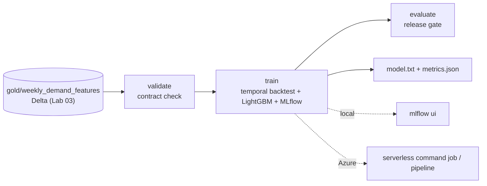

# Lab 05: Train and Backtest the Demand Model (Local then Azure ML)

## Overview

This lab turns the Gold feature table from [Lab 03](../lab-03-lakehouse/README.md) into a trained, backtested, tracked demand model. You do it twice with the **same code**: first locally (no Azure, no cost), then as an Azure ML job. The local part is the real deliverable for the capstone's Stage 1 model; the Azure part shows how it operationalises.



What is what: **LightGBM**, **MLflow** and **delta-rs** are open source; the backtest, metrics and release gate are **course code** ([`code/forecasting/`](../../code/forecasting/)); the workspace, serverless compute, command job and pipeline are **native Azure ML**. Read the [jobs lesson](../../docs/azure-machine-learning/02-jobs-data-and-tracking.md) alongside this lab.

## Prerequisites

| Requirement | Check | Needed for |
|---|---|---|
| Lab 03 completed (or run its steps) | `gold/weekly_demand_features` exists | All tasks |
| Python 3.10+ in WSL with the venv | `python -c "import lightgbm, mlflow"` | Tasks 1-4 (local) |
| Azure ML workspace + `az ml` extension | `az ml workspace show` | Tasks 5-7 (Azure, optional) |
| Workspace identity has *Storage Blob Data Reader* on the lake | Role visible in IAM | Task 6-7 |

## Required Azure resources

| Resource | Created by | Billable? | Notes |
|---|---|---|---|
| Azure ML workspace | You (task 5) | Dependents may cost pennies/day | Free resource; Storage/KV/App Insights are dependents |
| Container Registry (Basic) | Workspace, on first env build | **Yes, daily** | Delete at end of module, not between labs |
| Serverless compute (CPU) | The job | **Yes, per job runtime** | Nothing persists between jobs |
| ADLS Gen2 | Lab 01 | Negligible (few MB) | Holds the Gold table |

## Cost and safety

- **Tasks 1-4 are free**: everything runs locally on open-source Delta + LightGBM + MLflow.
- The Azure part costs **minutes of one CPU VM** per job plus the **one-time image build**, after which the **Basic ACR bills daily** until you delete it. No GPU is used or needed.
- Serverless leaves **nothing running** between jobs - there is no cluster or endpoint to forget. The only standing charge is ACR (and a few cents of storage).
- Confirm current rates with the [pricing calculator](https://azure.microsoft.com/pricing/calculator/).

## Step-by-step tasks

### Task 1: set up (reuse the Lab 03 venv)

**Where:** WSL, from the academy `code/` folder.

```bash
cd ~/src/azure-data-science-academy/code       # adjust to your copy
source .venv/bin/activate
pip install -r requirements.txt                 # now also installs lightgbm + mlflow
```

### Task 2: make sure the Gold table exists

**Where:** WSL

```bash
python retail_data/generate.py --out ../data/raw --seed 42        # if not already done in Lab 03
python lakehouse_local/medallion.py all --raw ../data/raw --lake ../data/lake
```

Expect `gold: {"daily_sales_store_category": 30750, "weekly_demand_features": 42000}`.

### Task 3: validate, then backtest and train locally

**Where:** WSL

```bash
python -m forecasting.validate --data ../data/lake/gold/weekly_demand_features    # CONTRACT OK
python -m forecasting.train    --data ../data/lake/gold/weekly_demand_features \
  --output ../data/model --n-estimators 300
```

Expected (deterministic, seed 42): 42,000 rows / 400 series / 105 weeks; 4-fold backtest **WAPE ≈ 0.227, bias ≈ +0.022, MASE ≈ 0.707**, about **33% lower WAPE than the persistence baseline** (naive WAPE ≈ 0.337). Files `metrics.json` and `model/model.txt` appear under `../data/model`.

### Task 4: inspect runs and apply the release gate

**Where:** WSL

```bash
mlflow ui --backend-store-uri ../data/model/mlruns    # open http://127.0.0.1:5000, compare runs
python -m forecasting.evaluate --metrics ../data/model/metrics.json   # RELEASE APPROVED
```

Then tighten the gate and watch it block: `python -m forecasting.evaluate --metrics ../data/model/metrics.json --wape-max 0.20`.

### Task 5 (Azure, optional): create the workspace and environment

**Where:** WSL, signed in with `az login`. **Billable (ACR build).**

```bash
az ml workspace create --name mlw-adsa --resource-group rg-adsa-ml --location <region>
az configure --defaults group=rg-adsa-ml workspace=mlw-adsa
az ml environment create -f aml/environment.yml      # builds the image once (ACR)
```

### Task 6 (Azure, optional): register the data asset and run the command job

**Where:** WSL. **Billable (serverless job).** Requires the workspace identity to have *Storage Blob Data Reader* on your Lab 01 storage account (see the [workspace lesson](../../docs/azure-machine-learning/01-workspace-compute-and-costs.md)).

```bash
az ml data create --name weekly_demand_features --type uri_folder \
  --path "abfss://lakehouse@<yourStorageAccount>.dfs.core.windows.net/retail/gold/weekly_demand_features"
az ml job create -f aml/train-job.yml --web          # serverless; opens Studio
```

In Studio, confirm the job's MLflow metrics match the local numbers and that the output `model` contains `model.txt` + `metrics.json`. The SDK equivalent is [`aml/submit_job.py`](aml/submit_job.py).

### Task 7 (Azure, optional): run the validate-train-evaluate pipeline

**Where:** WSL. **Billable (serverless steps).**

```bash
python aml/submit_pipeline.py --subscription <id> --resource-group rg-adsa-ml \
  --workspace mlw-adsa \
  --gold-uri "abfss://lakehouse@<yourStorageAccount>.dfs.core.windows.net/retail/gold/weekly_demand_features"
```

The pipeline graph should show `validate → train → evaluate`; `evaluate` writes a `decision.json` (promote/block).

## Completion checklist

- [ ] Virtual environment active with `lightgbm` and `mlflow` installed
- [ ] Gold table present (42,000 weekly rows with seed 42)
- [ ] Contract validation passed (`CONTRACT OK`)
- [ ] Local backtest run: WAPE ≈ 0.23, MASE < 1, bias within ±5%
- [ ] Runs compared in `mlflow ui`
- [ ] Release gate run: approved at defaults, blocked with a stricter threshold
- [ ] (Azure, optional) Workspace + custom environment created
- [ ] (Azure, optional) Command job ran on serverless compute; metrics match local
- [ ] (Azure, optional) validate-train-evaluate pipeline ran end to end
- [ ] `python -m pytest` passes in `code/`
- [ ] Azure resources cleaned up (ACR + workspace deleted) if you did tasks 5-7

## Verification criteria

```bash
cd code && python -m pytest       # forecasting + existing tests (25 passed at build time)
cat ../data/model/metrics.json    # aggregate WAPE/MASE/bias and per-fold rows
```

A correct model: MASE < 1 (beats naive), WAPE around 0.23 on this synthetic data, |bias| ≤ 0.05.

## Cleanup

- **Local:** `rm -rf ../data/model` (regenerate any time).
- **Azure (if you did tasks 5-7):** delete the workspace and its ACR to stop the daily charge:

```bash
az ml workspace delete --name mlw-adsa --resource-group rg-adsa-ml --all-resources --yes
# or remove the whole resource group:
az group delete --name rg-adsa-ml --yes --no-wait
```

The Container Registry is deleted with `--all-resources` (or with the resource group). A deleted workspace is soft-deleted and can be purged if you need to reuse the name.

## Troubleshooting

| Symptom | Cause | Fix |
|---|---|---|
| `ModuleNotFoundError: lightgbm` | Venv not active or deps not reinstalled | `source .venv/bin/activate && pip install -r requirements.txt` |
| `mlflow ui` fails on the file store | MLflow 3 gates the file backend | Pass `--backend-store-uri ../data/model/mlruns` (the training script already opts in) |
| Backtest "Not enough weeks" | Too little history | Use the default date range (seed 42) or lower `--n-splits` |
| Azure job 403 reading data | Workspace/job identity lacks a data role | Assign *Storage Blob Data Reader* on the storage account; wait a few minutes |
| `forecasting` not importable in the job | `code:` not pointing at `code/` | The provided YAML sets `code: ../../../code`; run `python -m forecasting.train` |
| Surprise daily charge after task 5 | ACR created on first env build | Expected; delete it at the end of the module |

## What was tested in this course build

Tasks 1-4 and the test suite were **run** on Linux (Python 3.14, LightGBM 4.7, MLflow 3.17): the numbers above are from those runs with seed 42. Tasks 5-7 (Azure) were **not** run (no subscription); the job YAML, SDK scripts and pipeline follow the current `azure-ai-ml` v2 documentation cited in the lessons.

## References

- [Workspace, compute and costs](../../docs/azure-machine-learning/01-workspace-compute-and-costs.md)
- [Jobs, data and tracking](../../docs/azure-machine-learning/02-jobs-data-and-tracking.md)
- [Sweeps, components and pipelines](../../docs/azure-machine-learning/03-sweeps-components-and-pipelines.md)
- [Train models (SDK v2)](https://learn.microsoft.com/azure/machine-learning/how-to-train-sdk) · [Serverless compute](https://learn.microsoft.com/azure/machine-learning/how-to-use-serverless-compute) · [MLflow](https://learn.microsoft.com/azure/machine-learning/how-to-use-mlflow)
