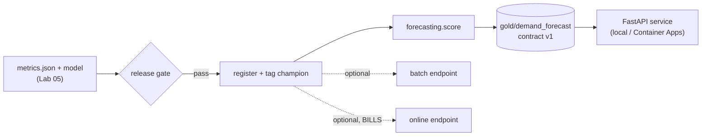

# Lab 06: Register, Score and Serve the Demand Forecaster

## Overview

This lab takes the trained model from [Lab 05](../lab-05-model-training/README.md) all the way to a served product. The local path (free) produces the forecast data product and runs the API; the optional Azure path registers the model and deploys batch, online and container services.



What is what: the gate, scoring and FastAPI service are **course code** ([`code/forecasting/`](../../code/forecasting/), [`code/forecast_service/`](../../code/forecast_service/)); the registry, batch and online endpoints are **native Azure ML**; **Azure Container Apps** hosts the service; **FastAPI** is open source. Read the three Module 6 lessons alongside this lab.

## Prerequisites

| Requirement | Check | Needed for |
|---|---|---|
| Lab 05 done: `metrics.json` + `model/model.txt` | files exist under `../data/model` | All tasks |
| The Gold table | `gold/weekly_demand_features` exists | Scoring, service |
| venv with `fastapi`, `uvicorn`, `httpx` | `python -c "import fastapi"` | Tasks 3-4 |
| Azure ML workspace (from Lab 05) | `az ml workspace show` | Tasks 5-8 (optional) |

## Required Azure resources

| Resource | Created by | Billable? | Notes |
|---|---|---|---|
| Model registry entry | Task 5 | No | Free to register |
| Batch endpoint + compute cluster | Task 6 | Only while a job runs | `min_instances=0` |
| Managed online endpoint | Task 7 | **Yes, per instance while deployed** | Delete immediately after |
| Azure Container Apps | Task 8 | Scale-to-zero (near-zero idle) | Cold starts when idle |
| ADLS Gen2 | Lab 01 | Negligible | Holds the forecast product |

## Cost and safety

- **Tasks 1-4 are free** (local).
- The **batch** path uses a scale-to-zero cluster: minutes of CPU, nothing when idle.
- The **online endpoint bills per instance for as long as it exists, even at zero traffic** - the single most common surprise bill in this course. Delete it the moment you have seen it work.
- **Container Apps** scales to zero; idle cost is near nothing.
- Confirm rates with the [pricing calculator](https://azure.microsoft.com/pricing/calculator/).

## Step-by-step tasks

### Task 1: setup

**Where:** WSL, from `code/`.

```bash
source .venv/bin/activate
pip install -r requirements.txt        # adds fastapi, uvicorn, httpx
```

### Task 2: apply the release gate and (locally) validate

**Where:** WSL

```bash
python -m forecasting.evaluate --metrics ../data/model/metrics.json      # RELEASE APPROVED
python -m forecasting.validate --data ../data/lake/gold/weekly_demand_features   # CONTRACT OK
```

### Task 3: produce the forecast data product

**Where:** WSL

```bash
python -m forecasting.score \
  --data ../data/lake/gold/weekly_demand_features \
  --model ../data/model/model/model.txt \
  --output ../data/lake/gold/demand_forecast \
  --scoring-input ../data/forecast_scoring_input.parquet
python data_mesh/registry.py validate      # 8 products, 0 errors, 5 warnings; demand-forecast published
```

Expect 400 forecast rows (one per series), contract OK, mean `forecast_units` about 20.

### Task 4: run the FastAPI service locally

**Where:** WSL

```bash
FORECAST_TABLE=../data/lake/gold/demand_forecast \
GOLD_TABLE=../data/lake/gold/weekly_demand_features \
MODEL_PATH=../data/model/model/model.txt \
uvicorn forecast_service.app:app --reload
```

In another terminal:

```bash
curl localhost:8000/health
curl localhost:8000/forecast/S001/P0001
curl -X POST localhost:8000/score -H 'content-type: application/json' \
  -d '{"store_id":"S001","product_id":"P0001","promo_days":5}'
```

### Task 5 (Azure, optional): register the champion

**Where:** WSL / Python, from `aml/`. Requires a completed training job (Lab 05 task 6).

```bash
python register_model.py --subscription <id> --resource-group rg-adsa-ml \
  --workspace mlw-adsa --job-name <train_job_name>
```

The script blocks registration if the gate fails, then tags the new version `stage=champion`.

### Task 6 (Azure, optional): batch scoring to the lake

**Where:** WSL. Billable only while the job runs (scale-to-zero cluster).

```bash
# scheduled-style scoring job writing gold/demand_forecast (edit datastore path first)
az ml job create -f aml/score-job.yml --web
# or a batch endpoint over the scoring matrix:
python aml/deploy_batch.py --subscription <id> --resource-group rg-adsa-ml --workspace mlw-adsa
```

### Task 7 (Azure, optional): managed online endpoint - BILLS WHILE LIVE

**Where:** WSL.

```bash
python aml/deploy_online.py --subscription <id> --resource-group rg-adsa-ml --workspace mlw-adsa
# ... test the scoring URI, then DELETE IT:
az ml online-endpoint delete -n <endpoint_name> --yes
```

### Task 8 (Azure, optional): FastAPI on Container Apps

**Where:** WSL. Edit the variables at the top of the script first (`service/deploy_containerapp.sh`), including your storage account.

```bash
bash service/deploy_containerapp.sh
```

It builds the image (`service/Dockerfile`), deploys with a managed identity, and grants that identity read access to the lake.

## Completion checklist

- [ ] venv updated with FastAPI/uvicorn/httpx
- [ ] Release gate approved the model locally
- [ ] `gold/demand_forecast` produced and contract-validated (400 rows, seed 42)
- [ ] `registry.py validate` shows `demand-forecast` published with a contract
- [ ] FastAPI service run locally: health, precomputed GET, and what-if POST all worked
- [ ] (Azure, optional) Model registered and tagged champion via the gate
- [ ] (Azure, optional) Batch scoring job wrote the forecast product
- [ ] (Azure, optional) Online endpoint tested AND deleted
- [ ] (Azure, optional) FastAPI deployed to Container Apps with a managed identity
- [ ] `python -m pytest` passes in `code/`
- [ ] All billable endpoints deleted

## Verification criteria

```bash
cd code && python -m pytest tests/test_scoring.py tests/test_forecast_service.py   # 10 passed at build time
python -c "from deltalake import DeltaTable; print(DeltaTable('../data/lake/gold/demand_forecast').to_pandas().shape)"
```

## Cleanup

- **Local:** `rm -rf ../data/lake/gold/demand_forecast ../data/forecast_scoring_input.parquet`.
- **Azure online endpoint (important):** `az ml online-endpoint delete -n <endpoint_name> --yes`.
- **Batch endpoint:** `az ml batch-endpoint delete -n demand-forecast-batch --yes`.
- **Container App:** `az containerapp delete -g rg-adsa-ml -n demand-forecast-api --yes`.
- **Everything:** `az group delete --name rg-adsa-ml --yes --no-wait`.

## Troubleshooting

| Symptom | Cause | Fix |
|---|---|---|
| Online endpoint still on the bill | Not deleted | `az ml online-endpoint delete -n <ep> --yes` |
| `score.py` won't write | Forecast breaks the contract | Fix scoring; the contract is doing its job |
| Service 404s a known series | No history for that series in Gold | Expected; only series with history score |
| Container App 403 on the lake | Managed identity lacks a data role | Grant *Storage Blob Data Reader*; wait for propagation |
| Batch endpoint categorical errors | Scoring matrix lost category codes | Use the parquet written by `--scoring-input` (preserves categories) |

## What was tested in this course build

Tasks 1-4 and the test suite were **run** on Linux (Python 3.14, LightGBM 4.7, FastAPI 0.146): 400 forecast rows (seed 42), contract OK, and all FastAPI endpoints behaving as above. Tasks 5-8 (Azure) were **not** run (no subscription); the SDK/CLI/Docker assets follow the current `azure-ai-ml` v2 and Container Apps documentation cited in the lessons.

## References

- [Model registry and release](../../docs/azure-machine-learning/04-model-registry-and-release.md)
- [Batch endpoints and the forecast product](../../docs/azure-machine-learning/05-batch-endpoints.md)
- [Online endpoints and FastAPI](../../docs/azure-machine-learning/06-online-endpoints-and-fastapi.md)
- [Batch endpoints](https://learn.microsoft.com/azure/machine-learning/how-to-use-batch-endpoint) · [Online endpoints](https://learn.microsoft.com/azure/machine-learning/how-to-deploy-online-endpoints) · [Container Apps](https://learn.microsoft.com/azure/container-apps/overview)
