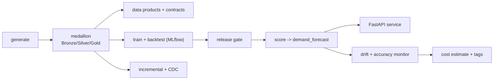

# Lab 07: End-to-End Capstone - Build the Whole Platform

## Overview

This is the capstone: everything Modules 1-9 built, run as one platform on your machine, with no Azure required. It is the portfolio artifact - a demand forecasting platform you can reproduce from a clean clone and explain end to end. The optional Azure deployment is split across the earlier labs ([01](../lab-01-azure-setup/README.md), [03](../lab-03-lakehouse/README.md), [05](../lab-05-model-training/README.md), [06](../lab-06-model-deployment/README.md)).



See the [capstone project page](../../projects/retail-demand-forecasting/README.md) for the business problem, architecture and the verified-vs-designed statement.

## Prerequisites

| Requirement | Check | Needed for |
|---|---|---|
| Python 3.10+ in WSL with the venv | `python -c "import lightgbm, deltalake, fastapi"` | All tasks |
| ~500 MB free disk | for data, lake, model, venv | All tasks |
| Modules 1-9 read (or skim) | context for each step | Understanding, not running |

## Required Azure resources

None locally. The optional Azure path reuses the resources from Labs 01/03/05/06 (storage account, Azure ML workspace, endpoints), each with its own cost and cleanup.

## Cost and safety

The whole capstone runs **free** on open-source tooling (Delta/LightGBM/MLflow/FastAPI). The only billable work is the optional Azure deployment in the earlier labs; follow their cleanup steps, and remember the two standing-cost traps: a managed **online endpoint** and an idle **AI Search** service.

## Step-by-step tasks

All commands run in **WSL**, from the academy `code/` folder with the venv active.

### Task 1: environment and data (Stages 1-2)

```bash
cd ~/src/azure-data-science-academy/code
python3 -m venv .venv && source .venv/bin/activate
pip install -r requirements.txt
python retail_data/generate.py --out ../data/raw --seed 42
python lakehouse_local/medallion.py all --raw ../data/raw --lake ../data/lake
```

Expect 24 POS files, Silver 244,524 rows (0.6% quarantined), Gold 42,000 weekly feature rows.

### Task 2: data products and governance (Stage 3)

```bash
python data_mesh/registry.py validate                  # 8 products, 0 errors, 5 warnings
python data_mesh/contract_compat.py contracts/sales.pos_sales.v1.yaml \
  contracts/proposals/sales.pos_sales.v1.1-proposal.yaml ; echo "exit $? (1 = breaking, as expected)"
```

### Task 3: train, backtest and gate (Stage 4)

```bash
python -m forecasting.validate --data ../data/lake/gold/weekly_demand_features
python -m forecasting.train    --data ../data/lake/gold/weekly_demand_features --output ../data/model
python -m forecasting.evaluate --metrics ../data/model/metrics.json       # RELEASE APPROVED
```

Expect WAPE ~0.23, MASE ~0.71 (beats the naive baseline), ~33% better than persistence.

### Task 4: score the forecast product and serve it (Stage 5)

```bash
python -m forecasting.score --data ../data/lake/gold/weekly_demand_features \
  --model ../data/model/model/model.txt --output ../data/lake/gold/demand_forecast
# serve it (Ctrl-C to stop); in another terminal: curl localhost:8000/forecast/S001/P0001
FORECAST_TABLE=../data/lake/gold/demand_forecast GOLD_TABLE=../data/lake/gold/weekly_demand_features \
  MODEL_PATH=../data/model/model/model.txt uvicorn forecast_service.app:app
```

### Task 5: incremental processing and monitoring (Stage 6)

```bash
python -m pipelines.incremental --lake ../data/lake                    # first run processes the batch
python -m pipelines.incremental --lake ../data/lake                    # "skipped": true (idempotent)
python -m forecasting.monitor drift --reference ../data/lake/gold/weekly_demand_features \
  --current ../data/lake/gold/weekly_demand_features
```

### Task 6: governance and cost (Module 9)

```bash
python -m governance.tags
python -m governance.cost_estimate        # total, standing vs usage, by domain
```

### Task 7: verify the whole platform

```bash
python -m pytest                          # all tests, including tests/test_capstone_end_to_end.py
```

### Task 8 (optional, Azure): deploy

Follow, in order, the Azure tasks of [Lab 01](../lab-01-azure-setup/README.md) (setup), [Lab 03](../lab-03-lakehouse/README.md) task 7 (lake on ADLS Gen2), [Lab 05](../lab-05-model-training/README.md) tasks 5-7 (train on Azure ML), and [Lab 06](../lab-06-model-deployment/README.md) tasks 5-8 (register/batch/online/Container Apps). Delete billable resources after each.

## Completion checklist

- [ ] Environment set up and synthetic data generated (seed 42)
- [ ] Medallion lakehouse built (Bronze/Silver/Gold)
- [ ] Data products validated; breaking contract change rejected
- [ ] Model trained and backtested; release gate approved (MASE < 1)
- [ ] Forecast product `gold/demand_forecast` produced and served via FastAPI
- [ ] Incremental Silver idempotent; drift monitor run
- [ ] Tag check and monthly cost estimate run
- [ ] `python -m pytest` passes, including the end-to-end capstone test
- [ ] Wrote a short reproducibility + verified-vs-designed note for the portfolio
- [ ] (Optional) Deployed to Azure via Labs 01/03/05/06 and cleaned up all billable resources

## Verification criteria

```bash
cd code && python -m pytest tests/test_capstone_end_to_end.py    # the integration test for the whole chain
python -c "from deltalake import DeltaTable; print('forecast rows', DeltaTable('../data/lake/gold/demand_forecast').to_pandas().shape[0])"
```

A complete local platform: lakehouse tables present, a trained model that beats the naive baseline, a contract-valid `demand_forecast` product, a working forecast API, and all tests green.

## Cleanup

- **Local:** `rm -rf ../data` (regenerate any time).
- **Azure (if you did task 8):** run each earlier lab's cleanup; delete any online endpoint and AI Search service first (they bill while they exist), then `az group delete`.

## Troubleshooting

| Symptom | Cause | Fix |
|---|---|---|
| A step can't find a table | Earlier step not run | Run tasks in order (data → lakehouse → train → score) |
| `ModuleNotFoundError` | venv not active / deps missing | `source .venv/bin/activate && pip install -r requirements.txt` |
| Slow runs | Repo under `/mnt/c` | Move it to the Linux filesystem |
| Azure step fails | See the specific lab | Each earlier lab has its own troubleshooting table |

## What was tested in this course build

Tasks 1-7 were **run** on Linux (Python 3.14): the numbers above are from those runs with seed 42, and `tests/test_capstone_end_to_end.py` exercises the full chain. Task 8 (Azure) was **not** run (no subscription); it composes the earlier labs' Azure tasks, which are documented and verified against Microsoft Learn.

## References

- [Capstone project page](../../projects/retail-demand-forecasting/README.md) · [Course map](../../COURSE_MAP.md)
- Labs: [01](../lab-01-azure-setup/README.md) · [02](../lab-02-cloud-storage/README.md) · [03](../lab-03-lakehouse/README.md) · [04](../lab-04-data-pipelines/README.md) · [05](../lab-05-model-training/README.md) · [06](../lab-06-model-deployment/README.md)
