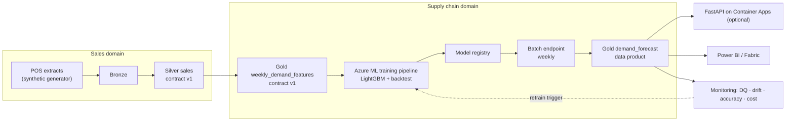

# Capstone: Retail Demand Forecasting Platform

## Business problem and value

Contoso Retail runs 10 stores (configurable) selling 40+ products across fresh, grocery, household, electronics and seasonal categories. Replenishment is planned weekly. Under-forecasting causes stock-outs (lost sales, which also *hide* true demand); over-forecasting causes waste for perishables and tied-up working capital.

The platform delivers weekly forecasts at **product × store** level, aggregable to category, region and chain, with prediction intervals, published as a governed **data product** for the replenishment system and planners.

Value levers to quantify in the final write-up: forecast error (WAPE) reduction vs a seasonal-naive baseline; estimated stock-out reduction; waste reduction for perishables; analyst hours saved by automation.

## Architecture (target)



## Stages and status

| Stage | Scope | Status | Where |
|---|---|---|---|
| 1. Local baseline: data | Synthetic dataset: dates, products/categories, stores/geography, sales, prices, promotions, holidays, stock-outs, injected defects | **Implemented and tested** | [`code/retail_data/generate.py`](../../code/retail_data/generate.py) |
| 1. Local baseline: model | Validation, feature engineering, LightGBM, temporal backtesting, WAPE/MASE/bias, reproducible run | **Implemented and tested** (seed 42: WAPE ~0.23, MASE 0.71, ~33% better than naive) | [`code/forecasting/`](../../code/forecasting/), [Lab 05](../../labs/lab-05-model-training/README.md) |
| 2. Azure data platform | Bronze/Silver/Gold on Delta, quality checks, quarantine, idempotent MERGE; same code targets ADLS Gen2 | **Implemented locally and tested**; ADLS Gen2 path written but not run in the build environment | [`code/lakehouse_local/`](../../code/lakehouse_local/), [lesson](../../docs/lakehouse/01-lake-warehouse-lakehouse-medallion.md) |
| 3. Data products and governance | Sales and forecasting data products, contracts, ownership, freshness, registry, breaking-change gate; Azure mapping (Purview, Unity Catalog, Fabric) | **Implemented locally and tested** (registry + contracts); Azure catalog steps are documented procedures | [`code/data_mesh/`](../../code/data_mesh/), [`code/contracts/`](../../code/contracts/), [lesson](../../docs/data-mesh/01-data-mesh.md) |
| 4. Azure ML | Tracked training, registered versions, reusable pipeline, automated evaluation and promotion | **Implemented and tested** locally (MLflow-tracked train+backtest, release gate, validate→train→evaluate pipeline); Azure ML jobs/registry/pipeline authored, not run | [`code/forecasting/`](../../code/forecasting/), [Modules 5-6](../../docs/azure-machine-learning/README.md), [Lab 05](../../labs/lab-05-model-training/README.md) |
| 5. Production inference | Scheduled batch forecasts, optional online endpoint/FastAPI, input/output validation, failure tracking | **Implemented and tested** locally (scoring → `gold/demand_forecast` contract-validated + FastAPI service); Azure endpoints documented | [`code/forecasting/score.py`](../../code/forecasting/score.py), [`code/forecast_service/`](../../code/forecast_service/), [Lab 06](../../labs/lab-06-model-deployment/README.md) |
| 6. Operations | Schedules, DQ/drift/accuracy monitoring, retraining rules, alerts, CI/CD, cost estimate | **Implemented and tested** locally (drift + accuracy monitor, retrain decision, CI workflow); Azure schedules/monitoring documented | [`code/forecasting/monitor.py`](../../code/forecasting/monitor.py), [MLOps lessons](../../docs/mlops/README.md) |

## Run what exists today

```bash
# WSL, from the academy root
cd code
python3 -m venv .venv && source .venv/bin/activate
pip install -r requirements.txt
python retail_data/generate.py --out ../data/raw --seed 42
python lakehouse_local/medallion.py all --raw ../data/raw --lake ../data/lake
python data_mesh/registry.py validate
python -m forecasting.validate --data ../data/lake/gold/weekly_demand_features
python -m forecasting.train    --data ../data/lake/gold/weekly_demand_features --output ../data/model
python -m forecasting.score    --data ../data/lake/gold/weekly_demand_features \
  --model ../data/model/model/model.txt --output ../data/lake/gold/demand_forecast
python -m pipelines.incremental --lake ../data/lake                 # incremental Silver (idempotent)
python -m forecasting.monitor drift --reference ../data/lake/gold/weekly_demand_features \
  --current ../data/lake/gold/weekly_demand_features                # drift signal
python -m governance.cost_estimate                                  # monthly cost (standing vs usage, by domain)
python -m pytest                                                    # all tests incl. the end-to-end capstone test
```

Every line above runs locally with no Azure. The full chain is also covered by one integration test, [`code/tests/test_capstone_end_to_end.py`](../../code/tests/test_capstone_end_to_end.py), which builds the lakehouse, trains, scores and monitors on a tiny dataset and asserts the forecast product is produced and contract-valid.

## End-to-end: how the modules compose the platform

The capstone is where Modules 1-9 become one system. Each stage is the runnable artifact of its module(s):

| Platform step | Module(s) | Runnable artifact |
|---|---|---|
| Identity, RBAC, secure setup | [1](../../docs/azure-fundamentals/01-azure-fundamentals.md) | [Lab 01](../../labs/lab-01-azure-setup/README.md) |
| Storage access, Parquet layout | [2](../../docs/storage-and-data-engineering/02-python-data-access.md) | [`code/storage/`](../../code/storage/) |
| Lakehouse + data products | [3](../../docs/lakehouse/01-lake-warehouse-lakehouse-medallion.md) | [`code/lakehouse_local/`](../../code/lakehouse_local/), [`code/data_mesh/`](../../code/data_mesh/) |
| Orchestration, incremental, CDC | [4](../../docs/storage-and-data-engineering/06-incremental-cdc-and-testing.md) | [`code/pipelines/`](../../code/pipelines/) |
| Train, backtest, track, register | [5](../../docs/azure-machine-learning/02-jobs-data-and-tracking.md), [6](../../docs/azure-machine-learning/04-model-registry-and-release.md) | [`code/forecasting/`](../../code/forecasting/) |
| Score → forecast product; serve | [6](../../docs/azure-machine-learning/05-batch-endpoints.md) | [`forecasting.score`](../../code/forecasting/score.py), [`code/forecast_service/`](../../code/forecast_service/) |
| Monitor, retrain, CI/CD, IaC | [7](../../docs/mlops/README.md) | [`forecasting.monitor`](../../code/forecasting/monitor.py), [`.github/workflows/`](../../docs/mlops/07-cicd-and-iac.md) |
| RAG / AI assistant (optional) | [8](../../docs/generative-ai/README.md) | [`code/genai/`](../../code/genai/) |
| Landing zones, networking, governance, FinOps | [9](../../docs/security-and-costs/README.md) | [`code/governance/`](../../code/governance/) |

## Design decisions so far

- **Weekly grain for features**, daily grain in Silver: replenishment is weekly, but daily Silver keeps options open (e.g. day-of-week profiles).
- **Stock-outs are flagged, not imputed**, in Gold. Treatment (censored demand modelling, excluding stock-out weeks from training targets) is a modelling decision documented in Stage 4.
- **Closed days produce no rows.** Consumers must not treat missing rows as zero demand; the contract says so.
- **Delta Lake** for every table; **contracts** gate Silver and Gold writes.

## The capstone lab

[Lab 07: End-to-end capstone](../../labs/lab-07-end-to-end-capstone/README.md) runs the whole platform locally in one sitting (data → lakehouse → products → train → score → monitor → cost), then points at Labs 01/03/05/06 for the optional Azure deployment. Start there.

## Portfolio checklist

- [x] Architecture document with ADRs — target architecture above + the [decision guide](../../ARCHITECTURE_DECISION_GUIDE.md#architecture-decision-record-adr-template) template and 12 decisions
- [x] Setup and reproducibility from a clean clone — the run block above and [Lab 07](../../labs/lab-07-end-to-end-capstone/README.md)
- [x] Tests in CI — [`code/tests/`](../../code/tests/) (incl. the end-to-end test) run by [`.github/workflows/ci.yml`](../../docs/mlops/07-cicd-and-iac.md)
- [x] Backtest report with baseline comparison — [Lab 05](../../labs/lab-05-model-training/README.md) (`metrics.json`: WAPE ~0.23, MASE 0.71, ~33% better than naive, seed 42)
- [x] Cost estimate for running the platform monthly — [`code/governance/cost_estimate.py`](../../code/governance/cost_estimate.py) + [Module 9 FinOps](../../docs/security-and-costs/03-governance-responsible-ai-finops.md)
- [x] Clear statement of what is deployed and verified vs designed — see below

## What is verified vs designed

- **Verified (run and tested in the build, Linux / Python 3.14):** the entire local platform — synthetic data, the Bronze/Silver/Gold lakehouse, data products and contract gates, LightGBM training with temporal backtesting and MLflow, the release gate, batch scoring to the `demand_forecast` product, incremental/CDC/SCD2, drift and accuracy monitoring, the FastAPI service, the RAG core, and the governance/FinOps checks. 61+ tests pass, including the end-to-end capstone test.
- **Designed and authored, not run against a subscription:** every Azure execution path — Azure ML jobs/pipelines/endpoints, model registry and monitoring, ADLS Gen2 and Azure SQL, Foundry/AI Search, ADF/Databricks orchestration, private networking, Purview and landing zones. These are written as real YAML/SDK/Bicep/CLI, verified against Microsoft Learn and dated where version-sensitive, and labeled in each lesson and lab as not executed here.

This honest split is itself part of the portfolio: the local platform is reproducible from a clean clone, and the Azure steps are documented procedures a reader with a subscription can follow.
